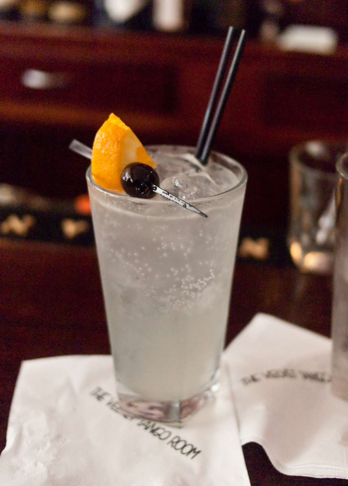

# 汤姆柯林斯

汤姆柯林斯（Tom Collins）是老汤姆金酒、柠檬汁、糖浆与苏打水的长饮。IBA 把它列在“John Collins”名下：45 ml 金酒、30 ml 新鲜柠檬汁、15 ml 糖浆、60 ml 苏打水，在高球杯中加冰直调，装饰柠檬片与马拉斯奇诺樱桃，并注明“做 Tom Collins 时用老汤姆金酒”。同一张配方，换一种金酒，就换了一个名字。

图：汤姆柯林斯。图片：Edsel L，CC BY-SA 2.0，via Wikimedia Commons（[原图页面](https://commons.wikimedia.org/wiki/File:VTR_-_Tom_Collins.jpg)）。

## 定义与身份

柯林斯是一个家族：John Collins、Tom Collins，以及以朗姆、龙舌兰、威士忌为基酒的各种 Collins。它的结构是“酸 + 苏打 + 大杯 + 大量冰”，比[金菲士](ref:gin-fizz)更长、更淡、更解渴。名字里的 Tom 不是发明者，而是老汤姆金酒的代号；这也是它和普通金酒酸最容易被混淆的地方。

## 结构化配方：从 John Collins 到 Tom Collins

IBA 官方条目（John Collins）：

- 金酒 45 ml，做 Tom Collins 时换成老汤姆
- 新鲜柠檬汁 30 ml
- 糖浆 15 ml
- 苏打水 60 ml
- 杯型：柯林斯杯或高球杯，12–14 盎司
- 冰：杯中加满冰块
- 技法：全部材料直接入杯，轻搅
- 装饰：柠檬片 + 马拉斯奇诺樱桃

商业版本会调整。Beefeater 用 50 ml 金酒、25 ml 柠檬汁、25 ml 糖浆、100 ml 苏打水，先加金酒与冰，再加柠檬与糖浆，轻搅后补苏打；Hayman's 的老汤姆版本则是 60 ml 金酒、25 ml 柠檬、15 ml 糖浆，摇和后双重过滤，再补苏打。三个版本的共同点是：苏打最后加，冰必须满杯。关于直调与摇和的一般原则，见[调酒基础](ref:cocktails-guide)。

## 1874 年纽约的“汤姆·柯林斯骗局”

1874 年，纽约流行一个恶作剧：有人告诉你，一个叫 Tom Collins 的人正在街角酒吧说你的坏话。你赶过去，酒保说“他刚走，去了下一家”；你再到下一家，得到的还是同一句话。受害者被一家一家地指使，去找一个不存在的人。报纸当年认真报道过这场“Great Tom Collins Hoax”，等真相揭开，名字已经传遍全城。两年后，1876 年，Jerry Thomas 在《The Bar-Tender's Guide》里收录了 Tom Collins 的配方——骗局与鸡尾酒，就这样在同一座城市里接上了头。

## Limmer's Hotel 与 John Collins 的来源

另一条线在伦敦。常见说法是：Limmer's Hotel 的首席侍者 John Collins 做出了以金酒、柠檬、糖与苏打为基础的饮料，后来被称为 John Collins；当基酒换成更甜的老汤姆金酒，名字就变成了 Tom Collins。这个说法无法用一纸文件钉死，但它解释了两件事：为什么 IBA 的官方条目叫 John Collins，以及为什么“Tom”总与老汤姆金酒绑在一起。大西洋两岸各有一套起源叙事，本页不替任何一方下定论。

## Old Tom 金酒的甜感

老汤姆是 19 世纪伦敦的原始金酒风格，Hayman's 至今按家族 160 年的配方生产，酒精度 41.4%，描述是“圆润、饱满、带一点甜”。这种甜不是加糖，而是蒸馏与配方留下的圆润感，正好接住柠檬的尖酸与苏打的微苦。今天大多数酒吧用伦敦干金酒做 Tom Collins，成品更干、更杜松子，严格说更接近 John Collins；如果要还原历史味道，用老汤姆，或者把糖浆从 15 ml 提到 20–25 ml。Beefeater 的 25 ml 糖浆就是这种补偿思路。

## 柯林斯杯：12–14 盎司的容量逻辑

Bormioli Rocco 的器皿指南把高球杯定在 10–12 盎司、柯林斯杯定在 12–14 盎司。柯林斯杯更高、更窄，目的是让气泡走更长的路，同时装下长条冰与一整片柠檬。算一下容量：45 + 30 + 15 + 60 = 150 ml，加上摇和或融冰带来的稀释，成品大约 200 ml 出头；12–14 盎司（约 355–415 ml）的杯子留出了冰与气泡的空间，不会一倒就满。杯口窄、杯身高，也方便把樱桃卡在杯沿。

## 与金菲士的边界：60 毫升苏打与杯中冰

金菲士和汤姆柯林斯共享 45 ml 金酒 + 30 ml 柠檬的骨架，但四项参数把它们分开：苏打 60 ml 对约 10 ml；糖浆 15 ml 对 10 ml；杯中有冰对无冰；樱桃对柠檬皮。结果是一长一短：柯林斯是长饮，冰与苏打把强度拉到可以慢慢喝一下午；菲士是短饮，温度低、气泡密、每一口都更集中。把柯林斯装进小杯、把菲士装进大杯，都会得到一杯“不对”的酒。

## 摇和还是直调：两种有来源的做法

IBA 与 Beefeater 都选择直调：材料入杯、加冰、轻搅、补苏打。好处是气泡损失最少，操作快；代价是降温慢，前几口偏温，且稀释靠杯中冰，难以精确。Sipsmith 与 Hayman's 则选择摇和后过滤：先摇到冷，滤入装有冰的柯林斯杯，再补苏打。好处是温度低、口感更紧；代价是多一层稀释，且需要预冷杯子。两种做法都有来源，选择取决于你要“气泡优先”还是“温度优先”。

## 常见失败点：基酒、冰量与气泡

第一，用伦敦干金酒却坚持叫 Tom Collins。可以做，但那是 John Collins 的路线。

第二，杯中冰不够满。冰少，融化快，十分钟后就是一杯温柠檬水。

第三，苏打猛倒。气泡被冲散，杯口全是沫。

第四，糖浆不足。干金酒加 30 ml 柠檬，没有 15 ml 糖浆会尖得刺口。

第五，樱桃用劣质糖水罐头。它会毁掉整杯的收尾。

第六，提前半小时做好。苏打与冰都不等人。关于冰量与温度，见[加冰与温度](ref:ice)。

## 变体与无酒精版本

把金酒换成朗姆、龙舌兰或威士忌，就是 Rum Collins、Tequila Collins、Whiskey Collins；加几滴安高天娜苦精，会多一层香料；把柠檬换成青柠，酸度更锐。无酒精版本用 0% 金酒替代，保留 30 ml 柠檬、15 ml 糖浆与 60 ml 苏打的结构，装饰不变；也可以直接用苏打水加柠檬与糖浆，做成一杯无酒精的柠檬柯林斯。

## 饮用与边界

汤姆柯林斯是典型的长饮：容量大、酒精度中等、气泡多，适合午后、烧烤、早午餐。它容易入口，也容易喝快；一杯 150 ml 的酒液，喝两杯就接近一顿饭的酒量。慢饮、配水、配咸味小食，是更稳妥的喝法。驾车、服药或孕期不应饮酒。成品的强度取决于金酒的[酒精度](ref:abv)与杯中冰的稀释，不能只看配方数字。

本页的配方与年份均来自公开来源；起源叙事存在英、美两套说法，文中已分别标明。

## 延伸阅读

- [金酒](ref:gin)：老汤姆与伦敦干金酒的风格差异。
- [金菲士](ref:gin-fizz)：同一骨架的短饮版本。
- [调酒基础](ref:cocktails-guide)：直调、摇和与稀释。
- [加冰与温度](ref:ice)：杯中冰如何改变长饮。
- [酒精度](ref:abv)：理解长饮的强度。

**关键事实。**

| 项目 | 内容 |
| --- | --- |
| 一句话定位 | 老汤姆金酒、柠檬汁、糖浆与苏打水组成的长饮；IBA 将其列在 John Collins 条目下（45 ml 金酒、30 ml 柠檬汁、15 ml 糖浆、60 ml 苏打水），做 Tom Collins 时改用老汤姆金酒，柯林斯杯加冰，以柠檬片与樱桃装饰 |
| 类型 | 经典鸡尾酒 |
| 起源 | 英国伦敦与美国纽约（19 世纪） |

**来源与边界。** 本页关于「汤姆柯林斯」的关键事实，主要由以下来源交叉核对：International Bartenders Association（45 ml 金酒、30 ml 柠檬汁、15 ml 糖浆、60 ml 苏打水、高球杯加冰直调与“做 Tom Collins 时用老汤姆金酒”的官方说明）、Sipsmith Gin、Beefeater (Pernod Ricard)（50 ml 金酒、25 ml 柠檬汁、25 ml 糖浆、100 ml 苏打水、杯中直调与柠檬片加樱桃装饰）等 7 条来源。价格、批次与状态会变，涉及这些字段时以页面所列来源的最新版本为准。正文为项目自写，来源只作核验，不复制原文。
