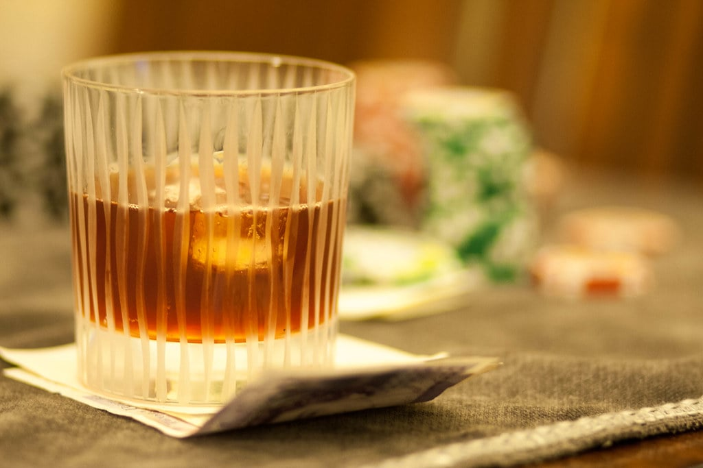

# 老广场

老广场（Vieux Carré）是一款以[黑麦威士忌](ref:whisky)、[干邑](ref:brandy)、[甜味美思](ref:vermouth)、Bénédictine 与佩肖、安高天娜两种苦精调制的短饮。它通常搅拌后滤入装有冰块的古典杯，装饰是一圈橙皮和一颗酒渍樱桃。黑麦的辛香、干邑的果香、甜味美思的草本甜、Bénédictine 的蜂蜜与香料，再加上两种苦精的香气，让它在同一杯里同时具备烈酒骨架与甜香层次。它是新奥尔良对鸡尾酒史最完整的贡献之一。

图：一杯 Vieux Carré，琥珀色酒液与冰块盛于古典杯；这张照片没有拍到橙皮与樱桃装饰。图片：ChodHound，CC BY-SA 2.0，via [原图页面](https://www.flickr.com/photo.gne?id=8609713590)。

## 法语区与“老广场”

Vieux Carré 在法语里是“老广场”的意思，指的是新奥尔良的法国区（French Quarter）。这个街区由法国殖民者始建于 18 世纪，后来经历西班牙统治、美国接管与多次火灾重建，形成了今天混合法国、西班牙与加勒比影响的城市肌理。把一款酒命名为“老广场”，等于把整片街区的历史装进杯子里。

名字不是装饰。老广场的配方里有法国干邑、法国甜味美思与法国修道院利口酒，也有美国黑麦威士忌和新奥尔良本地的佩肖苦精；这种“法国材料加美国烈酒”的组合，正好对应了这座城市的文化层叠。它不是一款只用一种基酒的鸡尾酒，而是一款把多来源材料放在同一杯里、让它们互相解释的酒。

法国区的街道与建筑常被用作这款酒的视觉联想，但本页不把它写成旅游文案。可以确认的是，名字与街区的对应关系是明确的；至于创作时是否刻意用配方去映射城市历史，属于后人的解读，不能当作档案。

## 1938 年，Hotel Monteleone 的 Walter Bergeron

这款酒常被记为 1938 年由新奥尔良 Hotel Monteleone 的调酒师 Walter Bergeron 创作。酒店自己的历史页把 1938 年与 Bergeron、Vieux Carré 以及后来的 Carousel Bar 联系在一起；也有资料把年份写作 1937 年。年份的出入不影响故事的主干：它诞生于法国区的一家老酒店酒吧，后来成为酒店的标志性饮品。

创作地点常被写作酒店的 Swan Room，也就是后来的 Carousel Bar 所在的位置。Carousel Bar 在 1949 年开始旋转，成为新奥尔良的酒吧地标；老广场在酒店的酒单上留了下来，并在 20 世纪的鸡尾酒书里被反复收录。它的身世比很多“禁酒令前传说”更清楚，因为有酒店与配方书的双重记录。

Bergeron 的名字在这款酒里出现得很频繁，但关于他个人的资料并不多。可以确认的是他的职位与创作归属，无法确认的是他当时的灵感来源、是否受到某位客人或某本配方书的影响。写作时把这些空白留出来，比编造一段轶事更诚实。

## 双基酒：黑麦与干邑各做什么

常见配方是黑麦威士忌 30 毫升、干邑 30 毫升、甜味美思 30 毫升、Bénédictine 1 吧勺（约 5 毫升）、佩肖苦精 2 抖、安高天娜苦精 2 抖。黑麦提供辛香、黑胡椒与干燥的谷物骨架，干邑提供葡萄、花香与圆润的中段；两者各占一半，不是谁替代谁，而是让酒体同时具备“骨架”和“肉”。

黑麦的选择会明显改变成品。高黑麦比例的威士忌更辛辣、更干，能压住甜味美思与 Bénédictine 的糖；低黑麦、高玉米比例的威士忌更甜、更圆，成品会偏向柔顺。干邑的选择同样重要：年轻的干邑果味直接、单宁少，适合强调柑橘与樱桃；陈年干邑带更多橡木、香草与干果，会让整杯更沉、更接近餐后酒。

双基酒的结构也解释了为什么这款酒不适合用单一威士忌替代。只用黑麦，成品会太干、太辛；只用干邑，成品会太圆、太甜。把两者各放一半，再让甜味美思与 Bénédictine 填在中间，才形成这款酒特有的“宽而不散”的体量。若想简化，可以用波本替代黑麦，但甜度会上升，苦精的比例也要跟着调整。

## 甜味美思不是配角

30 毫升甜味美思在这款酒里占总量近三分之一，它不是“洗杯”或“调味”的用量，而是酒体的重要组成部分。甜味美思提供葡萄酒的酸度、草本与苦味，也提供糖分与颜色；它把黑麦与干邑之间的空隙填满，让两种烈酒不至于各说各话。没有甜味美思，老广场会变成一杯加香料的烈酒。

甜味美思的新鲜度是这款酒最常见的变量。开瓶后它会缓慢氧化，香气从新鲜草本转向酱油、坚果与酸味；用氧化的味美思做老广场，成品会显得沉闷、带苦底，甚至有一种“旧酒柜”的味道。开瓶后应冷藏，尽量在几周内用完；如果酒吧的味美思已经放了很久，这杯酒的质量很难靠其他材料补救。

选择甜味美思时，可以看它的苦味与酸度。偏苦、偏干的类型能压住 Bénédictine 的甜，适合黑麦比例高的版本；偏甜、偏果味的类型会让成品更圆，适合干邑比例高或想要柔和口感的人。不要在配方里同时增加糖浆，甜味美思与 Bénédictine 已经提供了足够的糖。

## Bénédictine：27 种植物与蜂蜜甜

Bénédictine 是一款产自法国诺曼底 Fécamp 的草本利口酒，官方资料给出的酒精度是 40%，配方含 27 种植物与香料，带有蜂蜜、藏红花、柑橘皮、肉桂与香草的甜香。它在老广场里的用量只有 1 吧勺，约 5 毫升，但这一小勺足以改变整杯酒的香气方向：没有它，成品更干、更偏葡萄酒与威士忌；有了它，中段会出现蜂蜜与香料的圆润。

5 毫升是一个很窄的窗口。太少，Bénédictine 只留下一点模糊的甜，喝不出它的草本；太多，蜂蜜与糖会压住干邑的花香，尾段发黏，苦精的香气也会被埋。调酒时应该用吧勺或小量杯准确量取，不要“随手一倒”；这款酒的容错率比等份鸡尾酒低，甜味一旦过量就很难拉回。

Bénédictine 的甜不是单纯的糖甜，它带着植物的苦与香料的暖。它与甜味美思的草本、佩肖的茴香、安高天娜的丁香形成一条连续的香气链；如果换成其他蜂蜜利口酒，甜度可能相近，但草本与香料的层次会断掉。它不是可以随意替换的材料。

## 两种苦精的分工

佩肖苦精与安高天娜苦精不是重复。佩肖苦精起源于 19 世纪的新奥尔良，带有茴香、樱桃、丁香与轻微的红色果香，苦味较轻，香气更明亮；安高天娜苦精的苦味更重，带有龙胆、丁香、肉桂与麝香般的复杂气息，负责把尾段拉长。两者各 2 抖，一个在前，一个在后，让香气有层次而不是一团。

佩肖苦精在这款酒里还有地域意义。它由新奥尔良的药剂师 Antoine Amédée Peychaud 在 19 世纪推广，后来成为萨泽拉克与许多新奥尔良鸡尾酒的标志。老广场同时使用佩肖与安高天娜，等于把本地苦精与加勒比/委内瑞拉来源的苦精放在一起，呼应了这座城市的贸易与移民史。

苦精的用量要克制。2 抖是常见起点，但不同瓶口的流速不同，实际用量会有差异；如果苦精倒得太多，成品会发苦、发干，Bénédictine 的甜香被压住。苦精不是“越多越复杂”，它的作用是提香与连接，不是增加苦味的存在感。

## 搅拌、冰与杯型

这款酒用[搅拌](ref:stirring)，不用摇和。所有材料倒入搅拌杯，加冰，搅拌 20 至 30 秒，直到杯壁充分冷却、稀释达到大约 20%，然后滤入装有冰块的古典杯。搅拌的目的是均匀冷却与适度稀释，不引入空气；摇和会让酒液变浑，也会让甜味美思与干邑的香气变得松散。

杯型以[古典杯](ref:rocks)为主。杯中加入一块大而透明的冰，能让酒液保持低温、缓慢稀释；冰块太小会融得太快，后半杯会水薄。杯子应预冷，倒到七分满左右，留出闻香的空间。IBA 的书面版本写作滤入预冷鸡尾酒杯，属于“上桌即饮”的呈现；新奥尔良的常见做法是古典杯加冰，两种都成立，但稀释曲线不同。

装饰通常是橙皮与酒渍樱桃。橙皮在杯口挤压后，柑橘油会浮在酒液表面，第一口能闻到橙香；樱桃提供视觉与一点果甜，但不要用糖水樱桃，它的甜与色素会干扰酒体。若不想加樱桃，只留橙皮也成立。

## 风味结构与常见失衡

入口先是黑麦的辛香与干邑的果香，随后甜味美思的草本甜与 Bénédictine 的蜂蜜、香料展开，尾段是佩肖的茴香、安高天娜的苦与橡木的单宁。它属于“甜香型烈酒”，但不是甜酒：30 毫升甜味美思与 5 毫升 Bénédictine 提供糖分，黑麦与苦精负责把甜拉回干燥。理想状态是每一层都能被辨认，但没有任何一层独占。

常见失衡包括：Bénédictine 过多，成品像加香料的糖浆；甜味美思氧化，尾段发酸、发苦；黑麦过辣，压住干邑；干邑过陈，木味与甜味美思打架；搅拌不足，酒精刺鼻、温度不均；搅拌过度，水薄、香气散。调整时先检查味美思的新鲜度，再检查 Bénédictine 的用量，最后才考虑换基酒。

温度与冰会改变平衡。刚倒进杯里时，酒液温度低、香气集中；随着冰融化，甜味与草本逐渐展开，苦味也变得柔和。它适合慢慢喝，但不适合放到冰完全融化；如果环境炎热，可以用更大的冰块，或者把杯子冰得更透。

## 与萨泽拉克的区别

老广场与[萨泽拉克](ref:sazerac)常被放在一起讨论，因为两者都来自新奥尔良，都用黑麦与佩肖苦精。区别在于结构：萨泽拉克以黑麦、糖、佩肖苦精与苦艾酒洗杯构成，通常滤入预冷的杯子，不加冰；老广场则加入干邑、甜味美思与 Bénédictine，通常加冰饮用。萨泽拉克更干、更直接，老广场更宽、更甜、更复杂。

把老广场称为“萨泽拉克的加强版”并不准确。萨泽拉克的香气核心是苦艾酒的茴香与佩肖的樱桃，老广场的核心是双基酒、甜味美思与 Bénédictine 的蜂蜜草本；两者的甜味来源、酒体厚度与饮用方式都不同。它们更像同一座城市的两条分支，而不是同一款酒的两个版本。

如果想比较，可以点两杯小杯，先喝萨泽拉克，再喝老广场。前者的苦艾与黑麦会先把味蕾打开，后者的甜香与双基酒会显得更宽；顺序反过来，老广场的甜可能会压住萨泽拉克的细节。比较时注意两杯的冰量与稀释，否则差异会被温度掩盖。

## 变体与点单

以波本替代黑麦，会得到更甜、更圆的版本；以阿马尼亚克替代干邑，会得到更偏干果与香料的方向；以干型味美思替代甜味美思，则会让成品更干、更苦，但已经不是经典结构。也有配方加入一小滴苦艾酒或橙味利口酒，增加香气，但这类改动应注明，否则同名配方之间的比较会失去意义。

点单时可以直接说“老广场”，并确认基酒是黑麦加干邑，而不是单一威士忌。若不喜欢太甜，可以要求减少 Bénédictine 或使用更干的甜味美思；若喜欢更烈，可以要求少冰或使用更大的冰块，但不要要求“完全不加冰”，那会改变这款酒的稀释与香气释放。若酒吧的味美思开瓶太久，可以换一款更简单的酒，而不是冒险。

它适合作为餐前酒或餐后酒，搭配秋葵汤、贾姆巴拉雅、烤鸭、牛排、硬质奶酪与黑巧克力。黑麦的辛香与苦精能切开油脂，干邑与 Bénédictine 的甜香能承接烤肉与香料；不建议搭配过辣的菜肴，辣味会压住味美思与苦精的细节。

## 常见误区

第一，认为老广场是“新奥尔良版曼哈顿”。曼哈顿以威士忌、甜味美思与苦精构成，老广场多了干邑、Bénédictine 与第二种苦精，结构更宽。第二，把 Bénédictine 当成可选装饰。它只有 5 毫升，但决定了中段的蜂蜜与香料。第三，用氧化的甜味美思。它是这款酒最常见的失败来源。第四，认为苦精越多越复杂。两种苦精各 2 抖已经足够，过量会发苦。第五，把老广场当成甜酒。它的甜被黑麦、苦精与稀释拉住，酒精度大约在 25% 至 27%。第六，忽略冰的质量。大块透明冰与碎冰带来的稀释曲线完全不同。

## 另见

- [威士忌](ref:whisky)：黑麦的辛香与谷物骨架。
- [白兰地](ref:brandy)：干邑的果香与圆润中段。
- [味美思](ref:vermouth)：甜味美思的草本、酸度与新鲜度。
- [搅拌](ref:stirring)：冷却、稀释与香气整合。
- [萨泽拉克](ref:sazerac)：同一座城市的另一条经典分支。
