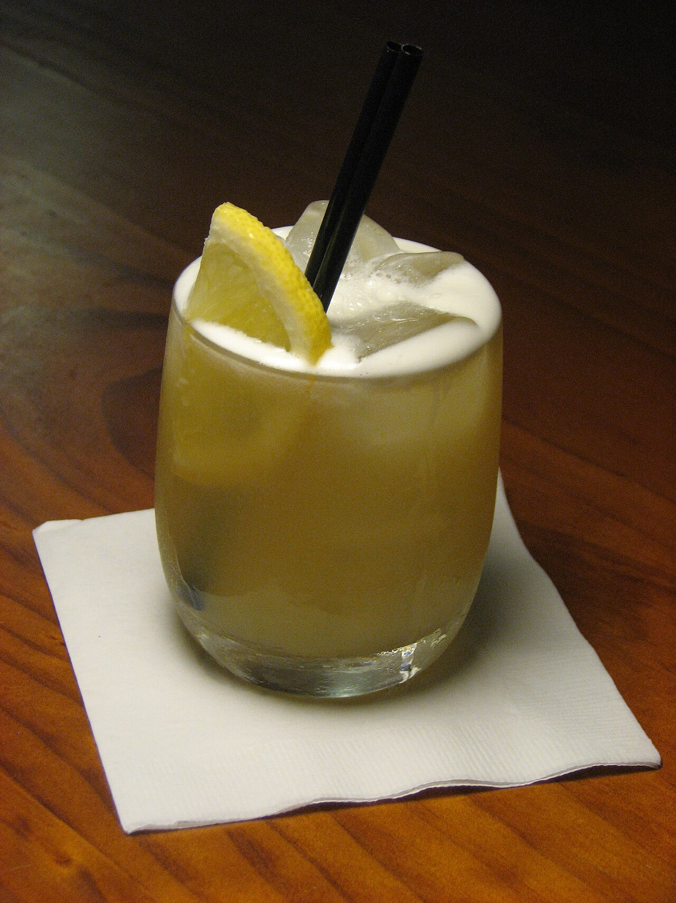

# 威士忌酸

威士忌酸（Whiskey Sour）是一款以[威士忌](ref:whisky)、柠檬汁与糖浆摇和后调制的经典鸡尾酒。它用酸与甜平衡烈酒的强度，表面的蛋清泡沫是可选项，常见装饰为柠檬片或樱桃。

图：威士忌酸。图片：Jgilgamesh，CC BY-SA 3.0，via Wikimedia Commons（[原图页面](https://commons.wikimedia.org/wiki/File:Whiskey_Sour.jpg)）。

## 定义与身份

“酸”在鸡尾酒史中是一类结构：烈酒加酸（通常是柑橘汁）与甜（糖或糖浆），再加水或冰稀释。威士忌酸属于这一类，但并不是唯一版本；金酒、朗姆酒等也可以构成各自的“酸”。

威士忌酸的骨架是烈酒、柑橘酸与糖的三角平衡，蛋清是可选的第四层。没有蛋清时，酒体较清、酸度更直接；加入蛋清后，泡沫让口感更圆润，也会缓冲酸味的尖锐感。两种做法都可以叫威士忌酸，但应在配方里注明。

## 配方（IBA 版本）

IBA 公开配方使用威士忌、柠檬汁与糖浆，摇和后滤入杯中，以柠檬片或樱桃装饰；蛋清为可选项，加入后会形成细腻泡沫。用量是起点，不是法律：威士忌多则更烈，柠檬汁多则更酸，糖浆多则更甜。

摇和的目标是让材料充分混合、温度下降并获得适量稀释，而不是把酒摇成泡沫。若加入蛋清，需要先干摇再加冰摇和，才能形成稳定的泡沫层。

## 威士忌的选择

[威士忌](ref:whisky)是这款酒的主体。波本带来玉米甜香、香草与焦糖，黑麦更辛辣、更干，苏格兰威士忌可能带来泥煤或麦芽味。不同威士忌与柠檬、糖的组合会得到不同的平衡。

高酒精度的威士忌需要更多稀释，低酒精度的威士忌则要少摇。若威士忌本身风味强烈，糖浆与柠檬汁的比例也要相应调整，否则成品会失衡。

## 酸与甜

柠檬汁提供酸度与柑橘香气，是“酸”结构的核心。酸度不足，酒会显得甜腻、扁平；酸度过高，会压住威士忌的香气。新鲜柠檬汁与瓶装柠檬汁的差异明显，前者香气更完整。

糖浆提供甜味与圆润度，平衡酸度与酒精刺激。糖太少，酸会显得尖锐；糖太多，会盖住威士忌。糖浆比砂糖更容易溶解，适合摇和；若使用砂糖，应先溶解再调酒。

## 摇和与稀释

威士忌酸通常摇和，而不是搅拌：摇和能更快降温、更好混合，并让蛋清形成泡沫。摇和时间不足，温度不够低、稀释不足；摇和过度，稀释太多，酒体会变薄。

威士忌酸含蛋清时要先干摇，再加冰摇和；冰要新鲜、大块，避免碎冰快速出水。摇到壶壁起霜后滤入预冷杯，成品不要久放；若不加蛋清，稀释会更快，摇和时间应相应缩短。

## 杯型与装饰

传统上使用酸酒杯或古典杯。酸酒杯杯口窄、杯身小，便于集中香气与保留泡沫；古典杯容量更大，适合加冰饮用。杯子应提前冷却。

柠檬片或樱桃是常见装饰，提供柑橘香气与视觉识别。若加入蛋清，泡沫应在摇和后静置片刻再倒入杯中，装饰放在泡沫表面。

## 变体

以波本替代黑麦，会得到更甜的版本；以其他柑橘汁替代柠檬汁，会改变酸度与香气；加入蛋清，会得到泡沫更丰富的版本；加入少量红葡萄酒，会形成“纽约酸”的变体。

变体不是错误版本，而是有明确替换逻辑的分支。记录变体时，应写清替换了什么、比例如何变化。关于鸡尾酒结构的一般说明，可以参考[调酒基础](ref:cocktails-guide)；与[曼哈顿](ref:manhattan)相比，威士忌酸以柠檬与糖浆替代美思。

## 常见误区

第一，认为酸酒必须很酸。酸与甜需要平衡，过酸会压住威士忌。

第二，用瓶装柠檬汁替代鲜榨而不调整用量。两者酸度与香气不同。

第三，忽略摇和与稀释。稀释不足，香气打不开，酒精刺激会显得突出。

第四，把蛋清当作必需。它影响口感与外观，但不是定义的一部分。

## 饮用与边界

威士忌酸适合作为餐前或餐后慢饮，搭配坚果、奶酪或简单咸味小食。威士忌酸的酒精度较高，应小口慢饮并补充水分；不要空腹快速饮用。驾车、服药或孕期不应饮酒。

本页只记录一个有来源的版本，不评价具体品牌，也不把某一种威士忌或比例说成唯一正确答案。成品的强度取决于威士忌的[酒精度](ref:abv)、糖浆用量与冰块稀释，不能只看配方数字。

威士忌酸的风味平衡来自威士忌、柠檬酸与糖浆三者的比例，蛋清只负责质地，不是必需项。干摇让蛋清起泡，再加冰摇和稀释；柠檬汁的酸度会随品种与新鲜度变化，配方不能死守毫升数，应该按实际酸度调整。

对照阅读：[威士忌](ref:whisky)、[调酒，是另一种认识酒的方式](ref:cocktails-guide)。

## 延伸阅读

- [威士忌](ref:whisky)：威士忌酸的主体与风格来源。
- [调酒基础](ref:cocktails-guide)：结构、稀释与摇和的一般原则。
- [加冰与温度](ref:ice)：威士忌酸的冰型、稀释与出杯温度。
- [酒精度](ref:abv)：理解成品强度与冰块稀释。
- [曼哈顿](ref:manhattan)：以美思替代柑橘与糖浆的另一款经典。

**关键事实。**

| 项目 | 内容 |
| --- | --- |
| 一句话定位 | 以威士忌、柠檬汁与糖浆摇和后调制的经典鸡尾酒，酸甜平衡，表面可加蛋清泡沫；常见装饰为柠檬片或樱桃 |
| 类型 | 经典鸡尾酒 |
| 起源 | 美国（19 世纪后期） |

**来源与边界。** 本页关于「威士忌酸」的关键事实，主要由以下来源交叉核对：International Bartenders Association（官方配方、调制方法与装饰；确认该饮品属于 IBA 官方鸡尾酒名单）、Oxford University Press（威士忌酸的历史背景与基本构成；由原条目末尾参考资料迁移，未逐条复核访问日期）、David Wondrich / Perigee（19 世纪美国鸡尾酒演变的背景）等 6 条来源。价格、批次与状态会变，涉及这些字段时以页面所列来源的最新版本为准。正文为项目自写，来源只作核验，不复制原文。

**并读。** 把「威士忌酸」与「威士忌」、「酒精度（ABV）」、「调酒，是另一种认识酒的方式」放在一起读时，先确认它们是同一层级还是上下游关系：先确认基酒与比例，再比较酸甜平衡、杯型与出品差异。本页负责给出鸡尾酒的基本坐标，对照条目补上具体案例与差异；读完再回到本页，才能分清哪些差别属于鸡尾酒本身，哪些只是产地、批次或品牌选择。

**适用边界。** 对「威士忌酸」而言，配方比例、基酒品牌与杯型会变；IBA 版本是参照，不是唯一做法。

**更新提示。** 「威士忌酸」最近核对于 2026-11-07；配方比例、基酒品牌、杯型与出品标准会变，调酒前以 IBA 或酒吧现行配方为准。
