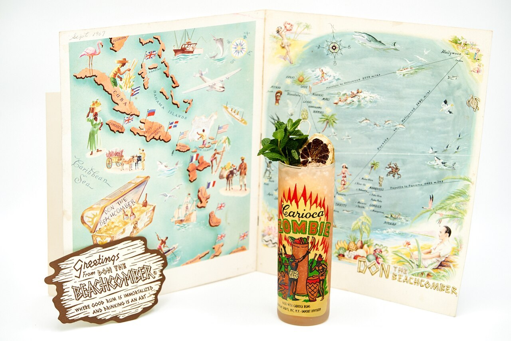

# 僵尸

僵尸（Zombie）不是“加了很多朗姆酒的热带饮料”，而是 1934 年好莱坞 Don the Beachcomber 刻意不让同行学会的招牌酒：配方写成编号，连店内调酒师也不知瓶里装的是什么。今天能复原，靠的是后来者对旧笔记本与糖浆代号的追查。

图：僵尸。摄影：Zombie cocktail gianni zottola。署名：GianniZottola，CC BY-SA 4.0，来自 Wikimedia Commons（[来源](https://commons.wikimedia.org/w/index.php?curid=63768726)）。

## 一杯被编码的酒

Donn Beach 把配方当作商业机密。Beachbum Berry 的记述里，Don the Beachcomber 的配方用编号对应吧台后没有标签的瓶子，员工只负责按编号取用，无法从瓶身读出成分。竞争对手即使挖走调酒师，也复制不出一杯完整的 Zombie。

编码也塑造了它的历史：原方失传后，模仿者各凭想象拼出“朗姆加果汁”的版本，Zombie 一度变成什么都不精确的热带长饮。今天讨论它，先要区分 1934 年的结构与后来的发挥。

## Donn Beach 与 1934 年的好莱坞

Donn Beach 本名 Ernest Raymond Beaumont Gantt，1934 年在好莱坞开设 Don the Beachcomber。这家店把南太平洋的装饰、碎冰、果汁与多朗姆混调放进同一个空间，后来被视为提基酒吧的原型。

Zombie 是这家店最出名的酒之一。流传最广的轶事是：一位宿醉的客人晚上还有商务会议，Donn 把六种朗姆酒各倒一盎司，加进其他材料，客人喝完说“我变成了僵尸”。这是 1948 年的店方回忆，不宜当档案；可确认的是酒名、店名与 1934 年这个时间点。

## 每人限两杯的 1934 年

Zombie 的“每人限两杯”不是都市传说。Beachbum Berry 明确写道，Donn 本人最多只给一位客人上两杯。这个限制既是安全措施，也是营销：果汁感很强的酒被变成“需要认真对待”的挑战。

限制有配方上的理由：三份朗姆合计 120 毫升，其中还有 151 proof 的德梅拉拉；碎冰与果汁盖住酒精刺激，喝起来像果汁，后劲却接近两到三份标准短饮。把它当普通长饮快喝，是这款酒最常见的危险。

## 1939 年纽约世界博览会与冒名者

1939 年前后，Zombie 已从小众酒吧饮品变成全国性的提基符号。同一时期，纽约出现自称“Monty Proser Beachcomber”的模仿者，公开宣称 Zombie 是自己发明的；Don the Beachcomber 一方把这件事视为品牌被冒名的典型。

同一时期纽约世界博览会把热带主题酒吧带进更多人的视野，Zombie 借热度扩散，各地也出现大量与原方无关的版本。年份与地点可以确认，具体是谁先把酒带到博览会，则有不同叙述。

## 结构化配方：Berry 复原版

下面以 Jeff “Beachbum” Berry 依据旧笔记本复原、并与 IBA 配方互校的版本为基准。两版差别很小：IBA 用 20 毫升青柠汁，Berry 写作约 22.5 毫升。搅拌与混合的原则可参考[搅拌与混合](ref:blending)。

| 材料 | 用量 | 说明 |
| --- | --- | --- |
| 牙买加陈年深色朗姆 | 45 ml | 提供焦糖、熟果与厚重的酒体 |
| 波多黎各金色朗姆 | 45 ml | 提供干净的甘蔗甜与中段 |
| 德梅拉拉朗姆（常见 151 proof） | 30 ml | 提供烟熏、香料与强度 |
| 鲜青柠汁 | 20 ml | IBA 用量；Berry 版约 22.5 ml |
| falernum | 15 ml | 丁香、杏仁、姜与青柠的糖浆 |
| Donn's Mix | 15 ml | 西柚汁 2 : 肉桂糖浆 1 |
| 石榴糖浆 | 5 ml（1 茶匙） | 提供红色与少量果甜 |
| 安高天娜苦精 | 1 dash | 连接香气 |
| Pernod 或苦艾酒 | 6 drops | 茴香尾韵，不可多加 |

- **比例**：朗姆合计 120 ml，青柠 20 ml，甜味材料合计约 35 ml；以体积看是“重酒体、轻酸甜”的结构。
- **杯型**：400–450 ml 的高身 tiki 杯或高球杯。
- **冰**：搅拌机内 170 g 碎冰；倒入杯中后再补冰块。
- **技法**：电动搅拌机脉冲 3–5 秒，连冰倒入，不过滤；目标是“闪打”，不是打成冰沙。
- **装饰**：一大枝薄荷，插入碎冰。

## 三种朗姆酒的分工

三种[朗姆酒](ref:rum)各有分工。牙买加朗姆负责深色果香与酯类气息，波多黎各金色朗姆负责干净的甘蔗甜和酒体，德梅拉拉朗姆负责烟熏、焦糖与最后的强度。三者不是“越多越复杂”，而是各补一块：缺牙买加，酒会平；缺波多黎各，酒会闷；缺 151 proof 德梅拉拉，尾段会短。

替换时不要只换品牌，要看风格：重酯型牙买加朗姆会把整杯推向熟果与香料，德梅拉拉的 proof 则直接改变强度。若只有两种朗姆，可用更高 proof 的深色朗姆替代德梅拉拉，但甜度与烟熏感会变。

## Donn's Mix：西柚汁与肉桂糖浆

Donn's Mix 最容易被省略，也最不该省略。Berry 的追查显示，旧笔记本里的“Spices #4”最终被一位老调酒师认出是肉桂糖浆；所谓 Donn's Mix，就是两份鲜西柚汁对一份肉桂糖浆。

西柚给苦与酸，肉桂给温暖与甜，两者合起来才是 Zombie 的中段。缺了肉桂，酒像普通柑橘长饮；缺了西柚，酒甜得发闷。糖浆可提前冷藏，西柚汁应当现榨。

## falernum 与那六滴 Pernod

falernum 是加勒比加香糖浆，常见风味是丁香、杏仁、姜与青柠，不是高酒度的[利口酒](ref:liqueur)。它也不是可有可无的甜味，而是“提基感”的来源：没有它，朗姆与果汁之间会缺少香料连接。

Pernod 或苦艾酒只放六滴，为尾段添一点茴香与草本；稍多就会盖过 falernum。安高天娜苦精只需一抖，提香而不加苦。两者都“看不见但尝得出”。

## 搅拌机、碎冰与杯型

Zombie 用搅拌机，但只脉冲几秒：让碎冰、糖浆与果汁迅速混匀，同时保留大量碎冰。打到顺滑就成了冰沙，稀释曲线完全变了。连冰倒入杯中再补冰块，能让酒保持低温。成品的厚度见[酒体](ref:body)。

杯型要 400 毫升以上，否则装不下碎冰、酒液与薄荷。杯提前冰镇；环境很热时，杯与冰都要更冷，否则后半杯水薄。

## 与 Mai Tai 的起源争议

Donn Beach 与 Trader Vic（Victor Bergeron）都声称自己创作了 Mai Tai，这是提基史上最著名的公案。常见叙述把 Trader Vic 的版本定在 1944 年的奥克兰，Donn 一方坚持更早；谁先做，现有材料不足以一刀切。

但两者不是同一杯酒的两种写法。Zombie 用三种朗姆、falernum、西柚-肉桂糖浆与石榴糖浆，杯量大、果味重、香料层次深；[迈泰](ref:mai-tai)用朗姆、橙皮利口酒、杏仁糖浆与青柠，杯量小、酸度更集中。把 Zombie 说成“另一种 Mai Tai”，会同时错过两杯酒的结构。

## 常见失败点

第一，打太久。超过五秒，冰全碎成水，酒体变薄，香气被打散。

第二，省略 Donn's Mix。西柚与肉桂是这款酒的中段，缺了就只剩朗姆加果汁。

第三，151 proof 朗姆放太多。它提供强度，不提供主角香气；超过 30 毫升，酒精感会压住 falernum。

第四，用瓶装青柠汁或加糖西柚汁。酸度与苦味都不对，成品会甜腻。

第五，当普通长饮快喝。总酒精量很高，碎冰会延迟醉意，后劲来得比想象中晚；[酒精度](ref:abv)不能只看配方数字。

## 变体与无酒精版本

- **Smuggler's Cove 简化版**：用两种朗姆替代三种，保留青柠、石榴糖浆、falernum 与西柚-肉桂糖浆，适合家庭吧台。
- **减少 151 proof**：以额外深色朗姆替代，酒体更柔，但烟熏与强度下降。
- **增加西柚**：把 Donn's Mix 提到 30 毫升，成品更长、更苦，适合炎热天气。
- **复古冰沙版**：碎冰加到最大量、打到顺滑，已偏离“闪打”的原意。

无酒精替代只能近似：0.0% 深色“朗姆”60 毫升、鲜青柠 20 毫升、falernum 糖浆 15 毫升、Donn's Mix 20 毫升、石榴糖浆 5 毫升与一两滴茴香糖浆，摇和后加碎冰。香料与柑橘的骨架还在，但缺少朗姆的重量与酯香，口感明显更薄。

相关条目：[朗姆酒](ref:rum)、[利口酒](ref:liqueur)。
