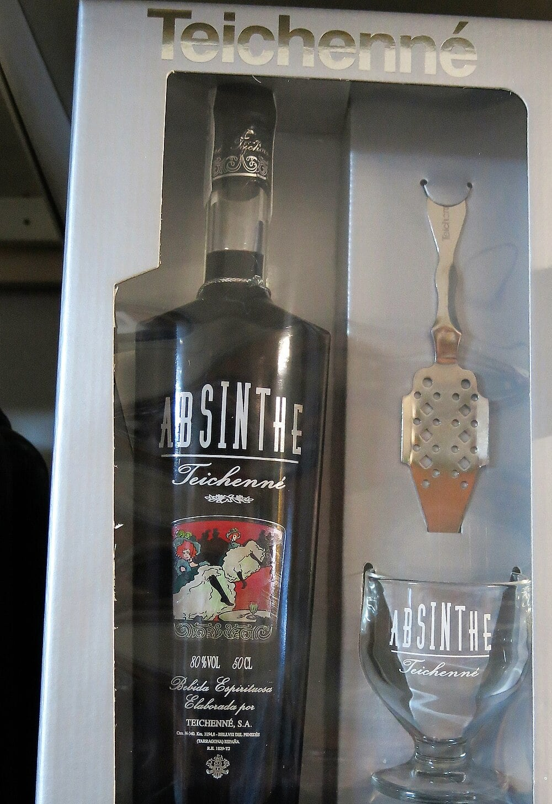

# 苦艾酒

苦艾酒（absinthe）是一种以苦艾、茴香和茴芹为特征的烈酒。它通常经过浸提与蒸馏，酒精度很高，加水后会从透明变为乳白。19 世纪末它在法国与瑞士的咖啡馆文化中极为流行，20 世纪初被多国禁售，直到 1990 年代才逐步回归市场。它不是[味美思](ref:aperitif)，也不是[利口酒](ref:liqueur)，而是一个以植物配方与高酒精度为核心的烈酒类别。

图：苦艾酒礼盒：黑色 Teichenné 酒瓶、槽孔金属糖匙与印有 ABSINTHE 的玻璃杯。图片：Tangopaso，Public domain，via [原图页面](https://commons.wikimedia.org/wiki/File:Absinthe_bottle_with_glass_and_spoon.jpg)。

## 定义边界：什么算苦艾酒

苦艾酒的核心植物是苦艾（Artemisia absinthium），通常与绿茴香、茴芹一起使用，形成“茴香 + 苦味 + 草本”的骨架。它必须经过浸提与蒸馏，而不是简单把草本泡在酒精里；酒精度通常在 45% 至 74% 之间，远高于多数餐前酒。

不算苦艾酒的产品包括：以茴香为主的 pastis、ouzo 与 sambuca（它们通常不含苦艾，或酒精度与配方不同）；以葡萄酒为基酒的加香葡萄酒；以及只添加茴香香精、没有草本浸提过程的调配酒。它们可能同样会因加水而变浑浊，但类别与原料不同。

## 草本配方

除苦艾外，传统配方常包含罗马苦艾（Artemisia pontica）、绿茴香、茴芹、海索草、香蜂草、芫荽与八角。苦艾提供苦味与草本底调，茴香类提供甜香与乳化能力，其他植物负责花香、柑橘与辛香。配方比例是各家酒厂的核心机密。

“绿仙子”之类的名称描述的是颜色与文学想象，不是配方标准。苦艾酒可以是绿色、透明、琥珀色甚至红色；颜色来自第二次浸提的叶绿素或天然色素，而不是人工色素的必需项。

## 蒸馏与着色

生产时，酒厂先把草本浸入高酒精度中性酒精，再转入蒸馏器蒸馏。蒸馏得到无色基酒，随后有两种路径：直接稀释装瓶，得到 blanche（白色）风格；或用更多草本进行第二次冷浸，得到 verte（绿色）风格。第二次浸提带来颜色与额外的草本苦味。

蒸馏设备与切割点决定酒体。过度追求高酒精度会让茴香与苦艾的细节被酒精掩盖；切割过宽则会带入粗糙的植物味。传统配方常以 68% 至 72% 作为装瓶强度，现代产品则覆盖更宽的区间。

## Louche：加水为什么会变白

加水后出现的乳白现象称为 louche。原因是水降低了酒精度，使茴香中的茴香脑等疏水化合物溶解度下降，形成悬浮微粒并散射光线。温度、加水速度与酒精度都会影响乳化的浓稠程度。

这是物理现象，不是变质，也不是“苦艾酒有毒”的证据。把它当作质量标志同样不准确：不同配方与酒精度的产品，乳化点与乳化强度本来就不同。

## 法规与侧柏酮

欧盟烈酒法规没有为苦艾酒单列一个与金酒同级的类别，它通常按茴香风味烈酒或一般烈酒规则管理。真正与苦艾酒直接相关的是香料法规：欧盟 1334/2008 对含侧柏酮的酒精饮料设定了上限，酒精度高于 25% 的饮料为 35 mg/kg，低于或等于 25% 的为 10 mg/kg。

侧柏酮是苦艾中的一种萜类化合物，高剂量下具有神经活性；但规范产品中的含量远低于历史上引发恐慌的剂量。美国市场则由 TTB 按成分与标签规则管理苦艾类产品，各州的具体销售规定可能不同。

## 历史与禁令

苦艾酒在 1790 年代出现于瑞士与法国边境，19 世纪随着咖啡馆文化在巴黎流行。它被视为波希米亚生活方式的象征，也因高酒精度与社会问题受到攻击。1905 年瑞士的 Lanfray 案件成为禁令运动的导火索；瑞士在 1910 年正式禁止苦艾酒，1915 年法国跟进，美国在 1912 年已禁止销售。

禁令把侧柏酮塑造成“致幻元凶”，但后来的研究认为，规范剂量下的侧柏酮不足以解释传说中的效果。瑞士在 2005 年解除禁令，法国在 2011 年解除，欧洲市场从此逐步恢复。美国的禁令在 2007 年前后因标准调整而松动。

## 风格谱系

法国 verte 风格通常绿色、草本感强、酒精度高；瑞士 blanche 风格无色、口感更柔、茴香更突出；西班牙与捷克产品则可能更甜或更强调八角。捷克市场上名为 absinth 的产品有时不含苦艾，属于不同的商业传统，不能与法国传统配方混为一谈。

按酒精度，苦艾酒可以分为 45% 至 55% 的柔和型、60% 左右的标准型，以及 68% 至 74% 的传统高强度型。高酒精度并不意味着质量更高，它只是配方与饮用方式的一部分。

## 饮用仪式

传统饮法是把冰水缓慢滴入杯中，水经过放在杯口的方糖，糖溶解后进入酒液。水和糖会降低酒精刺激、释放茴香香气，并触发 louche。杯子通常有刻度，方便控制水量；苦艾酒匙的镂空结构用于承托方糖。

把方糖点燃再丢入杯中是一种表演性做法，不是传统必需步骤，也会带来安全风险。纯饮苦艾酒并不常见，因为酒精度太高；更常见的是加水稀释后饮用，或作为鸡尾酒的少量配料。

## 鸡尾酒中的用法

苦艾酒在经典鸡尾酒中常以“洗杯”或少量添加的方式出现。[Sazerac](ref:sazerac) 用它润洗杯壁，[Corpse Reviver #2](ref:corpse-reviver) 用它增加茴香与草本层次，Death in the Afternoon 则以苦艾酒与香槟组合。它的高酒精度与强烈香气意味着用量必须克制。

与[金酒](ref:gin)相比，两者都依靠草本蒸馏获得香气，但金酒以杜松子为核心，苦艾酒以苦艾与茴香为核心，不能互相替代。19 世纪末它常被当作餐前[开胃酒](ref:aperitif)，今天则更多出现在调酒与收藏场景。

## 常见误解与争议

第一，认为苦艾酒会致幻。第二，认为所有苦艾酒都是绿色的。第三，认为“苦艾酒”就是味美思。第四，认为酒精度越高越好。第五，认为点火加糖是传统仪式。第六，认为禁令证明它比其他烈酒更危险。

争议主要集中在侧柏酮的长期健康影响、各国残留禁令的差异，以及“absinthe”名称是否被滥用。可以确认的是：它是一种高酒精度烈酒，应当像其他烈酒一样适量饮用；孕妇、服药者与需要驾驶的人不应饮用。

相关条目：[金酒](ref:gin)、[利口酒](ref:liqueur)。

侧柏酮含量有法规上限，但苦艾酒致幻的说法缺乏可靠证据；变白是加水后茴香类成分析出，不是药效发作。

