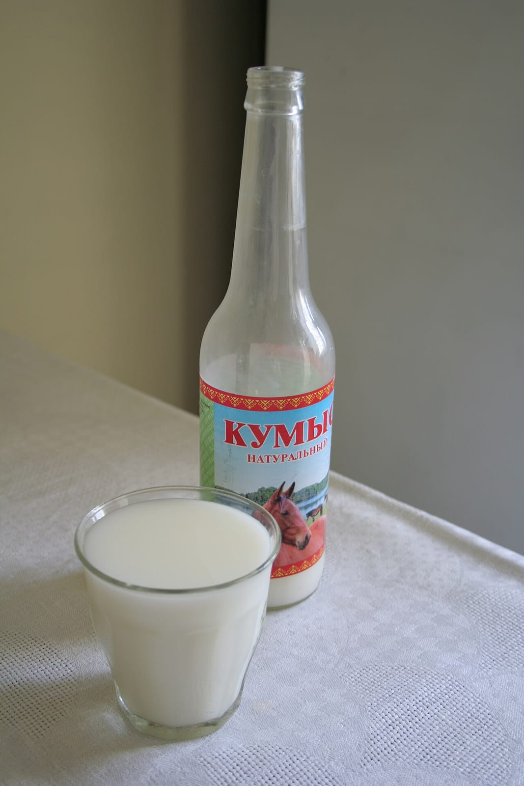
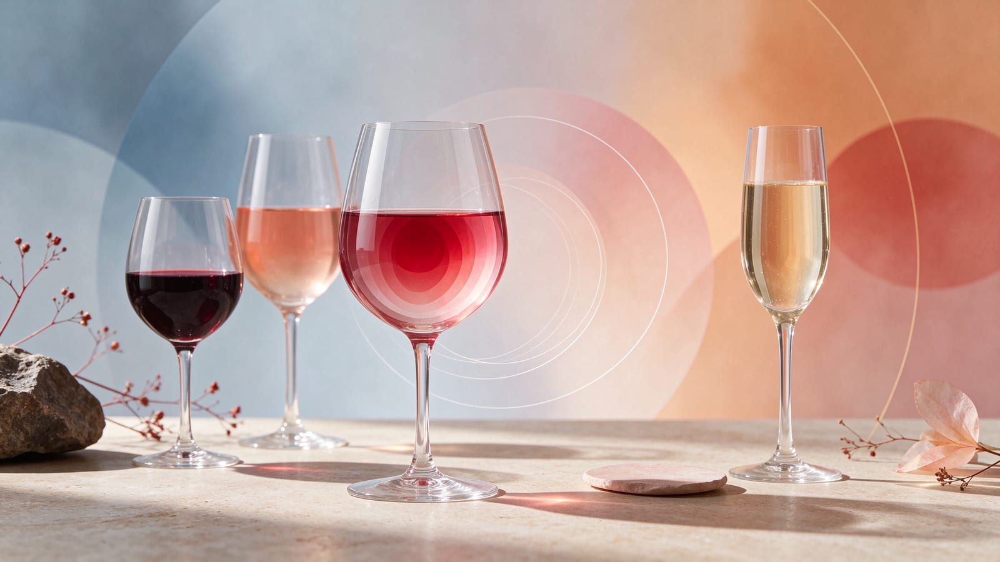

# 马奶酒

蒙古与中亚以马奶自然发酵的低酒精饮品，带酸味、乳香与轻微气泡；酒精度通常 1–3%，是游牧饮食与节庆的一部分。

在“喝酒去”的分类里，马奶酒属于发酵乳饮，不是葡萄酒、啤酒或蒸馏酒。判断它是否典型，先看四项：原料是否为马奶、是否靠乳酸菌与酵母自然发酵、酒精度是否在 1–3%、是否带轻微气泡与酸味。它没有“年份”“陈桶”或“蒸馏切割”这些概念，风味更多取决于奶源、季节、容器、发酵温度与新鲜度。

图：Airag / Kumis：Kumys-bottle（Wikimedia Commons）。图片：A.Savin，CC BY-SA 3.0，via Wikimedia Commons（[原图页面](https://commons.wikimedia.org/wiki/File:Kumys-bottle.jpg)）。

## 定义与边界

马奶酒（蒙古语 Airag，突厥语 Kumis／Kumyss）以马奶为原料，经乳酸菌与酵母自然发酵而成；蒙古、哈萨克斯坦、吉尔吉斯斯坦、俄罗斯南部以及中国内蒙古、新疆的牧区都有传统。各地做法相近，但奶源、发酵时间、是否保留引子与饮用习惯不同。

它不是一个受地理标志保护的“酒类风格”，而是游牧饮食中的一类发酵乳饮。Airag 与 Kumis 在不同语言里的所指范围略有差别，但通常都指马奶发酵的低酒精饮品，而不是蒸馏酒。

读标签时先看配料：是否只有马奶（或马奶加少量发酵引子）、是否标注活菌、酒精度与保质期。市面上也有用牛奶仿制的“kumis”，原料一换，风味、法规属性与乳糖含量都不同。

## 历史与命名

马奶酒的历史与游牧迁徙、季节性产奶和马群管理绑在一起。传统挤奶季大约从 6 月中旬到 10 月初，一匹母马每天可产 3–6 升奶；鲜奶冷却后倒入 khokhuur（牛皮囊），用 buluur（搅棒）反复搅动，让留在容器里的 khovoo（发酵引子）继续工作。

19 世纪，俄罗斯的“kumis 疗法”把这种草原饮品带进疗养院；苏联时期出现规模化生产。蒙古的那达慕、夏季牧场与家庭节庆仍保留以牧群为单位的制作方式。2019 年，联合国教科文组织把“在 khokhuur 中制作马奶酒的传统技术及相关习俗”列入人类非物质文化遗产代表作名录。

起源叙事常把它归给某位祖先或一次偶然发酵，但更可靠的线索是容器、气温、挤奶频率与迁徙路线：这些条件决定菌群、酸度与气泡，也解释了它为什么难以远距离商品化。

## 原料与工艺

原料是新鲜马奶。马奶的酪蛋白与脂肪结构不同于牛奶，乳糖含量更高，发酵后酸度上升快、口感更轻。传统做法靠环境与容器中的乳酸菌、乳酸链球菌与酵母自然发酵，并用搅棒反复搅动；教科文组织的说明特别强调“500 次以上”的搅动，以及发酵引子的保存与传代。

关键参数是奶温、容器、搅动频率与时间：温度低时发酵慢、酸度柔和；温度高时乳酸上升快，容易过酸。发酵通常在数小时到两天内完成，酒精度多在 1–3%，并产生少量二氧化碳。现代生产会接种菌种、控温并冷藏灌装；巴氏杀菌会削弱自然菌群与气泡感，这是它和工业化乳饮最大的差别。

## 风格与味觉

风味以酸奶、乳脂、轻微酒精与气泡为主，酸度明显，收口短，常带一点酵母或青草气息。它不是“越陈越好”的饮品：新鲜度、冷链与菌群活性比陈年更重要。

温度会明显改变表现：冰镇到 4–8°C 更清爽、气泡感更强；常温会放大乳香与酸感；加热到蛋白质分离的温度就毁了。它也不适合像葡萄酒那样长时间醒酒。

味觉判断看四项：酸甜平衡、乳香干净度、气泡与酒精刺激。过酸、哈败味、明显酵母苦味或分层，通常是发酵或储存出了问题。

## 代表产区与饮法

代表产地包括蒙古、哈萨克斯坦、吉尔吉斯斯坦、俄罗斯南部，以及中国内蒙古、新疆等牧区。生产以家庭、牧群与节庆场景为主，少有面向全国市场的品牌；同一地区不同牧户的差异，往往比“品牌”更大。

传统用木碗或皮囊直接饮用，常搭配手把肉、奶豆腐、炒米与节庆宴席。那达慕、婚礼与夏季牧场是主要场景；它不适合当调酒基酒，酸度与乳香会和多数果汁、糖浆冲突。

饮用温度建议 4–8°C；乳糖不耐受者应少量尝试。开瓶后尽快喝完，不要长期存放。

## 选购、储存与误区

常见误区：把“酸”当成坏了；把“有气泡”当成人工碳酸；把牛奶仿制品当成马奶酒；把“传统”“手工”当成质量保证。

买瓶装产品时看配料、菌种、酒精度、杀菌方式与保质期；散装或自制产品要确认冷链与卫生条件。跨国销售受乳制品检疫与冷链限制，市面上的瓶装产品多为本地生产、本地消费。

价格高不等于更传统。小批量手工与工业化产品各有风险，关键仍是原料、发酵参数与新鲜度。

相关条目：[发酵](ref:fermentation)。

马奶酒的低酒精度来自自然发酵，不是加水稀释；酸味、乳香与轻微气泡都是发酵的结果。

## 延伸阅读与另见

马奶酒与酸奶、开菲尔、奶酪等发酵乳制品共享乳酸发酵逻辑，而不是与葡萄酒共享“风格—产区—年份”框架。比较时优先看原料、菌种、酸度与酒精度。

学习这类饮品，可以按“新鲜—稍酸—过酸”三段建立边界：先喝当天发酵的版本，再喝冷藏一天的产品，最后对比一批发酵过头的样本。三步之后，酸度与气泡的变化会很清楚。

- 相关条目：[other](ref:other)、[fermentation](ref:fermentation)、[aroma](ref:aroma)、[body](ref:body)、[terroir](ref:terroir)。
- 本页不提供品牌排名、价格或购买渠道；马奶酒是发酵乳饮的一类，不是品质等级。

对照阅读：[其他酒类（分类说明）](ref:other)、[香气（aroma）](ref:aroma)。

**关键事实。**

| 项目 | 内容 |
| --- | --- |
| 一句话定位 | 蒙古与中亚以马奶自然发酵的低酒精饮品，带酸味、乳香与轻微气泡；酒精度通常 1–3%，是游牧饮食与节庆的一部分 |
| 上位风格 | 其他酒类（分类说明） |

**来源与边界。** 本页关于「马奶酒」的关键事实，主要由以下来源交叉核对：FAO（马奶、游牧乳制品与发酵背景）、FAO / WHO（乳制品与发酵食品标准框架）、UNESCO Intangible Cultural Heritage（马奶酒的挤奶季、khokhuur 搅动工艺、发酵引子与相关习俗）等 4 条来源。价格、批次与状态会变，涉及这些字段时以页面所列来源的最新版本为准。正文为项目自写，来源只作核验，不复制原文。

## 相关图像

图：酒体的编辑插图：不同杯型与酒液颜色深浅，用色带表达酒体轻重；AI 辅助绘制，不是实拍。图片：Hejiu 编辑团队，使用豆包 Seedream 5.5 AI 辅助生成；项目自制，不是现场照片（[项目说明](https://hejiu.org/about/)）。关联图像：马奶酒。
