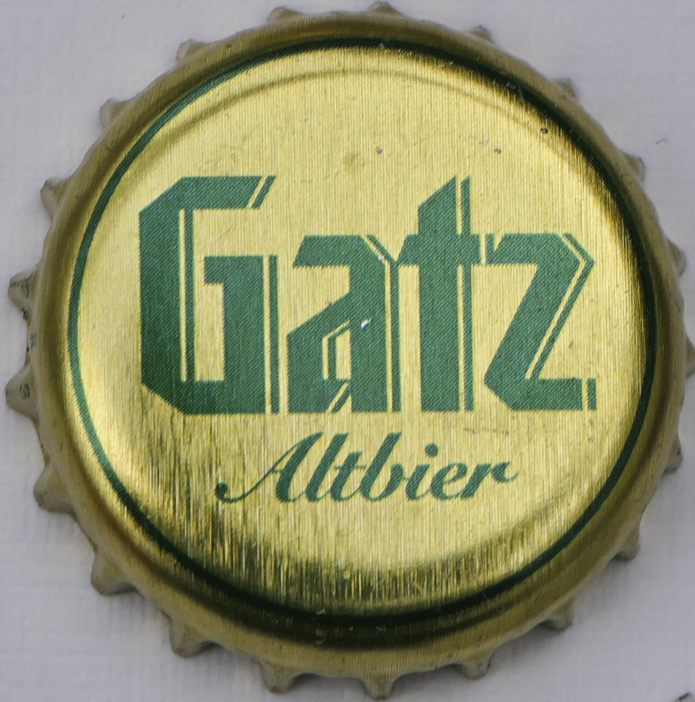
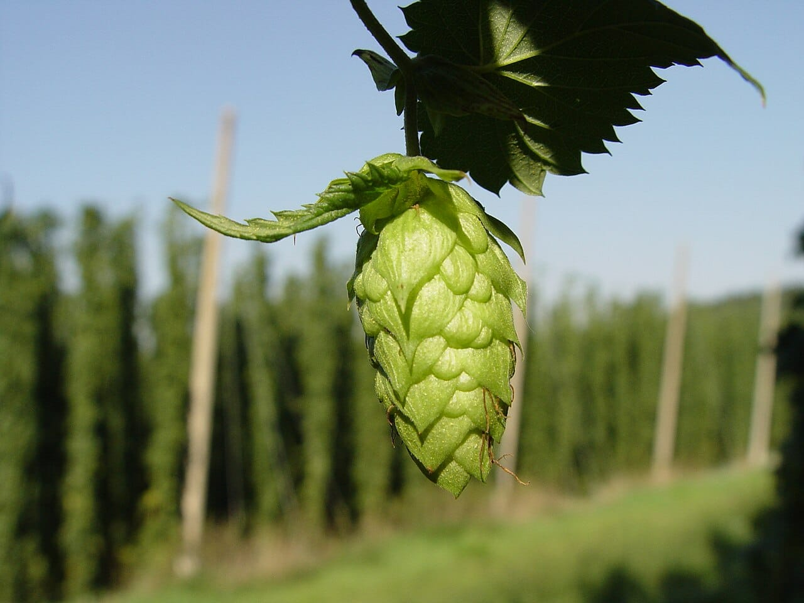

# 阿尔特啤酒

阿尔特啤酒是德国杜塞尔多夫及莱茵兰地区的传统顶层发酵啤酒，发酵后经低温贮藏熟成，铜棕色、麦芽干净、酒花苦度中高，工艺介于艾尔与拉格之间；名字里的 Alt 意为“老”，指采用拉格普及之前的传统上层发酵方法。

图：Altbier：Gatz - Altbier, 2019（Wikimedia Commons）。图片：unknown, scanned by 5snake5，CC0，via Wikimedia Commons（[原图页面](https://commons.wikimedia.org/wiki/File:Gatz_-_Altbier,_2019.jpg)）。

## 定义与边界

阿尔特啤酒（Altbier）是一类先以艾尔酵母顶层发酵、再像拉格一样低温贮藏熟成的啤酒(ref:beer)。它保留了艾尔的发酵方式，却借用了拉格的冷贮藏工艺，因此风格处在两者之间：麦芽骨架比典型拉格更分明，收尾又比多数英式艾尔更干爽。比赛指南把宽口径的 Altbier 与更严格的 Düsseldorf Altbier 分开列档，后者在苦度、颜色与酒体上更贴近杜塞尔多夫本地传统。

名称中的 Alt 是德语“老”，强调这套上层发酵、传统糖化的做法早于现代拉格工艺。阿尔特啤酒不是受法律保护的法定产区名称：德国(ref:germany)之外也有酒厂按相近工艺酿同类产品，标签上是否标注杜塞尔多夫、原料与酵母类型，是判断来源与风格的关键。它与科隆的 Kölsch 同为德国上层发酵传统，但颜色、麦芽与苦度取向不同。

## 历史与命名

今天意义上的阿尔特啤酒在 19 世纪后期的杜塞尔多夫成形：当时底层发酵拉格开始普及，本地酒厂保留上层发酵方法，并以“Altbier”相称，与拉格形成对照。Mathias Schumacher 于 1838 年在杜塞尔多夫开厂，是较早使用 Altbier 这一名称的生产者；其子 Ferdinand 于 1871 年在 Oststraße 123 建起新厂。

区域内更早的酿酒渊源可以追溯到中世纪：杜塞尔多夫地区有文献记载的酿造活动见于 873 年（Gerresheim 修道院与大主教 Willibert），974 年 Otto II 授予修道院 grut 酿造权；14 世纪的 keutebier 是当地早期麦芽饮品；比赛指南指出，这些旧时德国风格与现代阿尔特啤酒并无直接工艺传承。邻近 Korschenbroich 的 Bolten 酒厂拥有 1266 年的酿酒权利，被称为世界上最古老的阿尔特啤酒厂。需要区分的是，中世纪麦芽饮品与今天的阿尔特啤酒在麦芽处理、酒花品种和贮藏方式上都已不同，这段历史只是区域背景，不是现行配方的复刻。

## 原料与工艺

基酒使用德国基础麦芽，以皮尔森麦芽为主，有时加入慕尼黑麦芽；少量结晶麦芽、巧克力麦芽或黑麦芽调色与增加烤香，偶有加入小麦的做法。大麦(ref:barley)麦芽提供干净的面包与饼干骨架，深色部分只给铜棕颜色和轻微烘烤感，不追求世涛式的厚重焦香。

酒花(ref:hop)传统上用 Spalt 一类捷克型或德国贵族酒花，其他 Saazer 型酒花也可使用，贡献泥土、草本与花香，苦味中高但不刺鼻。酵母是干净、发酵衰减度高的艾尔菌株；糖化采用阶梯糖化或煮沸糖化（decoction mash），先在偏凉的艾尔发酵温度（约 15.5–20 摄氏度）完成发酵(ref:fermentation)，再转入低温（约 10 摄氏度）贮藏熟成，让酒体变得干净平滑。成品一般不添加水果、香料或橡木调味。

## 风格与味觉

典型阿尔特啤酒呈铜棕到红棕色，香气以面包、饼干、轻微焦糖与麦芽甜感为主，酒花带来泥土、草本与淡淡花香；入口麦芽干净，中段有贵族酒花的苦与辛香，收尾干爽，苦味留存不拖甜。酒体中轻，碳酸化适中，口感利落，不像甜棕色艾尔那样黏润。

参数上，宽口径 Altbier 酒精度 4.3–5.5%，IBU 25–50，色度 SRM 9–17；杜塞尔多夫 Altbier 酒精度 4.5–5.2%，IBU 35–50，SRM 11–17。两地档位的差别主要在苦度与颜色深浅，而非原料体系。强款 Sticke Alt（方言意为“秘密”）酒精度更高，杜塞尔多夫个别酒馆只在固定日子供应；双倍 Sticke 强度更进一档，属于同风格内的变体。

## 代表产区与品牌

杜塞尔多夫 Altstadt 老城区的四家传统酒馆是本地参照：Zum Uerige、Im Füchschen、Schumacher 与 Zum Schlüssel，多在自家庄园或相连酒厂供应鲜啤。区域内的其他常见生产者包括 Diebels Alt、Schlösser Alt、Frankenheim Alt 与 Bolten Alt，既有酒馆桶装鲜啤，也有瓶装与全国流通产品。

这些品牌名称是市场与品鉴参照，不是官方分级；同一酒厂的常规 Altbier 与 Sticke 强度不同，不能互换比较。德国以外的仿制产品常调整麦芽比例与苦度，读标签时留意产地、酒精度与是否标注上层发酵。瓶装产品与酒馆现打鲜啤在新鲜度和气泡上也有差别，传统喝法以本地酒馆现打为准。

## 怎么喝与配餐

阿尔特啤酒传统上用小容量直杯（Altbierglas / Stange）在接近窖藏的温度（约 10–12 摄氏度）供应，不必冰镇到透凉，以免压住麦芽与酒花香气；现打鲜啤优先在酒馆饮用，年轻瓶装款开瓶即饮，不需要醒酒。

配餐围绕莱茵兰酒馆食物：烤猪肉、各式香肠、火腿与黑麦开放三明治（如 Halve Hahn 黑麦面包配硬奶酪）能承接麦芽面包香，酒花的干爽苦味正好切割油脂；硬质奶酪与碱水面包也是常见搭配。偏重的烟熏肉与炖肉适合常规强度款，强款 Sticke 可配更浓郁的肉食与蓝纹奶酪；甜点与酸甜水果菜不太对路，干爽苦味会与甜味打架。

## 选购、储存与误区

读标签先确认产地与工艺：产自杜塞尔多夫或德国、标注上层发酵与低温贮藏的产品，更接近传统阿尔特啤酒；只写“深色艾尔”而不标产地与酵母类型的产品，可比性有限。再看酒精度与苦度，常规档与 Sticke 强款要分开比较。

阿尔特啤酒是鲜饮型啤酒，不适合长期陈年：瓶装款避光、避高温存放，买新不买旧，开瓶后尽快喝完。常见误区有三类：一是把冷贮藏工艺当成拉格酵母发酵，实际上它仍是艾尔酵母；二是把铜棕色误当世涛或波特的厚重烘焦，阿尔特的深色来自少量烤麦芽，酒体偏轻爽；三是把它当成甜棕色艾尔，传统款收尾干爽，残糖不高。与 Kölsch 的区分也常被混淆：Altbier 铜棕、麦芽与苦味更重，Kölsch 浅金、酒体纤细清爽。

## 延伸阅读与另见

认识阿尔特啤酒，可以先从一款常规强度的杜塞尔多夫风格入手理解麦芽与苦度骨架，再比较一款外地产区的瓶装版本，最后试一次强款 Sticke；三档对照之后，发酵方式、贮藏熟成与强度带来的差别会比较清楚。

- 相关条目：[beer](ref:beer)、[barley](ref:barley)、[hop](ref:hop)、[fermentation](ref:fermentation)、[germany](ref:germany)。

## 相关图像

图：啤酒花。图片：LuckyStarr，CC BY 2.5，via Wikimedia Commons（[原图页面](https://commons.wikimedia.org/wiki/File:Humulus_Lupulus_Hopfendolde-mit-hopfengarten.jpg)）。关联图像：阿尔特啤酒。
