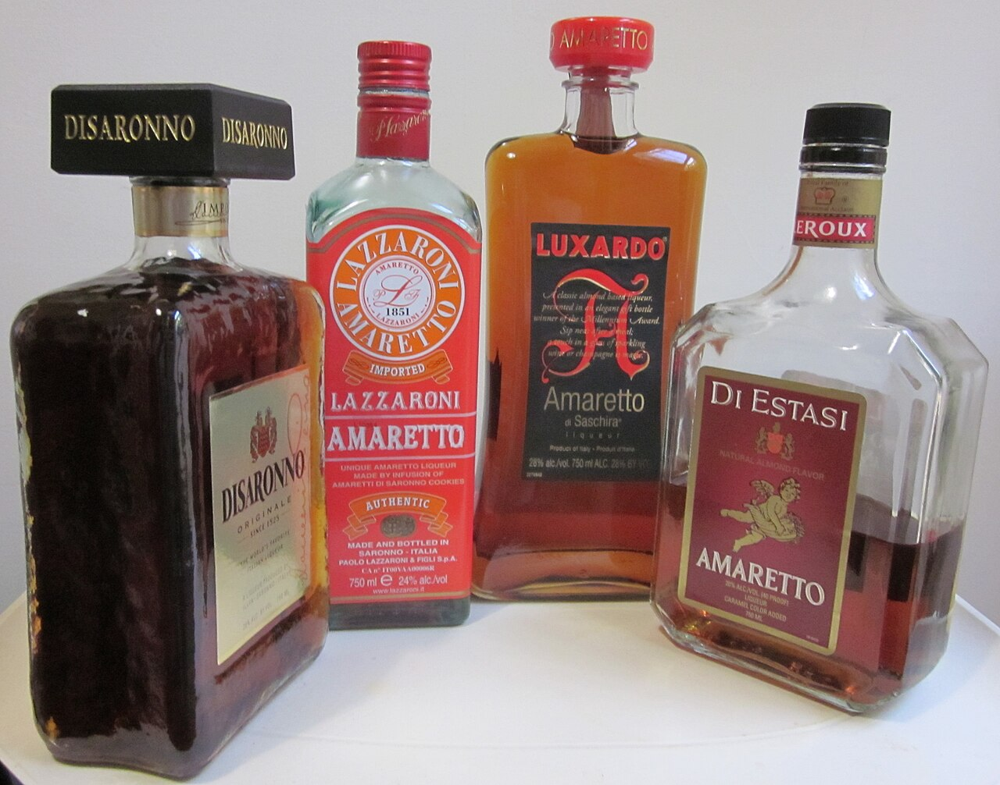

# 阿玛雷托

阿玛雷托（amaretto）是意大利杏仁风味的甜利口酒，名字来自意大利语 amaro（苦），指果核原料带来的微苦尾韵；常用杏核、苦杏仁或桃核浸渍，带杏仁、香草、焦糖与花香，酒精度通常 21–28%，可纯饮、加冰或调入咖啡与鸡尾酒。

图：Amaretto：Amaretto Bottles 4（Wikimedia Commons）。图片：Infrogmation of New Orleans，CC BY-SA 3.0，via Wikimedia Commons（[原图页面](https://commons.wikimedia.org/wiki/File:Amaretto_Bottles_4.JPG)）。

## 定义与边界

在欧盟烈酒法规中，阿玛雷托并不是一个单列的烈酒类别，产品在市场上以通用名称"利口酒"（liqueur）销售。按法规，利口酒是以农业来源乙醇、农业来源蒸馏物或一种以上烈酒为基底，加糖并加入香料、农产品或食品制成的烈酒，最低酒精度 15%，除樱桃等特例类别外，每升最低含糖量折合转化糖 100 克。阿玛雷托的杏仁风味属于风味来源选择，而不是受保护的法定名称。

判断一款酒是否属于阿玛雷托，要看风味来源与配料，而不是只看琥珀色或瓶型。它与苦酒（amaro）不是一类：amaro 是草本苦味开胃或餐后酒，通常不甜；阿玛雷托是甜型果核风味利口酒，尾韵的苦只是平衡甜味的一部分。标签上若写"杏仁风味"，要分清原料是真杏仁、杏核或桃核，还是杏仁香精；不同品牌的配方彼此保密，差距可以很大。

## 历史与命名

阿玛雷托最著名的起源传说与萨罗诺（Saronno，伦巴第大区）有关。1525 年，达·芬奇的学生 Bernardino Luini 受托在当地绘制"奇迹圣母"壁画，他以一位年轻的旅店女主人为模特；作为答谢，女主人把杏核浸入白兰地，酿成了第一瓶传说中的阿玛雷托。这则故事是品牌叙事，不能当作可考证的史实，但它解释了"杏仁味来自果核而非杏仁"这一传统认知。

品牌谱系方面，Disaronno 的公司资料称，Reina 家族在 17 世纪前后自酿餐后利口酒，Giovanni Reina 重新发现了古老配方；20 世纪初，Domenico Reina 在萨罗诺市中心开设名为"Domenico Reina Coloniali"的店铺与工坊，1947 年 ILLVA Saronno 成立并延续这一品牌。该产品原名 Amaretto di Saronno，2001 年更名为 Disaronno Originale。另一家 Lazzaroni 自 1851 年起在萨罗诺生产阿玛雷托，以 Amaretti di Saronno 杏仁饼干浸入酒精浸渍为特色。

## 原料与工艺

风味原料通常包括杏核、苦杏仁、桃核，部分品牌也用甜杏仁或杏仁提取物。杏仁般的香气来自原料中的苯甲醛类物质；苦杏仁与杏核含有生氰糖苷，工业生产中会经过脱除氢氰酸的处理，成品不再保留毒性成分。配方属于各品牌的商业秘密，有的以整核浸渍，有的使用果仁油或天然提取物，也有品牌加入香草、焦糖、干果与花香类香料。

工艺上，常见做法是把果核或果仁在中性烈酒中浸渍数日至数周，萃取香气后分离残渣，再补糖、调色并降度；部分高端产品会在浸渍后做轻微蒸馏或调配。基底可以是农业来源乙醇、蒸馏物或烈酒本身，这一点与[利口酒](ref:liqueur)的通用规则一致。成品颜色从浅琥珀到深棕，酒体浓稠，甜味明显，杏仁与焦糖香气占据前调，尾韵带一点苦杏仁与樱桃核的回味。

## 风格与味觉

典型阿玛雷托以甜、杏仁、焦糖为主导，辅以香草、樱桃与花香，酒精感被糖分包裹，入口柔顺；质量好的产品甜而不腻，苦底清晰，不会只剩糖浆感。不同品牌差异集中在原料路线：用杏核油的版本香气偏清透、坚果感轻，用苦杏仁的版本更厚实、接近马卡龙或杏仁糖的味道，甜度与酒精度也各有高低。

温度会改变表现：冰镇或加冰会降低甜度与酒精刺激，香气更收敛；室温纯饮则把焦糖、杏仁与暖香料感放大。它不是干型餐后酒，不能用品鉴白兰地或威士忌的干瘦标准衡量；平衡与否，看甜、苦、酒精与香气是否互相托住，而不是看单一强度。

## 代表产区与品牌

Disaronno Originale 是全球最知名的阿玛雷托，产自伦巴第萨罗诺，由 ILLVA Saronno 生产，酒精度 28%；据品牌介绍，它以杏核油、无水酒精、焦糖化糖与十七种精选草本和水果的精华调配，成品不含杏仁，瓶身为穆拉诺风格的长方形玻璃瓶。Lazzaroni Amaretto 自 1851 年在萨罗诺装瓶，走饼干浸渍路线；Luxardo Amaretto di Saschira 产自威尼托，酒精度 24%，杏仁味来自樱桃、桃与杏果核中的精油；Gozio Amaretto 产自布雷西亚附近的 Gussago，由 Distillerie Franciacorta 生产，配方始于 1901 年，以苦杏仁与少量秘料调配，酒精度 24%。

这些品牌分属不同路线：有的强调品牌历史与全球渠道，有的坚持产区小镇与传统浸渍方法。同一名字之下，产地、原料、甜度和定位差别很大，读背标上的原料与酒精度，比记住"典型阿玛雷托"的笼统印象更可靠。

## 怎么喝与配餐

餐后纯饮是最传统的喝法，用小利口酒杯在室温或稍凉状态下饮用；加冰可以弱化甜度与酒精刺激，适合夏天或不喜甜的人。阿玛雷托也常加入咖啡、热巧克力或牛奶中，作为甜味餐后饮品；调酒里的经典款包括 Godfather（威士忌与阿玛雷托）和 Amaretto Sour（柠檬汁，可选蛋白打发），前者醇厚，后者清爽带酸。

餐食搭配上，它适配杏仁饼干、提拉米苏、奶油布丁、坚果塔与水果干等甜点，也可少量加入糕点制作中；与蓝纹奶酪或咸坚果并置时，甜味与咸鲜可以互相衬托。厚重的红肉、油炸菜肴并不适合配甜利口酒，会让甜味更腻。作为餐后酒，少量慢饮比大口快饮更能体会其香气层次。

## 选购、储存与误区

常见误区：以为阿玛雷托一定含杏仁——Disaronno 等多款产品实际使用杏核油，不含坚果；把它和 amaro 苦酒混为一谈；把颜色深浅当作陈年程度；认为甜度越高品质越好。实际上颜色来自果核、焦糖与调色，甜度是配方选择，不等于质量等级。

买酒时先读背标：风味原料是杏仁、杏核还是桃核，酒精度与含糖量标注是否清楚，产地与生产者是谁；正面大字往往是品牌营销。储存上，未开封的阿玛雷托避光、阴凉、直立存放即可，高糖度使它相对稳定；开瓶后香气会逐渐散失，建议在数月内喝完，不必像烈酒那样长期陈放。价格高通常对应品牌溢价或渠道，不必然代表风格更典型。

## 延伸阅读与另见

与阿玛雷托相近的饮品共享果核浸渍与甜利口酒工艺：[利口酒](ref:liqueur)是它所属的大类，[意大利](ref:italy)是萨罗诺、威尼托与布雷西亚等产地的背景，[浸渍](ref:maceration)是果核香气进入酒液的主要方式，[蒸馏](ref:distillation)关系到基底烈酒的制备，[酒精度](ref:proof)则是标签上最容易直接比较的参数。

学习一类利口酒，可以先喝最标准的基准款，再试一个换原料或甜度的变体，最后接触一个风格极端的款式；三步之后，风格边界会比读定义更清楚。

- 相关条目：[liqueur](ref:liqueur)、[italy](ref:italy)、[maceration](ref:maceration)、[distillation](ref:distillation)、[proof-and-abv](ref:proof)。
