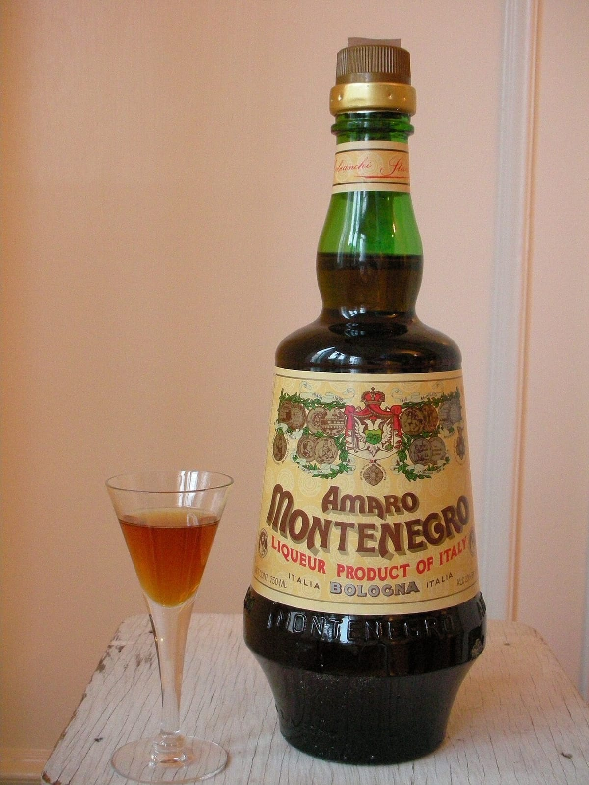
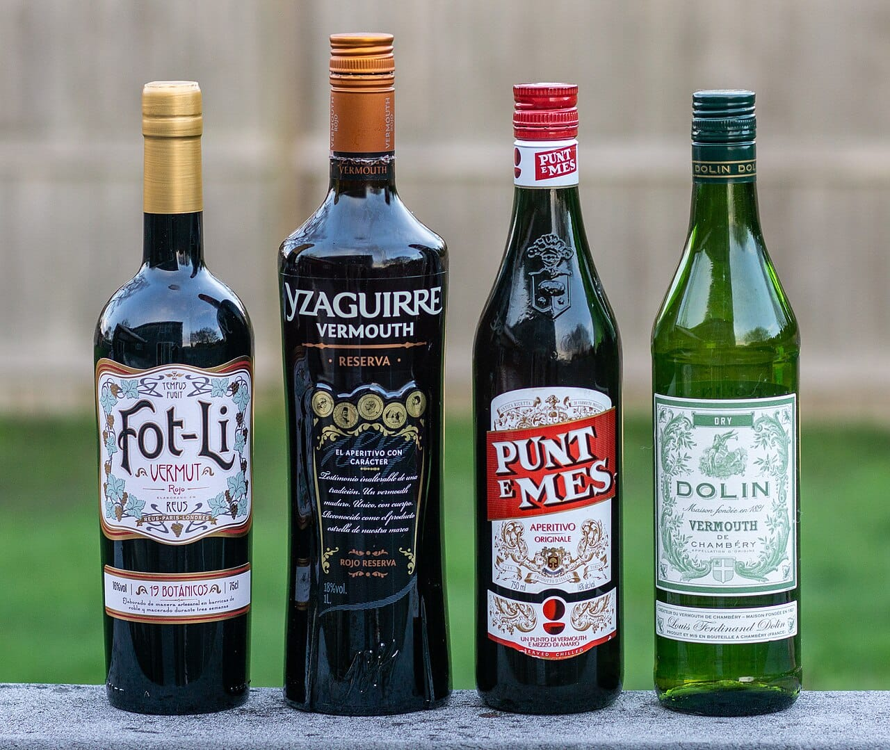

# 阿玛罗

阿玛罗（amaro）是意大利草本苦味[利口酒](ref:liqueur)的总称。它的共同点不是某一种植物，而是一种结构：用酒精浸提或蒸馏草药、根茎、树皮、花和柑橘，得到带有苦味的基液，再加糖浆、水或酒液调配，让苦与甜形成平衡。它可以很苦、很甜、很草本、很柑橘，也可以带焦糖或薄荷；唯一不能缺少的是“苦味”与“草本”这两个轴。

图：一瓶 Amaro Montenegro 与一杯琥珀色阿玛罗，瓶身标签标着 Amaro Montenegro 与 Product of Italy。图片：Shabbychef，CC BY-SA 4.0，via [原图页面](https://commons.wikimedia.org/wiki/File:Amaro_Montenegro.jpg)。

## 意大利苦味利口酒的定义

在欧盟法规里，amaro 通常落在“利口酒”或“苦味烈酒”的范围内，而不是一个受保护的地理标志。它没有统一的植物名单、最低陈年时间或固定酒精度；不同酒厂可以根据家族配方自由发挥。意大利人把这类酒统称为 amaro，字面意思是“苦的”，但实际口感往往苦甜并存，而不是单纯的苦。

这带来一个现实问题：amaro 的范围太宽，消费者很难用一句话判断风格。有的酒精度只有 11% vol，适合加冰大口喝；有的接近 30% vol，苦味浓重，只适合小杯餐后慢饮。购买时，酒精度、糖度、植物描述和产地比“amaro”这个词本身更有信息量。

## 修道院、药房与家族配方

阿玛罗的源头常被追溯到修道院和药房。中世纪的修士用草药浸泡酒精，制作消化剂和药酒；19 世纪，意大利的城市药房和蒸馏厂把这些配方商业化，形成今天熟悉的品牌。配方往往由家族或药师掌握，经过几代人的调整，成为地方身份的一部分。

这种“药草—药酒—利口酒”的路径，解释了为什么阿玛罗的标签上常出现“digestivo”“erbe amare”“ricetta originale”之类的词。它既有民间医学的记忆，也有现代品牌营销的包装；两者并不矛盾，但不应把“助消化”当成医学承诺。

## 浸提、糖与陈年

阿玛罗的生产通常从浸提开始：把干燥或新鲜的植物材料放入酒精或酒精水溶液中，浸泡数天到数周，让苦味、香气和颜色进入液体；有些配方会把部分植物放入蒸馏器，通过蒸汽提取更轻盈的香气。浸提液经过过滤、调配、加糖，有时还会陈年。

糖不是简单的“遮苦”。它提供黏度、圆润感和收口长度，让苦味从尖锐变成可饮；糖太少，酒体会显得干瘦，糖太多，又会盖住植物层次。陈年则让苦味与甜味融合，木质容器还会带来香草、香料和轻微氧化感。不同酒厂的糖度差异很大，不能只用“甜不甜”来判断质量。

## 苦味的层次

阿玛罗的苦味来自多种化合物：龙胆根、苦木、金鸡纳、蒿属植物、橙皮、大黄和洋蓟等都可能贡献苦味。苦味的位置也不同：有的在入口，有的在中段，有的在收口；有的苦味干净、像柚子皮，有的苦味深沉、像树皮和土壤。

品鉴时可以分三层：第一层是甜味和酒精带来的圆润，第二层是草本、柑橘、花香和香料，第三层是苦味的长度与质地。好的阿玛罗不是“越苦越好”，而是苦味有支撑、甜味不腻、植物层次清楚，收口干净。温度也会改变平衡：加冰会压低苦味和香气，室温则让细节更明显。

## 代表品牌与地域

意大利北部的伦巴第、威尼托、皮埃蒙特和南部的西西里、卡拉布里亚都有代表性品牌。Averna 来自西西里，配方可追溯到 1868 年，风格偏甜、带柑橘和草本；Fernet-Branca 来自米兰，1845 年创立，苦味强烈、薄荷与藏红花感明显，是 fernet 类别的代表；Cynar 以洋蓟为标志，1952 年推出，苦味柔和、适合加冰或调酒。

这些品牌只是入口，不是全部。意大利各地还有大量小型生产者，用本地草药、葡萄酒酒精或谷物酒精制作阿玛罗；有的强调新鲜植物，有的强调长期陈年。地域不是质量保证，但能提供风格线索：北部常更草本、更苦，南部常更甜、更柑橘。

## 餐后酒与调酒

阿玛罗最传统的角色是餐后消化酒：小杯、室温或加冰，慢慢喝完。它也可以做高球，与苏打水、汤力水或姜汁汽水搭配，降低甜度和酒精刺激；在冬天，有些人会加一点热水，让香气打开。

在鸡尾酒里，阿玛罗是“带苦味的调味酒”。它可以替代部分[味美思](ref:vermouth)或[苦精](ref:bitters)的角色，为[内格罗尼](ref:negroni)增加草本深度，也能让[古典鸡尾酒](ref:old-fashioned)的变体更有层次。使用时要控制用量：阿玛罗的糖分和苦味都很强，过量会压过基酒。

在意大利，阿玛罗也常与咖啡、苏打水或橙皮一起出现，作为餐后最后的味觉清理。

## 与苦精、味美思的区别

[苦精](ref:bitters)是浓缩的苦味调味液，通常以滴或少量加入，不直接大口饮用；阿玛罗是加糖的利口酒，可以纯饮，也可以作为鸡尾酒的主要配料。两者的苦味来源有重叠，但浓度、糖度和使用方式完全不同。

[味美思](ref:vermouth)是加香加强葡萄酒，以葡萄酒为基，酒精度通常低于阿玛罗；阿玛罗以酒精浸提或蒸馏为基，通常不含葡萄酒。把三者混为一谈，会错过它们各自在调酒中的功能：味美思提供葡萄酒的酸度与香气，苦精提供集中的苦味，阿玛罗提供甜苦平衡和草本体积。

相关条目：[利口酒](ref:liqueur)。

**关键事实。**

| 项目 | 内容 |
| --- | --- |
| 一句话定位 | 意大利草本苦味利口酒的总称，以酒精浸提或蒸馏草药、根茎、树皮和柑橘，再加糖浆调配；酒精度多在 11% 至 30% vol，苦甜交织，既是餐后消化酒，也是内格罗尼、曼哈顿变体与高球的重要配料 |
| 上位风格 | 利口酒 |
| 香气家族 | 草本/苦味/柑橘 |

**来源与边界。** 本页关于「阿玛罗」的关键事实，主要由以下来源交叉核对：European Union（利口酒、苦味烈酒与加香葡萄酒的法定边界）、Federvini（意大利烈酒与利口酒行业的分类与传统）、Amaro Averna（1868 年配方与西西里家族生产史）等 4 条来源。价格、批次与状态会变，涉及这些字段时以页面所列来源的最新版本为准。正文为项目自写，来源只作核验，不复制原文。

**并读。** 把「阿玛罗」与「利口酒」、「味美思」、「苦精」放在一起读时，先确认它们是同一层级还是上下游关系：先确认定义与工艺，再比较原料、产区与代表品牌。本页负责给出酒类风格的基本坐标，对照条目补上具体案例与差异；读完再回到本页，才能分清哪些差别属于酒类风格本身，哪些只是产地、批次或品牌选择。

## 相关图像

图：味美思。图片：Kenneth C. Zirkel，CC BY-SA 4.0，via Wikimedia Commons（[原图页面](https://commons.wikimedia.org/wiki/File:Four_bottles_of_vermouth.jpg)）。关联图像：阿玛罗。
