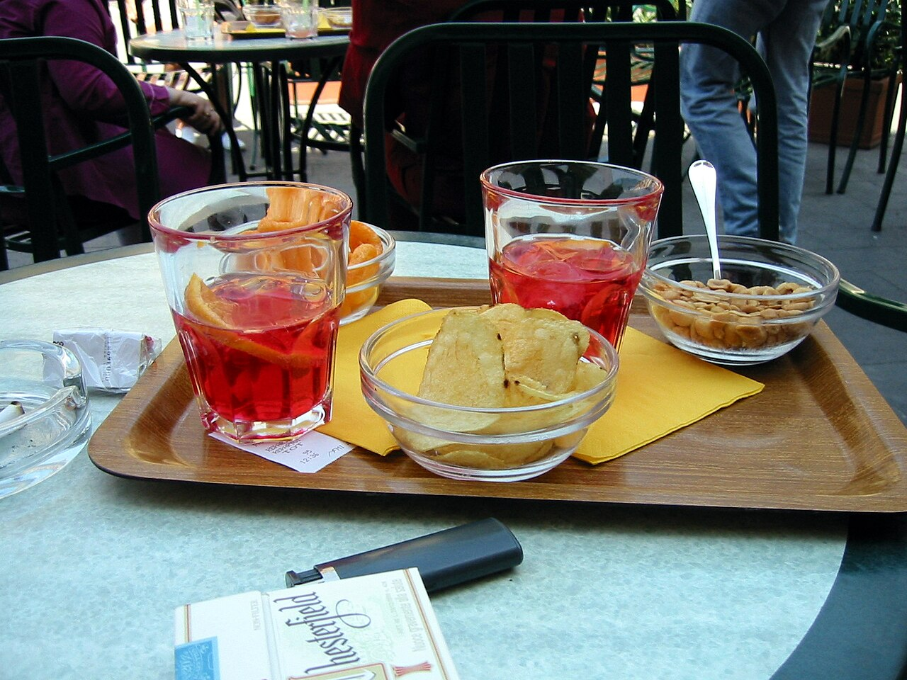

# 开胃酒

开胃酒（aperitif / aperitivo）指正餐前饮用的酒饮，核心目的是用苦味、酸度、气泡或干型结构刺激食欲，而不是提供大量酒精。它按饮用场景划分，而不是按原料划分：味美思、苦味酒、茴香酒、干型加强酒与低酒精鸡尾酒都可以归入这个类别。

图：开胃酒。图片：Wikimedia Commons contributor，Public domain，via Wikimedia Commons（[原图页面](https://commons.wikimedia.org/wiki/File:Aperitif_Campari_Soda.jpg)）。

## 先划清「开胃酒」的边界
开胃酒不是一个法定酒类类别，而是一组饮用习惯的统称。同一瓶酒可以在餐前作为开胃酒，也可以在餐后作为消化酒（digestif），差别在于场合、温度、份量与搭配。意大利语 aperitivo 更强调社交仪式：傍晚在酒吧配小食饮用；法语 apéritif 更强调餐前那一段时间。

判断一款酒是否适合餐前，可以看三个维度：酒精强度、糖分与苦味。酒精过高会麻痹味觉，糖分过高会压制食欲，适度的苦味与酸度则能促进唾液分泌。开胃酒不等于“低度酒”，苦味酒与加强酒的酒精度可能并不低，关键是份量小、温度低、风味清爽。

开胃酒与消化酒常被混用。消化酒多在餐后饮用，偏向高酒精、高糖或强苦味，目的是帮助消化与收尾；开胃酒则强调清爽与低负担。两者的边界不是固定的：同一款苦味酒在意大利可能餐后饮用，在别的市场可能被当作餐前酒。理解这一点，就不必执着于给每瓶酒贴唯一标签。

## 「开胃酒」的时间线
“aperitif”一词来自拉丁语 aperire，意为“打开”。18 世纪，欧洲的餐前饮酒习惯逐渐固定；19 世纪，随着城市酒吧、咖啡馆与苦味酒工业的发展，开胃酒成为城市中产的日常仪式。都灵在 1786 年出现现代味美思的商业生产，苦味植物与葡萄酒的结合奠定了后来开胃酒的基本结构。

20 世纪，意大利的 aperitivo 文化把饮酒与小食结合，形成傍晚社交场景；法国则发展出 pastis 加水的饮用方式。二战后，Spritz、Americano 等鸡尾酒把开胃酒从纯饮扩展到调酒，内格罗尼则把苦味、甜味与杜松子香气组合成结构完整的餐前酒。今天低酒精与无酒精开胃酒也在增长，但仍遵循“少量、清爽、开胃”的功能逻辑。

## 常见类型

- 味美思（vermouth）：以[加强葡萄酒](ref:fortified-wine)为基底，加入苦味植物与香料，分干型、甜型与半甜型；干型适合餐前纯饮或调马丁尼。
- 苦味酒（bitters / amaro）：草本、根茎、柑橘浸提，苦甜平衡；意大利 amaro 常作餐后酒，但低糖、低酒精的苦味酒也常作开胃酒，可参见[利口酒](ref:liqueur)。
- 茴香酒：法国 pastis、希腊 ouzo，加水后浑浊，风味强烈，通常少量饮用。
- 开胃酒鸡尾酒：Spritz、Americano 与[内格罗尼](ref:negroni)，酒精度与甜度差异很大，不能一概而论。

## 风味结构

开胃酒的共同风味是“苦—酸—香”的三角。苦味来自植物生物碱、萜类与多酚，能延长余味并抑制甜腻；酸度来自葡萄酒或柑橘，能清洁口腔；香气来自草本、根茎、柑橘皮与香料。糖分的作用是平衡苦味，而不是制造甜饮，因此开胃酒的甜通常是“收口甜”，入口后很快转为苦与香。

温度与气泡会改变感知。低温压低甜味与酒精刺激，让苦味更清晰；气泡通过碳酸与酸度提升清爽感，也会加快香气挥发。同一款酒加冰、加苏打或加柑橘皮，风味重心会明显移动，这也是开胃酒适合按场合调整的原因。

苦味感知存在个体差异。人对苦味的敏感度受味觉受体与饮食习惯影响，同一杯酒在不同人嘴里可能呈现完全不同的强度。因此“这款酒太苦”不是绝对判断，而是个人阈值与温度、糖分共同作用的结果。初次尝试时，选择低苦度、低酒精、带气泡的产品，比直接挑战高强度苦味酒更容易建立体验。

## 饮用方式

常见的餐前服务是小杯、低温、少冰：味美思可加一块冰与柠檬皮；苦味酒可加苏打与橙皮；茴香酒按传统加水稀释。鸡尾酒则按配方控制糖与稀释，Spritz 通常以起泡酒、苦味酒与苏打构成，Americano 用苦味酒、甜味美思与苏打，Negroni 以等量金酒、苦味酒与甜味美思。

份量应小。餐前饮酒的目的是打开味觉，而不是喝醉；高酒精的开胃酒尤其要控制杯数。搭配小食时，选择咸味、橄榄、坚果、奶酪与腌渍物，避免重甜点心，因为糖会与苦味冲突并压低食欲。若在正式晚宴前饮用，通常只安排一杯，以免酒精影响后续品尝。

## 「开胃酒」容易被读错的地方
第一，把开胃酒当成一个法定酒种。它是场景类别，同一款酒可以出现在不同场合。
第二，认为开胃酒必须低酒精。苦味酒与加强酒的酒精度可能很高，关键在份量与饮用方式。
第三，用甜饮料替代开胃酒。高糖会压制食欲，与餐前目的相反。
第四，认为苦味越强越正宗。苦味需要与糖、酸、香气平衡，不同产品差异很大。
第五，忽视温度与稀释。加冰与苏打会显著改变风味，不能只按瓶标判断。

对照阅读：[利口酒](ref:liqueur)、[内格罗尼](ref:negroni)。

开胃酒并不等于低度酒：苦味、干型和少量饮用的场景，比酒精度更能决定它为什么出现在餐前。

开胃酒是按场景分类，不是按原料分类；苦味与干型比酒精度更能定义它为什么出现在餐前。

**来源与边界。** 本页关于「开胃酒」的关键事实，主要由以下来源交叉核对：European Union（味美思等加香葡萄酒产品的类别定义）、International Bartenders Association（开胃酒风格鸡尾酒在经典调酒分类中的位置）、Oxford University Press（提供关于餐前酒传统、苦味酒与欧洲开胃酒文化的条目；由原条目末尾参考资料迁移，未逐条复核访问日期）。价格、批次与状态会变，涉及这些字段时以页面所列来源的最新版本为准。正文为项目自写，来源只作核验，不复制原文。

**并读。** 把「开胃酒」与「利口酒」、「加强葡萄酒」、「内格罗尼」放在一起读时，先确认它们是同一层级还是上下游关系：先确认定义与工艺，再比较原料、产区与代表品牌。本页负责给出酒类风格的基本坐标，对照条目补上具体案例与差异；读完再回到本页，才能分清哪些差别属于酒类风格本身，哪些只是产地、批次或品牌选择。

## 参考资料
- [利口酒](ref:liqueur)：苦味酒与甜味酒的类别框架。
- [加强葡萄酒](ref:fortified-wine)：味美思的基酒类别。
- [内格罗尼](ref:negroni)：以开胃酒为骨架的经典鸡尾酒。
