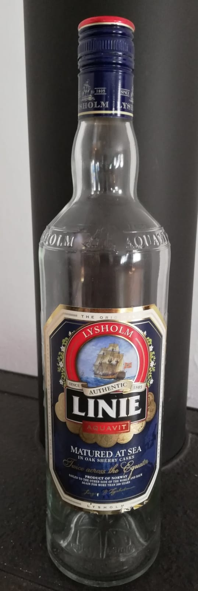
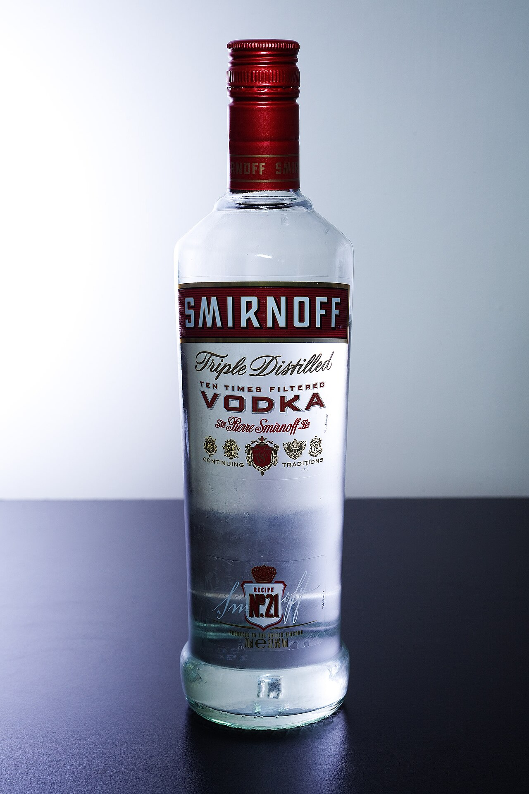

# 阿夸维特

阿夸维特（aquavit，北欧常写作 akvavit 或 akevitt）是以葛缕子籽或莳萝为核心香料的北欧烈酒。它可以是无色透明的，也可以是经橡木桶陈年的琥珀色；酒精度通常从 37.5% 起，常见装瓶在 40% 左右。它不是伏特加加了香精，也不是金酒的北方变体：葛缕子与莳萝的组合、北欧的谷物或马铃薯基酒，以及圣诞餐桌上的 snaps 仪式，共同构成了它的身份。

图：一瓶 Lysholm Linie 阿夸维特，标签标着 LINIE AQUAVIT 与 Matured at Sea。图片：Mojmir Churavy，CC0 1.0，via [原图页面](https://commons.wikimedia.org/wiki/File:Lysholm_LINIE_Aquavit_bottle.jpg)。

## 北欧的“生命之水”

Aquavit 这个名字来自拉丁语 aqua vitae，意思是“生命之水”。中世纪欧洲把蒸馏酒精当作药物，后来北欧人把葛缕子、莳萝等当地香料加入其中，逐渐形成今天的风味轮廓。它在丹麦、挪威、瑞典都有各自的传统，德语区则常写作 Aquavit 或 Akvavit。名称拼写不同，核心定义却相近：以葛缕子或莳萝调味的烈酒。

在挪威，它常与圣诞晚餐、腌鲱鱼、烟熏三文鱼和烤猪肉一起出现；在丹麦，它是午餐与 snaps 文化的一部分；在瑞典，它出现在仲夏节与圣诞餐桌。它通常用小杯冰镇后一口喝下，也会配着祝酒词，节奏比单纯品饮更热闹。

## 法规：葛缕子与莳萝的最低要求

欧盟烈酒法规把 akvavit/aquavit 列为独立类别：以农业来源的乙醇为基酒，用葛缕子籽和/或莳萝调味，最低酒精度为 37.5% vol。法规没有要求它必须是清澈的，也没有规定糖分下限，因此它既可以是无色的，也可以是橡木桶带来的金色。它不属于[利口酒](ref:liqueur)的甜味类别，尽管北欧人有时会把它当作餐后酒。

各国还有更细的传统：挪威 akevitt 常以马铃薯或谷物为基酒，酒精度多在 40% 左右，部分经雪莉桶陈年；丹麦与瑞典更常保持清澈。酒标上的“taffel”“juleakevitt”是风格与季节提示，不是法定分级。

## 1531 年的一封信

斯堪的纳维亚最早的文字记录之一，是 1531 年卑尔根胡斯要塞指挥官埃斯克·比勒写给大主教奥拉夫·恩格尔布雷克松的一封信。信中附上一瓶他称为 aqua vitae 的蒸馏酒，并把它描述为可以治疗多种疾病的药。这封信并不能证明现代葛缕子阿夸维特已经诞生，却说明蒸馏酒精在 16 世纪的北欧已经进入精英与教会的视野。

另一个常被讲述的故事发生在 1805 年。挪威 Lysholm 家族把一批马铃薯基阿夸维特装上帆船运往东印度，结果产品在当地不受欢迎，只好原船返回。回到奥斯陆后，人们发现酒液在木桶与海浪的摇晃中变得圆润，香气也更复杂。从此，部分挪威阿夸维特开始以“海上陈年”为卖点，船只会两次穿过赤道，因此有了 Linie（线）这个名字。

## 谷物、马铃薯与香料

阿夸维特的基酒可以是谷物，也可以是马铃薯。谷物基酒通常更干净、更偏甜；马铃薯基酒更饱满、更带土质感。基酒先经[蒸馏](ref:distillation)到较高酒精度，再与香料一起处理。常见香料包括葛缕子、莳萝、茴香、芫荽、柑橘皮、丁香与肉豆蔻；葛缕子提供干燥的甘草与面包香，莳萝则带来青绿、类似腌黄瓜的清新。

香料可以通过浸泡、蒸汽蒸馏或直接调配加入。传统生产商会把香料放入[壶式蒸馏器](ref:pot-still)或浸泡后重新蒸馏，让香气与酒体融合；大型生产商则可能用柱式蒸馏与精确调配，追求稳定。无论哪种方式，葛缕子与莳萝都必须能被辨认出来，否则就失去了阿夸维特的身份。

## 清澈与琥珀：两种陈年

无色的阿夸维特通常强调香料的锐度：葛缕子、莳萝、柑橘与白胡椒在口中排成一条清晰的线。经橡木桶陈年的版本则多出香草、焦糖、坚果与雪莉酒的甜香，颜色从浅金到深琥珀不等。挪威的 Linie 以雪莉桶与海上摇晃闻名，陈年后的酒体更圆，香料被木头包住，适合纯饮。

陈年并不是质量的分水岭。清澈版本适合冰镇、配腌鱼与作为鸡尾酒基酒；琥珀版本更适合室温、小杯纯饮，或搭配烤肉与浓郁奶酪。橡木桶会带来甜感与单宁，但也会遮住一部分莳萝的青绿，选择时取决于你想要“香料”还是“圆润”。

## 挪威、丹麦、瑞典的分叉

挪威的阿夸维特常以马铃薯为基酒，风格更厚重，陈年版本比例更高。Linie 是最知名的出口品牌，Gammel Opland 则强调传统与圆润。丹麦的 Aalborg 与 Brøndums 更常保持清澈，香气直接，适合冰镇一口喝；瑞典的 O.P. Anderson 与 Skåne 版本同样偏清澈，常出现在仲夏与圣诞餐桌。芬兰也有自己的茴香烈酒传统，但通常不以 akvavit 命名。

这些差异来自原料、蒸馏与陈年，而非法律强制；跨过国境，葛缕子与莳萝的骨架不变。

## 圣诞餐桌与 snaps

在挪威，圣诞晚餐常以腌鲱鱼、烟熏三文鱼、烤排骨与酸菜开场，阿夸维特是桌上的固定角色。杯子通常很小，酒液冰得发稠，喝之前要举杯说“skål”。在丹麦，午餐的冷盘与奶酪也会配 snaps；在瑞典，仲夏节的鲱鱼与新鲜土豆同样离不开它。它不是为了醉，而是为了把腌制、烟熏与油脂的味道切开。

纯饮时温度要低，但不必冻到失去香气；琥珀版本可以稍微回温，让雪莉桶的甜香展开。它也可以用于鸡尾酒，例如替代金酒制作北欧风味的马天尼，或与姜汁啤酒、柑橘搭配。配餐时，腌鱼、鲱鱼、烟熏肉、硬奶酪与黑麦面包是最稳妥的选择。

## 与金酒、伏特加的区别

阿夸维特与[金酒](ref:gin)都用植物香料调味，但金酒的核心是杜松子，阿夸维特的核心是葛缕子与莳萝；金酒通常强调松针与柑橘，阿夸维特更偏面包、甘草与腌菜般的青绿。它与[伏特加](ref:vodka)的区别更直接：伏特加追求中性，阿夸维特必须让香料可辨。它也不是利口酒，除非额外加糖；大多数阿夸维特是干型烈酒。

与苦艾、茴香酒相比，阿夸维特的茴香感更弱，葛缕子与莳萝更突出，通常也不会加水变浊。把阿夸维特当作“北欧伏特加”会错过它的香料结构，也会误判它的配餐方式。

## 选购与保存

购买时看类别词与酒精度：标“akvavit/aquavit”的产品必须符合葛缕子或莳萝的最低要求；40% 左右是常见强度。清澈版本适合冰镇与调酒，琥珀版本适合纯饮；若酒标写明“juleakevitt”，通常是圣诞风格的香料加强版。开瓶后避光常温保存即可，低酒精度版本建议冷藏并在一年内喝完。

阿夸维特不适合长期陈放，橡木桶风味在瓶中不会继续发展。若香气变平淡或出现明显氧化味，说明已过最佳状态。用它做鸡尾酒时，记得减少其他香料的比例，否则葛缕子会迅速占据整杯酒。

相关条目：[利口酒](ref:liqueur)、[蒸馏](ref:distillation)、[壶式蒸馏器（pot still）](ref:pot-still)。

## 相关图像

图：伏特加。图片：Ashley Pomeroy，CC BY 4.0，via Wikimedia Commons（[原图页面](https://commons.wikimedia.org/wiki/File:Smirnoff_Red_Label_8213.jpg)）。关联图像：阿夸维特。
