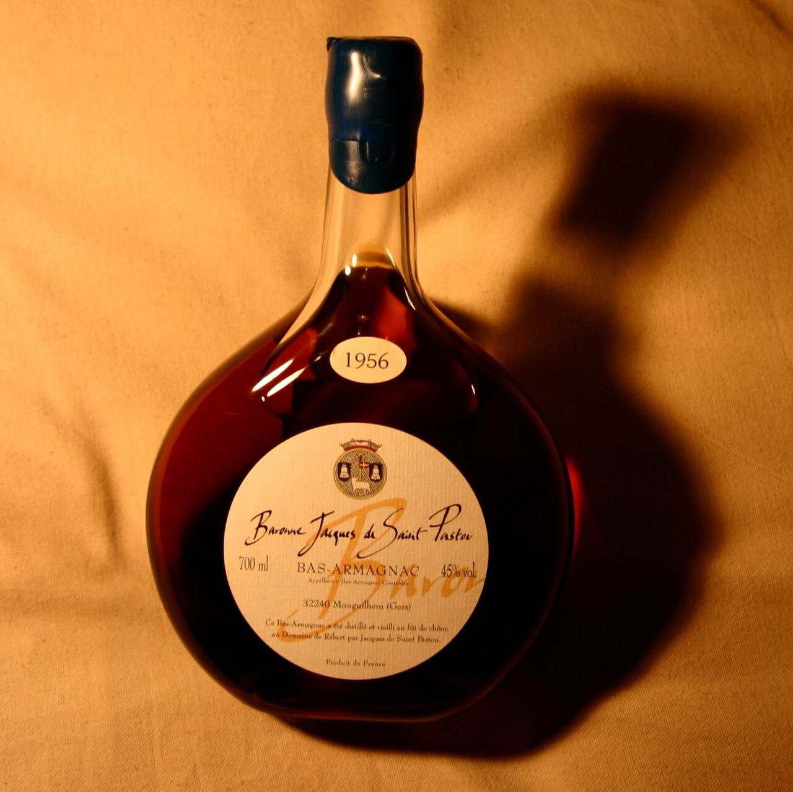

# 雅文邑

雅文邑最容易被记住的一点，是它的蒸馏器：酒液只通过一次，不像干邑那样蒸两遍。这一次通过留下的同系物更多，原酒度数更低，香气更粗、更厚，也更早显露。围绕这套“一次通过”的技术，加斯科涅人还发展出单一年份装瓶的传统，让每一年的气候差异都能被单独保存下来。

图：雅文邑。图片：Rama，CC BY-SA 2.0 fr，via Wikimedia Commons（[原图页面](https://commons.wikimedia.org/wiki/File:Armagnac-img_0465.jpg)）。

## 一份 1310 年的文书

当地常把雅文邑的历史追溯到 14 世纪。1310 年的一份拉丁文医学文献列出“aygue ardente”（生命之水）的四十种用途，被广泛引用为加斯科涅蒸馏传统最早的书面证据。文献的具体语境可以讨论，但它至少说明，这一带在中世纪晚期已经掌握葡萄酒蒸馏。

17 至 18 世纪，荷兰与北欧商人的贸易推动蒸馏规模扩大。19 世纪的根瘤蚜灾害几乎摧毁葡萄园，灾后重植改变了品种结构，也间接造就了雅文邑今天独特的 Baco 22A。1936 年 AOC 建立，产区开始统一品种、蒸馏与年份标注规则。

## 三个分区

雅文邑分为下雅文邑、泰纳雷泽与上雅文邑。下雅文邑以沙质与铁质土壤为主，酒体细腻、果香清晰、陈年潜力长，常被视为核心；泰纳雷泽以黏土石灰岩为主，酒体更厚、香料感更强，常用来做调配骨架；上雅文邑位于石灰岩高原，风格较轻、熟成较快。

这三个名称可以印在酒标上，但它们不是质量等级。“下”指地势较低，不是“低档”；同一分区内，酒庄的蒸馏选择、桶材与酒窖条件仍会拉开明显差距。

## 连续蒸馏器怎么工作

雅文邑的传统器具是 alambic armagnacais，一种连续式蒸馏器。酒液从顶部进入塔板，逐层下降，与上升的蒸气反复接触；酒精与香气物质在塔内完成一次连续的浓缩，酒液只通过一次就得到成品原酒。

原酒酒精度通常在 52% 至 60% vol 之间，明显低于干邑 72.5% vol 的上限。度数低意味着保留更多高沸点物质与油脂，香气更集中、口感更厚，也更“野”。产区同样允许使用夏朗德壶式蒸馏器二次蒸馏，得到更精细的风格；两条路线并存，不是谁替代谁。

蒸馏须在采收后次年 3 月 31 日前完成。关于[蒸馏](ref:distillation)的一般原理，可另见工艺条目。

## Baco 22A 与品种组合

主要品种包括[白玉霓](ref:trebbiano)，当地也称 Saint-Émilion；此外有 Baco 22A、白福儿与鸽笼白。白玉霓提供酸度与骨架，白福儿带来花香，鸽笼白补充柑橘与清爽感。

Baco 22A 是雅文邑最特别的一笔。它由白福儿与 Noah 杂交育成，育成者是 19 世纪末的 François Baco；根瘤蚜灾害后，这种抗病杂交品种帮助产区恢复生产，后来被保留在 AOC 允许名单中。它带来李子、干果与香料气息，也让雅文邑的品种组合比干邑更宽。

## 单一年份：把气候装进瓶子

单一年份雅文邑（millésime）要求全部酒液来自所标年份的葡萄，并在生产者自己的酒窖中陈年，采收与装瓶记录须可追溯。它与 VS、VSOP 等调配等级是两条并行的产品逻辑：前者强调某一年气候与酒庄选择，后者强调风格稳定。

单一年份不是营销噱头。加斯科涅的酒庄常年保有多年的库存，逐年装瓶，让饮用者可以横向比较年份差异。这种做法在干邑并不常见，是雅文邑最鲜明的身份之一。

## 加斯科涅橡木

陈年使用本地橡木，常被称为加斯科涅黑橡木，多来自 Monlezun 一带的森林。桶材的纹理、烘烤程度与使用次数会改变香气：新桶带来香草、焦糖与单宁，旧桶让果香与陈香更突出。

[橡木桶陈年](ref:oak-ageing)在雅文邑里往往比干邑更“慢”。原酒度数低、香气物质多，长时间陈年容易走向干果、烟草、皮革与被称为 rancio 的陈香。仓储的温度与湿度、桶的容量与位置，都会改变这一过程；颜色深浅不能单独作为酒龄证据。

## 等级与标示

等级按瓶中最年轻原酒的陈年时间划分：VS 至少 1 年，VSOP 至少 4 年，XO 至少 6 年，Hors d'âge 至少 10 年。这些数字低于干邑的部分等级，原因之一是雅文邑原酒在年轻时香气就已经比较开放，不必完全依赖长时间陈年来获得结构。

读标时应注意三点：等级只是下限，不是平均年龄；单一年份与调配等级不能混为一谈；产区名称（下雅文邑、泰纳雷泽、上雅文邑）不是质量排序。

## 饮用与配餐

用郁金香形杯，室温纯饮。先闻李子、无花果与花香，再找香草、烟草与皮革；入口注意酒体厚度、酒精整合度与收口，最后看回味。加一滴水可以打开香气，但雅文邑本身度数较低，通常不需要大幅稀释。

它适合作为餐后酒，搭配巧克力、干果、坚果与干酪；在加斯科涅当地，也常与鸭胸、油封鸭等浓郁菜肴搭配。单一年份适合慢饮，VS 或 VSOP 也可以用于调酒。本页关于雅文邑的内容涉及酒精饮料；过量饮酒有害健康，未成年人不应饮酒。

## 常见误解

- 雅文邑是干邑的分支：两者是并列的 AOC，产区、品种与蒸馏传统都不同。
- 雅文邑都用壶式蒸馏：连续式才是当地传统，壶式是允许的另一条路线。
- 年份可以随意标：单一年份受 AOC 约束，必须全部来自所标年份并可追溯。
- XO 是固定年份：XO 是最低陈年门槛。
- 下雅文邑是低档产区：下指地势，不是等级。
- 雅文邑只能纯饮：它也可以加冰、调酒或佐餐。

## 延伸阅读

- [白兰地](ref:brandy)：雅文邑所属的蒸馏酒大类。
- [蒸馏](ref:distillation)：连续式蒸馏器与壶式蒸馏的差异。
- [橡木桶陈年](ref:oak-ageing)：加斯科涅橡木与长期陈年的作用。
- [白玉霓](ref:trebbiano)：雅文邑的主要葡萄品种之一。
- [雅文邑产区](ref:armagnac)：三个分区的土壤与风格。
- [原产地命名](ref:appellation)：理解 AOC 与地理标志制度的入口。

**关键事实。**

| 项目 | 内容 |
| --- | --- |
| 一句话定位 | 法国加斯科涅地区的葡萄白兰地，1936 年获原产地命名控制；以连续式蒸馏为主，原酒约 52% 至 60% vol，香气奔放、酒体厚实，并保留单一年份装瓶传统，产区分为下雅文邑、泰纳雷泽与上雅文邑 |
| 上位风格 | 白兰地 |
| 香气家族 | 果香/花香/橡木 |

**来源与边界。** 本页关于「雅文邑」的关键事实，主要由以下来源交叉核对：BNIA（雅文邑的产区、三个分区、允许品种、蒸馏方式、陈年与年份标示规则）、European Union（葡萄白兰地与地理标志烈酒的定义框架）、Oxford University Press（提供关于雅文邑、连续式蒸馏与加斯科涅橡木的条目）等 4 条来源。价格、批次与状态会变，涉及这些字段时以页面所列来源的最新版本为准。正文为项目自写，来源只作核验，不复制原文。
