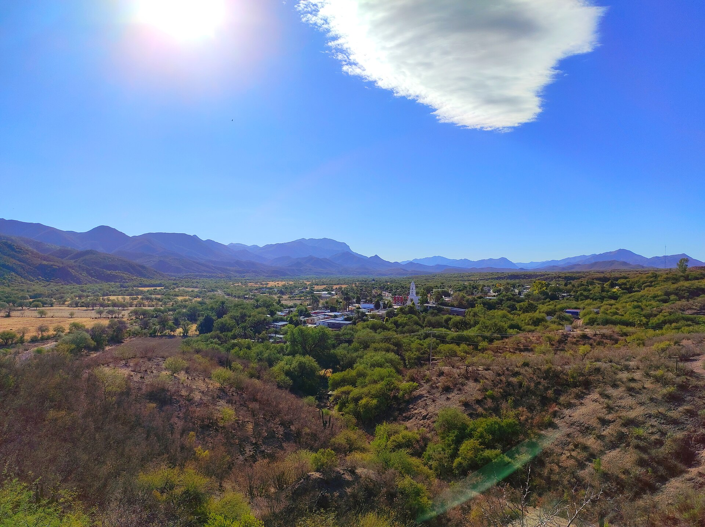

# 巴卡诺拉

巴卡诺拉（Bacanora）是墨西哥西北部索诺拉州的龙舌兰蒸馏酒，原料为 Agave angustifolia Haw.，当地称 pacífica 或 yaquiana；传统做法在地下土窑烘烤龙舌兰心，用石磨碾碎、发酵后壶式二次蒸馏。2000 年它获得墨西哥原产地名称保护，产区覆盖索诺拉山区 35 个市镇，产品列入 1997 年欧盟—墨西哥烈酒相互承认协定附件。

图：巴卡诺拉相关实景照片。图片：KousakaED，CC BY-SA 4.0，via Wikimedia Commons（[原图页面](https://commons.wikimedia.org/wiki/File:BacanoraCerros.jpg)）。

## 定义与边界

巴卡诺拉是受原产地名称（DO）保护的地区烈酒，现行产品标准为 NOM-168-SCFI-2004，由 Consejo Sonorense Regulador del Bacanora 负责认证。法定产区包括索诺拉州中部山脉、里奥索诺拉与南部山区的 35 个市镇，名称来自州府埃莫西约以东 Sierra Centro 的 Bacanora 镇；只有在这些市镇按标准生产、经认证的产品才能使用 Bacanora 名称。

按标准描述，原料是成熟龙舌兰的心（piña），碾碎取汁后经蒸煮完成水解，加糖后的汁液经酒精发酵，再蒸馏与精馏得到烈酒；[龙舌兰](ref:agave)品种限定为索诺拉山区生长的 A. angustifolia Haw.，当地名 pacífica、yaquiana。它与其他龙舌兰烈酒需要分开看：特其拉以蓝色韦伯龙舌兰为主、产区集中在哈利斯科等地；梅斯卡尔是更宽泛的大类；索托尔（sotol）用的是另一种植物，产地也在北部其他州。

在欧盟市场，Bacanora 与 Tequila、Mezcal、Sotol、Charanda 一同列入 1997 年欧墨烈酒协定附件，受相互承认与保护；这一条款早于近年的自贸协定谈判，并不是 2024 年才获得的新保护。

## 历史与命名

索诺拉山区的村镇长期有自酿龙舌兰酒的传统，靠山地剩余的野生龙舌兰维持家庭作坊式生产。20 世纪初的禁酒管制把这种蒸馏列为非法：1915 年到 1992 年间，巴卡诺拉只能由一代代私酿者（vinateros）在山间秘密生产，正规商业渠道买不到。1992 年合法化之后，产区协会推动标准与认证，2000 年墨西哥政府授予原产地名称保护，并通过里斯本体系在国际上注册。

名称取自 Bacanora 镇，传统生产范围却比镇子大得多，覆盖前述 35 个市镇。历史叙事常把某款烈酒的起源归于单一人物或家族，但巴卡诺拉的形成是山地作物、家庭工艺、税收管制与边境消费共同作用的结果；真正延续下来的是山区龙舌兰烘烤蒸馏的味觉传统。

## 原料与工艺

龙舌兰在心叶长成后采收，剥去外围叶片，留下坚实的芯。传统作坊把龙舌兰心放入地下开凿的圆筒形黏土与火山岩石窑，用牧豆木（mesquite）烧火烘烤，窑内焖烤 4–6 天，让淀粉转化、糖分焦香渗入；烤熟的芯再用 tahona 石磨碾碎、分离纤维，汁液进入敞口容器，借天然酵母或接种酵母完成发酵。

发酵后的醪液转入铜制壶式蒸馏器，分两次蒸馏：第一次取粗馏酒，中段酒心转入较小的壶式蒸馏器再次蒸馏，去掉带头味的酒头和带杂醇油的酒尾。部分现代作坊保留土窑与石磨，部分环节改用可控设备；按 NOM 的框架，蒸煮水解、酵母发酵、蒸馏精馏是必不可少的工序环节。

刚馏出的 blanco 颜色最浅、果香与草本感直接；经过木桶或容器静置的版本颜色转深，带出焦糖、香草与干果调。原料成熟度、烘烤时长、发酵温度与蒸馏切割，都会改变烟熏强度和酒体干净度；发酵停滞、杂菌污染或切割不干净，会留下生青味、冲鼻酒精或焦苦烟气。

## 风格与味觉

典型巴卡诺拉带土窑烘烤带来的烟熏感，底色是龙舌兰甜香，辅以草本、柑橘与矿物气息；生产者常把它放在特其拉与梅斯卡尔之间：比特其拉多一层烟熏和山地草本，比粗犷的梅斯卡尔更柔顺易饮。市售商业样本酒精度约 43% ABV，传统小批次产品酒精度可能更高。

缺陷样本容易辨认：生青植物味说明蒸煮不足，刺鼻酒精和蜡质感来自酒头没切净，过重的焦苦烟味来自烘烤过头或发酵异常。年轻 blanco 适合配清淡开胃场景，静置版本的焦糖与干果调更接近餐后慢饮。

不同市镇与作坊的差别主要体现在烟熏轻重、草本柑橘和矿物感上，比较时先固定龙舌兰品种、是否土窑烘烤与陈放状态，再谈产区风格。

## 代表产区与品牌

产区内生产者以小型蒸馏厂和村镇合作社为主，规模普遍不大。面向市场的样本包括阿尔阿莫斯（Álamos）海岸沙漠产区的 Kilinga、Aguamiel、采用 Rio Zanjón 含水层泉水与本地铜壶蒸馏的 Sunora，以及 Puntagave 等；这些品牌分别代表海岸沙漠、山区与传统作坊路线。

价格由投料方式、小批量生产、陈放时间和品牌定位决定：手工小批次定价偏高，工业化生产的入门款更容易出口零售。品牌只是入口，同一类别下原料等级、工艺路线和新鲜度差异不小，读标签参数比记住名字更可靠。

## 怎么喝与配餐

巴卡诺拉通常纯饮，用小杯在室温或微凉状态下慢慢品尝；也可调入以它为基底的 Sonora Mule，配姜汁与柠檬。配餐多选烧烤肉类、咸香坚果和辣味菜肴，烟熏与龙舌兰甜香能接住烤肉的焦香和辣椒的刺激。

纯饮时先闻草本与柑橘，再小口咽下，让烟熏在收口展开；加冰会稀释酒精、放出甜感，冰镇过度则会压住山地草本和矿物味。它不像葡萄酒那样需要长时段醒酒，开瓶后短期喝完即可。

## 选购、储存与误区

读标签先找 DO 标识、市镇、NOM 标准、龙舌兰品种与酒精度：受保护产区的产品须在 35 个市镇内按标准生产。颜色深浅不等于陈酿程度，blanco 的浅色是常态；"手工""传统""小批量"属于营销描述，不是法律术语。

储存避开光照、高温与震动，直立密封；高酒精度成品开瓶后比低度饮料耐放，但草本和烟熏香气会随年月散失，建议开瓶后一年内喝完。常见误区有三个：把巴卡诺拉当成梅斯卡尔的一个品牌，实际上它是独立 DO；把它等同于特其拉，两者原料品种、产区与烘烤方式都不同；另外以讹传讹的"2024 年获欧盟保护"也不准确，其欧盟保护依据是 1997 年协定附件。

相关条目：[梅斯卡尔](ref:mezcal)、[蒸馏](ref:distillation)。

## 延伸阅读与另见

- 相关条目：[mezcal](ref:mezcal)、[agave](ref:agave)、[distillation](ref:distillation)、[peat](ref:smoke)、[liqueur](ref:liqueur)。
- 想建立品类边界，可以先喝一支 blanco 巴卡诺拉和一支静置版本，对比烟熏轻重、草本柑橘与焦糖干果调，再与一支梅斯卡尔横向比较烘烤工艺的差别。
