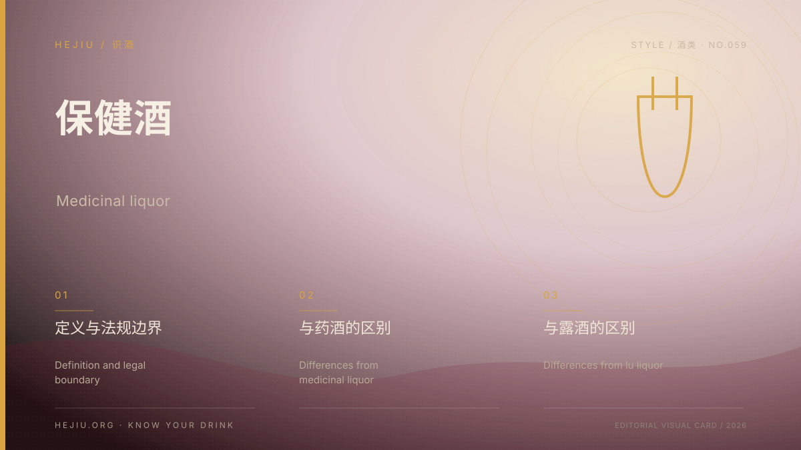

# 保健酒

保健酒通常指以蒸馏酒或[黄酒](ref:yellow-wine)为基酒，加入药食同源原料、可食用中药材或提取物制成的配制酒。它属于食品或保健食品范畴，不是药品。在中国，宣称保健功能需要符合保健食品的注册或备案要求，普通配制酒不得声称疾病治疗作用。

图：保健酒 双语视觉卡（项目自绘 SVG）。不是实拍。

## 定义与法规边界

“保健酒”不是法定酒类分类名称，而是一组以健康诉求为卖点的配制酒俗称。产品可能落在三个不同的监管轨道：普通食品、保健食品、药品。判断轨道的关键不是包装上的宣传语，而是批准文号、备案号与标签上的产品类别。

保健食品需要注册或备案，取得“蓝帽子”标志，并在标签中标明适宜人群、不适宜人群、保健功能与食用量。普通配制酒不能宣称保健功能，更不能宣称治疗疾病。《广告法》对酒类与保健食品广告有额外限制，涉及疾病治疗功能的表述属于明确禁区。

## 与药酒的区别

药酒在传统上指中药材浸入酒中制成的制品。部分药酒按药品管理，有明确的适应症、用法用量与不良反应说明；另一部分则作为普通食品或保健食品流通。药酒与保健酒在民间语境中常被混用，但在监管上必须分开看。

关键区别在证据与责任：药品需要经过审评并承担相应的临床证据要求；保健食品只能宣称批准的保健功能；普通食品不能作功能宣称。消费者看到的“祖传配方”“宫廷秘方”属于营销叙事，不构成监管分类依据。

## 与露酒的区别

露酒是以蒸馏酒、发酵酒或食用酒精为基酒，加入可食用原料调配而成的酒类，范围比保健酒更广。露酒可以是果味、花香、草本或药食同源配方，但并不自动获得保健食品身份。反过来，保健酒也可能采用露酒式的配制工艺。

因此，“露酒”是工艺与品类概念，“保健酒”是监管与宣称概念。购买时应先看产品类别与批准信息，再看配方与酒精度，避免把“加了草本”直接等同于“有保健功能”。

## 原料与配方

常见基酒是[白酒](ref:baijiu)或黄酒，也有以食用酒精为基的产品。配方原料多来自药食同源目录或可食用中药材，如枸杞、山药、桂圆、茯苓、当归等；具体品种与用量因产品而异。部分产品加入糖、蜂蜜或果汁调整口感。

配方并不等于疗效。原料是否属于允许使用的范围、用量是否合规、是否标注过敏原与不适宜人群，都是标签与监管信息要回答的问题。看到“多种名贵药材”这类描述时，应回到配料表与批准信息，而不是凭感觉判断。

## 生产工艺

保健酒的生产通常包括原料处理、浸提或蒸馏、调配、过滤、陈放与灌装。浸提让药材中的可溶性成分进入酒液；蒸馏则把部分挥发性成分带入馏出液。调配阶段调整酒精度、糖度与香气平衡，过滤与陈放让酒体稳定。

工艺差异会影响口感与成分分布，但不改变产品的法律属性。无论工艺多复杂，产品能否宣称保健功能，仍取决于注册或备案，而不是工艺叙事。生产环境的卫生与标签合规，往往比配方故事更能决定产品是否合格。

## 标签与功能声称

合法标签通常包含产品名称、配料表、酒精度、净含量、生产者信息、生产日期、执行标准，以及保健食品标志与批准文号（如适用）。保健食品还应标明保健功能、适宜人群、不适宜人群与食用方法。

需要警惕的表述包括“治疗”“根治”“替代药物”“无副作用”等。这些说法既不符合保健食品的宣称边界，也可能违反广告法规。遇到无法核实的功能宣传，最稳妥的做法是查询监管部门的公开数据库，而不是相信销售话术。

## 饮用与安全

保健酒仍然含酒精，饮用时应按标签建议的食用量，不宜当作日常饮品大量摄入。孕妇、未成年人、肝病患者、服药人群以及需要戒酒的人群不宜饮用；酒精与某些药物的相互作用可能带来风险，服用处方药期间应先咨询医生。

不能把保健酒当作药物替代治疗。出现疾病症状时应就医，而不是依赖酒类产品。若饮用后出现不适，应停止饮用并保留产品与标签信息，必要时向监管部门反映。

## 常见误区

第一，把保健酒当药。它最多是保健食品，不能治疗疾病。
第二，把“药食同源”当成“无风险”。原料安全与用量、酒精与药物相互作用都需要考虑。
第三，只看宣传语不看批准信息。蓝帽子、批准文号与适宜人群才是合规线索。
第四，认为露酒都是保健酒。露酒是更宽的品类概念，不自动具备保健功能。
第五，忽视酒精本身的风险。基酒度数再低，也仍然是含酒精饮料。

## 延伸阅读

- [白酒](ref:baijiu)：保健酒最常见的基酒类别之一。
- [黄酒](ref:yellow-wine)：另一类常见基酒，风味与酒精度不同。

补充阅读：[露酒](ref:c-extra-1)。

相关条目：[露酒](ref:c-extra-1)、[白酒](ref:baijiu)、[黄酒](ref:yellow-wine)。

**来源与边界。** 本页关于「保健酒」的关键事实，主要由以下来源交叉核对：国家市场监督管理总局（保健食品的注册、备案、标签与功能声称要求；未复制法规原文）、全国人民代表大会常务委员会（酒类与保健食品广告的限制，特别是疾病治疗功能声称）、国家市场监督管理总局、国家标准化管理委员会（可在国家标准全文公开系统按标准号检索原文）等 4 条来源。价格、批次与状态会变，涉及这些字段时以页面所列来源的最新版本为准。正文为项目自写，来源只作核验，不复制原文。

**并读。** 把「保健酒」与「白酒」、「黄酒」、「露酒」放在一起读时，先确认它们是同一层级还是上下游关系：先确认定义与工艺，再比较原料、产区与代表品牌。本页负责给出酒类风格的基本坐标，对照条目补上具体案例与差异；读完再回到本页，才能分清哪些差别属于酒类风格本身，哪些只是产地、批次或品牌选择。

**适用边界。** 对「保健酒」而言，法定定义、原料比例与地域风格会随法规和行业分类更新；品牌案例不等于整个风格。

## 相关图像

图：露酒类型示意图。项目自制双语视觉卡，示意性编辑图，不是现场照片。关联图像：保健酒。
