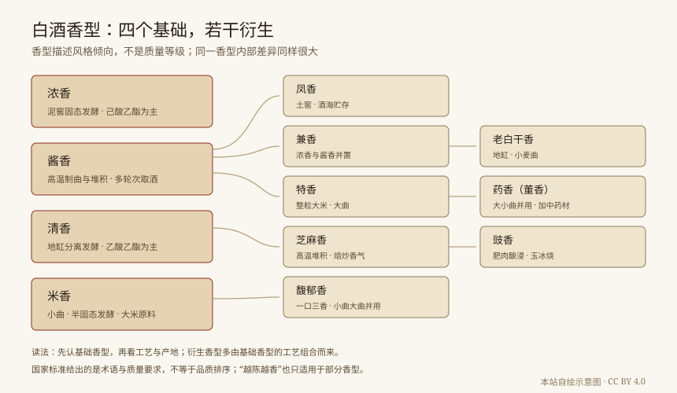

# 白酒

白酒是中国传统蒸馏酒的一类。按 GB/T 15109-2021《白酒工业术语》，它通常以粮谷为主要原料，使用大曲、小曲、麸曲、酒母等作为糖化发酵剂，经蒸煮、糖化、发酵、蒸馏、陈酿和勾调等工序制成。这个定义给出的是工艺与酒种层面的身份，而不是某一瓶酒的质量等级。

图：白酒四个基础香型与主要衍生香型的关系。本站自绘示意图，CC BY 4.0。

## 定义与边界

“白酒”回答的是“这是什么酒种”。具体到货架上一瓶酒，还要继续区分风格、品牌、生产者与产品：同一个品牌可能覆盖多个产品，同一风格也会有许多不同表达。GB/T 17204-2021《饮料酒术语和分类》把白酒放在更大的饮料酒框架中，与发酵酒、配制酒区分开来；GB/T 15109-2021 则进一步规定白酒工业内部的术语。

白酒与烧酒、清酒、威士忌、伏特加同属蒸馏酒或蒸馏酒类饮品，但原料、曲种、发酵方式和风味目标不同。不能因为“都是透明的高度酒”就把它们当成同一种东西。同样，白酒也不等于“某一种香型”；香型只是白酒内部的一种分类方式。

## 原料与曲

白酒的原料以粮谷为主。高粱是最常见的原料之一，小麦、大米、糯米、玉米、大麦、豌豆等也常参与配料或制曲。不同原料带来不同的淀粉结构、蛋白质含量和香气前体，进而影响发酵与蒸馏结果。原料比例不是越复杂越好，关键在于它是否与工艺和目标风格匹配。

曲是白酒酿造的关键。大曲以小麦、大麦、豌豆等为原料，经过制曲、培菌和贮存，富含微生物和酶；小曲通常以米粉或米糠为载体，体积较小、糖化发酵能力集中；麸曲以麸皮为原料，常用于特定工艺路线；酒母则是经过扩培的酵母培养物。曲种决定了糖化与发酵的微生物基础，也影响香气物质的生成。

## 工艺主干

白酒的工艺可以概括为“蒸煮、糖化、发酵、蒸馏、陈酿、勾调”。原料经过蒸煮糊化，淀粉变得可被酶利用；曲或酒母把淀粉转化为可发酵糖，酵母再把糖转化为乙醇和二氧化碳；蒸馏把乙醇与香气物质从发酵醪中分离并浓缩；陈酿让酒体在陶坛、酒海或不锈钢罐中逐渐稳定；勾调则是把不同批次、不同轮次、不同风格的基酒组合起来，达到目标风味和一致性。

按发酵状态，行业常区分固态法、半固态法和液态法。固态法发酵的基质含水率较低，微生物在粮糟中生长，工艺复杂、风味层次丰富；半固态法和液态法的生产效率更高，风味路径不同。不同工艺路线各有产品标准和质量要求，不能简单用“固态一定优于液态”来做绝对判断，但工艺差异确实会影响香气和口感。

## 香型

香型是白酒最常见的分类维度。行业常以浓香、酱香、清香、米香为四大基础香型，此外还有凤香、兼香、馥郁香、芝麻香、特香、老白干香等。香型描述的是香气与工艺的综合特征，不是质量排名，也不能覆盖产地、原料、年份和具体产品。

以[浓香型白酒](ref:strong-aroma)为例，它常与泥窖固态发酵、续糟配料和混蒸混烧等工艺联系在一起；酱香型则常强调高温制曲、多轮次发酵和长期贮存；清香型强调清蒸清烧、地缸发酵和清爽风格。不同香型之间的边界并非绝对，兼香型就是对多种香气特征的组合表达。

## 产区与品牌

白酒产区横跨中国多个省份。四川、贵州、山西、江苏、安徽、山东、陕西、湖南等地都有长期形成的产业带和风格传统。产区叙事常强调气候、水质、微生物环境和工艺传承，但这些因素需要通过具体生产者、原料和工艺来验证，不能只凭产区名称推断品质。

品牌、生产者和产品是三个不同层级。品牌是市场识别，生产者是生产主体，产品是具体酒款。以[茅台酒](ref:moutai)、[汾酒](ref:fenjiu)、[五粮液](ref:wuliangye)为例，它们分别对应不同的产区、香型和产品体系；文章不应把“品牌知名度”直接写成“某款酒的质量结论”。

## 酒精度与标签

白酒的酒精度通常以 % vol 表示，常见产品覆盖从低度到高度的多个区间。酒精度由发酵、蒸馏和勾调共同决定，不是单一原料或年份决定。标签上的酒精度、容量、香型、原料、执行标准号和生产者信息，应该能够互相对照；如果标签只强调“年份”“原浆”等营销词，却缺少可核查信息，就值得谨慎。

“年份”“陈酿”“原浆”等词在不同语境中含义并不统一。行业对年份表达有自律规范，但消费者仍应看具体产品的标签、执行标准和生产者说明，不要把营销词当成法定等级。

## 怎么喝与常见误区

白酒常用小杯慢饮，常温或稍加冰都可以，具体取决于个人偏好和酒体。高度酒不宜大口急饮；配餐时可以选择风味浓郁、油脂适中的菜肴，避免用过度辛辣或过甜的食物掩盖酒体。陈年白酒的风味会变化，但不是所有白酒都“越陈越好”，保存条件、容器和酒体结构都会影响结果。

常见误区包括：把香型当质量排名；把“固态法”当唯一合法工艺；把“高度”当品质；把品牌知名度当具体产品评价；把“年份”当法定等级。更可靠的做法，是回到标准定义、标签信息和可核查的生产者资料。

白酒的香型不是质量等级，也不能替代酒精度与年份；同一香型内部从入门到高端差异很大，选酒要看标签与酒体，而不是只认香型，香型只是分类入口。

## 延伸阅读

- [浓香型白酒](ref:strong-aroma)：从香型进入具体风格。
- [茅台酒](ref:moutai)：酱香型白酒的具体产品实例。
- [汾酒](ref:fenjiu)：清香型白酒的具体产品实例。
- [五粮液](ref:wuliangye)：浓香型多粮酿造的具体产品实例。

**来源与边界。** 本页关于「白酒」的关键事实，主要由以下来源交叉核对：国家市场监督管理总局、国家标准化管理委员会、中国酒业协会（行业术语、香型与产区表达，未复制协会文本）、全国白酒标准化技术委员会（白酒国家标准归口信息，未复制标准正文）。价格、批次与状态会变，涉及这些字段时以页面所列来源的最新版本为准。正文为项目自写，来源只作核验，不复制原文。
