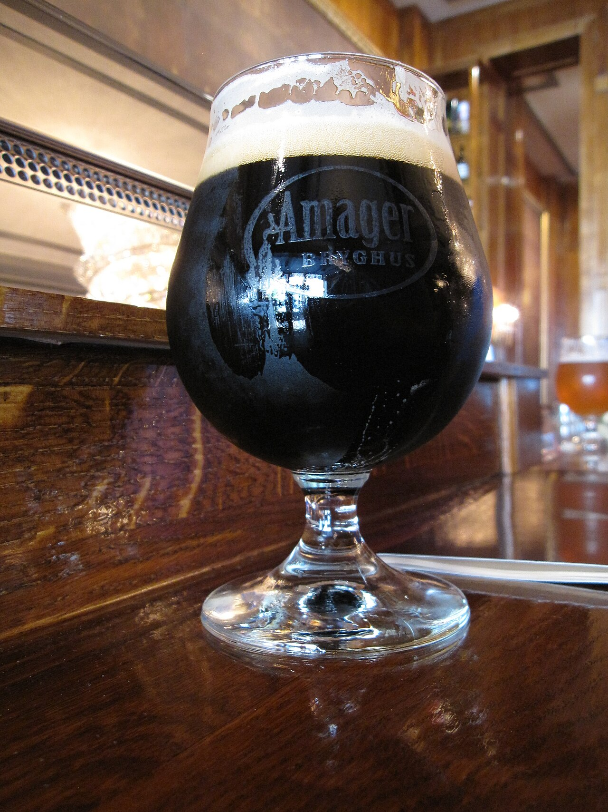

# 波罗的海波特

波罗的海沿岸以拉格酵母酿造的深色高酒精度啤酒，带黑巧克力、焦糖、干果与甘草；与英式波特同源，但工艺更接近帝国世涛。

波罗的海波特的关键不是“深色啤酒”四个字，而是下发酵酵母、较高酒精度与深色麦芽的组合：常见 8–9.5% ABV，酒体厚，带黑巧克力、焦糖、干果与甘草，苦度通常低于帝国世涛。它和英式波特共享历史名称，却在 19 世纪波罗的海贸易与本地酿造传统中被拉格工艺重新塑造，因此不能把两地的酒直接画等号；“波罗的海”也不是法定产区。选酒时先确认酵母类型、麦芽配方与酒精度，再判断它想走甜润还是偏干的路线；波兰 Żywiec、Okocim 与立陶宛 Švyturys 是可对照的基准，小型酒厂的燕麦、黑麦或咖啡版本只能算变体。饮用温度 10–13°C，用郁金香杯或 snifter 小口慢饮；开瓶后冷藏并在两三天内喝完，回温不要超过 14°C。这类酒在波兰与立陶宛常作为冬季款，适合配烟熏猪肉、黑麦面包与硬质奶酪；若标签只写 porter 而未注明下发酵，可能只是英式波特的深色版本。

图：Baltic Porter：Amager Rugporter (4941931513)（Wikimedia Commons）。图片：Bernt Rostad from Oslo, Norway，CC BY 2.0，via Wikimedia Commons（[原图页面](https://commons.wikimedia.org/wiki/File:Amager_Rugporter_(4941931513).jpg)）。

## 定义与边界

波罗的海波特是英式波特在波罗的海地区的本地化版本：使用下发酵（拉格）酵母、较高浓度麦芽汁和较长的低温熟成，酒精度通常 7–9.5% vol，颜色深棕到黑。它与英式波特共享“深色、烘焙麦芽、苦甜平衡”的谱系，却不是同一个法定类别；与帝国世涛相比，苦度通常更低、甜感更突出、气泡更柔。

在酒标与配方里，波罗的海波特常被写作 Baltic Porter、Bałtycki porter 或 Baltijas porteris。它不是受欧盟保护的传统特色保证酒名，也没有统一的跨国法规；各国酒厂以自身产品标准命名，因此同名产品的残糖、酒花与酒精度可以差别很大。

## 历史与命名

18 世纪伦敦的波特啤酒通过波罗的海贸易进入港口城市；19 世纪，波兰、立陶宛、拉脱维亚与俄罗斯的酒厂开始用本地麦芽复制这一风格。当地气候冷、拉格酵母更容易控制发酵，于是波特逐渐从英式桶装艾尔转为下发酵、长熟成的“波罗的海版本”。

苏联时期，立陶宛、拉脱维亚与波兰的国营酒厂继续生产深色高浓度啤酒，形成稳定的出口产品；1990 年代以后，小型酒厂用巧克力麦芽、焦糖麦芽与更长熟成重建这一类别。今天它既是历史风格，也是中东欧酒厂的技术名片。

在德国，波罗的海波特又常被称为 Ostsee-Porter，罗斯托克与吕贝克的酒厂在 19 世纪也有类似产品；名称随港口贸易扩散，不只是波兰一国的传统。

## 原料与工艺

基础配方以淡色麦芽为主，加入慕尼黑麦芽、焦糖麦芽与烘焙麦芽，部分酒厂使用巧克力麦芽或黑麦；酒花用量中等，目标是让麦芽的甜与烘焙苦平衡，而不是突出酒花。水质的碳酸盐硬度影响深色麦芽的酸度，酒厂常做碱化或酸休止调整。

糖化后煮沸 60–90 分钟，冷却到 8–12°C 接种拉格酵母，主发酵 1–2 周，随后在 0–4°C 熟成数周至数月。低温熟成让酵母沉降、气泡细腻，也让烘焙香气与酒体融合；部分产品会再经过橡木桶或添加咖啡、香草，但传统版本不靠添加物。

## 风格与味觉

倒入杯中呈深棕到黑，泡沫细而持久；香气以黑巧克力、焦糖、烤面包、干果与甘草为主，酒花只提供背景。入口甜感明显，随后是烘焙苦与酒精暖意，收口偏干还是偏甜，取决于残糖与熟成时间。

与英式波特比，它更甜、更厚、气泡更细；与帝国世涛比，它的苦度与焦苦通常更低，酒精度也略低。判断一瓶酒是否典型，先看酵母类型、酒精度、苦度与残糖，再看它是否用深色麦芽堆出“焦苦”而不是“巧克力”。

## 代表产区与品牌

波兰的 Żywiec Porter 是最常见的出口基准，Okocim Porter 与 Kormoran 的深色版本也有稳定口碑；立陶宛 Švyturys、拉脱维亚 Tērvete、爱沙尼亚 Saku 与俄罗斯 Baltika 都有各自的下发酵波特。

小型酒厂常用“Baltic Porter”做季节款，加入燕麦、黑麦或咖啡；这些变体可以扩展风格边界，但不能替代对基础款的判断。找代表酒款时，优先选原产地、酒精度 8–9.5%、苦度中等的版本，再与一款英式波特对照。

## 怎么喝与配餐

饮用温度 10–13°C 比冰镇更能释放巧克力与干果香气；杯型选郁金香或 snifter，倒 150–200 mL，让酒液回温。配餐适合烟熏肉、烤猪肘、硬质奶酪、黑巧克力与焦糖甜点；高酒精版本适合小口慢饮，不适合配清淡海鲜。

开瓶后若一次喝不完，塞紧瓶塞冷藏，2–3 天内喝完；碳酸与香气会逐渐损失，重新回温不要超过 14°C。

## 选购、储存与误区

先看背标的酒精度、原料与保质期，再看是否为下发酵酵母；深色玻璃瓶、避光与 10–15°C 存放能延缓氧化。价格高不等于更典型，可能只是陈年或包装；波罗的海波特没有统一分级，酒厂风格差异比“等级”更重要。

常见误读有三：把深色等同于苦；把“波罗的海”当成法定产区；把高酒精度当成帝国世涛。它可以是甜润的、也可以是偏干的，关键在配方与熟成。

## 延伸阅读与另见

- [波特啤酒](ref:porter)：英式波特的谱系与历史。
- [啤酒](ref:beer)：发酵饮料的分类与工艺。
- [拉格啤酒](ref:lager)：下发酵酵母与低温熟成。
- [大麦](ref:barley)：麦芽与谷物原料。
- [橡木桶陈酿](ref:oak)：桶陈对风味的影响。

对照阅读：[波特啤酒](ref:porter)、[拉格啤酒](ref:lager)、[啤酒](ref:beer)。

**关键事实。**

| 项目 | 内容 |
| --- | --- |
| 一句话定位 | 波罗的海沿岸以拉格酵母酿造的深色高酒精度啤酒，带黑巧克力、焦糖、干果与甘草；与英式波特同源，但工艺更接近帝国世涛 |
| 上位风格 | 波特啤酒 |

**来源与边界。** 本页关于「波罗的海波特」的关键事实，主要由以下来源交叉核对：Beer Judge Certification Program（啤酒风格的定义、参数与典型特征）、Brewers Association（美国啤酒风格、原料与行业分类）、CAMRA（英国传统啤酒与艾尔风格）等 4 条来源。价格、批次与状态会变，涉及这些字段时以页面所列来源的最新版本为准。正文为项目自写，来源只作核验，不复制原文。
