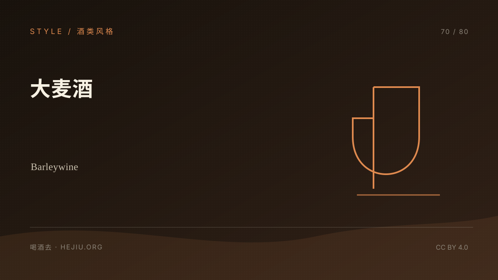
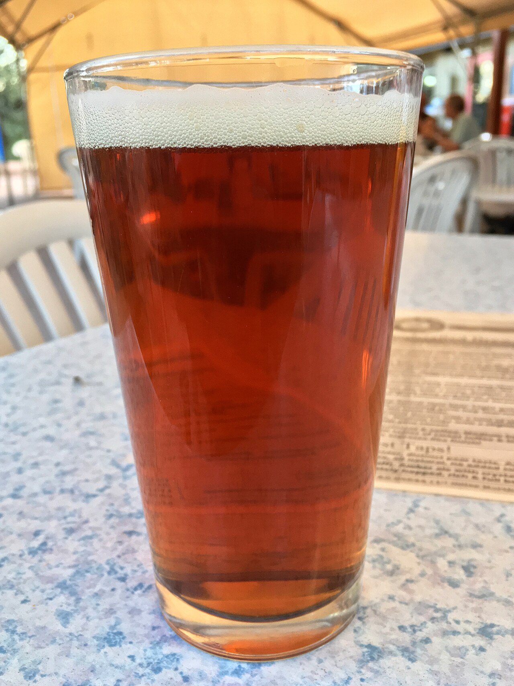

# 大麦酒

大麦酒（Barleywine）是英国传统中的超浓艾尔，以极高的麦芽浓度、较高的酒精度、饱满酒体与明显的陈年潜力为特征。它叫 wine 只是形容强度与饮用方式，原料仍是[大麦](ref:barley)，不是葡萄。英式大麦酒与美式大麦酒共享这个名称，却在酒花、色泽与平衡上分歧明显。

图：大麦酒 类型示意图。图片：Doubao Seedream 5.0 AI 辅助绘制（项目自有），不是大麦酒的实拍。

## 一款被叫作“酒”的啤酒

Barley wine 这个词在 19 世纪的英国出现，用来描述强度接近葡萄酒的艾尔。1854 年，伯顿（Burton upon Trent）的 Bass 酒厂开始生产 No. 1，这款单一麦芽汁浓度的烈性艾尔后来被当作大麦酒的早期样本。18 世纪的“十月啤酒”与“三月啤酒”是它的前身：长时间煮沸、高浓度、耐存放。

名称的模糊性带来误解。大麦酒不是加了大麦的葡萄酒，也不是烈酒；它的酒精完全来自谷物糖化的发酵。把它当成啤酒中的波特酒更贴切：高酒精度、低碳酸化、适合小杯慢饮，并能在瓶中继续演化。19 世纪没有统一的酒精度标注，消费者靠价格、瓶型与酒厂声誉判断强度，这也是后来许多大麦酒喜欢用编号、年份或纪念版命名的原因。

## 英式与美国式的分岔

英式大麦酒以麦芽为绝对核心。使用 Maris Otter 等英式淡色麦芽，长时间煮沸浓缩，得到面包、太妃糖、坚果与深色果干的风味；酒花只负责平衡，苦味中等，收口偏甜，酯香来自[发酵](ref:fermentation)。颜色从琥珀到深棕，酒体厚，碳酸化低，常在 12–15°C 以郁金香杯或小杯饮用。

美式大麦酒在 20 世纪后期被精酿运动重新定义。酒厂使用高α酸[酒花](ref:hops)，提高苦味与香气，颜色更浅，发酵更干，酒花气息从柑橘到松脂不等。它仍然属于浓烈麦芽酒，但平衡点从麦芽甜移向酒花苦。两类都好喝，问题是不能用同一套标准评判。市场上有些产品把“大麦酒”印在酒标上，实际更接近烈性艾尔或双料 IPA，读配方与酒精度比读名称可靠。

## 麦芽浓度、酒精度与陈年

参数只能给范围。英式大麦酒的[原麦汁浓度](ref:original-gravity)常在 19–25 °P，酒精度约 8%–12%，[苦度](ref:ibu)约 35–70 IBU；美式版本酒精度相近或更高，苦度可达 50–100 IBU。颜色、甜度与酒花强度随酒厂与年份变化，不应把某一款酒的数值当成风格定义。

高酒精度与高残糖让它具备陈年能力。瓶内残余酵母与氧气缓慢作用，果干、蜂蜜、雪莉与皮革的气息逐渐出现，尖锐的酒花与酒精感变得圆润。并非所有大麦酒都适合久放：酒花型美式版本通常建议新鲜饮用，麦芽型英式版本更适合数年瓶陈；若使用[橡木桶](ref:oak-ageing)，香草与香料气息会进一步叠加。储存应避光、恒温、直立，并留意瓶盖的密封状态。瓶内二次发酵的版本还要看酵母活性与残糖，开瓶时可能有明显气泡，侍酒前应静置，避免把沉淀搅起。

## 伯顿与伦敦的酒厂传统

伯顿的硬水富含硫酸盐，能放大酒花苦味，这让当地烈性艾尔在 19 世纪获得声誉；Bass No. 1 就是这条传统的代表。伦敦的酒厂则发展出更偏麦芽甜、适合瓶陈的版本，Fuller's 的 Vintage Ale 与 Golden Pride 是常见参照。美国西海岸在 20 世纪后期贡献了酒花导向的版本，Anchor 与 Sierra Nevada 的早期产品影响深远。这些酒多以玻璃瓶出售，瓶陈表现取决于封口、残糖与储存温度，酒标上的年份因此比宣传语更有参考价值。

[英式艾尔](ref:english-ale)的谱系里，大麦酒位于强度顶端，与老艾尔、苏格兰烈性艾尔相邻。它的产量通常不大，价格偏高，适合作为季节性或纪念性产品。购买时留意年份与批次，不同年份的同一款酒可能有明显差异。

## 与帝国世涛、老艾尔、双料 IPA 的区别

[帝国世涛](ref:imperial-stout)使用烘焙大麦，带咖啡、巧克力与焦苦，颜色近黑；大麦酒以烘烤麦芽的甜香为主，苦味来自酒花而非焦苦。老艾尔的酒精度通常更低，常有混合陈酒与氧化风味；大麦酒更强调单一批次的浓度与陈年潜力。双料 IPA 颜色浅、酒花极强、残糖低，大麦酒则保留更厚的麦芽骨架。

与[淡色艾尔](ref:pale-ale)相比，大麦酒不是加强版淡色艾尔，而是另一套配方逻辑：更长煮沸、更高浓度、更低碳酸化。把它当成烈性啤酒的统称也会失真，因为烈性拉格、烈性艾尔与桶陈啤酒的工艺目标各不相同。

## 小杯慢饮

大麦酒适合 12–15°C，用郁金香杯或小号白兰地杯，倒 60–90 毫升即可。温度过低会封闭香气，过高则酒精刺鼻。开瓶后让它静置几分钟，香气会更完整；高年份酒可能有沉淀，倒酒时留底。一瓶通常够两三人分饮，开瓶后若喝不完，塞紧冷藏并在数日内喝完，久放会让香气散失。

配餐上，英式大麦酒适合硬质奶酪、烤牛肉、野味、黑巧克力与干果蛋糕；美式酒花型版本可以配蓝纹奶酪、烤肉与香料重的菜肴。蓝纹奶酪的咸味会放大酒体，也让麦芽甜更清晰。它不适合大口解渴，也不适合与清淡海鲜同席。最后是分量：8%–12% 的酒精度意味着一杯就接近一顿饭的酒精预算，慢饮比多杯更合适。

**关键事实。**

| 项目 | 内容 |
| --- | --- |
| 一句话定位 | 英国传统中的超浓艾尔，以高麦芽浓度、8%–12% 的酒精度、饱满酒体与瓶陈潜力为特征，分为英式与美式两条路线 |
| 上位风格 | 英式艾尔 |
| 香气家族 | 麦芽与酒花 |

**来源与边界。** 本页关于「大麦酒」的关键事实，主要由以下来源交叉核对：Beer Judge Certification Program（英式与美式大麦酒的强度、苦度、色度与陈年描述）、Fuller, Smith & Turner（伦敦酒厂历史与烈性艾尔产品线的公开信息）、Oxford University Press（提供关于大麦酒起源、Bass No. 1 与英式烈性艾尔的条目）等 4 条来源。价格、批次与状态会变，涉及这些字段时以页面所列来源的最新版本为准。正文为项目自写，来源只作核验，不复制原文。

**并读。** 把「大麦酒」与「英式艾尔」、「帝国世涛」、「淡色艾尔」放在一起读时，先确认它们是同一层级还是上下游关系：先确认定义与工艺，再比较原料、产区与代表品牌。本页负责给出酒类风格的基本坐标，对照条目补上具体案例与差异；读完再回到本页，才能分清哪些差别属于酒类风格本身，哪些只是产地、批次或品牌选择。

## 相关图像

图：淡色艾尔。图片：https://www.flickr.com/photos/cogdog/，CC BY 2.0，via Wikimedia Commons（[原图页面](https://commons.wikimedia.org/wiki/File:THAT_Brewery_Bearfoot_Pale_Ale.jpg)）。关联图像：大麦酒。
