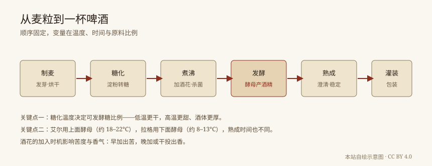

# 啤酒

啤酒是以谷物（通常为大麦麦芽，也可使用小麦、玉米、大米等）经糖化、煮沸、发酵酿成的饮品。大多数现代啤酒在煮沸阶段加入啤酒花，以获得苦味、香气和防腐性。它[酒精度](ref:abv)通常不高，却是风格差异极大的一个大家族。

图：从麦粒到一杯啤酒的六个基本阶段。本站自绘示意图，CC BY 4.0。

## 先划清「啤酒」的边界
啤酒的基本结构是“谷物糖化—煮沸—发酵”。在饮料酒分类中，它属于发酵酒，与蒸馏酒不同。含酒精的谷物饮料并非都叫啤酒：以谷物发酵后蒸馏得到的是威士忌一类；以果汁发酵的是果酒；以蜂蜜与水发酵、酒精度较低的可能是蜂蜜酒。

“啤酒”在各国法规中的定义细节不同，但共同点通常包括谷物原料、发酵工艺与啤酒花的使用。无醇或低醇啤酒是近年增长的品类，其工艺可以包括脱醇或限制发酵，具体酒精度应以标签为准，不能因为叫“啤酒”就默认含酒精。

## 原料

水、麦芽、啤酒花和酵母是基本原料。麦芽提供可发酵糖与风味底子，特种麦芽通过烘烤程度带来饼干、焦糖、咖啡或巧克力气息。啤酒花提供苦味与香气，不同品种的柑橘、松针、花香与辛香差异明显。酵母决定发酵副产物，是艾尔与拉格风格差异的核心。

辅料包括小麦、燕麦、玉米、大米与糖。小麦带来柔和口感与轻微浑浊，燕麦增加顺滑感，玉米与大米让酒体更轻、更干净。所谓“纯酿法”只描述特定的法律传统，不等于所有好啤酒都必须只用四种原料；现代啤酒允许的原料范围要宽得多。

## 发酵方式与风格家族

最实用的粗分是**艾尔（ale）**与**拉格（lager）**。艾尔使用酿酒酵母在较温暖温度下发酵，常带有酯香与更丰富的香气；拉格使用低温发酵的酵母，风格通常更干净、收口更利落。拉格在低温下长时间熟成，这一过程称为拉格化。

风格家族还包括小麦啤酒、世涛、波特、酸啤、IPA、比利时风格与混合发酵啤酒等。BJCP 风格指南把这些家族进一步细分为具体风格，并给出参数范围。风格标签是描述工具，不是质量等级：一款酒是否“好”，取决于它是否在自己的目标风格内做到平衡与完成度。

## 生产工艺

流程通常包括：制麦、粉碎、糖化、过滤、煮沸、加酒花、冷却、接种酵母、主发酵、后发酵或拉格化、过滤或离心、灌装。糖化温度决定可发酵糖比例与酒体；煮沸时间影响酒花苦味物质的异构化与蛋白质凝聚；发酵温度影响酯香与高级醇生成。

干投酒花是在发酵后期或后发酵阶段加入酒花，主要提取香气而非苦味。桶陈啤酒使用木桶进行微生物与氧化作用，带来香草、酸度或复杂陈味，这与[橡木桶陈酿](ref:oak-ageing)的一般原理相通，但啤酒的桶陈通常时间更短、风险更高。灌装时的氧含量控制直接决定货架期风味。

## 「啤酒」的闻与喝
品鉴从外观开始：泡沫的持久度、酒体的清澈或浑浊、颜色的深浅都提供信息，但不能代替香气判断。闻香时先找麦芽基调，再找酒花与发酵香气：拉格多为谷物与草本，艾尔常有水果酯香，IPA 偏向柑橘、热带水果与树脂，世涛偏向咖啡与巧克力。

入口后判断苦味的质量而不只是强度：好的苦味应该干净、有支撑，并与麦芽甜味形成平衡。酒体、碳酸化与收口同样重要。温度会显著改变感受：过冷会压住香气，过热会让酒精感突出。对比品鉴时，先确定风格目标，再判断完成度。

## 「啤酒」的饮用与搭配
拉格、小麦啤酒和多数淡色艾尔适合充分冰镇后饮用；世涛、大麦酒和桶陈啤酒温度可以稍高，香气更完整。杯型会影响泡沫与香气聚集，但不必把酒具规则神秘化。倒酒时保留泡沫层，有助于香气释放并减缓二氧化碳逸出。

佐餐时，清爽拉格适合油炸与辛辣食物，小麦啤酒适合沙拉与轻食，IPA 的苦味能切开油脂，世涛适合烤肉与甜点。搭配的原则是强度匹配：酒比菜更重，菜会被压住；酒比菜更轻，酒会显得单薄。

## 包装与保存

啤酒怕光、怕热、怕氧。透明与绿色玻璃瓶对光敏感，棕色瓶与金属罐的防护更好。保存应避光、阴凉，未杀菌的精酿产品通常需要冷藏。开瓶后应尽快喝完，因为二氧化碳逸出与氧化会迅速改变风味。

“越新鲜越好”适用于多数强调酒花香气的风格，但并非所有啤酒都如此：桶陈、酸啤与高酒精度啤酒可以在适宜条件下陈放。购买时看生产日期与储存条件，比看包装设计更能判断实际状态。

## 「啤酒」容易被读错的地方
第一，认为颜色越深酒越烈。颜色来自烘烤麦芽，与酒精度没有必然关系。
第二，认为拉格就是“工业水啤”。拉格是发酵方式，其中既有清淡商业拉格，也有工艺精细的手工拉格。
第三，认为 IPA 越苦越好。苦味需要平衡与支撑，单纯高苦度不等于高质量。
第四，把“纯酿法”当成唯一标准。它是特定法律传统，不覆盖所有优秀啤酒。
第五，忽视杯具与温度。同一款酒在不同温度与杯型下的表现差异明显。

对照阅读：[橡木桶陈酿](ref:oak-ageing)、[GB/T 17204-2021《饮料酒术语和分类》](ref:gbt-17204)。

相关条目：[酒精度（ABV）](ref:abv)。

**来源与边界。** 本页关于「啤酒」的关键事实，主要由以下来源交叉核对：Beer Judge Certification Program（啤酒风格分类、发酵方式与代表性风格的描述边界）、Brewers Association（美国精酿啤酒的行业定义与风格讨论；未复制其文案）、国家市场监督管理总局、国家标准化管理委员会（啤酒在饮料酒分类中的位置与相关术语）等 4 条来源。价格、批次与状态会变，涉及这些字段时以页面所列来源的最新版本为准。正文为项目自写，来源只作核验，不复制原文。

## 进阶判断

图：浑浊酵母小麦啤与清澈小麦啤，同一风格家族里的两种处理。图片：Ich，Public domain，via Wikimedia Commons（[原图页面](https://commons.wikimedia.org/wiki/File:Hefeweizen_and_kristallweizen.jpg)）。

| 风格家族 | 发酵 | 饮用温度 | 购买线索 |
| --- | --- | --- | --- |
| 拉格 | 下发酵 | 4–8°C | 生产日期、清爽度 |
| 小麦啤 | 上发酵 | 6–10°C | 酵母香气、浑浊度 |
| IPA | 上发酵 | 8–12°C | 酒花品种、苦度 |
| 世涛 / 波特 | 上发酵 | 10–13°C | 烘烤麦芽、酒体 |

**啤酒浑浊是不是坏了？** 不一定。小麦啤、未过滤拉格与酒花干投都可能带浑浊；判断标准是生产日期、储存温度与是否有明显酸败味。

**IPA 越苦越好吗？** 不是。苦度只是酒花投放与异构化的结果，香气、苦味质量与收口同样重要。高苦度也可能掩盖麦芽与发酵缺陷。

**啤酒杯重要吗？** 重要，但没有那么玄。收口杯聚香，直口杯方便畅饮；关键是干净、无油渍、容量合适。先选对温度，再谈杯型。

延伸阅读：[饮料酒分类](ref:gbt-17204)、[酒精度](ref:abv)。

## 参考资料
- [橡木桶陈酿](ref:oak-ageing)：理解桶陈啤酒风味变化的工艺背景。
- [酒精度](ref:abv)：比较不同啤酒强度时的基础指标。
- [饮料酒术语和分类](ref:gbt-17204)：啤酒在分类体系中的位置。
