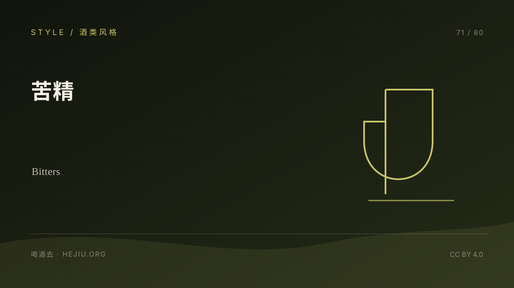
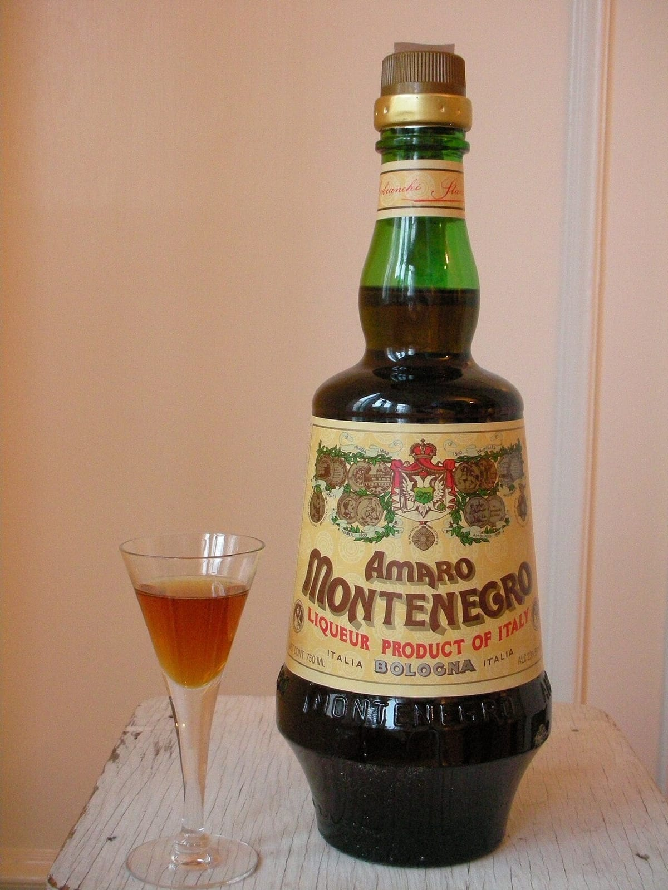

# 苦精

苦精（bitters）是一种高浓度、以苦味植物为核心的酒精调味液。它通常不直接大口饮用，而是按滴、按 dash 或按几毫升加入鸡尾酒，像厨师用盐和胡椒一样调整整杯酒的香气、苦味和长度。它的酒精度通常不低，风味却极其浓缩；理解苦精，关键不是“苦不苦”，而是“它在整杯酒里做什么”。

图：苦精 类型示意图。图片：Doubao Seedream 5.0 AI 辅助绘制（项目自有），不是苦精的实拍。

## 一瓶浓缩的苦味

苦精的基液可以是酒精、水或酒精水溶液，植物材料包括龙胆根、金鸡纳、苦木、橙皮、肉桂、丁香、豆蔻、茴香和多种树皮。生产商通过浸提、蒸馏或两者结合，把香气和苦味提取出来，再过滤、调配、静置。成品通常清澈、颜色从淡黄到深棕不等，酒精度常在 35% 至 45% vol。

它和阿玛罗的最大区别是浓度与使用方式。阿玛罗是加糖的利口酒，可以纯饮；苦精是浓缩调味液，一次只用几滴。苦精的糖分通常很低，甚至没有，因此苦味和香气更直接、更锋利。它也不是“苦味的酒”，而是一种“苦味的香料”。

## 从药酒到调酒台

19 世纪的药房是苦精的摇篮。药剂师用草药浸泡酒精，制作助消化、退热或提神的药酒；Angostura 的故事始于 1824 年，最初是委内瑞拉医生 Johann Siegert 为士兵调配的健胃酊剂，后来在特立尼达发展成全球品牌。官方资料还提到，第一份使用 Angostura 的鸡尾酒配方出现在 1831 年。

美国新奥尔良的 Peychaud's 苦精同样来自药房传统，19 世纪 30 年代由 Antoine Peychaud 调配，后来成为 Sazerac 鸡尾酒的核心。禁酒令时期，苦精因为被归类为调味品而得以继续销售，许多经典配方因此保留了苦精的位置。20 世纪的鸡尾酒复兴让苦精从“药”变成“调酒材料”，也让橙味苦精、芳香苦精和热带苦精重新流行。

## 浸提、蒸馏与配方

苦精的工艺没有统一模板。冷浸提取香气和苦味，时间从几天到几周；热浸效率更高，但可能损失细腻香气；蒸馏可以得到更干净的香气，却会留下部分苦味。许多配方会把浸提液和蒸馏液混合，以兼顾香气与苦味。

配方是生产者的核心资产。Angostura 的配方至今保密，官方只说它自 1824 年以来基本未变；Peychaud's 以茴香、樱桃和苦味草本为特色；橙味苦精则以橙皮、肉桂和丁香为主。不同品牌的同一“类型”可以差得很远，调酒时不能只看名字，还要试味道。

苦精的类型也不只芳香苦精。橙味苦精以橙皮为主，适合金酒和黑麦；芹菜苦精带咸鲜和草本，常用于 Bloody Mary；巧克力或 Mole 苦精带可可、辣椒和香料，适合深色烈酒；热带苦精则强调柑橘、花香和香料。类型不同，用量和搭配也不同。

## 用量：几滴就够

苦精的用量通常以 dash 计，一 dash 大约几滴，具体取决于瓶口和倒法。它不需要像糖浆那样按盎司计量，因为香气浓度太高；加太多会让整杯酒变苦、变涩，甚至盖过基酒。经典配方里的“2 dashes”不是精确科学，而是历史习惯，现代调酒师会根据品牌和瓶口调整。

使用时可先少加，再逐步增加。苦精在搅拌或摇匀后会继续释放香气，所以试味时不要一次加到极限。温度也会影响表现：低温让苦味和香气收敛，室温则更开放；同一杯酒在冰融前后，苦精的存在感会变化。

苦精也会随时间变化。开瓶后香气会慢慢氧化，柑橘类苦精尤其容易失去亮度；深色、香料型苦精更耐放。保存时应避光、密封、阴凉，不必冷藏，但也不要放在炉灶旁。如果一瓶苦精开了几年，使用前先闻一下，确认没有明显的纸板味或醋味。一瓶苦精可以用很久，但风味会随着时间衰退，这也是它和普通烈酒不同的地方，因此不要囤太多，开瓶后尽量在一年内用完。

## 经典配方里的角色

在[古典鸡尾酒](ref:old-fashioned)里，苦精把威士忌的甜感和橡木味串起来，提供香料、柑橘和苦味；在[曼哈顿](ref:manhattan)里，它平衡味美思的甜味，让收口更干净；在[内格罗尼](ref:negroni)里，苦精不是必需，但少量加入可以增强草本和苦味层次。Sazerac 则几乎以苦精为标志，Peychaud's 的茴香与樱桃气息直接定义了这杯酒。

苦精也可以用于高球、酸酒和甜点。它和[味美思](ref:vermouth)的区别在于浓度：味美思是葡萄酒基的加香酒，可以大口喝；苦精是浓缩调味液，只能少量使用。它和[阿玛罗](ref:amaro)的区别在于糖与体积：阿玛罗是利口酒，苦精是香料。

## 与阿玛罗、利口酒的区别

阿玛罗是意大利草本[利口酒](ref:liqueur)，有糖、有体积、可以纯饮；苦精是浓缩苦味液，糖少、用量小、通常不纯饮。两者都使用草药和根茎，但目标不同：阿玛罗追求苦甜平衡和饮用体验，苦精追求香气强度和调味效率。

利口酒的范围更广，包括水果、奶油、咖啡和草本类型；苦精只是其中一个功能性的分支。把苦精当成“很苦的利口酒”会误导使用：它不应该被倒满一杯，也不应该用甜度来衡量。它是鸡尾酒的调味品，少量、精准、讲究搭配，才是它的正确位置。

对照阅读：[利口酒](ref:liqueur)、[味美思](ref:vermouth)。

**关键事实。**

| 项目 | 内容 |
| --- | --- |
| 一句话定位 | 以草药、根茎、树皮和柑橘浸提或蒸馏得到的高浓度苦味调味液，通常酒精度 35% 至 45% vol，按滴或几毫升使用；它既是 19 世纪药酒的遗产，也是古典鸡尾酒、曼哈顿和内格罗尼中不可替代的“盐和胡椒” |
| 上位风格 | 利口酒 |
| 香气家族 | 苦味/草本/香料 |

**来源与边界。** 本页关于「苦精」的关键事实，主要由以下来源交叉核对：Angostura（1824 年配方起源、特立尼达生产与 1831 年鸡尾酒配方记载）、Sazerac Company（新奥尔良苦精与 19 世纪调酒传统）、European Union（苦味烈酒类别与最低酒精度 15% vol 的法定门槛）等 4 条来源。价格、批次与状态会变，涉及这些字段时以页面所列来源的最新版本为准。正文为项目自写，来源只作核验，不复制原文。

**并读。** 把「苦精」与「利口酒」、「阿玛罗」、「味美思」放在一起读时，先确认它们是同一层级还是上下游关系：先确认定义与工艺，再比较原料、产区与代表品牌。本页负责给出酒类风格的基本坐标，对照条目补上具体案例与差异；读完再回到本页，才能分清哪些差别属于酒类风格本身，哪些只是产地、批次或品牌选择。

## 相关图像

图：一瓶 Amaro Montenegro 与一杯琥珀色阿玛罗，瓶身标签标着 Amaro Montenegro 与 Product of Italy。。图片：Shabbychef，CC BY-SA 4.0，via Wikimedia Commons（[原图页面](https://commons.wikimedia.org/wiki/File:Amaro_Montenegro.jpg)）。关联图像：苦精。
