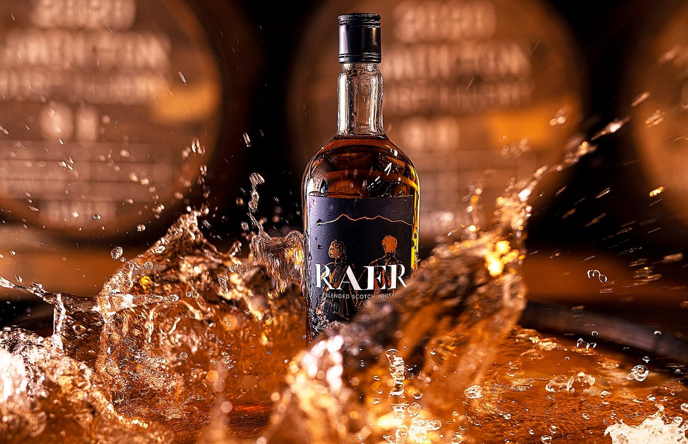
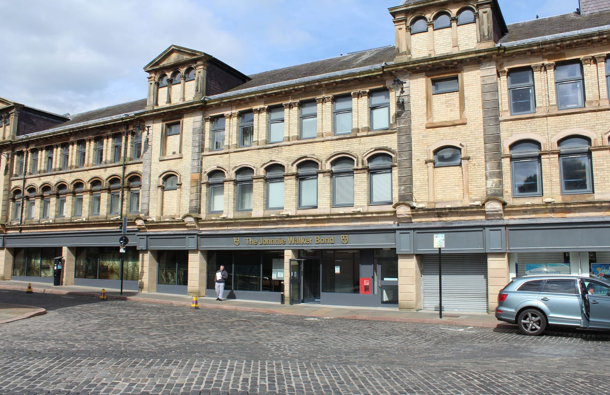

# 调和苏格兰威士忌

调和苏格兰威士忌（Blended Scotch Whisky）是[苏格兰威士忌](ref:scotch)中产量最大的一类：把一家或多家酒厂的单一麦芽原酒，与一家或多家酒厂的单一谷物原酒混合，得到风味稳定、适合大规模装瓶的产品。它不是一个含糊的市场词，而是《2009 年苏格兰威士忌条例》写明的法定类别；同样带“blended”字样的调和麦芽与调和谷物，则是另外两个类别。

图：调和苏格兰威士忌相关实景照片。图片：WhiskyLass，CC BY-SA 4.0，via Wikimedia Commons（[原图页面](https://commons.wikimedia.org/wiki/File:RAER_Original_Blended_Scotch_Whisky.jpg)）。

## 三个 blended，三套配方

[条例](ref:swr)把混合类拆成三种。调和麦芽（Blended Malt Scotch Whisky）是两家以上酒厂的单一麦芽原酒之间的混合，不加入谷物原酒。调和谷物（Blended Grain Scotch Whisky）是两家以上酒厂的单一谷物原酒之间的混合。调和苏格兰（Blended Scotch Whisky）才是麦芽与谷物的混合，比例不限。

这三个名称不能互换。把调和麦芽叫作“blended scotch”，在法规上不准确；把调和苏格兰写成“纯麦调和”，更是把两类原料混为一谈。此前流行的“vatted malt”说法，也已被现行法规的 blended malt 取代。

## 谷物威士忌：另一条蒸馏路线

调和苏格兰的另一半是单一谷物威士忌。它同样来自一家蒸馏厂，但原料可以用小麦、玉米或未发芽大麦，通常以连续式柱式蒸馏器生产。与壶式[蒸馏](ref:distillation)相比，柱式蒸馏效率更高、出酒酒精度更高、风味更中性，适合做骨架而不是主角。

谷物原酒并非“没有味道的酒精”。它的甜感、香草与谷物香气，决定了调和酒的下盘是否扎实。部分酒厂也用壶式蒸馏器做谷物威士忌，或把柱式与壶式原酒混合，因此“谷物等于中性”只是大致印象，不能当作定义。无论哪种路线，所有原酒仍须满足苏格兰威士忌的通用条件：蒸馏酒精度低于 94.8% vol，橡木桶陈年至少三年，装瓶不低于 40% vol。

## 调和师到底在调什么

[调和](ref:blending)不是把酒倒在一起。调和师先建立风味档案，再从不同酒厂、不同年份、不同桶型中挑选样品，反复配比，目标是在每一批之间复现同一个“酒厂风格”。一家大型调和品牌可能同时管理数十种麦芽与谷物原酒，每种承担不同角色：有的提供花香，有的提供油脂，有的提供烟熏，有的只负责把口感连起来。

[调和](ref:blend)因此是一门关于比例与补偿的手艺。某一批麦芽偏干，就用更圆润的谷物原酒补；某一年雪莉桶不足，就用其他桶型重建干果与香料的方向。配方通常不公开，也不要求公开；法规约束的是类别与标签，不是配方。

## 一致性为什么是核心

单一麦芽卖的是酒厂个性，调和苏格兰卖的是可预期的稳定。消费者在东京、伦敦与圣保罗买到同一品牌的同一款酒，理应得到几乎相同的香气与口感。这种一致性依赖三件事：庞大的原酒库存、严格的样品库，以及有权否决不合格批次的调和师。

[尊尼获加](ref:johnnie-walker)是这种逻辑的典型：品牌以固定风格跨市场销售，产品线从入门款延伸到高价系列，差异来自原酒年龄、麦芽比例与稀有桶型，而不是简单地“加料”。一致性不等于平庸；在巨大产量下维持风格，本身就是技术难度。

## 与单一麦芽的市场分工

单一麦芽强调“一家酒厂是什么样”，调和苏格兰强调“一个品牌是什么样”。前者适合探索风格差异，后者适合日常饮用、调酒与宴席。两者共用同一批原酒：一家酒厂的麦芽可能大部分进入调和体系，只有少部分以单一麦芽装瓶。没有调和需求，许多酒厂的产能无法消化。

把调和视为“低端”，是把市场分层误当成质量分级。调和品牌的高价系列可以非常复杂，单一麦芽的入门款也可能简单直接。价格更多反映稀有度、年份与品牌定位，而不是类别本身的高低。

## 年份、桶与标签

调和苏格兰的年份同样指瓶中最低酒龄。把 12 年、18 年、21 年不同原酒混合，酒标只能标最低的那个数字；如果加入少量很老的酒，也不能据此标高年份。无年份标注（NAS）产品并不违法，它只是选择不披露最低酒龄。

[橡木桶](ref:oak-ageing)对调和的影响常被低估。麦芽原酒的桶型决定果香与香料方向，谷物原酒的桶型决定甜感与木质背景。调和师在配比时已经把桶的因素算进去，因此同一配方在不同桶源年份也会出现细微差异。装瓶酒精度、是否冷凝过滤与是否加焦糖色，则进一步改变入口感受。

## 调和威士忌的六个误读

第一，认为调和苏格兰是“兑出来的假酒”。它是法定类别，原酒同样必须陈年至少三年。第二，把调和麦芽与调和苏格兰混为一谈。第三，认为谷物威士忌就是中性酒精，忽略它的甜感与桶味。第四，认为年份越高越好，忽略配方与桶型。第五，认为所有调和品牌都用同一套配方。第六，认为单一麦芽一定更高级。

选购时先确认类别名称，再看酒精度与是否冷凝过滤。纯饮可以判断骨架与平衡，加少量水能打开香气；用于 Highball 时，气泡会放大甜感与谷物香。[威士忌](ref:whisky)的通用饮用原则同样适用：适量、慢饮，未成年人不应饮酒。

**关键事实。**

| 项目 | 内容 |
| --- | --- |
| 一句话定位 | 以一家或多家酒厂的单一麦芽原酒，与一家或多家酒厂的单一谷物原酒调配而成的苏格兰威士忌；它与调和麦芽、调和谷物共同构成三个不同的法定名称，靠谷物原酒提供骨架、麦芽原酒提供个性 |
| 上位风格 | 苏格兰威士忌 |

**来源与边界。** 本页关于「调和苏格兰威士忌」的关键事实，主要由以下来源交叉核对：UK Government (legislation.gov.uk)（调和苏格兰、调和麦芽与调和谷物的法定定义及通用门槛）、Scotch Whisky Association（苏格兰威士忌的类别体系与出口结构）、Johnnie Walker（调和品牌的产品结构与表达方式）等 4 条来源。价格、批次与状态会变，涉及这些字段时以页面所列来源的最新版本为准。正文为项目自写，来源只作核验，不复制原文。

## 相关图像

图：尊尼获加相关实景照片。图片：Billy McCrorie，CC BY-SA 2.0，via Wikimedia Commons（[原图页面](https://commons.wikimedia.org/wiki/File:Johnnie_Walker_Bond,_Kilmarnock.jpg)）。关联图像：调和苏格兰威士忌。
