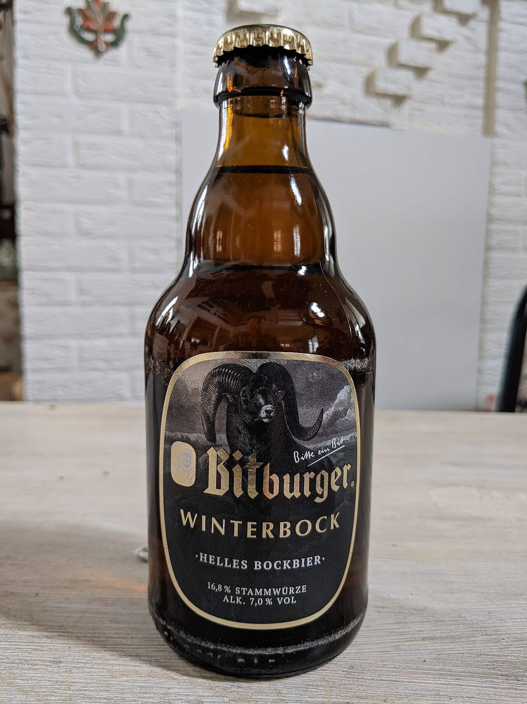

# 博克啤酒

博克（Bock）是德国的一类深色、以麦芽为主导的烈性拉格，酒体饱满、苦味低、收口偏甜，常见于冬末与春季。它不是一个单一配方，而是以艾因贝克（Einbeck）酿造传统为源头、在慕尼黑被重新解释后形成的家族，包含传统博克、双博克、迈博克与冰博克。放在[拉格](ref:lager)的整体框架里，博克代表的是高浓度麦芽汁、低温发酵与长时间贮酒的组合，而不是单纯的颜色深浅。

图：博克啤酒。图片：Sorennelson，CC BY-SA 4.0，via Wikimedia Commons（[原图页面](https://commons.wikimedia.org/wiki/File:Bitburger_Winterbock_Bottle_Front.jpg)）。

## 从艾因贝克到慕尼黑

博克的原型来自下萨克森小城艾因贝克。中世纪时，这座位于汉诺威与卡塞尔之间的城市是重要的酿造与出口中心；1368 年加入汉萨同盟后，它的烈性啤酒被运往斯堪的纳维亚、俄罗斯、英国与佛兰德。当时的酒未必等同于今日的深色拉格，但高浓度、耐运输、偏麦芽甜的特征已经确立，[大麦](ref:barley)与烘烤工艺是其中最重要的变量。

17 世纪，慕尼黑的酿酒者接手了这种风格，并按当地的拉格工艺改造：使用深色麦芽、低温发酵、长期窖藏。巴伐利亚口音把“Einbeck”读成“ein Bock”，也就是一只公山羊，这个名字从此固定下来，酒标上的山羊成了风格的图腾。1516 年巴伐利亚的《啤酒纯净法》规定的是原料范围，并不直接规定博克的强度，两者不应混为一谈。

## 麦芽如何撑起酒体

博克的风味主要来自麦芽处理，而不是酒花。基础麦芽之外，常加入慕尼黑麦芽与维也纳麦芽，通过较长时间的烘烤形成面包皮、焦糖与坚果气息；部分配方会少量使用深色麦芽调整颜色。糖化多采用煮出法，把部分醪液煮沸后混回，制造美拉德反应产物，让酒体更厚、回味更甜。

[发酵](ref:fermentation)仍是下层发酵，主发酵温度偏低，随后在接近冰点的温度贮酒数周至数月。低温与时间让粗糙的发酵味消退，也让麦芽香变得圆润。酒花用量通常克制，只负责提供最低限度的苦味支撑；若苦味过高，麦芽的甜感会被切断，风格就走样了。碳酸化一般中低，入口因此显得柔软。

## 博克家族的坐标

传统深色博克常见酒精度约 6.3%–7.2%，[苦度](ref:ibu)多在 20–27 IBU，[原麦汁浓度](ref:original-gravity)约 16–18 °P；这些区间随来源与酒厂而异，不是法定标准。颜色从深琥珀到深棕，清澈度良好，泡沫细腻。

双博克把浓度再推高，酒精度常见 7%–10%，风味转向枣、无花果、焦糖与面包皮，苦味依旧很低。许多酒厂用“-ator”结尾命名，源自慕尼黑 Paulaner 的 Salvator。迈博克颜色更浅，酒花与苦味略高，适合春季。冰博克通过冷冻去除部分水分来提高浓度，酒精度可达 9%–14%，口感更厚，酒精感也更明显。把这几类当成同一款酒的加强版并不准确，它们的麦芽配方与发酵目标并不相同。

## 德国北部的酒厂地图

艾因贝克的 Einbecker Brauhaus 仍以 Ur-Bock 系列作为历史参照，分为浅色与深色两个版本；这类酒强调的是干净的麦芽甜与克制的酒花。慕尼黑及周边则集中了双博克传统，Paulaner 的 Salvator、Ayinger 的 Celebrator、Spaten 的 Optimator 都是常见样本。巴伐利亚的酒馆在冬末举行“Bockanstich”，把新酒从木桶中引出，博克因此与季节仪式绑定。

[巴伐利亚](ref:bavaria)之外，德国其他地区也生产博克，但风格重心仍在南部与艾因贝克。美国精酿酒厂则把博克当作试验场，加入巧克力麦芽、咖啡或桶陈处理，这些变体可以好喝，却不宜用来界定传统风格。

## 与相邻风格的分野

最容易混淆的是世涛与修道院双料。世涛使用烘焙大麦，带明显咖啡与焦苦，收口干；博克的深色来自烘烤麦芽但避免焦苦，甜感更突出。修道院双料依赖比利时酵母的酯香与糖化添加的糖，果味与辛香更明显，酒体更轻。英式老艾尔则有氧化与陈年风味，常带坚果与雪莉感。

另一条边界是拉格与艾尔。博克是下层发酵，发酵温度低，酯香克制；把它当成深色艾尔会错判它的干净度。[小麦啤](ref:wheat-beer)的香蕉与丁香来自酵母，博克没有这类香气；[皮尔森](ref:pilsner)则以酒花苦与干爽收口为主，麦芽浓度低得多。至于“博克等于烈性啤酒”的说法也不准确：冰博克与双博克确实高，但传统博克的强度仍在可日常饮用的范围内。

## 温度、杯型与餐桌

博克适合在 8–12°C 饮用，温度过低会压住麦芽香，过高则酒精感突兀。郁金香杯或高脚杯能聚拢香气，也让高浓度酒的少量饮用更从容。在德国酒馆，博克常以小杯供应，理由与强度有关：香气集中，但酒精与残糖都高，大杯在升温后容易显得腻。开瓶后不宜久放，麦芽甜与香气会随氧化走样。

配餐上，博克的甜感与烘烤香适合烤猪肉、鸭肉、炖牛肉、面包饺子与洋葱塔；带烟熏或焦糖的菜肴也能呼应。作为餐后酒，它可以配硬质山地奶酪与坚果。若与辛辣菜同席，低苦度无法切油解辣，效果反而不如[皮尔森](ref:pilsner)。最后需要提醒：博克酒精度不低，分量应比普通拉格更小。

对照阅读：[拉格啤酒](ref:lager)、[小麦啤酒](ref:wheat-beer)。

**关键事实。**

| 项目 | 内容 |
| --- | --- |
| 一句话定位 | 源自德国艾因贝克、在慕尼黑被改造为深色烈性拉格的麦芽主导风格，涵盖传统博克、双博克、迈博克与冰博克 |
| 上位风格 | 拉格啤酒 |
| 香气家族 | 麦芽 |

**来源与边界。** 本页关于「博克啤酒」的关键事实，主要由以下来源交叉核对：Beer Judge Certification Program（传统博克、双博克与冰博克的强度、苦度与色度区间）、Einbecker Brauhaus AG（艾因贝克啤酒历史与 Ur-Bock 产品系列的公开介绍）、Deutscher Brauer-Bund e.V.（德国啤酒种类与酿造传统的公开表述）等 4 条来源。价格、批次与状态会变，涉及这些字段时以页面所列来源的最新版本为准。正文为项目自写，来源只作核验，不复制原文。

**并读。** 把「博克啤酒」与「拉格啤酒」、「皮尔森啤酒」、「小麦啤酒」放在一起读时，先确认它们是同一层级还是上下游关系：先确认定义与工艺，再比较原料、产区与代表品牌。本页负责给出酒类风格的基本坐标，对照条目补上具体案例与差异；读完再回到本页，才能分清哪些差别属于酒类风格本身，哪些只是产地、批次或品牌选择。
