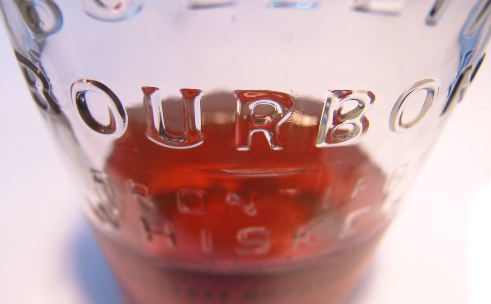

# 波本威士忌

“波本威士忌”是 bourbon whiskey 的中文译名。它既指一个受美国联邦法规约束的烈酒类别，也指一个在全球市场上被广泛使用的商品名称。本页讨论后者：这个称谓由哪些词构成、在哪些语境下会被误用、它与相邻类别和标签词汇的关系。关于波本的谷物配方、蒸馏与熟成机制，见[波本](ref:bourbon)条目，本页不重复工艺细节。

图：一杯波本威士忌，杯壁压印 BOURBON FRONTIER WHISKEY，杯中为琥珀色酒液。图片：Markyboy81，CC BY 2.0，via [原图页面](https://www.flickr.com/photo.gne?id=1001040958)。

## 名称的构成

Bourbon 来自肯塔基的 Bourbon County，whiskey 是类别词。美国联邦法规在拼写上使用 whisky，而美国市场与品牌普遍写作 whiskey；爱尔兰同样使用 whiskey，苏格兰、加拿大与日本多用 whisky。这组拼写差异没有统一的国际法律强制力，更多是行业惯例与身份表达。

中文把 bourbon 音译为“波本”，再加“威士忌”形成四字名称。问题在于，“波本”本身已经隐含了类别，后面再补“威士忌”在语义上是重复的；但在中文消费语境里，这个重复有助于把“波本”与地名、品牌名区分开。类似的重复还有“波旁威士忌”，只是音译用字不同。

## 称谓与法定类别不是一回事

“波本威士忌”作为商品名，必须落在法定类别之内：玉米不少于 51%、蒸馏酒精度不高于 80% ABV、入桶不高于 62.5% ABV、新烧焦橡木桶、装瓶不低于 40% ABV。这些数字是判断一瓶酒能否自称波本的底线，而不是营销形容词，也不是风味描述。

但反过来，符合这些数字的产品可以选择不写“波本”。美国有酒厂以“American whiskey”或自有风格名销售同类产品；也有产品在类别上属于 straight bourbon，却把品牌名放在最显眼位置。称谓是识别工具，不是质量证明，更不是产地证明。

## 标签词汇的层级

酒标上的词大致可以分为三层。第一层是法定类别：bourbon、straight bourbon、blended bourbon、rye whiskey、Tennessee whiskey。第二层是受规则约束的声明：酒龄、产地（如 Kentucky）、bottled-in-bond。第三层是行业与营销词：small batch、single barrel、barrel proof、small craft。

消费者常把第三层当成第一层。实际上 small batch 没有统一定义，single barrel 只说明装瓶来自单一桶，barrel proof 只说明未加水稀释到固定强度。它们可以提供信息，但不能替代类别名称与酒龄声明。把“单桶”当作等级，和把“小批次”当作法定类别，是同一类误读。

## 与田纳西威士忌的分工

田纳西威士忌是最容易被并入波本的市场类别。它使用与波本相同的谷物逻辑与新烧焦桶，但增加田纳西产地要求与林肯县工艺（枫木炭过滤），并以“Tennessee whiskey”作为独立名称销售。对消费者而言，两者的风味差异可能小于品牌差异；对标签与贸易而言，它们是两个名称。

类似地，rye whiskey 以黑麦为主料，corn whiskey 以玉米为绝对主体并使用非烧焦或旧桶，wheat whiskey 以小麦为主料。它们与波本共享“美国威士忌”的上位概念，却不能互相替换名称。名称边界的存在，是为了让消费者在货架上能做出可比较的选择。

## 地理标志与国际贸易

“Bourbon”在主要出口市场被视为与美国关联的名称。欧盟的烈酒法规为地理标志提供保护，欧美之间也有关于烈酒名称的相互承认安排；这意味着在欧洲市场上，非美国生产的产品不能随意把“Bourbon”当作通用风格词使用。

这类保护针对的是名称，而不是配方。也就是说，其他国家的酒厂可以生产玉米为主、新桶陈年的威士忌，但不能把它标成波本。理解这一点，有助于区分“风格相似”与“类别相同”，也有助于读懂跨境贸易争端中反复出现的“通用名称”之争。

## 市场用法：从基酒到风味产品

波本在美国市场首先是鸡尾酒基酒。古典鸡尾酒、Whiskey Sour、Manhattan 等配方让波本成为酒吧的常备酒。它的甜感与桶香容易与苦精、糖浆、柑橘结合，因此比高泥煤苏格兰威士忌更适合作为调酒骨架。

第二类是风味威士忌（flavored whiskey），例如蜂蜜、肉桂、苹果风味产品。它们通常以波本或其他威士忌为基酒，再添加香料与糖；标签上必须体现“flavored”或具体风味，不能只写 bourbon。第三类是跨界商品：以“bourbon barrel”陈年的啤酒、枫糖浆、咖啡豆等。这类用法描述的是桶的来源，不是酒液本身属于波本。

## 中国市场的译名问题

中文市场常见三种写法：波本威士忌、波旁威士忌、波本。前两者是同一名称的不同音译，第三种是简称。问题不在译名本身，而在用它替代类别：把任何美国威士忌都叫波本，或把“波本”当成甜味威士忌的同义词，都会造成误判。

进口酒的中文标签应能对应到原标签的类别名称。若原标签写的是 straight bourbon whiskey，中文只写“威士忌”并不算错，但会丢失关键信息；若原标签写的是 blended whiskey，中文却写成“波本”，则属于误导。选购时可以把中文背标与原标签的类别词对照，而不是只看正面大字。

## 常见误解

第一，认为“波本威士忌”是两种酒叠加。第二，认为波本必须是肯塔基产品。第三，把“波本”当成甜度描述。第四，把风味威士忌当作波本的子类。第五，认为拼写 whiskey 或 whisky 能判断产地。第六，把“单一桶”当成质量等级。

这些误解有共同的根源：把市场语言当成法规语言。解决方式并不复杂——先确认类别，再确认酒龄与[酒精度](ref:abv)，最后才看营销词与品牌故事。

bourbon whiskey 中的 whiskey 是类别通名，不是必须来自苏格兰拼写；美国法规与市场标签各有用法，不能按拼写判断产地。

## 选购提示

先看类别名称，再看酒龄与酒精度，最后看营销词。纯饮可以选桶强或单桶，调酒可以选性价比更高的标准款；风味威士忌适合特定场景，但不能用来判断波本风格。关于[原桶强度](ref:cask-strength)的计算与标签含义，可另见术语条目；关于[威士忌](ref:whisky)的总体分类，可回到上位条目。

补充阅读：[修道院啤酒](ref:c-extra-1)。

相关条目：[威士忌](ref:whisky)、[波本威士忌](ref:bourbon)、[酒精度（ABV）](ref:abv)。

**来源与边界。** 本页关于「波本威士忌」的关键事实，主要由以下来源交叉核对：US Department of the Treasury（波本威士忌的类别名称、标签管理与相邻类别）、U.S. Government Publishing Office（bourbon、straight bourbon、blended bourbon 与 Tennessee whiskey 的名称边界）、European Union（烈酒地理标志与名称保护的一般框架）等 7 条来源。价格、批次与状态会变，涉及这些字段时以页面所列来源的最新版本为准。正文为项目自写，来源只作核验，不复制原文。
