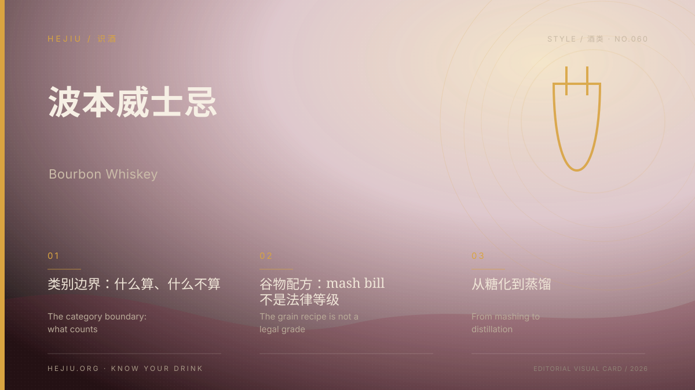

# 波本威士忌

波本威士忌（bourbon）是美国威士忌中以玉米为主料、以新烧焦橡木桶完成熟成的类别。[威士忌](ref:whisky)是大类，波本是其中一个有明确联邦定义的子集；反过来，并非所有美国威士忌都符合波本规则。本页讨论波本这一风格的法规、原料与工艺，不讨论“波本威士忌”这一称谓在贸易与市场中的用法。

图：波本威士忌 双语视觉卡（项目自绘 SVG）。不是实拍。

## 类别边界：什么算、什么不算

27 CFR 5.22 对波本给出四条硬约束：发酵醪中玉米不少于 51%；蒸馏后酒精度不高于 160 proof（80% ABV）；入桶酒精度不高于 125 proof（62.5% ABV）；必须装入新烧焦橡木容器，装瓶酒精度不低于 80 proof（40% ABV）。它不得添加色素或调味料，也不得通过添加其他烈酒来“修正”风格。

关键在于“新烧焦”和“玉米多数”这两条同时成立。用旧桶熟成的玉米威士忌可以是 corn whiskey，但不是波本；以黑麦为主料的是 rye whiskey，即使同样使用新桶。波本没有“必须陈年多少年”的通用下限，但一旦进入 straight 子类，就必须满足额外规则。

## 谷物配方：mash bill 不是法律等级

除 51% 玉米外，其余谷物可以自由组合。常见结构是玉米 60%–80%、黑麦或小麦 10%–25%、发芽大麦 5%–10%。发芽大麦提供糖化酶，黑麦带来胡椒、薄荷与干香料感，小麦让口感更圆、更柔软。

所谓 high-rye、wheated、high-corn 是行业与消费者用语，不是法定类别。它们描述配方取向，不能替代酒标上的类别名称。玉米比例越高，酒体通常越甜、越厚；但酵母、蒸馏切割与桶的状态会显著改写这一直觉。

## 从糖化到蒸馏

波本的起点是谷物粉碎、加水糖化，把淀粉转成可发酵糖，再接种酵母进行[发酵](ref:fermentation)。发酵时间与酵母菌株决定酯类与高级醇的生成，进而影响香气前体。发酵完成后进入[蒸馏](ref:distillation)：多数大型酒厂使用柱式蒸馏器连续蒸馏，小型酒厂可能使用壶式蒸馏器或混合流程。

蒸馏必须把酒精度控制在 160 proof 以下。这个上限不是“越接近越好”，而是类别边界：蒸馏过高会削弱谷物与发酵副产物带来的风味。蒸馏后的新酒加水降到不超过 125 proof 再入桶，入桶强度会改变木桶萃取的速度与方向。

## 新烧焦桶与熟成

波本必须使用新烧焦橡木容器，这一点与苏格兰威士忌的旧桶传统相反。桶内壁经火烤形成炭层，木糖与木质素在烘烤中转化为香草醛、愈创木酚与焦糖类化合物；炭层同时吸附部分硫化物，使新酒更干净。常见桶容为 53 加仑（约 200 升），炭化等级从轻到重分为数级。

熟成是萃取、氧化与挥发同时发生的过程。肯塔基仓库的四季温差推动酒液进出木材孔隙，[天使份额](ref:angels-share)则让一部分酒精与水逐年散失。仓库位置、楼层与桶的摆放方式会造成同一批原酒的差异，这也是单桶产品成立的前提。新桶风味强，过长时间的陈年可能让木质与椰子感压过谷物特征。

## 标签上的年份与等级

Straight bourbon 要求在烧焦新桶中至少陈年 2 年，且不得添加色素、调味料或其他烈酒。陈年不足 4 年的威士忌通常必须在标签上标注酒龄；这条规则适用于包括波本在内的威士忌，而不是波本独有。

Bottled-in-bond 是另一套自愿性标识：同一酒厂、同一蒸馏季、在政府监管仓库中陈年至少 4 年，并以 100 proof（50% ABV）装瓶。Small batch、single barrel、barrel proof 都没有统一的法定定义，它们描述批次规模或装瓶强度，不构成质量等级。

## 产区：肯塔基不是法定前提

波本的名字常被追溯到肯塔基的 Bourbon County，但联邦规则并不要求波本在肯塔基生产。只要满足类别要求，美国其他州也可以生产波本。Kentucky straight bourbon 同时满足“在肯塔基生产”的地理声明与 straight 规则，因此它比单纯的“波本”多一层产地约束。

把波本等同于肯塔基，是消费端最常见的简化。肯塔基的石灰岩水、气候与产业集聚确实塑造了当地风格，但产区名称描述的是传统与集中度，不是质量评级。

## 风格谱系

从风味谱系看，波本大致可以分成三支。高黑麦配方辛香突出，收口更干，适合纯饮与古典鸡尾酒；小麦配方（wheated）更柔和，常带面包、蜂蜜与奶油感；高玉米配方则更甜、更饱满，酒体厚。

代表性产品可以举 Buffalo Trace、Maker's Mark、Wild Turkey、Four Roses、Heaven Hill 与 Jim Beam 等酒厂的核心产品线。它们覆盖了不同配方与价格带，但具体酒款的配方、陈年与批次会变化，购买时应以酒标为准。本页不评价具体品牌。

## 与相邻类别的区别

Rye whiskey 以黑麦为主料（不少于 51%），辛香与干爽感更强；Tennessee whiskey 在波本式谷物配方与工艺上增加田纳西产地与林肯县工艺（枫木炭过滤），是独立的市场与法规类别；corn whiskey 要求玉米不少于 80%，且使用未烧焦或旧桶；wheat whiskey 以小麦为主料；blended bourbon 则以 straight bourbon 为主体，再与其他威士忌或烈酒调配，必须标注 blended。

这些类别的共同点是都以谷物为原料、都在美国生产；差别在主要谷物、桶型与是否允许调配。把它们统称为“波本”，会让标签信息失去意义。

## 常见误解与争议

第一，认为波本必须来自肯塔基。第二，把“玉米甜”理解为加糖，实际甜感来自玉米与桶。第三，认为年份越长越好，忽略新桶萃取在某个时点会转为过度木质。第四，把 small batch 当成法定等级。第五，认为所有波本都经过枫木炭过滤，实际上那是田纳西威士忌的工艺特征。

争议主要集中在“波本”名称的国际保护、风味威士忌是否稀释类别声誉，以及桶强产品的标签透明度。这些问题属于贸易与市场层面，不改变联邦定义本身。

还有一点常被混为一谈：波本的新桶要求只约束入桶时为烧焦新橡木桶，并不要求酒庄自己制桶；桶的来源与烘烤程度会影响香气，却不改变类别定义。

## 怎么喝

纯饮适合判断谷物、桶与陈年的关系；加少量水可以降低酒精刺激、打开香气；加冰会同时降温与稀释，适合较高酒精度的产品。波本是[古典鸡尾酒](ref:old-fashioned)的核心基酒，也常见于 Whiskey Sour 等配方。关于[橡木桶陈年](ref:oak-ageing)的通用机制，可另见工艺条目；关于壶式蒸馏与柱式蒸馏的差别，可参见[壶式蒸馏器](ref:pot-still)。

相关条目：[威士忌](ref:whisky)。
