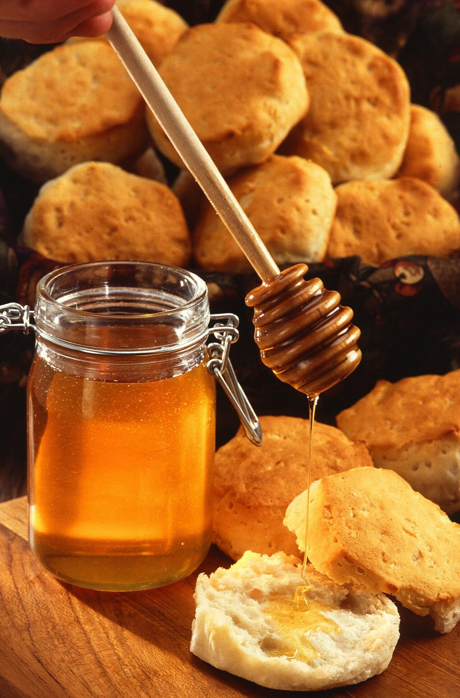

# 啤酒蜂蜜酒

蜂蜜与麦芽共同发酵的混合酒，介于蜂蜜酒与啤酒之间；酒花可加可不加，风格从淡色轻盈到深色高酒精度都有。

啤酒蜂蜜酒的核心是蜂蜜与麦芽共同发酵，而不是在啤酒里事后加蜂蜜：蜂蜜可占配方的一成到七成，酒花可加可不加，成品从淡色轻盈到深色高酒精度都有。它没有统一地理标志，标签上的 braggot 可能指蜂蜜比例很低的啤酒，也可能指以蜂蜜为主体的混合蜜酒，因此购买时要看配方比例、蜂蜜来源与发酵方式，不能只看名字。美国与英国的手工蜜酒厂、精酿酒厂是主要生产者，常见 hopped braggot、加香料与果干的节日版，以及深色麦芽基底的冬季款；蜂蜜比例越高越像蜜酒，麦芽比例越高越像啤酒。饮用温度 12–16°C，甜型配蓝纹奶酪与干果，干型配烤鸡与根茎蔬菜；含残糖的酒仍有继续发酵风险，开瓶前确认气泡，开瓶后冷藏并在两三天内喝完。如果酒厂愿意标出蜂蜜比例、麦芽类型与是否加酒花，基本可以判断它更接近蜜酒还是啤酒。

图：Braggot：Swedish Mead（Wikimedia Commons）。图片：Grapetonix，CC BY 3.0，via Wikimedia Commons（[原图页面](https://commons.wikimedia.org/wiki/File:Swedish_Mead.JPG)）。

## 定义与边界

braggot 是蜂蜜与麦芽共同发酵的混合酒，介于蜂蜜酒（mead）与啤酒之间。它的可发酵糖至少有一部分来自蜂蜜，另一部分来自麦芽；酒花可加可不加，颜色从淡金到深棕，酒精度常见 5–12% vol。

braggot 不是法定类别，欧盟与美国都没有为它单列定义；不同酒厂与蜜酒厂按自己的配方命名。判断一瓶 braggot，先看蜂蜜比例、麦芽类型、是否加酒花与甜度，而不是只看名字。

## 历史与命名

中世纪英语文献里已有 braggot 的记载，蜂蜜与麦芽一起发酵是北欧、英伦常见的家庭做法；当时没有啤酒花，香料与草本常被加入。

现代 braggot 由手工蜜酒厂与精酿酒厂重新演绎：有的以麦芽为主体、蜂蜜只占 10–20%，有的以蜂蜜为主体、麦芽提供谷物骨架。美国 BJCP 把 braggot 归入蜂蜜酒大类，允许从干型到甜型、从淡色到深色。

## 原料与工艺

麦芽先糖化，得到麦汁；蜂蜜用温水稀释后加入，避免高温破坏香气；两者可以一起煮沸（加酒花）或分别处理后再混合。蜂蜜缺乏酵母可用的氮与矿物质，发酵前常补少量酵母营养盐，否则容易停滞或产生硫味。

酵母选择决定风格：中性艾尔酵母让蜂蜜花香更清楚，拉格酵母更干净，葡萄酒酵母会抬高酒精与酸度。发酵温度 18–22°C，结束后可短期冷降、过滤或直接装瓶；含蜂蜜的酒液残糖高时，装瓶前要确认不再发酵，以免爆瓶。

蜂蜜种类会改变风格：荞麦蜜颜色深、矿物质高，带焦糖与坚果；洋槐蜜清淡、花香细；柑橘蜜带柑橘皮与白花。酒厂常把两种蜜混合，以兼顾香气与发酵稳定性。

## 风格与味觉

淡色版本带蜂蜜、白花、柑橘与麦芽甜，深色版本带焦糖、面包、干果与香料；酒花型 braggot 会有草本与松针香气。甜度从干型到甜型都有，酒体从中等到厚，气泡可高可低。

与普通蜂蜜酒比，braggot 的谷物骨架更明显；与啤酒比，蜂蜜的花香与甜感更突出。判断风格时，先看蜂蜜与麦芽的比例，再看酒花与甜度；只喝一款就下结论，容易把配方差异当成风格差异。

干型 braggot 的残糖低于 1%，酒体靠麦芽与蜂蜜的蛋白质撑起；甜型版本残糖可超过 10%，装瓶前必须确认发酵停止。酒花型 braggot 的苦度通常 20–40 IBU，香料型则可能完全不加酒花。

干型版本的酒体更接近啤酒，甜型更接近蜜酒；酒花与蜂蜜的平衡决定它站在哪一边。

## 代表产区与品牌

美国与英国的手工蜜酒厂、精酿酒厂是主要生产者；常见做法包括加酒花的 hopped braggot、加香料与果干的节日版本，以及以深色麦芽为基底的冬季款。

braggot 没有统一的地理标志，代表性来自配方与工艺，而不是产区。找酒时看标签上的蜂蜜来源、麦芽类型、酒精度与甜度；若只写“honey beer”，可能只是加了蜂蜜的啤酒，不是真正的混合发酵。

美国蜜酒厂常按蜂蜜来源标注，英国酒厂更强调麦芽与酒花；由于没有统一法规，标签上的“braggot”可能指 10% 蜂蜜的啤酒，也可能指 70% 蜂蜜的蜜酒。购买时要看配方比例，而不是只看名字。

## 怎么喝与配餐

温度 12–16°C，郁金香杯或高脚杯，倒少量让香气展开；甜型配蓝纹奶酪、干果与烤肉，干型配烤鸡、根茎蔬菜与温和香料。加酒花的版本可以配油炸食物，但不要冰镇到 6°C 以下，否则蜂蜜香气会被压住。

开瓶后冷藏，2–3 天内喝完；含残糖的 braggot 继续发酵的风险高，保存时直立、避光，开瓶时先确认气泡。

braggot 的碳酸可以很低，像静置蜜酒；开瓶前先看是否有沉淀，倒酒时留一点在瓶底。蜂蜜比例高的版本更适合小杯慢饮，不要像啤酒那样大杯灌。

## 选购、储存与误区

先看蜂蜜比例与甜度，再看麦芽与酒花；标签若只写“蜂蜜啤酒”，不等于 braggot。价格高可能来自蜂蜜原料或小批量，不代表风格更典型。

常见误读：把 braggot 当成“甜啤酒”；把蜂蜜味当成人工香精；把中世纪配方当成固定配方。它可以是干的、苦的、带酒花的，关键在混合发酵的比例。

## 延伸阅读与另见

- [蜂蜜酒](ref:honey-wine)：蜂蜜发酵的基本类型。
- [蜂蜜](ref:honey)：原料与香气来源。
- [啤酒](ref:beer)：麦芽、酒花与发酵。
- [大麦](ref:barley)：麦芽的谷物基础。
- [发酵](ref:fermentation)：糖转化为酒精与二氧化碳。

对照阅读：[蜂蜜酒](ref:honey-wine)、[蜂蜜](ref:honey)、[啤酒](ref:beer)。

**关键事实。**

| 项目 | 内容 |
| --- | --- |
| 一句话定位 | 蜂蜜与麦芽共同发酵的混合酒，介于蜂蜜酒与啤酒之间；酒花可加可不加，风格从淡色轻盈到深色高酒精度都有 |
| 上位风格 | 蜂蜜酒 |

**来源与边界。** 本页关于「啤酒蜂蜜酒」的关键事实，主要由以下来源交叉核对：Beer Judge Certification Program（蜂蜜酒类型、甜度与酒精度框架）、National Honey Board（蜂蜜原料与蜂蜜酒背景）、American Mead Makers Association（蜂蜜酒与 braggot 的原料、发酵和分类背景）等 4 条来源。价格、批次与状态会变，涉及这些字段时以页面所列来源的最新版本为准。正文为项目自写，来源只作核验，不复制原文。

## 相关图像

图：蜂蜜。图片：Scott Bauer, USDA ARS，Public domain，via Wikimedia Commons（[原图页面](https://commons.wikimedia.org/wiki/File:Runny_hunny.jpg)）。关联图像：啤酒蜂蜜酒。
