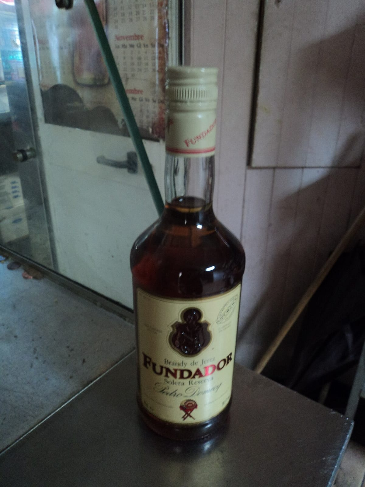

# 赫雷斯白兰地

赫雷斯白兰地（Brandy de Jerez）是西班牙安达卢西亚赫雷斯产区受地理标志保护的葡萄酒蒸馏白兰地，以本地葡萄酒蒸馏后，在曾装雪莉酒的美国橡木桶中经 solera 动态系统陈年；风格从年轻果香的 Solera 到陈年复杂的 Solera Gran Reserva 不等，带香草、干果、柑橘、烟草与坚果气息。

图：Brandy de Jerez：Fundador - Brandy de Jerez（Wikimedia Commons）。图片：Nicholas Gemini，CC BY-SA 3.0，via Wikimedia Commons（[原图页面](https://commons.wikimedia.org/wiki/File:Fundador_-_Brandy_de_Jerez.JPG)）。

## 定义与边界

Brandy de Jerez 是受保护的地理标志产品，生产与陈年限定在赫雷斯-德拉弗龙特拉（Jerez de la Frontera）、圣玛丽亚港（El Puerto de Santa María）与桑卢卡尔-德巴拉梅达（Sanlúcar de Barrameda）三座市镇及其周边的"赫雷斯产区"（Marco de Jerez）范围之内。它以葡萄酒为原料蒸馏，与以果渣、谷物或甘蔗为原料的白兰地分属不同路线；酒标上的名称受产区委员会（Consejo Regulador）监管，不是任何葡萄酒蒸馏物都可以自称 Brandy de Jerez。

它与雪莉酒共享同一套桶陈传统与产区空间，但产品类型不同：雪莉是加强葡萄酒，赫雷斯白兰地是蒸馏烈酒。判断一款酒是否属于这一类别，要看蒸馏原料、陈年桶类型、solera 系统与产区范围，而不只看颜色深浅。地理标志只约束产地与工艺，不保证具体品牌的风格高低。

## 历史与命名

赫雷斯的葡萄酒蒸馏与桶陈传统与 18 世纪以来当地雪莉贸易的扩张相连。solera 与 criaderas 动态陈年系统原本是赫雷斯酒窖为稳定供应市场而发展出的做法，18 世纪起在产区内连续使用，后来同时用于雪莉酒、醋与白兰地。这一系统的核心是在不同年龄层级的桶之间定期抽取与补入，使出库产品始终保持混合后的稳定风格。

品牌史上，Fundador 是西班牙最早的商业白兰地之一。其酒窖谱系可追溯到 1730 年建立的 Bodegas Fundador，是赫雷斯产区最古老的酒窖之一；1874 年，Pedro Domecq Loustau 创造了 Fundador，被称为第一款西班牙白兰地。此后 Osborne、Terry、Barbadillo 等赫雷斯与周边酒庄也加入白兰地生产，形成今天的品牌格局。

## 原料与工艺

蒸馏原料选用健康、澄清、与酒泥分离且平衡适饮的葡萄酒，品种以 Airén 为主，也使用赫雷斯传统品种 Palomino。按产区委员会的说法，大约需要三升葡萄酒才能蒸馏出一升白兰地，取其中最精华的中段馏分。蒸馏可在柱式蒸馏器或铜制 alquitara 壶式蒸馏器中进行，切去头馏分与尾馏分，只保留中段酒心。

按酒精度与挥发物含量，蒸馏物分为三类：holandas 酒精度低于 70% vol，挥发物 200–600 克/百升纯酒精，香气最丰富；aguardientes 介于 70–86% vol，挥发物 130–400 克/百升纯酒精；高度蒸馏物（destilados）介于 86–94.8% vol，挥发物低于 100 克/百升纯酒精，风格最纯净。不同等级的白兰地由这几类馏分调配而成：Solera 级别约为 50% aguardiente 与 50% holanda，Solera Reserva 约为 25% aguardiente 与 75% holanda。

陈年容器是赫雷斯白兰地的关键特征。木桶为美国橡木制成，容量 500–600 升，此前至少装过三年雪莉酒——fino、manzanilla、amontillado、oloroso 或 Pedro Ximénez 都有可能。桶型 envinado（曾装酒类型）直接影响品牌差异：fino 桶陈年的白兰地颜色更浅，amontillado 或 oloroso 桶的更深沉，PX 桶的最甜、颜色最深。桶内残留的雪莉酒风味与缓慢氧化一起，构成白兰地的干果与香草层次。

## 风格与味觉

陈年采用 criaderas 与 solera 动态系统：最底层的桶排称为 solera，向上依次为第一、第二 criadera；每次从 solera 抽取一部分装瓶（saca），再由上一层较年轻的酒补入（rocío），逐层传递。由于桶内始终是不同年龄酒液的混合，任何一瓶 Brandy de Jerez 都含有比静态陈年平均年龄更老的成分。这套系统自 18 世纪起在赫雷斯连续使用，是产区酒窖文化的一部分。

按产区法规，等级按平均陈年时间与挥发物含量划分：Solera 平均陈年超过 6 个月，挥发物高于 150 克/百升纯酒精；Solera Reserva 超过 1 年，挥发物高于 200 克；Solera Gran Reserva 超过 3 年，挥发物高于 250 克。法规另设"Vejez Calificada"长陈等级，如 Solera 12 年、Solera 15 年；多数 Gran Reserva 的实际平均陈年在 10 年上下，远超 3 年的下限。

风味上，年轻 Solera 偏果香、柔和，带葡萄与浅色干果气息；Reserva 增加焦糖、坚果与木质调；Gran Reserva 则有葡萄干、无花果、烟草、皮革与氧化坚果的复杂层次，酒体厚实、余味长。氧化带来的类似雪莉或波特的干坚果感是允许且被期待的风格特征，与威士忌新桶香草烘烤路线不同。

## 代表产区与品牌

Fundador 是赫雷斯白兰地最具代表性的品牌之一，隶属 Grupo Emperador 旗下，酒窖历史溯至 1730 年，1874 年推出 Fundador；产品线从入门 Solera 到 Supremo 18 等长陈版本不等。Osborne 是赫雷斯周边老牌酒庄，其白兰地与雪莉、利口酒产品线在西班牙与出口市场都有渠道；Barbadillo 则产自圣玛丽亚港，以本地传统桶陈方法生产。

这些品牌分属不同酒窖与调配哲学：有的偏年轻柔和、适合调饮，有的强调长陈与氧化复杂度。品牌之间的桶陈层级、馏分配比与 envinado 选择，往往比"Brandy de Jerez"这个统一名称更能决定杯中风格。选购时可先看等级标注（Solera、Reserva、Gran Reserva），再对照生产者的桶陈说明。

## 怎么喝与配餐

传统喝法是餐后纯饮，用收口白兰地杯或小型闻香杯，在室温或略凉状态下慢慢品鉴；年轻 Solera 可加冰或兑少量水，释放果香。Gran Reserva 与长陈版本适合不加冰、小口慢饮，搭配坚果、核桃、黑巧克力、伊比利亚火腿或干果拼盘；它也可加入咖啡，或用于调古典风格的白兰地鸡尾酒。

配餐上，赫雷斯白兰地与咸鲜、油脂感食物互补：腌肉、硬奶酪、烤坚果与焦糖类甜点都能承接其干果与木质调。清淡的海鲜、沙拉或酸味菜肴不适合配长陈白兰地，会放大酒精与氧化感。饮用温度不必像威士忌那样追求温热，室温纯饮即可；加冰会降低浓度，也会收敛陈年香气。

## 选购、储存与误区

常见误区：把颜色深当成陈年久——颜色也来自 PX 桶或焦糖调色；把所有西班牙白兰地都当作 Brandy de Jerez——只有在三座市镇范围内、按法规蒸馏与 solera 陈年的产品才能使用这一地理标志；以为等级标签等于品质保证，实际上等级只规定最低陈年与挥发物门槛。

买酒时读背标：地理标志名称、等级（Solera/Reserva/Gran Reserva）、生产者、酒精度与桶陈说明是否齐全；正面大字多为品牌营销。储存上，未开瓶的白兰地避光、阴凉、直立存放即可，烈酒不像葡萄酒那样需要横卧；开瓶后酒精缓慢挥发，建议在一两年内喝完。价格高可能来自长陈、品牌或渠道，不必然代表风格更典型。

## 延伸阅读与另见

赫雷斯白兰地与相邻品类共享工艺与产区背景：[白兰地](ref:brandy)是它所属的蒸馏烈酒大类，[雪莉酒](ref:sherry)提供了陈年木桶与 envinado 传统，[solera](ref:solera)系统是其动态陈年的核心机制，[橡木桶陈](ref:oak)决定香草、氧化与木质层次，[西班牙](ref:spain)则是安达卢西亚产区的国家背景。

学习一类白兰地，可以先喝最标准的基准款，再试一个换等级或桶型的变体，最后接触一个长陈极端款；三步之后，风格边界会比读定义更清楚。

- 相关条目：[brandy](ref:brandy)、[sherry](ref:sherry)、[solera](ref:solera)、[oak-ageing](ref:oak)、[spain](ref:spain)。

## 相关图像

图：赫雷斯 Lustau 酒窖内的雪莉酒桶与拱廊。图片：Anual，CC BY-SA 4.0，via Wikimedia Commons（[原图页面](https://commons.wikimedia.org/wiki/File:Lustau_003An2019.jpg)）。关联图像：赫雷斯白兰地。
