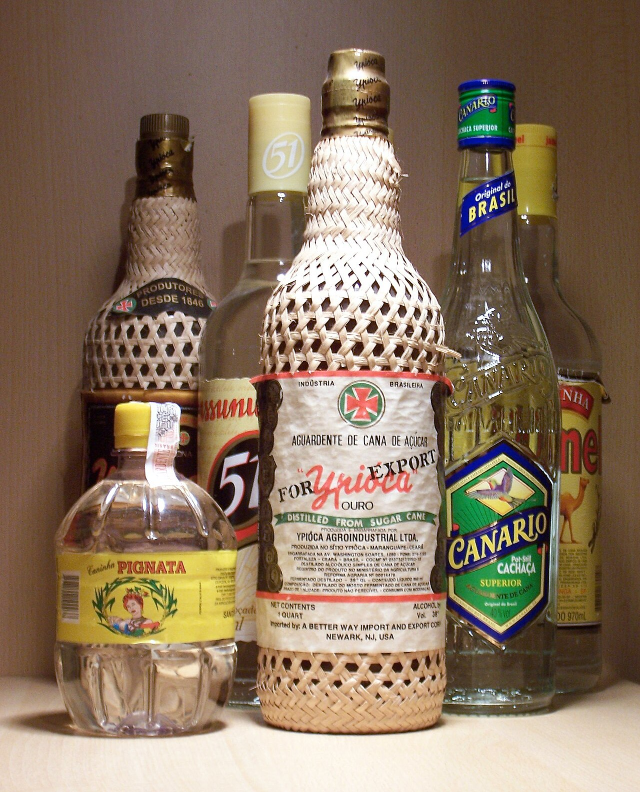

# 卡莎萨

卡莎萨（Cachaça）是巴西以甘蔗汁发酵后蒸馏得到的烈酒，也是巴西最具代表性的蒸馏酒。它与朗姆酒共享“甘蔗”这一原料起点，却在原料形态、法规身份与风味传统上走的是另一条路：朗姆酒多以制糖副产物糖蜜为原料，卡莎萨则以新鲜甘蔗汁为主；在巴西，卡莎萨是受法律定义与地理标志保护的独立类别，不是朗姆酒的地方叫法。

图：卡莎萨。图片：Tom Tom at German Wikipedia，CC BY-SA 3.0，via Wikimedia Commons（[原图页面](https://commons.wikimedia.org/wiki/File:Cachaca.JPG)）。

> **先给结论**
> **一句话：** 这页判断卡莎萨的风味位置，以及怎么选、怎么喝。
>
> - **适合谁：** 正在比较卡莎萨与其他风格、准备购买或点单的人。
> - **不适合谁：** 只想要“哪个最好”的排名、不接受口味差异的人。
> - **先看这两点：**
>   - 品鉴年轻卡莎萨时，用郁金香形杯，先闻甘蔗、青草与柑橘，再判断酒精是否刺鼻；入口注意甜度、酸度与酒体，咽下后看收口是否干净。
>   - 巴西第 4.851/2003 号法令把卡莎萨定义为“巴西生产的甘蔗烧酒（aguardente de cana）的典型且专属名称”，要求以甘蔗醪发酵后蒸馏。

## 定义与法规

巴西第 4.851/2003 号法令把卡莎萨定义为“巴西生产的甘蔗烧酒（aguardente de cana）的典型且专属名称”，要求以甘蔗醪发酵后蒸馏，酒精度在 38%–48% vol 之间（20°C）。这串数字是合规边界：低于 38% 不能叫卡莎萨，高于 48% 也不是卡莎萨。

卡莎萨必须在巴西境内生产。巴西国家工业产权局（INPI）承认“Cachaça”为地理标志，Paraty、Salinas 等传统产区还有各自的地理标志与产品规范。地理标志把名称、产区与工艺绑定，但不同产区的具体规则并不相同；阅读标签时，产地与 GI 名称比“手工”“传统”等形容词更有信息量。

## 与朗姆酒的分界

卡莎萨与[朗姆酒](ref:rum)最容易混淆。两者都以甘蔗为原料，也都经发酵与[蒸馏](ref:distillation)，但原料不同：朗姆酒的主流原料是糖蜜，卡莎萨的主流原料是压榨后的新鲜甘蔗汁。原料差异带来风味差异：甘蔗汁保留更多植物、青草与鲜甜感，糖蜜则更厚、更焦糖化。

法规身份也不同。朗姆酒是一个跨国的烈酒类别，卡莎萨是巴西的专属名称；把卡莎萨标成“巴西朗姆”会抹掉它的法定身份。工艺上，卡莎萨传统上多用铜制壶式蒸馏器（alambique），朗姆酒则壶式与柱式并用；这不是绝对分界，但能解释两者常见的风格差异。

## 历史

甘蔗在 16 世纪由葡萄牙人引入巴西，沿海与东北部的种植园经济迅速扩张。制糖过程中，甘蔗汁与糖蜜容易被微生物发酵，蒸馏技术随后被用于保存这些易腐的甜液。16 世纪中叶，圣保罗沿海一带已出现甘蔗蒸馏酒的生产记录；到 17 世纪，卡莎萨成为殖民地日常饮酒与贸易商品。

17 至 18 世纪，葡萄牙王室多次试图限制卡莎萨，以保护本土葡萄酒与白兰地贸易，但未能阻止它在巴西扎根。19 世纪，蒸汽动力与连续蒸馏器进入制糖业，卡莎萨的生产规模扩大；20 世纪，工业化与城市消费把它推向全国，凯匹林纳（Caipirinha）成为国际认知度最高的卡莎萨鸡尾酒。21 世纪，壶式蒸馏、单一产区与热带木材陈年重新受到重视。

## 原料与发酵

原料是[甘蔗](ref:sugarcane)。甘蔗收割后应尽快压榨，通常在 24–48 小时内完成，以避免汁液氧化与杂菌繁殖。压榨得到的甘蔗汁可以直接发酵，也可以先浓缩；传统卡莎萨更强调新鲜蔗汁。

发酵方式分为自发发酵与接种酵母两类。自发发酵依赖甘蔗园与压榨设备上的野生酵母，发酵时间较长，风味更复杂、批次差异更大；接种酵母发酵更可控，干净、稳定。发酵温度、时间与酵母种类决定香气基底：低温慢发酵保留更多果香与花香，高温快发酵容易产生更重的酯类与溶剂感。参见[发酵](ref:fermentation)。

## 蒸馏与陈年

蒸馏器主要有铜制壶式与柱式。壶式蒸馏（alambique）通常进行两次，掐头去尾，只取酒心，保留更多酯类与原料香气，是手工卡莎萨的典型设备；柱式蒸馏效率高、酒精度高，风格更干净，常用于大规模生产。铜材料能吸附部分硫化物，对香气的干净度有帮助。

陈年不是卡莎萨的必要条件，但是风格分化的重要环节。未陈年的酒液通常在不锈钢或惰性容器中静置，颜色透明，风格直接，称为“prata”（银）或白卡莎萨。陈年使用橡木、amburana、balsa、jequitibá、cabreúva 等木材；不同木材带来不同风味：橡木偏香草与香料，amburana 偏椰子、肉桂与甜香，balsa 更轻。热带气候下陈年速度快，数年即可带来明显颜色与口感变化。

## 分类与标签

巴西法规按陈年比例与糖分设定类别。“Cachaça envelhecida”要求至少 50% 的酒液在容量不超过 700 升的合适木桶中陈年不少于一年；“Premium”与“Extra Premium”在此基础上叠加糖分与陈年比例要求，具体门槛以巴西农业部的产品规范为准。

市场上的常见说法还包括“cachaça de alambique”（壶式蒸馏卡莎萨）、“cachaça artesanal”（手工卡莎萨）、“ouro”（金色）与“prata”（银色）。这些词有的是法规类别，有的是行业习惯；“ouro”可能来自陈年，也可能来自焦糖着色，不能仅凭颜色判断陈年时间。

## 感官风格

年轻卡莎萨的典型香气是新鲜甘蔗、青草、青香蕉、柑橘皮与白花，入口干、酒体中等，酒精感明显但应干净。壶式蒸馏版本常有更明显的酯香、热带水果与轻微泥土感；柱式版本更中性、轻盈，适合调酒。

陈年卡莎萨会发展出香草、焦糖、椰子、巧克力、咖啡与香料。amburana 桶的椰子与肉桂感尤其突出，橡木桶则更接近威士忌的香草与单宁结构。甜味不应成为判断陈年的唯一依据：卡莎萨可以是干的，甜感可能来自木材、焦糖着色或添加糖，标签与类别才是依据。

## 产区

巴西的卡莎萨产区遍布多个州。圣保罗是历史悠久的产区，也是甘蔗与蒸馏技术较早集中的地区；米纳斯吉拉斯以壶式蒸馏与小型酒厂著称，Salinas 是其中知名的传统产区；里约热内卢州的 Paraty 以海岸气候与传统工艺形成地方风格；伯南布哥、巴伊亚、戈亚斯、巴拉那与塞阿拉也各有生产传统。

产区名称能提示气候、甘蔗品种与工艺传统，但不自动等于高质量。同一产区内，发酵方式、蒸馏器、木材与陈年时间差异很大；把“Salinas”当成质量保证，会忽略具体酒厂的选择。

## 代表产品

代表性类型包括：壶式蒸馏的白色卡莎萨，香气鲜明，适合纯饮或调制凯匹林纳；amburana 桶陈年卡莎萨，带椰子、肉桂与甜香；橡木桶陈年卡莎萨，结构更接近陈年烈酒；以及标注单一产地或单一甘蔗品种的产品。

凯匹林纳是卡莎萨最广为人知的饮用方式：卡莎萨、青柠、糖与冰。比例会显著改变平衡；高酒精度卡莎萨需要更多稀释与酸度支撑。纯饮时，陈年卡莎萨可以像威士忌一样小杯品鉴。

## 品鉴与饮用

品鉴年轻卡莎萨时，用郁金香形杯，先闻甘蔗、青草与柑橘，再判断酒精是否刺鼻；入口注意甜度、酸度与酒体，咽下后看收口是否干净。陈年卡莎萨可以对比不同木材：amburana 的甜香、橡木的香草与单宁、balsa 的轻盈。

纯饮适合判断风格；加冰会压住香气，但能降低酒精刺激；凯匹林纳、Batida 与卡莎萨酸是常见调法。高酒精度产品应适量饮用；本页关于卡莎萨的内容涉及酒精饮料；过量饮酒有害健康，未成年人不应饮酒。

## 常见误区

第一，把卡莎萨当成朗姆酒的一种。两者原料、法规与名称保护不同。第二，认为卡莎萨都是未陈年的白色烈酒。陈年卡莎萨有完整的类别与木材传统。第三，把“ouro”当成陈年证明。颜色可能来自焦糖着色。第四，认为所有卡莎萨都适合做凯匹林纳。陈年与壶式版本更适合纯饮。第五，把“手工”当成法规等级。手工是生产描述，不是质量认证。第六，认为陈年越久越好。木材、桶型与酒体结构同样重要。

## 延伸阅读

- [朗姆酒](ref:rum)：甘蔗烈酒的另一条主线，便于对比原料与法规。
- [蒸馏](ref:distillation)：壶式与柱式蒸馏对卡莎萨风格的影响。
- [甘蔗](ref:sugarcane)：卡莎萨的原料基础与压榨时机。
- [发酵](ref:fermentation)：自发发酵与接种酵母的差异。
