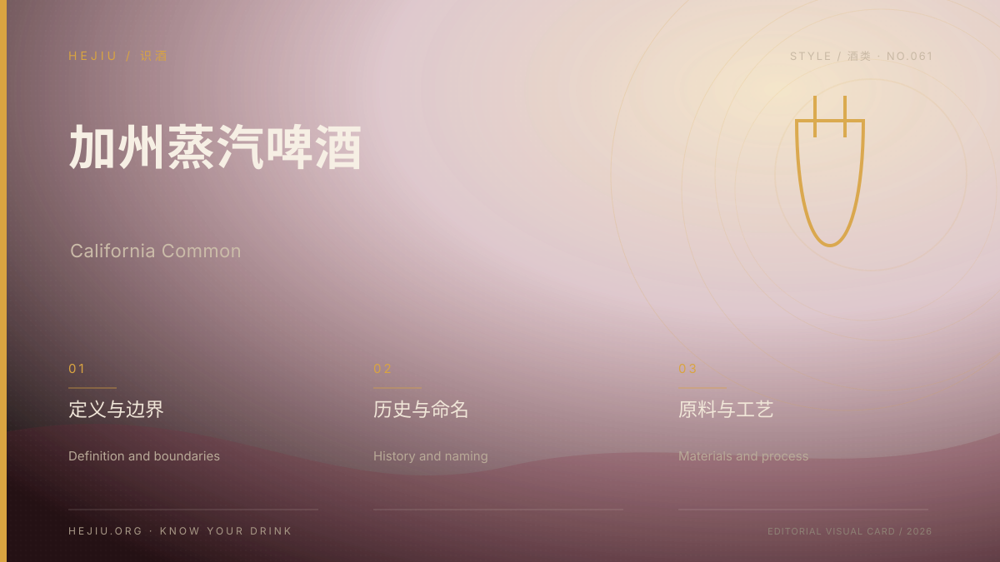

# 加州蒸汽啤酒

美国加州以拉格酵母在较高温度发酵的琥珀色啤酒，带麦芽甜、木质与酒花苦味；Anchor Steam 是唯一沿用"Steam Beer"商业名称的代表。

图：California Common主题示意图。图片：Doubao Seedream 5.0 AI 辅助绘制（项目自有）；不是加州蒸汽啤酒的实拍，仅作主题示意。

## 定义与边界

这个类别的核心工艺是拉格酵母在偏暖温度下发酵：传统做法在 55–60 °F（约 13–16 °C）的温度区间工作，高于普通拉格的冷发酵，又低于典型艾尔的温度；历史上使用敞口浅槽发酵槽（coolship）散热，现代作坊多用密闭罐控制同样的温度曲线。它因此介于拉格与艾尔之间：酵母干净度接近拉格，温热发酵带来的少量酯香接近艾尔。

名称上需要分清："Steam Beer"是 Anchor 持有的注册商标，比赛与通用风格层面使用 California Common 作为类别名。它与美式琥珀艾尔不同：后者多为上面发酵，常用现代柑橘型啤酒花；加州蒸汽啤酒以拉格酵母、传统酒花和谷物麦芽骨架为识别点。它也不是普通美式淡拉格，酒体、麦芽厚度与酒花表现都更突出。

BJCP 把它列在 7B California Common Beer，参数区间固定：原麦汁比重 1.048–1.054，最终比重 1.011–1.014，苦度 30–45 IBU，色度 10–14 SRM，酒精度 4.5–5.5% ABV。这些区间描述的是传统原型，现代实验版本可能在边缘浮动。

## 历史与命名

这类啤酒诞生于 19 世纪中期淘金热时代的旧金山。当时没有制冷设备，西海岸移民酿酒师利用旧金山湾区凉爽的环境温度，把热麦汁和发酵液放在敞口浅槽里散热；拉格酵母被筛选出能在偏暖条件下干净发酵的菌株，形成了这套独特做法。"steam"一词是当时西海岸对这种无冰条件下酿出的啤酒的俗称：一种解释是浅槽中热液散热时冒出的蒸汽，另一种解释是高碳酸化酒桶开桶时的气压冲声；确切原始工艺已无完整记录。

Anchor 酒厂的脉络可追溯到淘金热时期抵达旧金山的德国移民 Gottlieb Brekle 所开的 Pacific Street 酒厂。1896 年，德国酿酒师 Ernst F. Baruth 与女婿 Otto Schinkel Jr. 买下 Pacific 街 1431 号的老酒厂，命名为 Anchor。禁酒令结束后的 1933 年，Joe Kraus 在中断 13 年后重新酿造 Anchor Steam；次年酒厂失火，与 Joe Allen 合作在附近重建。

1965 年，Fritz Maytag 以数千美元购入酒厂 51% 股份，在濒临关闭时挽救了它，1969 年全资买下；1971 年开始瓶装现代版本的蒸汽啤酒，1979 年迁入 Potrero Hill 的旧咖啡烘焙厂厂房。2010 年 Maytag 退休，酒厂售予 Keith Greggor 与 Tony Foglio。当代这一风格的复兴，正是以 Anchor 在 1970 年代重新推出的版本为原型。

## 原料与工艺

基础麦芽为淡色艾尔麦芽，配少量烘烤麦芽或结晶麦芽，提供浅琥珀色与焦糖、烘烤骨架；酒花传统上用 Northern Brewer 这类非柑橘型美国酒花，表现木质、乡土草本与淡薄荷，现代柑橘香型酒花并不适合这个类别。酵母是能在偏暖温度下工作的拉格菌株，部分名称带"California"的菌株表现较好；某些德国菌株会产生不合宜的硫磺味。水质要求硫酸盐偏低、碳酸盐中低水平，以衬托麦芽与传统酒花。

历史上发酵在大型敞口浅槽中完成，靠湾区气温散热；现代版本在密闭发酵罐中复刻偏暖发酵曲线，再控制碳酸化水平。偏暖使用拉格酵母的难点是酯香与双乙酰控制：温度过高或酵母状态不佳，会带出不该有的果香、黄油感或硫磺味；糖化、煮沸与酒花添加节奏则围绕谷物麦芽与传统酒花的平衡展开。不同酒厂在麦芽配方与酒花用量上各有取舍：有的突出谷物甜感，有的强化传统酒花的草本与木质，偏暖发酵带来的酯香水平也因菌株而异。

## 风格与味觉

外观为中等琥珀到浅铜色，通常清亮，泡沫为米白色。香气以 Northern Brewer 的木质、乡土草本与淡薄荷为主，可有轻微果香，低到中等的焦糖与烘烤麦芽香托住酒花；入口是扎实的谷物麦芽感，带烘烤与焦糖味，收口偏干，酒花存在感明确但不冲。

常见缺陷包括：双乙酰带来的黄油感，现代柑橘酒花与传统骨架不协调，酵母不当产生的硫磺味，过重的巧克力或烘焙感（接近美式棕色艾尔），以及酒体单薄。比较时先看发酵方式、酒花类型与麦芽厚度，再谈版本差异。

## 代表产区与品牌

风格发源地是旧金山与美国西海岸；现代样本分布在北美工艺酒厂。旗舰原型是 Anchor Steam；其他商业样本包括 Flying Dog Old Scratch Amber Lager、Schlafly Pi Common、Steamworks Steam Engine Lager、Southampton Steem Beer 以及 Black Flannel Heavy Steam。

价格处于工艺啤酒常规区间，单一酒厂的不同版本在麦芽厚度、酒花强度与酒精度上有差别。品牌只能作为入口，读标签上的发酵方式、酒花品种与参数，比凭名字判断更稳妥。

## 怎么喝与配餐

加州蒸汽啤酒适合冰镇到 7–10 °C 饮用，用品脱杯或中等杯肚酒杯；纯饮能同时尝到麦芽骨架与传统酒花。配餐多选美式酒馆食物：汉堡、烤香肠、烟熏肉类、切达奶酪与咸香坚果，麦芽甜感与酒花苦度能接住烤肉与油脂。

它不适合过度冰镇，否则草本酒花与烘烤麦芽会被压住；也不需要像重口味艾尔那样长时间醒酒。佐餐时搭配同属西海岸风格的烧烤或奶酪，风格呼应最自然。

## 选购、储存与误区

读标签先确认风格名称、酒精度与酒厂：名为"steam"的产品受商标约束，通用类别名是 California Common；现代酒厂若用柑橘型酒花做琥珀艾尔，并不等于传统加州蒸汽啤酒。储存避开光照、高温与震动，直立存放，趁新鲜饮用，麦芽与酒花香气会随存放时间散失。

几个常见误区：把它当成上面发酵的艾尔；以为"steam"指蒸汽烘烤工艺；把所有琥珀拉格都归入这个类别；以及把注册商标名当成通用风格名。这些都需要结合发酵方式、原料与历史原型一起判断。

相关条目：[啤酒](ref:beer)、[拉格啤酒](ref:lager)、[大麦](ref:barley)。

## 延伸阅读与另见

- 相关条目：[beer](ref:beer)、[lager](ref:lager)、[barley](ref:barley)、[hop](ref:hop)、[usa](ref:usa)。
- 想建立品类边界，可以先喝一支 Anchor Steam 原型与一支现代工艺版本，对比传统酒花、谷物麦芽与偏暖拉格发酵的差别，再与一支美式琥珀艾尔横向比较。

**关键事实。**

| 项目 | 内容 |
| --- | --- |
| 一句话定位 | 美国加州以拉格酵母在较高温度发酵的琥珀色啤酒，带麦芽甜、木质与酒花苦味；Anchor Steam 是唯一沿用“Steam Beer”商业名称的代表 |
| 上位风格 | 啤酒 |
