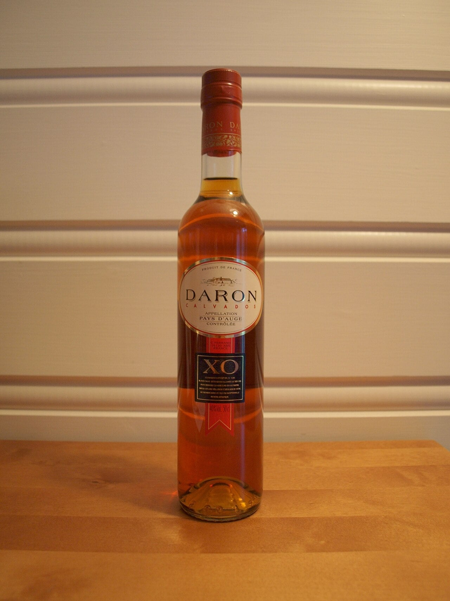

# 卡尔瓦多斯

卡尔瓦多斯（calvados）是法国诺曼底以苹果酒、梨酒或两者混合蒸馏得到的[白兰地](ref:brandy)。它的边界很清楚：原料必须是诺曼底的果园水果，先发酵成含酒精的苹果酒，再蒸馏成烈酒。它既不是加强型的苹果酒，也不是任何地方都能生产的“苹果味白兰地”；只有在法国规定的产区、按 AOC 规则生产，才能在酒标上使用这个名字。

图：一瓶 Daron Calvados XO，标签标着 Appellation Pays d’Auge Contrôlée。图片：ChickenFalls，CC BY-SA 3.0，via [原图页面](https://commons.wikimedia.org/wiki/File:Daron_Calvados_XO.JPG)。

## 三个命名，而不是一个等级

卡尔瓦多斯体系里有三个原产地命名：Calvados、Calvados Pays d'Auge 与 Calvados Domfrontais。三者是并列的产区命名，不是从低到高的质量阶梯。Calvados 覆盖诺曼底较大的范围，产量也最大；Pays d'Auge 位于东部的黏土石灰岩坡地，要求更严格的苹果品种比例和壶式二次蒸馏；Domfrontais 以梨为主，梨的比例明显高于其他两个命名。

Calvados 于 1942 年获得原产地命名控制。这个时间点常被误读为“卡尔瓦多斯从此才有历史”，其实它只是把已经存在的地方蒸馏传统写进了法规。Pays d'Auge 与 Domfrontais 后来各自单列，形成今天三块并行的地图。读酒标时，先看产区名，再看酒精度与陈年标示，比只看品牌更可靠。

## 苹果、梨与“cidre”的链条

诺曼底的果园不是单一品种的果园。当地把苹果按甜、酸、苦、苦甜分成不同角色，混酿出既有糖分、又有酸度和单宁的苹果汁。苦味品种提供结构和长度，甜品种提供酒精与圆润感，酸品种负责清爽度。把这些苹果压汁、自然发酵，得到 cidre，也就是苹果酒；蒸馏的对象是这层发酵酒，而不是果汁。

[苹果](ref:apple)的品种选择决定了原酒的骨架，但真正拉开差距的是发酵与蒸馏之间的时间管理。苹果酒若发酵过干，香气会变得单薄；若残留过多糖分，蒸馏时又容易让酒体显得浑浊。Domfrontais 加入梨，带来更柔和的花香与梨皮气息，也让“苹果白兰地”这个说法显得过于简单。

## 两次蒸馏与一次通过

Pays d'Auge 的传统是壶式蒸馏器二次蒸馏：第一次得到低度原酒，第二次再浓缩并切割酒心。两次蒸馏让香气更干净、层次更分明，也更容易保留苹果与梨的细节。其他 Calvados 产区常使用柱式蒸馏器，一次连续蒸馏即可完成，效率更高，酒体更厚，果香更直接。

[蒸馏](ref:distillation)在这里不是单纯的酒精浓缩。铜制蒸馏器会与硫化物结合，减轻还原味；蒸馏师对“头、心、尾”的切割决定最终风格。切得太宽，原酒粗重；切得太窄，香气又不够。卡尔瓦多斯的难点在于，苹果酒的香气本来就纤细，蒸馏时必须同时保住果香和足够的结构。

## 橡木桶至少两年

卡尔瓦多斯必须在橡木桶中陈年至少 2 年，才能上市。陈年标示按瓶中最年轻的原酒计算：2 年可标三星、VS 或三个苹果；3 年可标 Vieux 或 Réserve；4 年可标 VO、VSO 或 Vieille Réserve；6 年可标 XO、Hors d'âge 或 Très Vieille Réserve。它们都是最低门槛，不是平均年龄。

[橡木桶陈年](ref:oak-ageing)把苹果的清脆感慢慢推向烤苹果、焦糖、香草和坚果。新桶带来的香草与单宁更明显，旧桶则让果香和氧化气息占主导。诺曼底湿润的酒窖让酒精挥发较慢，酒体保留更多水分与圆润感；同一批原酒，桶的烘烤程度和使用次数不同，几年后就会走向完全不同的方向。

## 香气：从青苹果到烤苹果

年轻的卡尔瓦多斯以青苹果、梨、柑橘皮和白花为主，入口清脆，酒精感直接。随着陈年，香气转向烤苹果、苹果酱、蜂蜜、香草、肉桂和轻微的皮革；酒体从锋利变得圆滑，收口出现苦甜交错的单宁感。高品质的酒款在果香与木香之间保持张力，而不是被香草味盖住。

品鉴时可以先看颜色，但颜色不是酒龄的证据：焦糖调色在法规允许范围内存在，橡木桶的烘烤程度也会影响深浅。更可靠的是闻香与入口的整合度：果香是否清晰，酒精是否刺鼻，木味是否压过原料，收口是否干净。

## 餐桌上的诺曼底

卡尔瓦多斯最经典的场合是诺曼底餐桌上的“trou normand”：在主菜之间喝一小杯，用酒精与酸度重置味觉。它也可以作为餐后酒纯饮，搭配苹果塔、干酪、坚果和巧克力。年轻的酒款适合加冰或用于调酒，陈年酒款更适合用小郁金香杯慢慢喝。

在鸡尾酒里，卡尔瓦多斯能提供苹果与梨的果香，同时保留白兰地的骨架。它与姜汁汽水、汤力水、柠檬和苦精都能配合；在经典苹果白兰地配方中，它比中性烈酒更有层次。饮用时应注意酒精度通常在 40% vol 左右，本页关于卡尔瓦多斯的内容涉及酒精饮料；过量饮酒有害健康，未成年人不应饮酒。

## 与干邑、雅文邑、苹果白兰地的分界

[干邑](ref:cognac)与[雅文邑](ref:armagnac)以葡萄为原料，卡尔瓦多斯以苹果和梨为原料；前者讨论的是葡萄品种、产区和蒸馏次数，后者讨论的是果园品种、苹果酒发酵与桶陈。三者同属白兰地大类，却不能互相替代。

“苹果白兰地”是一个更宽的说法，美国 applejack 可以用苹果酒蒸馏甚至混合中性酒精，法规约束远少于卡尔瓦多斯。卡尔瓦多斯的身份来自诺曼底产区、指定品种、苹果酒原料和 AOC 规则，而不是“苹果”两个字。理解这一点，就不会把它当成带果味的普通烈酒。

相关条目：[白兰地](ref:brandy)、[干邑](ref:cognac)。

**关键事实。**

| 项目 | 内容 |
| --- | --- |
| 一句话定位 | 法国诺曼底以苹果酒和梨酒蒸馏而成的苹果白兰地，1942 年获原产地命名控制；帕伊多日使用壶式二次蒸馏，其他产区多用柱式蒸馏，橡木桶陈年至少 2 年，风格从青苹果、梨到烤苹果、香草与香料 |
| 上位风格 | 白兰地 |
| 香气家族 | 果香/花香/橡木 |

**来源与边界。** 本页关于「卡尔瓦多斯」的关键事实，主要由以下来源交叉核对：Calvados France（三个 AOC 的名称、产区范围、原料与蒸馏方式）、INAO（法国原产地命名体系的官方框架）、European Union（果渣烈酒、水果烈酒与地理标志烈酒的定义边界）等 4 条来源。价格、批次与状态会变，涉及这些字段时以页面所列来源的最新版本为准。正文为项目自写，来源只作核验，不复制原文。
