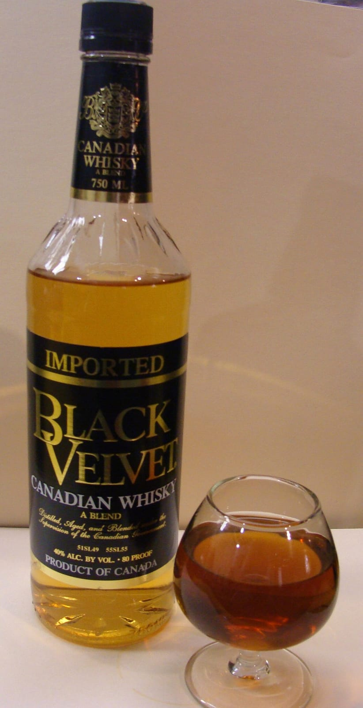
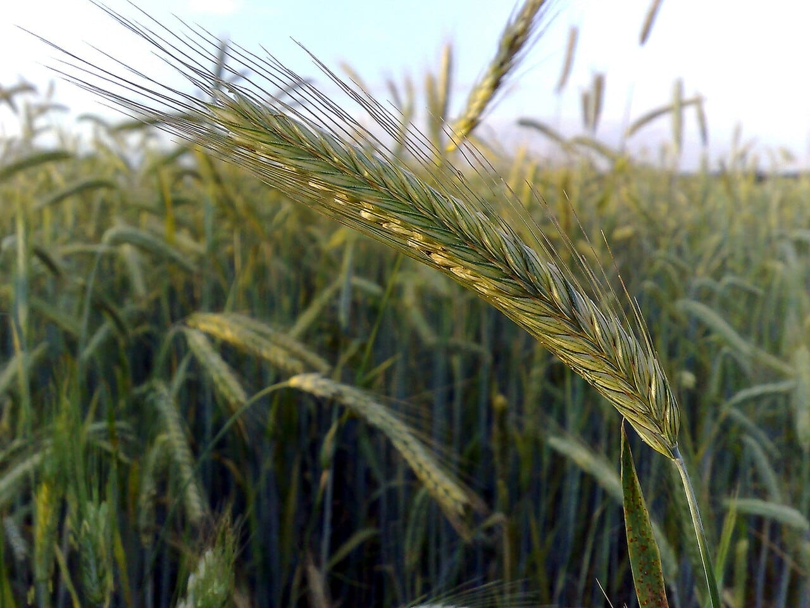

# 加拿大威士忌

加拿大威士忌以谷物（常用玉米、黑麦、小麦、大麦）分别蒸馏、成熟后再调和，风格轻柔顺滑，带焦糖、香草与黑麦香料；法规允许加入焦糖调色与调味酒液。常被提到的"9.090%"是年龄声明与出口证书的门槛，不是普通成分上限。

图：Canadian Whisky：Black Velvet Canadian Whisky（Wikimedia Commons）。图片：Craiglduncan at English Wikipedia，CC BY 3.0，via Wikimedia Commons（[原图页面](https://commons.wikimedia.org/wiki/File:Black_Velvet_Canadian_Whisky.jpg)）。

## 定义与边界

加拿大《食品与药品条例》对 Canadian Whisky、Canadian Rye Whisky 与 Rye Whisky 的定义包括几项硬条件：馏出物来自谷物或谷物制品醪液，经麦芽酶或其他酶糖化、酵母发酵；在小木桶（small wood，容量不超过 700 升）中陈年至少 3 年；糖化、蒸馏与陈年都在加拿大完成；成品酒精度不低于 40% ABV；法规允许加入焦糖与调味酒液（flavouring）。调味酒液指作为风味加入的其他国产或进口烈酒或葡萄酒。

现行条例还规定，在加拿大销售的威士忌须在小木桶中陈年至少 3 年；其中葡萄酒以外的调味酒液，本身必须先在小木桶中陈年至少 2 年才能使用。年龄声明只计算在小木桶中存放的时间；若已在小木桶陈年满 3 年，其中不超过 6 个月存放在其他容器中的时间也可计入酒龄。

"9.090%"规则出自《蒸馏酒年龄与原产地证书令》（SI/2009-61），要放在证书语境里理解。按其第 3 条，若作为调味加入的烈酒或葡萄酒，其绝对酒精含量不超过调和后成品总绝对酒精的 9.090%，成品的酒龄可按基础威士忌的陈年时间计算；按第 2 条，出口威士忌调和物中进口烈酒超过 9.090% 时，证书必须分别注明国产与进口比例，且不得称为 Rye Whisky、Canadian Whisky 或 Canadian Rye Whisky。第 5 条还要求，出口瓶身标签上出现"Canadian"字样时，成品至少 75% 的绝对酒精来自国产烈酒。

## 历史与命名

加拿大的蒸馏史与 19 世纪上半叶安大略的磨坊和剩余谷物有关。1830 年代，Gooderham and Worts 在多伦多从面粉磨坊转入蒸馏，到 1860 年代已成为加拿大最大的威士忌生产者之一。1858 年，Hiram Walker 在安大略 Walkerville（今温莎）创立 Canadian Club，最初叫 Hiram Walker's Club Whisky；在美国要求外国威士忌标注原产国之后，它成为加拿大最大的出口威士忌。同期，Henry Corby 于 1859 年在 Corbyville 开始蒸馏，Joseph Seagram 于 1883 年收购滑铁卢酒厂。

美国禁酒令时期，加拿大威士忌在底特律河两岸的走私贸易中占重要位置：酒厂在加拿大合法生产，转售给走私者带入美国。1939 年，Seagram 的 Sam Bronfman 为英王乔治六世与伊丽莎白王后访问加拿大调配出 Crown Royal，试调超过 600 个配方，最终 blend 约 50 款威士忌；该品牌 1960 年代进入美国市场，如今是销量领先的加拿大威士忌，生产基地在曼尼托巴省 Gimli。Canadian Mist 酒厂则于 1967 年在安大略 Collingwood 建立。

名称上有个常见误会：加拿大酒标写"rye"并不等于法规要求高比例黑麦。早期加拿大威士忌确实常以黑麦提供骨架，今天多数产品以玉米为基酒，只用少量黑麦馏出物提供香料感；"rye"更多是历史沿用的风格名称。

## 原料与工艺

基酒常用玉米，带来甜感与轻盈酒体；黑麦提供香料与骨架，小麦口感柔顺，大麦提供麦芽深度。传统做法把不同谷物做成单一谷物馏出物，分别蒸馏、分别成熟，到调和阶段才组合；蒸馏器既有柱式也有壶式，高黑麦版本常用铜壶式小批量蒸馏保留香料。成熟在小木桶中进行，加拿大气候寒冷，陈年速度比温带产区慢，酒液风格更干净。

法规允许用焦糖调整颜色，也允许在规则范围内加入调味烈酒或葡萄酒；这与苏格兰、波本对调色和调味的限制不同。调和师的工作是把玉米基酒的甜、黑麦馏出物的辛香、木桶带来的木质与香草拼到一起，成品通常比波本更轻、比多数苏格兰调和威士忌更甜顺。

工艺上需要区分"单一谷物蒸馏"与"混合醪液"：加拿大传统路线是各谷物分开走完整流程，成熟后由调和师决定比例；这也是 [威士忌](ref:whisky)类别里加拿大分支的典型做法。发酵温度、蒸馏切割、木桶新旧与陈年时长，都会改变最终香气。

## 风格与味觉

典型加拿大威士忌轻柔、顺滑，入口是焦糖、香草和淡木质，尾段带黑麦香料；市售酒精度常见 40% ABV。高黑麦样本辛香更明显，例如 Lot 40 用 100% 黑麦、铜壶式批次蒸馏，酒精度约 43% ABV；玉米基大众款则偏甜润、易饮。

与波本相比，加拿大威士忌不要求新炭烤橡木桶，木质与香草感更克制；与苏格兰调和威士忌相比，它的麦芽烟熏感很弱，甜感更靠前。缺陷样本常表现为酒精冲顶、焦糖甜腻、木桶味单薄或氧化纸板味；好的样本果香、谷物甜与香料之间收口干净。

不同产品线的差别主要来自基酒构成、黑麦比例和陈年时间，而不是品牌名气。比较时先看玉米与黑麦的主次、酒精度和是否壶式蒸馏，再谈风格典型性。

## 代表产区与品牌

安大略温莎的 Hiram Walker 酒厂建于 1858 年，是安大略仍在运行的最老酒厂之一，出品 Lot 40、Pike Creek、Gooderham and Worts、J.P. Wiser's 等品牌；Crown Royal 在曼尼托巴 Gimli 生产；Canadian Club 同出 Walker 体系；Forty Creek 走黑麦、大麦、玉米分别陈年再双桶调和的路线；Canadian Mist 1967 年建于 Collingwood，Black Velvet 也是市场常见名字。

价格跨度由基酒等级、黑麦比例、陈年时间与品牌定位共同决定。入门调和款渠道广、定价平稳，高黑麦壶式蒸馏和长陈年版本定价更高；品牌只能作为入口，同一类别下工艺与原料差异需要读标签参数判断。

## 怎么喝与配餐

加拿大威士忌适合纯饮、加冰或兑高球，也用于曼哈顿、古典等威士忌鸡尾酒；口感甜顺的产品做调酒基底比较容易入口。配餐可选烟熏或烧烤肉类、咸香坚果，焦糖与香草味能接上烤肉的焦香；清淡款也可配奶酪与干果。

纯饮时用中等杯肚的威士忌杯，先闻谷物甜与香料，再小口入口；加冰会稀释酒精、放出甜感。温度太高酒精感会抢香，冰镇过度则把木桶和香料味一起压住。

## 选购、储存与误区

读标签先看酒龄声明、谷物构成与酒精度：酒龄只计小木桶时间；写"rye"不代表黑麦含量高。9.090% 是年龄与出口证书规则，不是酒液里调味酒液的通用比例上限；出口标签上的"Canadian"则受 75% 国产酒精门槛约束。

储存避开光照、高温与震动，直立存放；高酒精度加焦糖调味的成品开瓶后比低度饮料耐放，但香气会随年月缓慢散失。常见误区还有把加拿大威士忌等同于波本：两者原料、桶陈规则和风格方向都不同；把"手工""传统"当成法律术语也不稳妥。

相关条目：[黑麦](ref:rye)、[橡木桶陈酿](ref:oak)。

## 延伸阅读与另见

- 相关条目：[whisky](ref:whisky)、[rye](ref:rye)、[oak-ageing](ref:oak)、[canada](ref:canada)、[liqueur](ref:liqueur)。
- 想建立品类边界，可以先喝一支玉米基大众调和与一支高黑麦壶式版本，对比甜润度、香料感与木质骨架，再尝试双桶或长陈年样本。

## 相关图像

图：黑麦。图片：LSDSL，CC BY-SA 3.0，via Wikimedia Commons（[原图页面](https://commons.wikimedia.org/wiki/File:Ear_of_rye.jpg)）。关联图像：加拿大威士忌。
