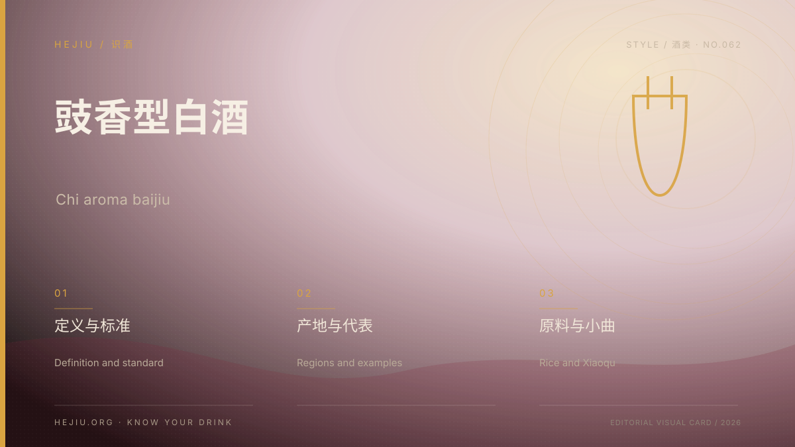

# 豉香型白酒

豉香型白酒是广东珠江三角洲一带的传统白酒香型，以大米为原料、小曲半固态发酵、蒸馏后再经肥肉酝浸而成。它的香气清甜，带有独特的脂香与轻微的豉香联想，风格在白酒中辨识度很高。

图：豉香型白酒 双语视觉卡（项目自绘 SVG）。不是实拍。

## 定义与标准

现行质量要求为 GB/T 10781.5-2021《白酒质量要求 第5部分：豉香型白酒》。标准规定了感官、理化与卫生指标，并对原料、工艺与标签提出要求。豉香型是香型分类，不是质量等级。

“豉香”不是豆豉的味道，也不是添加豆豉调香。它来自酒液与肥肉在酝浸过程中的相互作用，形成特有的脂香、花香与轻微咸鲜联想。把名称理解为“豆豉香精”，是对工艺的误读。

标准体系里，GB/T 10781.5-2021 与 GB/T 15109-2021 分工不同：前者规定豉香型产品的感官、理化与标签要求，后者把豉香型纳入白酒术语与分类。两者都不是产地认证，也不替代企业标准或生产许可。

## 产地与代表

豉香型白酒主要分布在广东佛山、南海九江一带，石湾玉冰烧是代表产品。当地气候温暖，米酒与小曲工艺基础深厚，肥肉酝浸的传统与饮食文化也有联系。

产地名称不是质量保证。不同酒厂的肥肉处理、酝浸时间、酒基质量与勾调方式差异明显，成品可以从清爽到浓郁。理解产区，应同时理解工艺，而不是只看地名。

## 原料与小曲

豉香型以[大米](ref:rice)为主料，要求淀粉充足、蛋白质与脂肪适中。大米蒸煮后拌入小曲，进行糖化与发酵。小曲通常含根霉与酵母，兼具糖化与产酒功能，参见[制曲](ref:qu-making)。

小曲的菌种与用量影响糖化速度、酸度与香气。大米原料的精度与蒸煮一致性，则影响发酵的稳定性。原料与曲是基础，但豉香型的个性更多来自后段的酝浸工艺。

## 发酵与蒸馏

发酵采用半固态或液态路线，蒸熟的米饭在小曲作用下糖化并发酵。[发酵](ref:fermentation)温度与时间影响酸度、出酒率与酒基的干净度。发酵完成后进行[蒸馏](ref:distillation)，掐头去尾保留中段，得到米酒基。

酒基的度数、干净度与切割方式，会直接影响酝浸后的风味。酒基过粗会带来杂味，过净又可能缺少与脂肪结合的物质。生产者的难点在于让酒基与肥肉酝浸形成平衡，而不是单靠某一步。

## 肥肉酝浸

肥肉酝浸是豉香型的标志工艺：把处理过的肥猪肉放入酒液中长期浸泡，让脂肪与酒液缓慢作用。传统做法对肥肉的选择、处理、陈放与更换周期都有经验要求，现代生产则更强调卫生与标准化。

酝浸带来脂香、柔和感与特殊香气，也会带来氧化与微生物风险。温度、时间与容器材质都需要控制。肥肉不是营销噱头，而是工艺的一部分；但“肥肉越多越好”并不成立，过量会带来油腻感与不稳定。

具体做法是把肥猪肉煮熟、切块、晾干后放入陶坛，与米酒基按比例混合，浸渍数月再分离。脂肪在长期接触中吸附部分杂质，脂肪酸与酒中的醇缓慢酯化，带来豉香型特有的脂香与柔化感。传统靠季节与经验控制温度，现代生产改用控温罐与更严格的卫生流程，但“肥肉参与陈化”这一核心没有改变。

## 风味特征

豉香型的香气清甜，带脂香、花香与轻微的咸鲜联想，入口柔和，酒体偏轻到中等，回味干净。与米香型的蜜香相比，豉香型多了一层脂肪与陈化带来的复杂度；与浓香型的窖香相比，它更轻、更少泥土气。

优质豉香型应有清晰的香气识别度，同时保持干净与平衡。香气过重可能来自酝浸过度或酒基不洁，过淡则可能显得单薄。风格强弱不是质量高低，平衡才是判断核心。

## 常见误区

第一，认为豉香来自豆豉。它来自肥肉酝浸与酒液的相互作用。
第二，把肥肉酝浸当成猎奇。它是产区传统工艺的一部分。
第三，把豉香型当成低度米酒。它是蒸馏酒，酒精度以标签为准。
第四，认为肥肉越多越好。过量会带来油腻与不稳定。
第五，把香型当质量等级。香型只是分类。

豉香型白酒的辨识点是“大米、小曲、半固态发酵”再叠加肥肉酝浸，形成清甜与脂香并存的风格，而不是普通米香白酒的延长版。肥肉在工艺中承担吸附与香气作用，不等于成品里真有油脂；读标准与标签时要把香型、质量要求和具体产品等级分开。

对照阅读：[白酒](ref:baijiu)、[制曲](ref:qu-making)。

## 延伸阅读

- [白酒](ref:baijiu)：豉香型白酒在白酒分类与工艺框架中的位置。
- [大米](ref:rice)：豉香型白酒的主要原料。
- [制曲](ref:qu-making)：小曲的糖化与产酒作用。
- [发酵](ref:fermentation)：半固态发酵与温度管理。
- [蒸馏](ref:distillation)：酒基切割对酝浸效果的影响。

**关键事实。**

| 项目 | 内容 |
| --- | --- |
| 一句话定位 | 广东珠江三角洲一带以大米、小曲半固态发酵并经肥肉酝浸的白酒香型，风格清甜而带独特脂香；现行质量要求为 GB/T 10781.5-2021 |
| 上位风格 | 白酒 |
| 香气家族 | 豉香 |

**来源与边界。** 本页关于「豉香型白酒」的关键事实，主要由以下来源交叉核对：国家市场监督管理总局、国家标准化管理委员会（可在国家标准全文公开系统按标准号检索原文；GB/T 10781 系列的适用范围、术语与分类口径）、Oxford University Press（提供关于中国白酒与香型的条目；由原条目末尾参考资料迁移，未逐条复核访问日期）。价格、批次与状态会变，涉及这些字段时以页面所列来源的最新版本为准。正文为项目自写，来源只作核验，不复制原文。

**并读。** 把「豉香型白酒」与「白酒」、「大米」、「制曲」放在一起读时，先确认它们是同一层级还是上下游关系：先确认定义与工艺，再比较原料、产区与代表品牌。本页负责给出酒类风格的基本坐标，对照条目补上具体案例与差异；读完再回到本页，才能分清哪些差别属于酒类风格本身，哪些只是产地、批次或品牌选择。

**适用边界。** 对「豉香型白酒」而言，法定定义、原料比例与地域风格会随法规和行业分类更新；品牌案例不等于整个风格。

## 相关图像

图：大米。图片：China News Service，CC BY 3.0，via Wikimedia Commons（[原图页面](https://commons.wikimedia.org/wiki/File:20201102.Hengnan.Hybrid_rice_Sanyou-1.6.jpg)）。关联图像：豉香型白酒。
