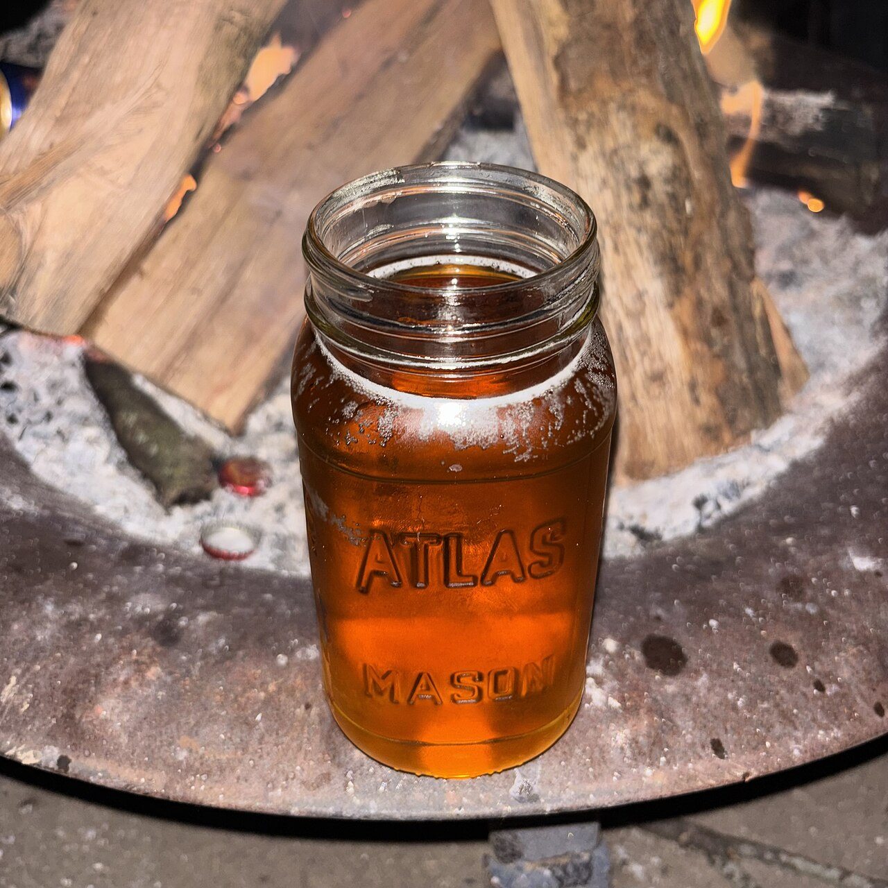

# 苹果酒

苹果酒（cider）是以[苹果](ref:apple)汁发酵而成的酒精饮料。它的原料简单，风格跨度却很大：从英国西部带单宁、略带泥土感的干型苹果酒，到法国诺曼底带甜味与气泡的乡村苹果酒，再到加拿大魁北克浓缩苹果汁发酵的冰苹果酒，都可以归入同一大类。它和[啤酒](ref:beer)、[葡萄酒](ref:wine)一样属于发酵酒，但原料与发酵逻辑不同。

图：苹果酒。图片：ChuckDabs，CC BY 3.0，via Wikimedia Commons（[原图页面](https://commons.wikimedia.org/wiki/File:Midwest_hard_cider.jpg)）。

## 定义边界：什么算苹果酒

苹果酒的核心是“苹果汁经酵母[发酵](ref:fermentation)”。最基本的配方只有苹果汁与酵母；允许添加糖、水、香料或果汁的产品仍然可以叫苹果酒，但通常会有更具体的名称。它不以谷物为原料，因此不是啤酒；不以葡萄为原料，因此不是葡萄酒。

不算苹果酒的产品包括：未经发酵的苹果汁、苹果醋、以苹果白兰地或中性酒精为基酒的调配酒，以及只添加苹果香精的酒精饮料。美国市场把发酵苹果酒称为 hard cider，以避免与未发酵的 apple cider 混淆；中文“苹果酒”通常已经指发酵产品。

## 苹果的分类与单宁

苹果酒专用苹果通常按酸度与单宁分为四类：甜型（sweet）酸度低、单宁低；尖酸型（sharp）酸度高、单宁低；苦甜型（bittersweet）单宁高、酸度低；苦酸型（bittersharp）单宁与酸度都高。单宁带来结构、苦涩与陈年潜力，酸度带来清爽与防腐能力。

食用苹果通常酸度与单宁都不足，单独发酵会显得单薄。英国西部与法国诺曼底的传统配方会把不同类别混合，以取得酸度、单宁与糖分的平衡。品种选择比“是不是纯果汁”更能决定苹果酒的质量。

## 压榨与发酵

苹果先清洗、破碎、压榨，得到果汁。传统生产者让果汁自然接种野生酵母，发酵启动慢、温度低，香气更复杂；现代生产者常接种商业酵母，以获得稳定与可预测的结果。发酵温度通常低于葡萄酒，以保留苹果的清香。

发酵过程中，糖被转化为酒精与二氧化碳。是否进行[苹果酸-乳酸发酵](ref:mlf)会影响酸度：它会降低尖锐的苹果酸，带来更圆润的口感，但也可能损失新鲜感。部分生产者会进行“keeving”（去果胶澄清），让果汁在发酵前失去部分营养，从而留下残糖并形成自然甜型。

## 甜度、气泡与稳定

苹果酒的甜度由[残糖](ref:residual-sugar)决定。干型发酵彻底，甜型则通过提前终止发酵、添加未发酵果汁或后期加糖实现。甜型产品需要足够的酸度与[单宁](ref:tannin)支撑，否则会显得腻。

气泡可以来自二次发酵（传统法或罐中法）、充气或保留发酵产生的二氧化碳。英国传统的“real cider”多为静止或轻微气泡，法国 cidre bouché 则以瓶中二次发酵产生细腻气泡。气泡不是质量等级，而是风格选择。

## 法规与税制

欧盟没有为苹果酒设立统一的类别定义，各成员国按本国法规管理。英国把苹果酒与梨酒作为独立酒类征税，税制按酒精度分档，1.2% 至 8.5% vol 的苹果酒适用苹果酒税率，超过 8.5% 的产品通常按葡萄酒或其他类别处理。这个阈值是税制边界，不是风格定义。

法国诺曼底与布列塔尼有受保护的传统苹果酒产区，西班牙阿斯图里亚斯有 sidra 的产区规则，加拿大魁北克对冰苹果酒有单独的标签与工艺要求。中国 GB/T 17204-2021 从饮料酒分类的角度给出术语基础。购买时应看酒标上的产地、酒精度与甜度，而不是只看“cider”一词。

## 风格地图

英国西部（萨默塞特、赫里福德郡、德文郡）以苦甜与苦酸苹果、较高的单宁与干型风格著称；肯特与东盎格利亚则更偏清爽与果香。法国诺曼底与布列塔尼的苹果酒通常酒精度较低、带气泡、口感更柔，常与可丽饼和奶酪搭配。

西班牙阿斯图里亚斯的 sidra natural 酸度高、带自然气泡，倒酒时从高处倒入杯中以激发气泡；巴斯克地区的 sagardoa 风格相近。加拿大魁北克的冰苹果酒用冻结浓缩的苹果汁发酵，酒精度通常在 7% 至 13% 之间，甜度高、酸度也高。

## 关键参数

多数苹果酒的酒精度在 2% 至 8.5% 之间；英国税制把 1.2% 至 8.5% vol 单列为苹果酒。冰苹果酒通常为 7% 至 13%。适饮温度约 8 至 12 摄氏度，单宁重的干型可以稍高，甜型与气泡型可以更低。

这些数字是风格与税制的参考，不是统一的法规。苹果品种、发酵温度、是否进行苹果酸-乳酸发酵、是否保留残糖，都会改变最终酒精度与口感。高酒精度不等于高质量，甜度也不等于低质量。

## 与相邻饮料的区别

苹果酒与啤酒都含气泡、都适合佐餐，但苹果酒以果汁为糖源，啤酒以谷物为糖源；苹果酒通常不含麸质，但生产过程中的交叉污染仍需注意。苹果酒与葡萄酒都用果实发酵，但苹果酒的酒精度通常更低、单宁结构不同。

梨酒（perry）以梨汁为原料，工艺与苹果酒相近，但梨的单宁与香气不同；苹果白兰地（Calvados）是蒸馏酒，不是苹果酒。把这些名称混用，会让消费者误判酒精度与饮用方式。

## 常见误解与争议

第一，认为苹果酒就是苹果汁。第二，认为苹果酒一定是甜的。第三，认为所有苹果酒都无麸质，忽略交叉污染。第四，认为苹果酒只能冷饮。第五，把梨酒当作苹果酒的子类。第六，认为“real cider”一定有法定定义。

争议主要集中在苹果酒的定义边界（是否允许加水、加糖、加香）、传统产区名称的保护，以及工业化甜型产品对品类形象的影响。这些问题涉及法规与市场，不改变“苹果汁发酵”这一核心。

## 怎么喝

干型苹果酒适合搭配猪肉、烤鸡、奶酪与油腻菜肴；甜型适合甜点或单独饮用；高酸度的 sidra 适合海鲜与油炸食物。温度过低会封闭香气，过高会突出酒精与甜腻。开瓶后应冷藏并尽快饮用，尤其是低酒精度、低单宁的产品。

苹果酒也可以用于调酒，但它的酸度与气泡会改变配方平衡。作为日常饮品，应注意酒精度与饮用量；未成年人不应饮酒。

相关条目：[啤酒](ref:beer)。
