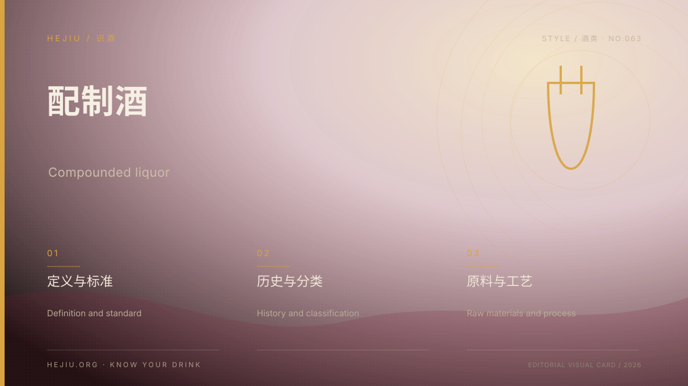

# 配制酒

配制酒是以发酵酒、蒸馏酒或食用酒精为酒基，加入可食用的原辅料或食品添加剂，经调配、混合或再加工制成的饮料酒。它的范围很宽，从加香加料的果酒到草本风味的露酒都属于这一类。GB/T 17204-2021《饮料酒术语和分类》对配制酒的术语与分类作出规定。

图：配制酒 双语视觉卡（项目自绘 SVG）。不是实拍。

## 定义与标准

按定义，配制酒的关键是“以酒为基、再加料再加工”。酒基可以是葡萄酒、黄酒等发酵酒，也可以是[白酒](ref:baijiu)等蒸馏酒，或食用酒精。加入的原辅料包括果汁、糖、草本、香料等，加入方式可以是浸泡、调配或再蒸馏。

配制酒是饮料酒的一个类别，不是“勾兑劣质酒”的同义词。分类描述的是原料与工艺来源，不构成质量等级。标签上的酒基、配料与酒精度，是判断产品的直接信息。

## 历史与分类

配制酒的历史与药用、香料贸易和加味酒传统相关。欧洲的味美思（vermouth）、中国的露酒，都可以看作在酒基上加入植物或其它原料的做法。工业化后，配方标准化与食品安全监管让配制酒成为独立品类。

分类上，常见做法是按酒基划分（发酵酒基、蒸馏酒基、食用酒精基），按工艺划分（浸泡、调配、再蒸馏），按风味来源划分（果香、草本、香料）。不同标准与行业习惯的分类方式不完全一致，具体以现行文本与标签为准。

## 原料与工艺

原料包括酒基、水、糖或甜味料、果汁、草本与香料等。工艺上，浸泡型把原料浸入酒基中提取风味；调配型把酒基与果汁、糖液、香料等按比例混合；再蒸馏型把浸泡后的酒液蒸馏，取香气更纯净的馏分。

[调配](ref:blending)是配制酒的核心动作之一：不同酒基、不同风味组分按比例组合，形成稳定配方。温度、时间与过滤方式会影响提取效率与澄清度。配方与参数属于企业技术范围，公开资料通常只描述原理。

## 主要类型与露酒

露酒是配制酒中的重要分支，按 GB/T 27588-2011《露酒》定义，以蒸馏酒、发酵酒或食用酒精为酒基，加入可食用或药食两用的辅料，经调配、混合或再加工制成，并已改变原酒基风格。参见[露酒](ref:lujiu)。

其它常见类型包括加味葡萄酒（如味美思）、果味配制酒、香料配制酒与部分餐前酒。加强酒（如雪莉、波特）通过加入葡萄蒸馏酒提高酒精度，在部分分类体系中与配制酒相邻但归属不同，阅读资料时应注意区分。

## 风味特征

配制酒的风味由酒基与加入原料共同决定。果味型突出果汁的酸甜与新鲜感；草本型带植物、根茎或苦味；香料型常见肉桂、丁香、柑橘皮等气息。酒基的风格通常被部分掩盖，但仍影响酒体与收口。

配制酒常带甜味，甜度来自糖、果汁或甜味料，不是发酵残糖。甜度与酒精度是两件事：高甜度不等于低酒精度，低甜度也不等于高度酒。判断时应看标签，而不是凭口感推测。

## 品鉴与饮用

品鉴时先闻香气，判断风味来源是果、草本还是香料，再入口看酒基与加入原料是否融合、甜酸是否平衡、收口是否干净。温度会影响香气释放，果味型适合冷藏，草本型可常温或加冰。

配制酒常用于餐前、调制鸡尾酒或餐后甜饮。高糖产品适合少量饮用，高酒精度产品应控制饮用量。饮用强度以标签上的[酒精度](ref:abv)为准，不以甜度或颜色推断。本页关于配制酒的内容涉及酒精饮料；过量饮酒有害健康，未成年人不应饮酒。

## 常见误区

第一，把配制酒等同于劣质酒。配制是法定类别，与质量高低无关。
第二，把配制酒等同于药酒。药酒属于药品管理范畴，配制酒是饮料酒。
第三，认为甜就是低度。甜度与酒精度互不决定。
第四，认为颜色越深年份越久。颜色多来自原料与焦糖色，不能作为年份依据。
第五，忽视标签上的配料表。配料与酒基是判断产品类别的关键。

配制酒是一个制造类别，不是质量等级：它以发酵酒、蒸馏酒或食用酒精为酒基，加入可食用原辅料或食品添加剂，再经调配或加工。露酒是其中重要分支，但“配制”不等于“劣质”或“药酒”；判断时要看酒基、添加物、糖分与标签类别，而不是只看颜色或甜度。配制酒的酒基可以是发酵酒、蒸馏酒或食用酒精，添加物与再加工方式决定了最终类别；露酒只是其中一支。标签上的“配制”说明制造路径，不说明原料好坏，也不等于药酒或保健酒。

对照阅读：[露酒](ref:lujiu)、[调配](ref:blending)。

## 延伸阅读

- [露酒](ref:lujiu)：配制酒中最具中国特色的分支。
- [白酒](ref:baijiu)：常见的蒸馏酒基。
- [调配](ref:blending)：配方组合与风味平衡的核心动作。
- [酒精度](ref:abv)：理解标签标注的基础概念。

**来源与边界。** 本页关于「配制酒」的关键事实，主要由以下来源交叉核对：国家市场监督管理总局、国家标准化管理委员会（可在国家标准全文公开系统按标准号检索原文；GB/T 17204-2021的适用范围、术语与分类口径）、国家质量监督检验检疫总局、国家标准化管理委员会（可在国家标准全文公开系统按标准号检索原文）、Oxford University Press（提供关于加味酒与加强酒的条目；由原条目末尾参考资料迁移，未逐条复核访问日期）。价格、批次与状态会变，涉及这些字段时以页面所列来源的最新版本为准。正文为项目自写，来源只作核验，不复制原文。

**并读。** 把「配制酒」与「露酒」、「白酒」、「调配」放在一起读时，先确认它们是同一层级还是上下游关系：先确认定义与工艺，再比较原料、产区与代表品牌。本页负责给出酒类风格的基本坐标，对照条目补上具体案例与差异；读完再回到本页，才能分清哪些差别属于酒类风格本身，哪些只是产地、批次或品牌选择。

**适用边界。** 对「配制酒」而言，法定定义、原料比例与地域风格会随法规和行业分类更新；品牌案例不等于整个风格。

**更新提示。** 「配制酒」最近核对于 2026-11-23；价格、状态与公开信息会变，引用前以本页来源的最新版本为准。
