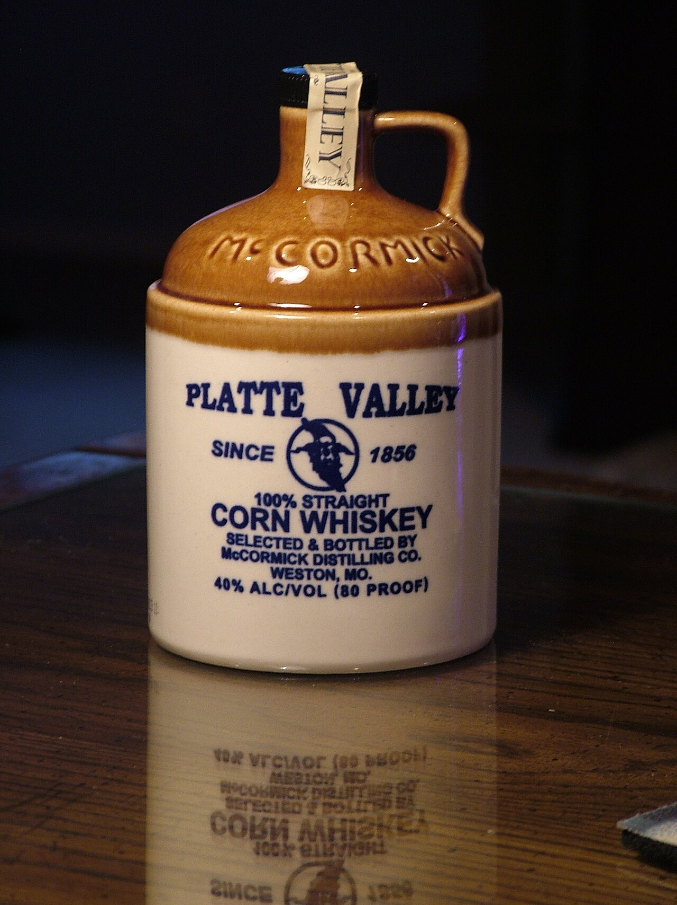

# 玉米威士忌

美国以玉米为主要原料的威士忌，法规要求至少 80% 玉米；可未经陈年或仅短暂陈年，风味带玉米甜、谷物与轻微辛辣。

玉米威士忌的身份首先由原料比例决定：美国法规要求至少 80% 玉米，可未经陈年或只短暂陈年，风味带玉米甜、谷物与轻微辛辣。它不等于 moonshine，也不等于波本：波本要以玉米为主要原料并进入新烘烤橡木桶，玉米威士忌可以不进桶，透明也不代表没有风味。看标签时先确认“corn whiskey”类别、玉米比例、是否标 straight 与年龄；标 straight 必须陈年至少两年，进口到欧盟还要符合当地烈酒标签规则。Mellow Corn 是最常见的商业基准，酒精度 50% ABV；Balcones Baby Blue 用 100% 玉米，风味更甜、更油润。未陈年版本适合 18–20°C 纯饮或加少量水，陈年版本可用郁金香杯；做 Old Fashioned 时要减少糖浆，否则玉米甜会盖过苦精。它在美国玉米带与南方蒸馏传统中都有根系，但现代商业版本多按统一法规生产，不能把任何透明玉米酒都当成私酿。标签上的 age statement 不是装饰，未标年份的版本可能只是短暂陈年。

图：Corn Whiskey：A jug of McCormick Platte Valley 100% straight corn whiskey（Wikimedia Commons）。图片：Ken444444，CC BY-SA 3.0，via Wikimedia Commons（[原图页面](https://commons.wikimedia.org/wiki/File:A_jug_of_McCormick_Platte_Valley_100%25_straight_corn_whiskey.JPG)）。

## 定义与边界

玉米威士忌是美国蒸馏酒类别：以玉米为主要原料，法规要求至少 80% 玉米；蒸馏酒精度不超过 80% ABV（160 proof）；可以不经陈年，也可以放在未烘烤的新橡木桶或已用过的桶中短暂陈年。

它与波本不是同一个类别：波本要求至少 51% 玉米、在新烘烤橡木桶中陈年；玉米威士忌的玉米比例更高，但允许不陈年。straight corn whiskey 若标注“straight”，则需至少陈年 2 年。

## 历史与命名

美国南部与阿巴拉契亚的玉米产量高，早期移民用玉米、黑麦与麦芽做家庭蒸馏；未陈年的玉米威士忌与 moonshine 文化有交集，但合法酒厂也生产同一类别。

20 世纪后期，玉米威士忌成为威士忌分类中的小众条目；近二十年，手工酒厂用它做未陈年白威士忌、桶陈版本与实验配方。它既是法规类别，也是美国谷物蒸馏史的一段。

20 世纪 30 年代，美国酒类管制与税法让家庭蒸馏转入地下，合法玉米威士忌则留在少数酒厂；今天的 craft corn whiskey 是对那段历史的回应。

## 原料与工艺

玉米淀粉需要高温糊化，通常先在高位糖化罐中煮玉米粉，再降温加入麦芽提供酶；玉米比例高时，麦芽比例受法规限制，酒厂会用外源酶或调整糖化温度。发酵 3–5 天，蒸馏到不超过 160 proof，再决定是否入桶。

未陈年版本直接加水稀释到装瓶酒度，颜色透明；陈年版本用未烘烤的新橡木或旧桶，时间从几个月到数年，风味从玉米甜、奶油与谷物转向香草、木质与轻微焦糖。

玉米威士忌的糖化温度通常在 90–100°C，让玉米淀粉充分糊化；降温到 60–65°C 后加入麦芽，避免酶被高温杀死。高玉米比例会让醪液黏稠，酒厂会用泵送与搅拌控制，或加入少量黑麦改善过滤。

## 风格与味觉

未陈年玉米威士忌带玉米甜、谷物、奶油与轻微辛辣，酒体中等，香气直接；陈年版本增加香草、椰子、木质与干果，但不应出现波本那种重度烘烤桶味。

它与波本的区别不在“玉米味”，而在原料比例与桶的处理：波本的烘烤桶带来香草与焦糖，玉米威士忌的未烘烤桶更强调谷物本身。判断典型性，先看是否标注 corn whiskey、玉米比例与陈年方式。

未陈年玉米威士忌常以 50% ABV 装瓶，加水后会出现白色絮状物，这是谷物脂肪与蛋白质析出，不代表变质。陈年版本的桶型从 5 加仑小桶到 53 加仑标准桶都有，小桶接触面大，颜色与香草味来得更快。

“straight”版本必须陈年至少 2 年，但许多手工产品选择不标 straight，以保留更直接的谷物风味；陈年与未陈年不是高低之分，而是两条风格路线。

## 代表产区与品牌

Mellow Corn（Heaven Hill）是最常见的商业玉米威士忌，未陈年、酒精度 50% ABV；Balcones 的 Baby Blue 与 Stillhouse 也做玉米基底产品，风格更偏手工与小批量。

美国中西部与南部还有区域品牌，但全国性产品不多；找酒时看“corn whiskey”而不是“bourbon”，再看是否标注 straight 与年龄。

Mellow Corn 的标签明确写“corn whiskey”，酒精度 50% ABV；Balcones Baby Blue 用 100% 玉米，风味更甜、更油润。

## 怎么喝与配餐

未陈年版本适合 18–20°C 纯饮，或加少量水打开香气；高酒精版本可以加冰，但不要过度稀释。陈年版本适合郁金香杯，配烧烤、玉米饼、烟熏肉与咸味坚果。

它也适合做鸡尾酒，例如玉米威士忌酸酒或与苹果汁搭配；甜味与谷物感能撑住较重的糖浆与苦精。

玉米威士忌在鸡尾酒里常替代波本，但甜味更直接；做 Old Fashioned 时要减少糖浆，否则会过甜。

## 选购、储存与误区

先看类别与玉米比例，再看陈年与酒精度；透明不代表未陈年，陈年也可能颜色很浅。价格高不等于更典型，手工小批量与品牌溢价要分开。

常见误读：把所有玉米威士忌当成 moonshine；把波本当玉米威士忌；把“未陈年”当成“没有风味”。它的风味来自玉米与发酵，不靠桶也能成立。

美国法规允许在标签上写“corn whiskey”而不标年份；若标“straight corn whiskey”，必须陈年至少 2 年。进口到欧盟的玉米威士忌还要符合欧盟烈酒标签规则，酒精度与类别名称可能被改写。

## 延伸阅读与另见

- [威士忌](ref:whisky)：谷物蒸馏酒的大类。
- [蒸馏](ref:distillation)：酒精提纯的基本原理。
- [橡木桶陈酿](ref:oak)：桶型与烘烤对风味的影响。
- [美国](ref:usa)：产区与法规背景。
- [利口酒](ref:liqueur)：与甜味烈酒的边界。

对照阅读：[威士忌](ref:whisky)、[蒸馏](ref:distillation)、[橡木桶陈酿](ref:oak)。

**关键事实。**

| 项目 | 内容 |
| --- | --- |
| 一句话定位 | 美国以玉米为主要原料的威士忌，法规要求至少 80% 玉米；可未经陈年或仅短暂陈年，风味带玉米甜、谷物与轻微辛辣 |
| 上位风格 | 威士忌 |

**来源与边界。** 本页关于「玉米威士忌」的关键事实，主要由以下来源交叉核对：European Union（烈酒类别、定义与标签规则）、US TTB（美国威士忌、朗姆与烈酒分类）、US Government（美国蒸馏酒身份标准、玉米威士忌的原料与陈酿要求）等 4 条来源。价格、批次与状态会变，涉及这些字段时以页面所列来源的最新版本为准。正文为项目自写，来源只作核验，不复制原文。
