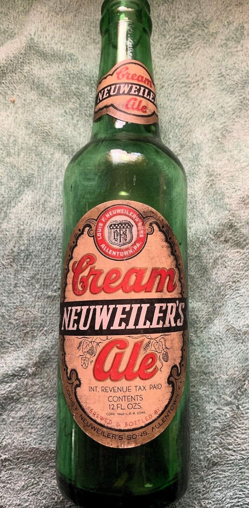
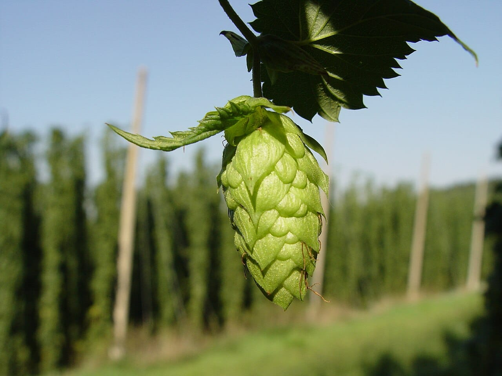

# 奶油艾尔

美国淡色艾尔，常加玉米或大米降低麦芽厚度，口感清爽、泡沫细、苦度低；名字里的“奶油”指质地，不是奶油味。

奶油艾尔是美国的淡色艾尔，不是加乳制品的啤酒，也不是拉格：它常用玉米或大米降低麦芽厚度，酒体清爽、泡沫细、苦度低，名字里的“cream”指质地而不是奶油味。它兴起于 19 世纪末美国东北部，酒厂用低温熟成模仿拉格的干净收口，却保留艾尔的发酵风味；与 Kölsch 相比，它的谷物甜更明显，苦度通常更低。看标签时先确认辅料、酒精度与苦度，只写 cream ale 而没有配方说明的，可能只是淡色艾尔的营销名。Genesee Cream Ale 是美国东北部最常见的商业代表，Little Kings 以小球瓶与顺滑口感闻名，德州也有 Lone Star、Shiner 等区域版本；精酿酒厂常把它做成 4–6% ABV 的夏季款。它适合新鲜饮用，购买时看生产日期，存放要避光并保持 5–10°C；饮用温度 4–8°C，用 pint 或 stange 杯保留细泡沫，配汉堡、炸鸡与轻咸零食，不适合重酱汁。它和 Kölsch 都走清爽路线，但奶油艾尔的玉米甜与低苦度更明显，颜色也更浅。

图：Cream Ale：1934 - Neuweiler Cream Ale Bottle - Allentown PA（Wikimedia Commons）。图片：Self Scanned，Public domain，via Wikimedia Commons（[原图页面](https://commons.wikimedia.org/wiki/File:1934_-_Neuweiler_Cream_Ale_Bottle_-_Allentown_PA.jpg)）。

## 定义与边界

奶油艾尔是美国淡色啤酒的一个历史类别：以淡色麦芽为主，常加入玉米或大米作为辅料，使用顶层发酵的艾尔酵母，再经过低温熟成，口感清爽、泡沫细、苦度低。名字里的“cream”指质地与泡沫，不是添加奶油或 lactose。

它不是受保护的法定风格，美国法规也没有为“cream ale”单列身份标准；酒厂可以在配方、酒精度与苦度上自由调整。与淡色拉格的区别在酵母与熟成：奶油艾尔用艾尔酵母主发酵，再借低温贮酒获得干净收口；与淡色艾尔的区别在辅料与苦度，麦芽厚度更低、酒花更克制。

## 历史与命名

19 世纪美国东岸与中西部的酒厂面对拉格啤酒的竞争，尝试用本地原料做出同样清爽、又保留艾尔发酵的产品。玉米与大米能稀释麦芽蛋白、降低酒体与成本，低温熟成则让发酵副产物沉降，形成“像拉格一样干净”的艾尔。

“cream ale”这个名称在 20 世纪逐渐固定，Genesee、Lone Star 等区域品牌把它做成大众产品；1970 年代以后，精酿酒厂又把旧配方重新诠释，加入更多酒花或提高酒精度，但基础仍是淡色、低苦、干净的谷物酒体。

在 20 世纪初的美国，奶油艾尔常与“cream”一起出现在广告里，强调比拉格更顺滑的泡沫；二战后，大型酒厂用连续发酵与低温贮酒把它做成低价大众产品，区域差异逐渐缩小。

## 原料与工艺

典型配方是淡色二棱麦芽占 70–80%，玉米片或大米占 20–30%，少量焦糖麦芽调色；酒花以温和的 Noble 型或美国传统品种为主，苦度通常 15–20 IBU。辅料需要单独糊化，再与麦芽一起糖化，否则玉米淀粉无法充分转化。

糖化温度偏低、时间偏长，让酒体更薄、可发酵糖更完全；煮沸时间不宜过长，避免麦芽香气被煮掉。艾尔酵母在 18–20°C 主发酵，结束后降到 0–4°C 贮酒 2–4 周，让酵母与硫化物沉降，装瓶时碳酸化到 2.4–2.8 体积。

部分酒厂会用拉格酵母做“cream ale”，但那就更接近淡色拉格；也有酒厂加少量小麦或燕麦增加泡沫持久度。辅料比例、酵母与贮酒时间是判断风格的关键，不是名字里的“cream”。

## 风格与味觉

酒液浅黄到金色，澄清度高，泡沫细白；香气以麦芽甜、淡淡谷物、轻微花香与柑橘为主，不应有奶油、香草或明显酯香。入口轻、碳酸中高，苦度低，收口干净，酒精度通常 4–5.5% vol。

它与淡色拉格最容易被混淆：奶油艾尔多一层麦芽甜与艾尔酵母的轻微果香，酒体也略圆；与淡色艾尔比，它的酒花与苦度低得多，谷物辅料带来的“空”感更明显。判断典型性，先看苦度、辅料比例与是否低温熟成。

它的碳酸感通常比淡色拉格略低，泡沫更细，这是低温贮酒与蛋白质分解的结果；若喝到碳酸尖锐、苦度突出的版本，更可能是淡色艾尔或酒花型拉格。

## 代表产区与品牌

Genesee Cream Ale 是美国东北部最常见的商业代表，风格清淡、价格亲民；Hudy Delight 的 Little Kings Cream Ale 以小球瓶与顺滑口感闻名；Lone Star 与 Shiner 等德州品牌也有区域版本。

精酿酒厂常把奶油艾尔做成夏季季节性产品，加入玉米、大米或少量小麦，酒精度从 4% 到 6% 不等。找酒时看背标的辅料、苦度与酒精度；只写“cream ale”而没有配方说明，可能只是淡色艾尔的营销名。

## 怎么喝与配餐

饮用温度 4–8°C，使用 pint 或 stange 杯，倒酒时保留细泡沫；温度过高会让谷物甜显得发腻，过低则压住香气。配餐适合汉堡、炸鸡、玉米饼、薯条与轻咸零食；它不适合配重酱汁或高单宁食物。

开瓶后尽量一次喝完；碳酸与新鲜谷物香气衰减很快。若用来做鸡尾酒，可以替代淡色拉格做 beer highball，但不要加过多糖浆，否则会盖住干净收口。

## 选购、储存与误区

先看生产日期与保质期，奶油艾尔适合新鲜饮用；再看辅料、酒精度与苦度，避免把“cream”当成甜味或奶味。深色玻璃瓶、避光与 5–10°C 存放能延缓老化；长期存放会出现纸板味与碳酸流失。

常见误读：以为它含乳制品；以为它是拉格；以为颜色浅就没有风味。它的风味来自谷物、低温熟成与细腻碳酸，不是奶油添加物。

## 延伸阅读与另见

- [啤酒](ref:beer)：发酵饮料的分类与工艺。
- [大麦](ref:barley)：麦芽与谷物原料。
- [发酵](ref:fermentation)：糖转化为酒精与二氧化碳。
- [美国](ref:usa)：产区与法规背景。
- [酒花](ref:hop)：苦度与香气的来源。

对照阅读：[啤酒](ref:beer)、[发酵](ref:fermentation)、[大麦](ref:barley)。

**关键事实。**

| 项目 | 内容 |
| --- | --- |
| 一句话定位 | 美国淡色艾尔，常加玉米或大米降低麦芽厚度，口感清爽、泡沫细、苦度低；名字里的“奶油”指质地，不是奶油味 |
| 上位风格 | 啤酒 |

**来源与边界。** 本页关于「奶油艾尔」的关键事实，主要由以下来源交叉核对：Beer Judge Certification Program（啤酒风格的定义、参数与典型特征）、Brewers Association（美国啤酒风格、原料与行业分类）、CAMRA（英国传统啤酒与艾尔风格）等 4 条来源。价格、批次与状态会变，涉及这些字段时以页面所列来源的最新版本为准。正文为项目自写，来源只作核验，不复制原文。

## 相关图像

图：啤酒花。图片：LuckyStarr，CC BY 2.5，via Wikimedia Commons（[原图页面](https://commons.wikimedia.org/wiki/File:Humulus_Lupulus_Hopfendolde-mit-hopfengarten.jpg)）。关联图像：奶油艾尔。
