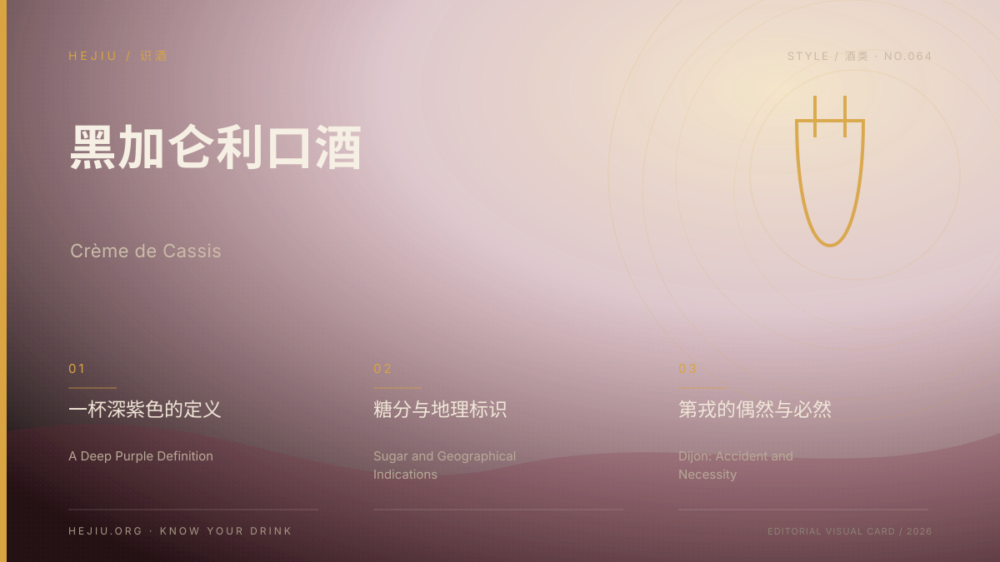

# 黑加仑利口酒

黑加仑利口酒（crème de cassis）是先把黑加仑果实浸入中性烈酒、再把浸提液加糖调成的深紫色甜酒。法语里的 crème 在这里并不表示奶油，而是指糖分更高、质地更厚的一档[利口酒](ref:liqueur)；因此它不含乳制品，却常比普通果味利口酒更浓稠。它最著名的用途是兑入白葡萄酒或起泡酒，做成 Kir 与 Kir Royale，但单独加冰或淋在甜点上同样成立。

图：黑加仑利口酒 双语视觉卡（项目自绘 SVG）。不是实拍。

## 一杯深紫色的定义

从结构上看，黑加仑利口酒是“烈酒 + 果实浸提 + 糖”的组合，不经过发酵。它需要足够的糖来承载黑加仑尖锐的酸度，也需要足够的酒精度来固定香气。颜色来自果皮与果肉中的花青素，通常呈深紫红到近乎黑色，摇杯时会在杯壁留下明显的紫色酒泪。

它与黑加仑糖浆的区别是有酒精，与黑加仑果酒的区别是没有发酵，与“crème de fruits”家族里的其他成员则共享高糖、高香气的设计。名字里的 cassis 在法语中就是黑加仑，在英国、美国与日本市场也常直接写作 crème de cassis。

## 糖分与地理标识

欧盟法规为黑加仑利口酒单列了类别：最低酒精度 15% vol，最低含糖量 400 克/升（以转化糖计）。这比普通利口酒的糖分门槛高得多，也解释了它浓稠的口感和较长的保存期。高糖并不等于甜腻，因为黑加仑本身酸度很高，糖与酸在口中形成拉扯，余味才不至于塌陷。

地理标识是另一条边界。第戎自 1925 年起就以“Cassis de Dijon”的名义保护本地黑加仑利口酒，生产者必须在该市范围内完成关键工序；勃艮第则从 2015 年起以“Crème de cassis de Bourgogne”的[地理标识](ref:france)进入欧盟保护体系。消费者看到的产地字样，往往比品牌名更能说明风格来源。

## 第戎的偶然与必然

第戎以芥末闻名，却在 19 世纪成为黑加仑利口酒的首都。1841 年，奥古斯特—德尼·拉古特在城中做出第一版商业化黑加仑利口酒，把当地果园的黑加仑与中性酒精、糖结合。此后，拉古特家族与勒杰家族把产品推向巴黎的咖啡馆，第戎的利口酒作坊也逐渐形成集群。

20 世纪，第戎市长费利克斯·基尔把黑加仑利口酒与勃艮第白葡萄酒兑在一起招待客人，这款饮品的叫法后来固定为 Kir。它既解决了低酸白葡萄酒口感单薄的问题，也让黑加仑利口酒从餐后酒变成餐前酒。以起泡酒代替静止酒的版本被称为 Kir Royale，颜色更亮，气泡把果香托得更高。

## 从果园到浸渍罐

核心原料是黑加仑，尤其是果粒小、皮厚、酸度高、香气浓的“勃艮第黑”品种。果实通常在盛夏成熟，采收后尽快破碎或整粒入罐，避免氧化。生产者把果实与中性酒精混合，浸泡数周，让颜色、酸度与浆果香气进入酒液；随后压榨、过滤，再加糖浆调整甜度与酒精度。

浸泡温度与时间决定风格：低温长时间更保留新鲜果香，高温短时间提取更多颜色与单宁。部分生产者会保留少量果肉带来的浑浊感，另一些则过滤到完全清澈。无论哪种做法，目标都是让黑加仑的酸、甜与紫色果皮的单宁保持在一条线上，而不是让糖把果实压扁。

## 酸、甜、单宁的三重奏

倒入杯中，它通常呈深紫红色，边缘带紫色反光。闻香先是黑加仑果酱、桑葚与紫罗兰，随后出现胡椒、灌木与一点酵母感。入口甜度高，但酸度紧跟着上来，把甜味切开；中段有果皮带来的轻微涩感，尾段则回到浆果与花香。酒精度通常在 15% 到 20% 之间，过高会压住果香，过低则显得像糖浆。

温度对它的影响很大。冰镇后酸度更利落，适合餐前；室温下香气更展开，但甜感也更重，适合搭配巧克力或蓝纹奶酪。评价时值得看三点：颜色是否自然、酸度是否有支撑、余味是否干净。只甜不酸的产品，喝两口就会疲倦。

## 第戎、勃艮第与品牌群像

第戎的代表是 Lejay-Lagoute，它把 1841 年的配方写进品牌史，也长期主张第戎产地；Gabriel Boudier 与 L'Héritier-Guyot 同样扎根第戎，前者以利口酒与调酒原料见长，后者更强调果味与甜点场景。Cartron 等勃艮第生产者则利用“Crème de cassis de Bourgogne”的地理标识，强调本地果园与更完整的产区叙事。

大型酒商与超市自有品牌会提供价格更低的版本，原料可能来自不同产区，糖酸比也更统一。它们未必难喝，但在纯饮或做 Kir 时，果香的鲜活度与酸度的锐利度通常不如小批量产品。购买时可以优先看产地、果实品种与糖分，而不是只看酒标上的紫色。

## Kir 与 Kir Royale：两种喝法

Kir 的经典比例是一份黑加仑利口酒兑四到五份干白葡萄酒，常用勃艮第的阿里高特；酒液会从淡金变成宝石红，黑加仑的酸香把白葡萄酒的圆润提亮。Kir Royale 把静止酒换成起泡酒，气泡让甜感更轻，适合庆祝场合。两种做法都不宜使用过甜的酒基，否则整体会发腻。

除了兑酒，它也可以加冰纯饮、兑苏打水、淋在香草冰淇淋上，或作为巧克力甜点的酱汁。与[葡萄](ref:grape)酒搭配时，酸度是关键词：高酸的白葡萄酒、干型起泡酒比甜型酒更容易与它相处。若用来调鸡尾酒，记得减少配方中的[残糖](ref:residual-sugar)，否则甜度会迅速累积。

## 它为什么不是果酒

黑加仑利口酒常被误称为“黑加仑果酒”，但两者工艺不同。果酒是果汁或果浆经过酵母发酵，酒精来自糖的转化；黑加仑利口酒的酒精来自外加的烈酒，果实只负责提供香气、颜色与酸度，糖则在最后加入。前者酒精度通常更低、风味更发酵感，后者更稳定、更甜、更适合长期保存。

它也不是黑加仑汁或糖浆：果汁开瓶后容易变质，而高糖高酒精让它更耐放。理解这一点，就能明白为什么配方里用它时要同时调整酸与糖，而不能按果汁的比例替换。

## 选购与保存

购买时先确认类别词：标“crème de cassis”的产品糖分更高，标“liqueur de cassis”的通常更轻。再看酒精度与产地，15% 到 20% 是常见区间，第戎或勃艮第产地往往意味着更明确的原料来源。开瓶后放在阴凉避光处即可，高糖高酒精使它比多数果味利口酒更耐放；若出现明显氧化味或颜色发褐，就不要再用于精细调酒。

补充阅读：[修道院啤酒](ref:c-extra-1)。

相关条目：[利口酒](ref:liqueur)、[法国](ref:france)、[葡萄](ref:grape)。
