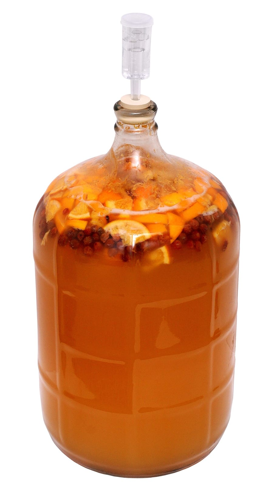

# 苹果蜂蜜酒

苹果蜂蜜酒（cyser）是蜂蜜与苹果汁共同发酵的蜂蜜酒类型，介于蜂蜜酒与苹果酒之间；苹果提供酸度与果香，蜂蜜提供糖分与花香，成品从干型到甜型、从静止到起泡都有。

图：Cyser：Swedish Mead（Wikimedia Commons）。图片：Grapetonix，CC BY 3.0，via Wikimedia Commons（[原图页面](https://commons.wikimedia.org/wiki/File:Swedish_Mead.JPG)）。

## 定义与边界

在蜂蜜酒分类中，加入水果发酵的蜂蜜酒统称 melomel，苹果蜂蜜酒是其中以苹果为原料的一类：通常使用未发酵的苹果汁（苹果酒原浆），也可以用餐用苹果或酿酒苹果的果浆，部分配方加入梨、榅桲等其他仁果类果实。它既是蜂蜜酒(ref:honey-wine)的分支，也与苹果酒(ref:cider)共用苹果原料与酸度骨架，两者的比例决定了最终产品更偏向哪一端。

判断一款产品是不是 cyser，要看糖源构成：蜂蜜与苹果汁共同发酵才属于这类；如果蜂蜜比例很低、主体是苹果发酵，比赛与行业分类中更接近特种苹果酒。加入香料的苹果蜂蜜酒会被归入水果香料蜂蜜酒，加入苹果以外水果的产品则归入其他水果蜂蜜酒，而不再是单纯的 cyser。标签上的蜂蜜来源、苹果品种、甜度与气泡等级，是区分产品方向的关键信息。

## 历史与命名

蜂蜜是欧洲与西亚最古老的甜味剂之一，苹果则在中亚被驯化后沿贸易路线传入地中海与北欧；两种原料结合的发酵饮品，在多地有各自的乡村传统。苹果本身含糖不高，单靠果汁发酵通常只能得到低度饮料，在砂糖普及之前，加入蜂蜜来提高酒精度与保存能力，是很自然的选择。苹果蜂蜜酒这类混合饮品，正是在这一原料条件下形成的。

英文 cyser 与 cider 同源，可追溯到中世纪拉丁语 sīcera，该词又与希伯来语中“烈酒”一词有关联；这是词源上的联系，不等于有单一文献记载的发明者。近代以前，蜂蜜在英格兰北部、诺曼底与斯堪的纳维亚一带都与苹果、浆果搭配发酵；进入 12 世纪以后，砂糖逐渐在欧洲取代蜂蜜成为主要甜味剂，蜂蜜酒的日常消费随之收缩，苹果蜂蜜酒更多保留在家庭酿造与节庆场合。现代手工蜂蜜酒厂复兴这一类产品时，又把苹果 cider 的工艺与风味带了回来。

## 原料与工艺

蜂蜜(ref:honey)在 cyser 中承担糖分、发酵底物与花香风味；苹果(ref:apple)汁提供自然酸度、果香、部分营养与单宁，深色苹果还能带来可感知的涩感与颜色。传统做法是把蜂蜜直接加入苹果汁中发酵，不再额外加水；现代配方也可以先分别酿出蜂蜜酒与苹果酒，再按比例调和。蜂蜜品种（如苜蓿、橙花、栗花）会带来不同的花香与颜色，苹果品种则决定清爽度、酸度与单宁强弱。

发酵(ref:fermentation)需要控制温度与营养补充：苹果汁含有一定果胶与浑浊物，会影响澄清度，酿造中常通过静置、倒桶或过滤处理。酵母多为葡萄酒或蜂蜜酒常用的培养酵母，发酵完成后按目标甜度决定是否终止发酵或保留残糖。苹果香气在瓶陈中会逐渐柔和，强款可以发展出类似苹果白兰地的复合感，干型则接近清爽的白葡萄酒；单宁会让偏甜的喝起来显得更干一些。

## 风格与味觉

cyser 的甜度分为干型、半甜与甜型，气泡从静止到起泡不等；酒体随甜度和强度从中轻到饱满。相比多数蜂蜜酒，它的酸度更明显，苹果的酸与蜂蜜的甜需要互相平衡，入口先感到苹果清爽，再回落蜂蜜甜感是常见结构。香气可以像干白葡萄酒一样清淡花果，也可以像新鲜甜苹果酒，陈年强款则接近陈酿苹果白兰地。

酒精度按强度分档：会话低度款约 3.5–7.5%，标准款约 7.5–14.0%，强款（sack）可达 14.0–18.0%。低度清爽款适合佐餐或畅饮，标准款最常见，强款酒精感明显、香料与干果气息更重。苹果单宁、蜂蜜浓度与残糖共同决定口感厚度，制作粗糙的产品容易出现残糖黏腻、酸度突兀或酵母、硫味等缺陷，这些属于发酵与澄清环节的问题，而不是风格本身。

## 代表产区与品牌

现代 cyser 主要由手工蜂蜜酒厂（meadery）与苹果酒厂生产，产地集中在北美、欧洲与新西兰的手工酿造圈子，没有统一的法定产区。比赛指南列出的代表产品包括 Brothers Drake Pollinator、Redstone Apple Nectar、Schramm's Mead Apple Reserve、White Winter Cyser 与 Williamson Idunn；这些名称用于说明市场上可找到的方向，并不是官方分级。

不同生产者的差别主要在蜂蜜与苹果的比例、苹果品种、甜度等级和是否起泡。入门选择可以从标准强度、干型或半甜的静止款开始认识骨架；强款与起泡款适合比较不同发酵与调配思路。同一名厂也可能同时推出干型、甜型与香料版本，购买时按标签上的甜度、气泡与酒精度筛选，比只记品牌更有效。

## 怎么喝与配餐

饮用温度按甜度调整：干型与半甜款冰镇到接近白葡萄酒的温度，能突出苹果酸度与清爽感；甜型与强款可在稍凉的室温下饮用，让蜂蜜与干果香气展开。起泡款适合开胃或作为餐间饮品，静止干款更适合佐餐。杯子用白葡萄酒杯或中等肚径通用杯即可，不必使用专用烈酒杯。

配餐围绕苹果与蜂蜜的酸甜结构：干型 cyser 配烤猪肉、禽肉、香肠与软质奶酪，苹果酸可以切割油脂；半甜与甜型配水果挞、蜂蜜蛋糕、坚果与蓝纹奶酪，蜂蜜甜感与甜点呼应。带香料的版本适合冬季炖菜与干果点心；辣味菜式会同时放大酸度和酒精，选择果味柔和的低度款更稳妥。

## 选购、储存与误区

读标签先分清产品属于蜂蜜酒还是苹果酒：蜂蜜比例高、以花香蜜甜为主的是 cyser 方向，苹果汁比例高、主体像苹果酒的产品更接近特种 cider。再看甜度、气泡、酒精度与标注的苹果或蜂蜜品种；比赛与酿造指南要求入口时注明这些参数，消费者读瓶标同样可以按这套信息比较。

储存上，低度与起泡款新鲜度优先，避光、避高温、横放或竖放均可，开瓶后尽快喝完；高糖、高酒精度的强款耐放一些，但开瓶后香气仍会随时间下降。未开瓶的 cyser 放在阴凉稳定的环境即可，不需要像葡萄酒那样长期卧瓶陈存。常见误区是把所有蜂蜜苹果混合饮品都当成同一种风格：甜度、气泡、强度与苹果单宁的差别，远比“蜂蜜加苹果”这个笼统描述更重要。

## 延伸阅读与另见

认识 cyser 可以先从一款标准强度的静止半甜款入手，再比较干型与起泡版本，最后试一款强陈年款；三档对照之后，蜂蜜、苹果与发酵陈年各自带来的作用会比较清楚。

- 相关条目：[honey-wine](ref:honey-wine)、[cider](ref:cider)、[honey](ref:honey)、[apple](ref:apple)、[fermentation](ref:fermentation)。

## 相关图像

图：蜂蜜酒。图片：Evan-Amos，CC0，via Wikimedia Commons（[原图页面](https://commons.wikimedia.org/wiki/File:Honey-Fruit-Mead-Brewing.jpg)）。关联图像：苹果蜂蜜酒。
