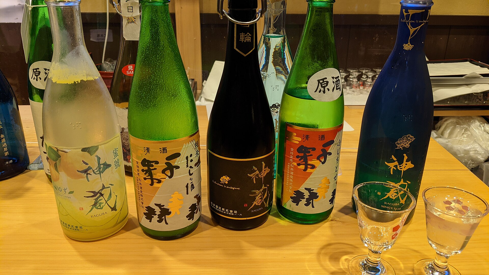

# 大吟酿

大吟酿是“把米磨到一半以下”的清酒。法定线只有两条：精米步合 50% 以下，采用吟酿造；可添加不超过白米重量 10% 的酿造酒精，不添加则称纯米大吟酿。但 50% 以下是一段陡峭的成本曲线，每一步都在和碎米、杂味与产量博弈。

图：大吟酿相关实景照片。图片：Nisiguti，CC BY-SA 4.0，via Wikimedia Commons（[原图页面](https://commons.wikimedia.org/wiki/File:Matsui_Sake_Brewery%27s_Sake_20211122.jpg)）。

## 50% 与 60% 的距离

从吟酿到大吟酿，法规上只差 10 个百分点，工艺上却是另一回事。米粒磨到一半时，心白已接近裸露，米粒体积小、强度低，洗米几秒钟就可能吸水过量，蒸米时外层过软、内层夹生。酒藏必须为高精米单独设定浸渍时间与蒸米压力。

这 10 个百分点也意味着出米率下降。同样一吨玄米，做吟酿能出更多成品，做大吟酿则要投入更多原料与研磨工时。价格差的根源在这里，而不只是“高级”两个字。

## 两个名称，一条边界

大吟酿可以添加酿造酒精；纯米大吟酿不添加。除此之外，两者对精米步合与工艺的要求完全相同。酒标通常同时印出精米步合，例如“纯米大吟酿 45%”，读标时应把名称与数字一起看。

需要提醒的是，大吟酿不是清酒的最高法定等级。它与吟酿、纯米吟酿、纯米大吟酿并列，四条边界由精米步合与是否添加酒精交叉构成。把大吟酿当作“顶配”，是把类别误读成排名。

## 精米的物理极限

精米不是把米磨小那么简单。米粒在研磨中会发热、开裂，需要控制转速与湿度；磨到 40% 以下时，碎米率显著上升，可用米粒变少。能磨到 23% 甚至更低的酒米，通常要求心白大、结构均匀，山田锦因此成为首选。

但极限精米不保证好喝。米味与旨味主要来自心白中的淀粉与蛋白质，磨得越深，可转化的风味物质越少。酒藏会用酒母、酵母、酿造水与熟成去补结构；补不回来时，酒会显得空、薄，只剩香气。

## 比赛酒：大吟酿的技术橱窗

日本全国新酒鉴评会是高精米技术最集中的展示场。参赛的“出品酒”通常把精米步合压到 35% 左右，使用香气突出的酵母，发酵温度极低，目标是让吟酿香在盲品中清晰可辨。

比赛酒与市售酒是两套逻辑。比赛酒追求香气强度与典型性，往往不适合常温饮用；市售大吟酿要考虑货架期、运输与配餐。把比赛获奖风格当成日常标准，容易买到香气过冲、酒体单薄的酒。

## 香气浓度与平衡

大吟酿的香气通常比吟酿更集中，苹果、白桃、梨、香蕉与白花是常见描述。浓度高不等于质量高。香气过冲时，酒精感会更明显，米味被压住，回味变短。

优质的大吟酿有三个特征：香气清晰但不刺鼻，入口有透明的质感，收口能回到米味。这三点靠的是发酵管理，而不是单靠精米步合。温度升高后果香会展开，但酒精也会更突出，10 至 13°C 是较稳妥的区间。

## 酒米不只有山田锦

山田锦心白大、吸水稳定，是高精米的主力。五百万石颗粒稍小、心白较少，磨到高精米时更难，但能给出清爽的酸度；美山锦耐寒，常见于东北；雄町颗粒大、心白明显，风格更厚；爱山与神力等古老酒米近年也被重新用于高精米产品。

同一精米步合下，酒米会改变香气类型与酒体厚度。选购时把酒米、酵母与酒母一起看，比只看步合数字更有意义。

## 火入、熟成与新鲜度

多数大吟酿以新鲜果香为目标，装瓶前经过一次或两次火入（低温杀菌），以稳定品质。生酒与生诘不加热，香气更活跃，但必须冷链；熟成酒（古酒）则走另一条路，靠时间把果香转成干果、蜂蜜与香料。

大吟酿不适合长期存放。即使未开封，果香也会在一年内逐渐减弱；开瓶后氧化更快。购买时注意灌装日期与保存条件，比追求“陈年”更实际。

## 价格与产量

高精米产品的产量低、工时长，价格通常是普通吟酿的数倍。价格差异主要来自出米率、精米时间、酒米等级与熟成成本，而不是品牌溢价一项。高价不等于合口，低价也不等于粗糙；把预算放在自己常喝的类别上，比追逐数字更划算。

## 饮用建议

用郁金香形杯或小号葡萄酒杯，10 至 13°C。先闻静止香，再轻摇；入口注意甜度、酸度、旨味与收口的干净程度。配餐以白身鱼、贝类、清蒸海鲜、寿司与清淡前菜为主；浓酱、炭烤与重辣会盖住细腻香气。

开瓶后冷藏，尽量在数周内喝完。生酒与未杀菌产品需要更严格的冷链。本页关于大吟酿的内容涉及酒精饮料；过量饮酒有害健康，未成年人不应饮酒。

## 常见误解

- 大吟酿就是纯米大吟酿：前者可添加法定上限内的酿造酒精。
- 精米步合越低越好：低步合可能削薄米味，平衡才是关键。
- 大吟酿越陈越香：多数以新鲜果香为目标，久放会衰退。
- 香气越浓越好：过浓常伴随酒精刺激与杂味。
- 大吟酿只能用山田锦：五百万石、美山锦、雄町等也能做高精米。
- 大吟酿高于吟酿：两者是并列类别，差别在精米门槛。

对照阅读：[清酒](ref:sake)、[发酵](ref:fermentation)。

## 延伸阅读

- [清酒](ref:sake)：清酒的类别体系与酿造框架。
- [精米步合](ref:polishing-ratio)：50% 门槛与出米率的含义。
- [发酵](ref:fermentation)：低温长期发酵与吟酿香的关系。
- [大米](ref:rice)：酒米品种与高精米的关系。
- [日本](ref:japan)：清酒产区与国家背景。

相关条目：[精米步合（polishing ratio）](ref:polishing-ratio)。

**关键事实。**

| 项目 | 内容 |
| --- | --- |
| 一句话定位 | 日本清酒中精米步合不超过 50%、采用吟酿造的特定名称类别；可添加不超过白米重量 10% 的酿造酒精，不添加时称纯米大吟酿 |
| 上位风格 | 清酒 |
| 香气家族 | 花果香 |

**来源与边界。** 本页关于「大吟酿」的关键事实，主要由以下来源交叉核对：Japan Sake and Shochu Makers Association（大吟酿与纯米大吟酿的精米步合上限、原料条件与吟酿造定义）、日本国税庁（大吟酿的 50% 精米步合门槛、特定名称标示与酿造酒精添加规则；清酒的法定分类与制造概况）、Oxford University Press（提供关于高精米清酒、吟酿香与清酒酿造的条目）。价格、批次与状态会变，涉及这些字段时以页面所列来源的最新版本为准。正文为项目自写，来源只作核验，不复制原文。
