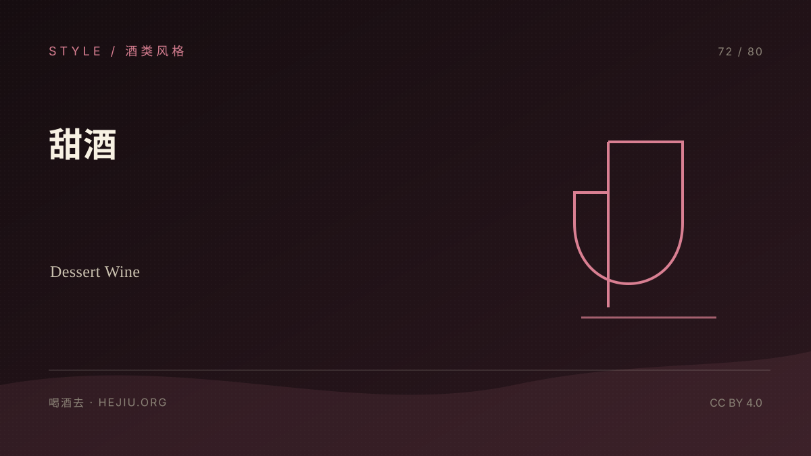

# 甜酒

甜酒（dessert wine）不是一种葡萄、一个产区或一条法规，而是一组以残糖为核心特征的[葡萄酒](ref:wine)。它可以是贵腐菌感染后浓缩的白酒，可以是晚收或风干葡萄酿成的酒，可以是冬天在藤上结冰的葡萄压榨出的冰酒，也可以是发酵中途加入葡萄蒸馏酒、保留糖分的加强酒。把它们放在一起的理由只有一个：入口明显的甜味，以及为平衡这份甜味而必须存在的酸度。

图：甜酒 类型示意图。图片：Doubao Seedream 5.0 AI 辅助绘制（项目自有），不是甜酒的实拍。

## 定义：糖在哪里

葡萄酒的甜来自葡萄自身的糖，或来自发酵被中断后剩下的糖。前者靠浓缩：葡萄在藤上失水、被贵腐菌穿透，或在采收后晾干，糖分比例上升。后者靠停止发酵：降温、过滤、加二氧化硫，或加入酒精抑制酵母。两条路径都会留下残糖，但风味走向完全不同：浓缩带来果干、蜂蜜与贵腐香气，中断发酵则保留更多新鲜果味。

残糖以克/升计。欧盟对静止葡萄酒的甜度分类把大于 45 克/升的酒归为甜型，但这一门槛只是标签体系的一部分，并不等于“甜酒”的完整定义。加强甜酒的酒精度更高，冰酒的糖与酸同时被浓缩，贵腐酒的香气来自真菌代谢，这些都无法被一个数字概括。

日常语境里“甜酒”常被当成餐后酒的代名词，但这两件事并不重合。干型的雪莉、干型的马德拉都可以在餐后饮用，而半干的雷司令常在餐前或配主菜。真正决定它是不是甜酒的，是残糖与感知到的甜度，而不是喝酒的时间。

## 五条把糖留在酒里的路径

第一条是[贵腐](ref:noble-rot)。葡萄被贵腐菌感染后，果皮出现微孔，水分蒸发，糖、酸与香气物质同时浓缩，并产生蜂蜜、姜与柑橘酱的气息。第二条是[晚收](ref:late-harvest)，葡萄留在藤上继续成熟，糖分上升、酸度下降，风格比贵腐更直接。第三条是风干，采收后在草席、木架或通风室内晾晒，意大利的 passito 与西班牙的 Pedro Ximénez 都属此类。第四条是结冰，葡萄在藤上自然冻结，压榨时冰晶留在外面，只流出浓缩汁。第五条是加强，在发酵未完成时加入葡萄蒸馏酒，酵母被酒精抑制，糖分保留下来。

五条路径的共同点是“浓缩”，差别在于浓缩发生在藤上、采后、压榨时还是发酵罐里。理解这一点，就能把甜酒从一个模糊的品类拆成可以比较的工艺。

## 法规只说了一半

欧盟法规为葡萄酒的类别、地理标志与标签提供框架，各产区再以自己的产品规范规定品种、最低糖度、产量与陈年。1855 年波尔多分级把苏玳与巴萨克列入甜白体系，2013 年托卡伊的改革则取消了以 puttonyos 强制标注的做法，改用[残糖](ref:residual-sugar)克/升。这两个例子说明：甜酒的“标准”一直在变，酒标上的词有时候是历史，有时候是法律。

## 酸度决定甜酒的上限

甜酒最容易失败的地方不是不够甜，而是没有酸。糖提供重量，酸提供轮廓；缺少酸的甜酒会显得黏、短、腻。贵腐酒的高酸来自葡萄本身与真菌对酒石酸、苹果酸的消耗差异，[冰酒](ref:ice-wine)的酸与糖同时被浓缩，加强甜酒的酸则常被酒精与氧化修饰。判断一款甜酒，可以先看它咽下之后口腔是否干净；如果甜味散不去、只剩糖浆感，多半是酸度不足。

另一个常被忽略的指标是酒精。酒精带来黏度与热度，糖带来重量，两者叠加会让酒显得更厚；因此高酒精的加强甜酒需要更高的酸度与更长的陈年来取得平衡。这也是为什么同样标着“甜”，冰酒喝起来轻盈，而陈年波特却厚重。

## 温度、杯型与开瓶后的寿命

轻盈的甜白，如年轻的白诗南或雷司令晚收，适合 6–8°C；贵腐酒与冰酒适合 8–10°C；年份较久的贵腐酒可以到 12°C；[加强](ref:fortified-wine)甜酒则在 12–14°C 更能展开。杯子不必太小，郁金香形或小号白葡萄酒杯能让香气聚拢，又不至于让酒精冲鼻。

开瓶后的寿命差异很大。冰酒与贵腐酒糖度高、氧化慢，冷藏可以放数天到两周；加强甜酒更耐放；而酒精度低、残糖中等的晚收酒最容易走味。用真空塞、冷藏、小瓶分装都能延缓氧化，但不要指望甜味能掩盖已经出现的醋味。

## 配餐不只有甜点

甜酒与甜点的搭配有一条基本规则：酒要比甜点更甜，否则酒会显得酸苦。蓝纹奶酪是经典的反差搭配，咸味与脂肪托住糖分；鹅肝与贵腐酒的组合靠油脂与酸度；水果塔、杏仁甜点适合年轻贵腐或晚收；而半干的雷司令常被用来搭配辛辣的中餐，因为甜味能缓和辣感。冰酒适合单独饮用，或配清爽的水果甜点。

## 五个常见误判

第一，认为甜酒等于低端酒。贵腐酒与冰酒的产量极低，采摘与筛选成本高，价格往往高于同产区干红。第二，认为甜酒都来自贵腐。冰酒、风干酒与加强甜酒都不依赖贵腐。第三，认为越甜越好。平衡来自糖与酸的比例。第四，认为开瓶后可以无限期保存。低酒精的甜酒同样会氧化。第五，认为冰酒是把葡萄采下后冷冻。合规的冰酒必须在藤上自然结冰。

相关条目：[葡萄酒](ref:wine)、[加强葡萄酒](ref:fortified-wine)。

**关键事实。**

| 项目 | 内容 |
| --- | --- |
| 一句话定位 | 以残糖而非单一法规界定的葡萄酒大类，涵盖贵腐、晚收、风干、冰酒与加强甜酒；糖的来源、酸的支撑与侍酒温度共同决定它是否平衡 |
| 上位风格 | 葡萄酒 |
| 香气家族 | 蜂蜜/果干/贵腐 |

**来源与边界。** 本页关于「甜酒」的关键事实，主要由以下来源交叉核对：International Organisation of Vine and Wine (OIV)（葡萄酒、甜型葡萄酒与特殊采收葡萄的定义）、European Union（葡萄酒类别、地理标志与甜度标签框架）、Oxford University Press（提供关于甜酒、贵腐、晚收与冰酒的条目）等 4 条来源。价格、批次与状态会变，涉及这些字段时以页面所列来源的最新版本为准。正文为项目自写，来源只作核验，不复制原文。

**并读。** 把「甜酒」与「葡萄酒」、「加强葡萄酒」、「残糖（residual sugar）」放在一起读时，先确认它们是同一层级还是上下游关系：先确认定义与工艺，再比较原料、产区与代表品牌。本页负责给出酒类风格的基本坐标，对照条目补上具体案例与差异；读完再回到本页，才能分清哪些差别属于酒类风格本身，哪些只是产地、批次或品牌选择。
