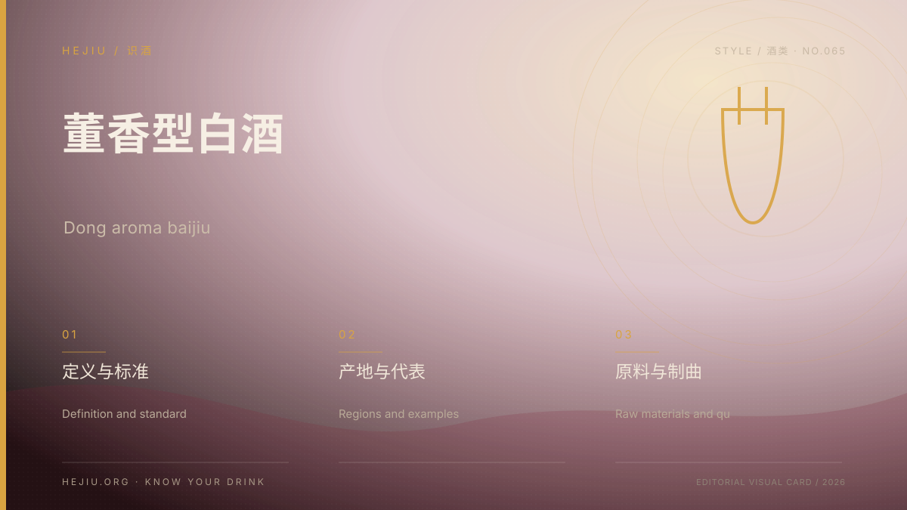

# 董香型白酒

董香型白酒又称药香型白酒，是白酒香型分类中的一种，以贵州董酒为代表。它的辨识度来自制曲时加入多种草本原料，以及大曲与小曲并用、双醅串蒸的工艺组合。贵州省地方标准 DB52/T 550-2013《董香型白酒》对该香型的产地、原料、工艺与质量指标作出规定。

图：董香型白酒 双语视觉卡（项目自绘 SVG）。不是实拍。

## 定义与标准

在[白酒](ref:baijiu)香型分类中，董香型与浓香、酱香、清香、米香等并列。术语与分类可参见 GB/T 15109-2021《白酒工业术语》，产品层面的具体要求则以贵州省地方标准 DB52/T 550-2013 为依据。

香型是分类，不是质量等级。董香型的“药香”描述的是制曲与发酵形成的香气类型，不代表产品具有药用功效，也不代表比其它香型更高级或更稀有。

在标准体系里，DB52/T 550-2013 是贵州省地方标准，直接约束省内生产企业；GB/T 15109-2021 则提供全国通用的术语与分类依据。两者一个管产品、一个管概念，不能互相替代。购买时仍以瓶身标注的执行标准与生产许可信息为准。

## 产地与代表

董香型的主要产地是[贵州](ref:guizhou)遵义，代表产品为董酒。董酒的生产集中在遵义一带，原料、曲种与当地气候共同构成其风格基础。

产地名称不是质量保证。同一香型下不同企业的原料配比、草本种类与制曲温度差异明显，成品可以从药香突出到偏浓香、偏酱香。把“董香”当成一个固定风味，会忽略企业的产品分层。

## 原料与制曲

董香型以[高粱](ref:sorghum)为主料，制曲同时使用大曲与小曲，并在曲料中加入多种草本原料。草本参与制曲，影响的是微生物群落与香气前体，不是把药材泡进酒里。

参见[制曲](ref:qu-making)的一般原理。大小曲并用意味着两套微生物与酶系要协同：小曲负责糖化与发酵启动，大曲补充香气前体与耐温菌群。草本比例与曲温控制不当，会让香气失衡或发酵失控。

产地细节也值得留意：董酒的酿造集中在遵义董公寺一带，制曲分工明确，小曲以大米为原料，负责糖化与产酒；大曲以小麦为原料并拌入草本，负责积累香气前体。两类曲分别培养、分别使用，再通过双醅串蒸把香醅中的香气带入酒体，这才是“大小曲并用”的实际含义。

## 工艺

董香型的核心工艺是双醅串蒸：酒醅与香醅分别制备，蒸馏时让香气穿过酒醅，使香气组分进入酒体。这一工序把制曲与发酵形成的复合香气转移到成品，是董香型区别于其它香型的关键。

工艺还涉及[发酵](ref:fermentation)容器、温度与轮次管理，以及[蒸馏](ref:distillation)时的分段摘酒。串蒸的时间、蒸汽强度与装甑方式都会影响香气提取效率。工艺参数属于企业技术范围，公开资料通常只描述原理，不给完整参数。

## 风味特征

董香型通常呈现草本、烘焙、酯香与轻微窖香交织的复合香气，入口醇厚，酒体较厚，回味长。香气中的“药香”更接近草本与曲香的综合感，而不是某一种具体药材的味道。

复合香气的难点在平衡。草本气息过强会掩盖粮香与酯香，过弱则失去辨识度。优质董香型应有清晰的层次与干净的收口，香气之间不冲突。

## 品鉴与饮用

品鉴时先闻静止香气，判断草本香、酯香与烘焙香的比例，再轻摇闻香，观察是否有冲突。入口注意甜、酸、苦的平衡与酒体厚度，咽下后看回味是否连贯。温度过高会放大酒精与草本气息，过低会压住层次。

董香型适合搭配风味较重的菜肴，如卤味、烧烤与红烧类。高度产品宜小杯慢饮，低度产品开瓶后应避光冷藏并尽快喝完。饮用强度以标签为准，不以香型推断。

## 常见误区

第一，把董香型的“药香”当成药酒。药香是制曲与发酵形成的香气类型，不是浸泡药材。
第二，认为董香型有保健功效。它是白酒，不是药品，标签上的功效宣称不应轻信。
第三，把香型当成等级。香型只是分类，不是质量高低。
第四，认为草本越多越好。草本比例需要与曲种和发酵条件匹配。
第五，把地方标准当成全国统一标准。董香型的产品标准目前以贵州省地方标准为依据。

董香型又称药香型，核心不是把药材泡进酒里，而是制曲时加入草本原料，并以大小曲、双醅串蒸形成复合香气。它以贵州董酒为代表，地方标准给出工艺与风味边界；消费者容易把“药香”误解为药酒或保健酒，实际它仍属于白酒。

对照阅读：[贵州省](ref:guizhou)、[高粱](ref:sorghum)。

## 延伸阅读

- [白酒](ref:baijiu)：董香型白酒在白酒分类与工艺框架中的位置。
- [贵州](ref:guizhou)：董香型的主要产区。
- [高粱](ref:sorghum)：董香型白酒的主要原料。
- [制曲](ref:qu-making)：大小曲并用与草本入曲的原理。
- [发酵](ref:fermentation)：容器、温度与轮次对复合香气的影响。
- [蒸馏](ref:distillation)：双醅串蒸与分段摘酒的作用。

**关键事实。**

| 项目 | 内容 |
| --- | --- |
| 一句话定位 | 又称药香型，以贵州董酒为代表；大小曲并用、制曲加入多种草本原料、采用双醅串蒸，贵州省地方标准 DB52/T 550-2013 对其作出规定 |
| 上位风格 | 白酒 |
| 香气家族 | 董香 |

**来源与边界。** 本页关于「董香型白酒」的关键事实，主要由以下来源交叉核对：贵州省质量技术监督局（董香型白酒的术语、产地、工艺与质量指标；未复制标准原文）、国家市场监督管理总局、国家标准化管理委员会（可在国家标准全文公开系统按标准号检索原文）、Oxford University Press（提供关于中国白酒与香型的条目；由原条目末尾参考资料迁移，未逐条复核访问日期）等 5 条来源。价格、批次与状态会变，涉及这些字段时以页面所列来源的最新版本为准。正文为项目自写，来源只作核验，不复制原文。

**并读。** 把「董香型白酒」与「贵州省」、「白酒」、「高粱」放在一起读时，先确认它们是同一层级还是上下游关系：先确认定义与工艺，再比较原料、产区与代表品牌。本页负责给出酒类风格的基本坐标，对照条目补上具体案例与差异；读完再回到本页，才能分清哪些差别属于酒类风格本身，哪些只是产地、批次或品牌选择。
