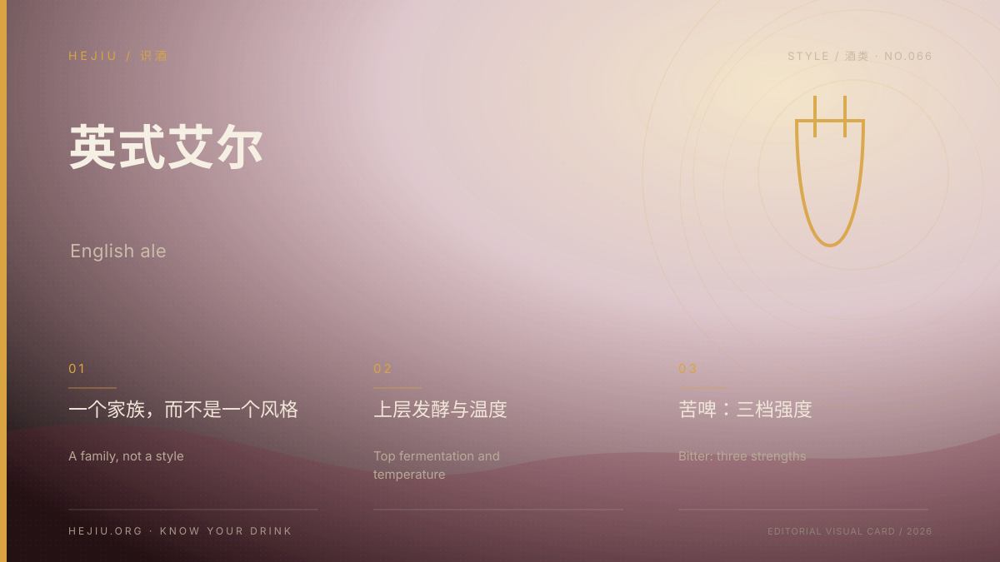

# 英式艾尔

英式艾尔是一个家族，不是一款酒。酒吧里日常的苦啤、颜色更浅的淡色艾尔、历史上的英式 IPA、深色的波特与世涛，都可以归在这个名字下。它们共享上层发酵、以麦芽为骨架、用酒花做平衡、追求适饮性而非极端强度这几条底线，却在颜色、苦味、酒精度与侍酒方式上各走各的路。

图：英式艾尔 双语视觉卡（项目自绘 SVG）。不是实拍。

## 一个家族，而不是一个风格

“艾尔”（ale）在英语中原本泛指未经酒花强化的发酵酒，后来逐渐指上层发酵的啤酒。它与拉格的分野在酵母与温度，不在质量。把艾尔理解为“更高级的啤酒”，是把工艺分类误当成品级排序；把英式艾尔理解为“一种苦啤”，则把一个大类缩成了一款酒。

英式艾尔的共同点是历史与市场，而不是单一配方。英国酒吧文化让小批量、就近供应、桶装侍酒成为传统；工业革命后的运输与税收又塑造了苦啤、波特与 IPA 的强度。读英式艾尔，最好把它当成一套“风格家族＋侍酒制度”，而不是一个可以被单一定义的词。

## 上层发酵与温度

艾尔使用酿酒酵母，在较温暖的环境中发酵，常见温度约 18–22°C。酵母在发酵液上层活动，发酵速度较快，产生的酯类带来苹果、梨、香蕉或花香。[发酵](ref:fermentation)温度会显著改变香气：温度偏高时酯香更浓，也可能带来溶剂感与杂醇；温度偏低则香气收敛，发酵变慢。

上层发酵不等于粗糙。现代酒厂同样使用精确温控、酵母管理和卫生控制，只是选择了不同的酵母与温度区间。传统与现代化并不矛盾，关键在于是否把工艺目标执行到位。英式艾尔的酵母常带轻微果香与低度双乙酰，这些是风格的一部分，不是缺陷。

## 苦啤：三档强度

苦啤（bitter）是英国酒吧最常见的日常艾尔，颜色从铜色到琥珀色，酒花苦味明显但不至于压倒麦芽。它不是法律分类，而是习惯叫法，也不是“苦味等级”。BJCP 2021 把英式苦啤分成三档：Ordinary Bitter 酒精度 3.2%–3.8%，Best Bitter 3.8%–4.6%，Strong Bitter 4.6%–6.2%。

三档的差别主要在强度与酒体，而不是简单的“越苦越好”。Ordinary 追求易饮与低酒精度，Best 是酒吧主力，Strong 更饱满、麦芽与酯香更明显。不同酒厂的苦啤在苦味、色泽与香气上差异很大；读酒标时，应看酒精度、色泽描述与酒花品种，而不是只认“bitter”这个词。

## 淡色艾尔与英式 IPA

淡色艾尔（pale ale）颜色更浅，麦芽甜感更清晰，酒花香气可以从草本、花香到柑橘。它与苦啤在历史上互相重叠，并非严格的法律分类。英式 IPA 是淡色艾尔中更烈、更干、酒花更突出的一支，BJCP 2021 给出的酒精度区间为 5%–7.5%。

IPA 的历史与 18 至 19 世纪英国向印度出口啤酒有关：为经受长途运输，酒花用量与酒精度被提高，形成酒花突出、苦味较强的风格。伯顿（Burton upon Trent）是重要产地，当地水质富含硫酸盐，会放大酒花苦味。现代 IPA 已分化出英式、美式与各类变体；英式 IPA 通常更注重麦芽骨架与草本酒花，苦味相对克制，美式 IPA 更强调柑橘、松脂与热带水果香。

## 波特与世涛

波特（porter）在 18 世纪初的伦敦流行，以深色麦芽与棕色麦芽带来烘烤、咖啡与巧克力风味，酒体中等偏厚；BJCP 2021 给出的英式波特酒精度为 4%–5.4%。世涛（stout）最初是“stout porter”，即更烈版本的波特，后来独立为风格，爱尔兰的健力士是代表。

世涛与波特不是对立面。二者共享深色麦芽基础，差别在强度、甜度与烘焙程度。把世涛理解为“黑色啤酒”的统称，会掩盖其内部差异；把波特当成“淡色世涛”，同样不准确。英式波特通常比美式波特更柔和、更焦糖化，酒花存在感更低；世涛则可以从甜世涛、燕麦世涛到帝国世涛，跨度很大。

## 桶装真艾尔

真艾尔（real ale）指在容器中完成二次发酵、含有活酵母、未经过滤与巴氏杀菌、靠重力或手泵侍酒的啤酒，常见容器是木桶或金属桶。CAMRA 在 1970 年代初推广“real ale”一词，把它与人工充气的桶装啤酒区分开来；1971 年 CAMRA 成立，推动保护传统桶装啤酒与酒吧文化。

真艾尔是一种供应与后处理方式，不是风格名称：同一款苦啤可以是桶装真艾尔，也可以是瓶装或听装。桶装真艾尔靠酵母继续发酵产生自然的碳酸气，形成保护层；侍酒温度通常为 11–13°C，比深冷更能释放麦芽与酒花的层次。开桶后与空气接触，保质期短，需要酒馆的窖藏与管路管理。

## 关键参数

- 发酵：上层发酵，常见 18–22°C。
- 苦啤：Ordinary 3.2%–3.8%，Best 3.8%–4.6%，Strong 4.6%–6.2%。
- 英式 IPA：5%–7.5%。
- 英式波特：4%–5.4%。
- 真艾尔侍酒温度：11–13°C，含活酵母，不使用外加二氧化碳。
- CAMRA 成立：1971 年。

这些数字来自风格指南与行业协会公开资料，描述的是风格区间与侍酒惯例，不是评分。酒精度高低、苦味强弱与颜色深浅都不能单独代表质量。

## 品鉴与配餐

品鉴时先看颜色与泡沫，再闻麦芽的饼干、焦糖或烘烤感，以及酒花的草本、花香或柑橘调。入口注意苦味与麦芽甜感的平衡、酒体厚度与碳酸化程度；咽下后看收口是否干净、苦味是否过长。温度过低会压住香气，过高会让酒精与酯香失控。

配餐上，苦啤适合炸鱼、薯条、烤肉与硬质奶酪；淡色艾尔适合鸡肉、沙拉与海鲜；英式 IPA 适合咖喱、辛辣菜肴与浓郁的奶酪；波特与世涛适合巧克力、烤肉与牡蛎。本页关于英式艾尔的内容涉及酒精饮料；过量饮酒有害健康，未成年人不应饮酒。

## 常见误解

第一，把艾尔当成一个风格。它是上层发酵啤酒的大类。第二，把“bitter”当成苦味等级。它是英国酒吧的习惯叫法。第三，认为世涛就是波特。二者的强度、甜度与配方不同。第四，认为 IPA 只属于英国。它已在美国与全球分化出多种版本。第五，把真艾尔当成风格。它描述的是发酵、过滤与侍酒方式。第六，认为桶装啤酒一定比瓶装好。桶装的优势在新鲜与口感，但仓储与侍酒管理不到位时，瓶装可能更稳定。

## 延伸阅读

- [啤酒](ref:beer)：啤酒的整体分类与工艺框架。
- [英国](ref:uk)：英式艾尔的产地与酒吧文化背景。
- [精酿啤酒](ref:craft-beer)：美国精酿运动与英式传统的对照。
- [发酵](ref:fermentation)：上层发酵与温度对香气的影响。
- [大麦](ref:barley)：麦芽与英式艾尔酒体的基础。

相关条目：[啤酒](ref:beer)、[英国](ref:uk)。
