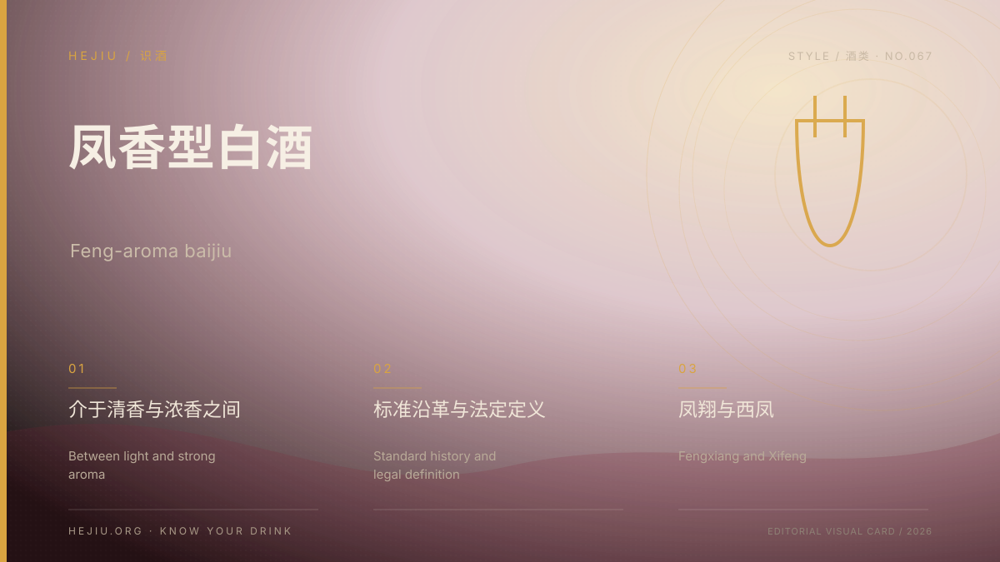

# 凤香型白酒

凤香型常被放在清香与浓香之间：它有清香的干净，也有浓香的窖香，却不属于任何一方。这种“中间感”不是调和出来的，而是由一套很具体的工艺决定的——高粱、大麦、豌豆、小麦，大曲，黄土泥窖，混蒸混烧，再加上酒海陈贮。把这几件事拆开看，凤香型的边界就清楚了。

图：凤香型白酒 双语视觉卡（项目自绘 SVG）。不是实拍。

> **先给结论**
> **一句话：** 这页判断凤香型白酒的风味位置，以及怎么选、怎么喝。
>
> - **适合谁：** 正在比较凤香型白酒与其他风格、准备购买或点单的人。
> - **不适合谁：** 只想要“哪个最好”的排名、不接受口味差异的人。
> - **先看这两点：**
>   - 凤香型的香气以乙酸乙酯为主，己酸乙酯为辅，既有清香的果香与爽净，又有浓香的窖香与厚度。
>   - 凤香型的旧标准是 GB/T 14867-2007。

## 介于清香与浓香之间

凤香型的香气以乙酸乙酯为主，己酸乙酯为辅，既有清香的果香与爽净，又有浓香的窖香与厚度。入口醇厚，收口干净，回味带一点酒海带来的木质陈香。它不是“清香加浓香”的简单相加，而是同一套发酵与贮存工艺自然形成的复合香。

这种中间位置也带来识别难度。有人把它当成浓香的一个分支，有人把它当成清香的重口味版本。判断时不能只看香气强弱，要看窖池、曲种、蒸馏方式与贮存容器：凤香型的黄土泥窖、混蒸混烧与酒海，是它区别于两端的硬标志。

## 标准沿革与法定定义

凤香型的旧标准是 GB/T 14867-2007。现行标准是 GB/T 10781.6-2025《白酒质量要求 第6部分：凤香型白酒》，2025 年 8 月 1 日发布，2026 年 8 月 1 日实施，全部代替 GB/T 14867-2007。新标准把产品纳入“白酒质量要求”的统一编号体系，并更新了术语与理化要求。

标准把凤香型白酒定义为：以高粱、大麦、豌豆、小麦为原料，采用大曲为糖化发酵剂，以黄土泥窖为发酵容器，采用混蒸混烧工艺，经固态发酵、固态蒸馏、酒海等陈贮、勾调而成，不直接或间接添加食用酒精及非自身发酵产生的呈色呈香呈味物质的白酒。定义把原料、曲、窖、蒸馏与贮存五件事一次写全。

## 凤翔与西凤

凤香型的代表产区是陕西宝鸡凤翔，核心企业是西凤酒。凤翔地处关中平原西部，气候温和、四季分明，适合高粱与制曲用粮的生长，也为黄土泥窖的微生物活动提供了稳定环境。西凤酒以“酒海”贮存著称，酒海与传统酿造一起构成凤香型的产地形象。

产区与品牌要分开。西凤酒是凤香型的代表品牌，但凤香型是香型类别，其他酒厂也可以按标准生产。把“凤香型”等同于“西凤”，会把品牌与类别混为一谈；反过来，把西凤的所有产品都当成凤香型，也不准确，企业产品线可能覆盖不同香型与等级。

## 原料与中高温大曲

凤香型用高粱、大麦、豌豆、小麦。高粱提供淀粉与单宁，是酒体的骨架；大麦与豌豆利于制曲，豌豆的蛋白质与脂肪带来曲香；小麦增加曲的粘结与营养。多粮组合让香气有层次，但比例与粉碎度仍由酒厂掌握。

曲为中高温大曲。制曲温度高于低温大曲、低于高温大曲，既能富集霉菌与酵母，又能保留一定的细菌群落。曲的温度曲线决定酶活与香气前体：温度偏高，曲香更重；温度偏低，糖化力更强。凤香型的“清而不淡、浓而不艳”，很大程度上来自这一定位。

## 黄土泥窖

发酵容器是黄土泥窖。窖池以黄土筑成，窖壁与窖底覆盖窖泥，窖泥中的己酸菌、丁酸菌等微生物产生己酸乙酯等物质，为凤香型提供浓香的一面。与浓香型的老泥窖相比，凤香型的窖池更强调“新泥”与“更新”：传统上每年更换窖泥，避免窖泥老化带来过重的窖香与杂味。

“每年更新”不是卫生习惯，而是风味控制。老窖泥的微生物群落更复杂，窖香更浓；新泥的窖香更轻，能让高粱与曲香露出来。凤香型要的是“有窖香但不压香”，因此宁愿牺牲一部分复杂度，也要保持窖池的清爽。这与浓香型追求“老窖”形成鲜明对照。

## 酒海：会呼吸的容器

酒海是凤香型最有辨识度的贮存容器。按标准定义，酒海用荆条编制或木材制成，以血料等物质配成黏合剂，用麻纸等裱糊，再以蜂蜡等涂抹内壁，干燥后用于贮酒。它的内壁不是玻璃或不锈钢，而是多层裱糊形成的微透气表面，酒液在贮存中会与微量空气接触，发生缓慢氧化与老熟。

这种微透气性带来“酒海香”：类似木质陈香、干果与轻微香料的气息，入口更绵柔，刺激感降低。酒海不是越大越好，也不是越老越好；裱糊层的老化、清洗与养护决定它是否还能正常使用。把酒海当成营销故事，会忽略它在风味形成中的实际作用。

## 混蒸混烧、贮存与勾调

凤香型采用混蒸混烧：粮食与酒醅按比例混合后一起蒸煮、蒸馏，粮食的香气与酒醅的香气在甑桶中同时释放。这与清香型的清蒸清烧不同，后者把粮食与酒醅分开处理，追求干净；也与浓香型的续糟混蒸有相似之处，但凤香型的窖池与曲种又把它拉开。

新酒经酒海或陶坛陈贮，让硫化物挥发、酒体柔和、酒海香进入。勾调时，酒厂会用不同轮次、不同年份、不同酒海的原酒搭配，目标是把清香的一面与浓香的一面调平，而不是把某一端推强。勾调是技术，不是“兑酒”；标准允许加水降度，但不允许添加食用酒精或外来呈香物质。

## 关键参数

- 现行标准：GB/T 10781.6-2025，2026 年 8 月 1 日实施。
- 原料：高粱、大麦、豌豆、小麦。
- 曲种：大曲。
- 发酵容器：黄土泥窖。
- 工艺：混蒸混烧、固态发酵、固态蒸馏、酒海陈贮、勾调。
- 酒精度：25.0%–68.0% vol。

这些参数来自国家标准，描述的是类别边界。酒精度、窖池年龄与酒海大小都不能单独代表质量；香气是否协调、酒体是否醇厚、收口是否干净，才是判断凤香型的实际标准。

## 与清香、浓香的边界

与清香型的区别，在曲、窖与蒸馏。清香型用低温大曲、地缸、清蒸清烧，乙酸乙酯为主，香气干净、爽利；凤香型用中高温大曲、黄土泥窖、混蒸混烧，乙酸乙酯为主但己酸乙酯为辅，香气更厚，带窖香与酒海香。与浓香型的区别，在窖池与酯的比例。浓香型用老泥窖、中偏高温大曲，己酸乙酯主导，窖香浓郁；凤香型的窖泥更新、窖香更轻，乙酸乙酯仍是主调，酒海香是额外一层。

与酱香型的区别更明显：酱香型用高温大曲、石壁泥底窖、多轮次发酵，酱香与焦糊香贯穿；凤香型没有高温多轮次的酱感，主体是清浓之间的平衡。把凤香型当成“陕西浓香”，会忽略酒海与混蒸混烧带来的差异。

## 常见误解

第一，认为凤香型是清香与浓香的勾兑。它是同一套工艺形成的复合香。第二，认为窖池越老越好。凤香型重视窖泥更新，新泥的清爽是风格的一部分。第三，把酒海当成普通木桶。酒海有特定的裱糊与蜂蜡内壁，微透气性影响风味。第四，认为凤香型就是西凤酒。品牌与香型类别不是一回事。第五，把“混蒸混烧”理解成“混在一起蒸”这么简单。粮食与酒醅的比例、蒸汽与分段摘酒都影响结果。第六，认为酒海香越重越好。过重的木味会掩盖粮香与果香。

## 延伸阅读

- [白酒](ref:baijiu)：中国白酒的总体分类与工艺框架。
- [高粱](ref:sorghum)与[小麦](ref:wheat)：凤香型的主料与制曲原料。
- [制曲](ref:qu-making)：中高温大曲的培养。
- [发酵](ref:fermentation)：黄土泥窖与窖泥微生物。
- [蒸馏](ref:distillation)：混蒸混烧与分段摘酒。

相关条目：[白酒](ref:baijiu)、[高粱](ref:sorghum)。
