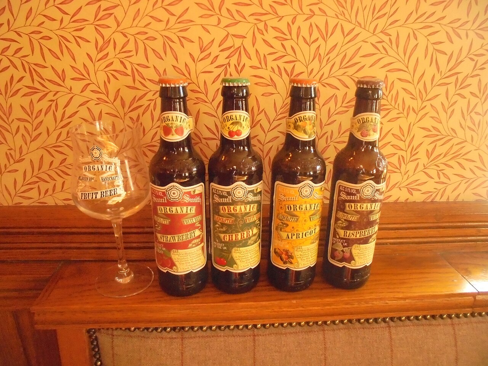

# 果啤

果啤是以水果或果汁参与风味形成的啤酒大类，横跨比利时水果兰比克、德国小麦混饮、英美果味艾尔与果味酸啤；水果可在糖化、煮沸、主发酵、二次发酵或装瓶前加入，风格从清爽低度的混饮到酸香复杂的陈年兰比克都有。

图：Fruit Beer：Samuel Smith's Organic Fruit Beer glass and bottles, lounge, Railway Inn, Spofforth, North Yorkshire (4th May 2019)（Wikimedia Commons）。图片：Mtaylor848，CC BY-SA 4.0，via Wikimedia Commons（[原图页面](https://commons.wikimedia.org/wiki/File:Samuel_Smith%27s_Organic_Fruit_Beer_glass_and_bottles,_lounge,_Railway_Inn,_Spofforth,_North_Yorkshire_(4th_May_2019).jpg)）。

## 定义与边界

果啤不是一条固定配方，而是以水果为主要风味来源的一组啤酒。啤酒评判指南把"保留基酒风格、另加水果"的产品归入 Fruit Beer 类别，比利时带水果的自发发酵产品则单列在 Fruit Lambic 类别之下；两者共同的前提，是水果的香气、酸感或单宁与啤酒基底能够融合，而不是盖过啤酒本身。

判断一款酒是否属于果啤，要看配料表与工艺，而不是只看瓶身颜色或名字里的"fruit"。加入的水果可以是整果、果泥、果汁、浓缩汁，也可以是天然水果提取物；加入时机不同，糖分、酸度和单宁进入酒液的方式也不同。需要与果啤区分开的，是以果汁或汽水为主、啤酒占比很低的混合饮料，以及完全不含麦芽发酵成分的果味汽水。在多数国家，"fruit beer"并不是受法律保护的类别名称，标签上的水果种类、果汁含量和酒精度才是判断依据。

## 历史与命名

比利时的水果兰比克是最古老的果味啤酒传统之一。布鲁塞尔以西的帕约滕兰一带，把整颗酸樱桃（传统上是 Schaarbeek 品种，带果核）或覆盆子加入陈年兰比克，在橡木桶中完成二次发酵，形成 kriek 与 framboise 两类产品；果核带来的杏仁核香气，与兰比克的酸、野菌气息叠加，是这一传统的标志性味道。

德国的果味传统走的是另一条路。战后德国形成了成熟的啤酒混饮（Biermischgetränk）习惯，把小麦啤与果汁风味饮品对半勾兑，酒精度低、口感清爽，Schöfferhofer Grapefruit 就是这类代表：50% 小麦啤酒与 50% 葡萄柚风味饮品调配，酒精度 2.5%。20 世纪后期以来，美国精酿运动把西瓜、血橙、百香果、蓝莓、樱桃等更多水果带入艾尔、世涛、戈斯与混合发酵酸啤，果味产品不再依附于某一种传统基酒。

## 原料与工艺

传统兰比克偏好酸果：酸樱桃、覆盆子、马斯卡特葡萄酸度高、单宁明确，加入后是为了增加酸与果香，而不是把啤酒调甜。现代产品常用桃、杏、李子、梅洛葡萄、西瓜与各类浆果；果皮、果肉与果核贡献的香气不同，果核类原料还会带来轻微的杏仁核苦味。水果自带的糖分会被酵母继续消耗，传统做法下成品往往偏干、酒体更轻；残留甜度要么来自发酵未耗尽的糖，要么来自后期补糖。

不同基酒的参数差别很大。以水果兰比克为例，指南给出的范围是 ABV 5–7%、IBU 0–10、OG 1.040–1.060、FG 1.000–1.010，颜色随水果品种变化；传统产品的水果用量约占酒液的 10–30%，其中樱桃款约 25%。普通果味艾尔、果味世涛的 OG、苦度与色度跟随各自基酒风格，不能套用兰比克的参数。果汁中的糖在装瓶后仍可能触发二次发酵，瓶内压力需要控制，这也是部分果啤存在喷瓶风险的原因。

## 风格与味觉

一款平衡的果啤，果香应当可以被辨识，但啤酒仍然像啤酒：麦芽、酵母或酸菌带来的基底不会被果香淹没。水果通常会降低酒体、让收口更干；个头小、颜色深的浆果可能带来单宁深度和轻微收敛感，这种涩感若过重，就会压过基酒的平衡。颜色是水果与陈放共同作用的结果，兰比克的果色会随陈年逐渐变淡，气泡感、酸度与麦芽甜则由基酒和桶内微生物决定。

判断质量时，果香应当接近真实果实：新鲜樱桃、覆盆子、西瓜或柑橘的香气清晰自然。明显的人工香精味、糖浆挂嘴感、氧化纸板味或溶剂感，通常指向原料等级、卫生或储存问题，而不是果啤风格本身。

## 代表产区与品牌

比利时传统阵营的代表包括 3 Fonteinen Schaerbeekse Kriek、Cantillon Fou' Foune（杏）、Cantillon Lou Pepe Framboise、Hanssens Oude Kriek 与 Boon Oude Kriek；Lindemans Framboise 是量产甜型覆盆子兰比克的常见入口。德国混饮阵营以 Schöfferhofer Grapefruit 为代表，英国的 Samuel Smith's Organic Fruit Beer 属于另一条有机果味艾尔路线。

美国精酿阵营覆盖面很广：21st Amendment Hell or High Watermelon（西瓜小麦）、Anderson Valley Blood Orange Gose（血橙戈斯）、Avery Liliko'i Kepolo（百香果艾尔）、Ballast Point Grapefruit Sculpin（葡萄柚 IPA）、Bell's Cherry Stout（樱桃世涛）与 Founders Rübæus（覆盆子酸啤）。品牌之间的配方差异往往比风格名称更大，有的坚持整果发酵、成品偏干，有的用果汁或提取物调味、甜度更高，读标签上的配料、酒精度和残留糖比记住笼统印象更可靠。

## 怎么喝与配餐

清爽型的果味小麦、果味艾尔适合冰镇到 4–8°C 饮用，杯型用中等肚径或收口的郁金香杯即可；酸香复杂的水果兰比克可以放到 8–12°C，温度太低会把酸香和氧化层次关掉。德国式混饮通常直接从瓶或罐中饮用，不需要专门杯型。

配餐上，淡爽的果味小麦与沙拉、清蒸海鲜、软质奶酪相配；果味酸啤适合冷切肉、火腿、蓝纹奶酪与带酸甜酱汁的猪肉菜；果味世涛或偏甜的果啤可以搭水果甜点、黑巧克力。果啤的饮用场景很宽，餐前开胃、夏日午后独饮、派对混饮都合适，酸度明亮的款式也可调啤酒冰茶或桑格利亚式调酒。

## 选购、储存与误区

常见误区有几类：把颜色深浅当成甜度高低；把"果味"等同于低度或更健康；以为所有果啤都偏甜；把香精调味的产品当成传统整果发酵酒。实际上颜色主要来自水果品种与麦芽，甜度要看残留糖，酒精度以背标为准。买酒时先读背标：水果或果汁排在配料表第几位、果汁含量多少、酒精度与糖分标注是否清楚、产地与生产者是谁；正面瓶标上的大字往往是品牌营销。

储存上，大多数果啤宜趁新鲜饮用，避光、阴凉、直立存放；瓶藏的水果兰比克可以在合适条件下继续陈年，发展出更复杂的氧化与野菌气息。开瓶后果啤的气泡与果香散失较快，高酸、低酒精度的款式不耐久放，应当在当天喝完。价格高并不等于风格更典型，溢价可能来自品牌、陈放或包装，而不是工艺本身。

## 延伸阅读与另见

与果啤相近的风格通常共享原料或工艺，而不是香气：[兰比克](ref:lambic)代表自发发酵的酸香传统，[啤酒](ref:beer)是所有果味产品的基底框架，[葡萄](ref:ingredient)在部分果啤与葡萄艾尔中直接作为原料出现，[发酵](ref:fermentation)阶段决定水果糖分与酸感的去向，[比利时](ref:belgium)则是传统水果兰比克的产地背景。学习一类风格，可以先喝最标准的基准款，再试一个改原料或工艺的变体，最后接触一个极端款式，三步之后风格边界会比读定义更清楚。

- 相关条目：[beer](ref:beer)、[lambic](ref:lambic)、[fermentation](ref:fermentation)、[grape](ref:ingredient)、[belgium](ref:belgium)。
