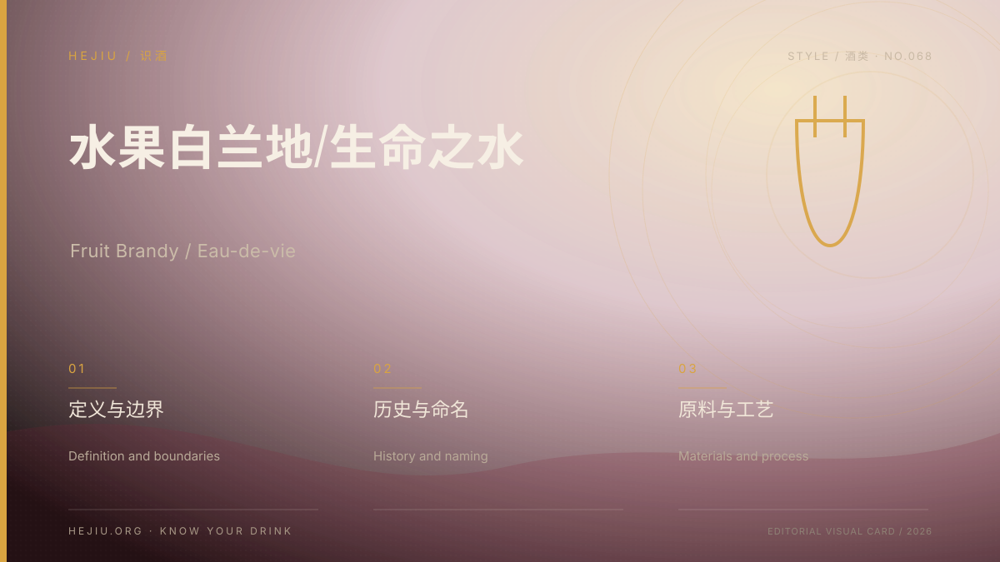
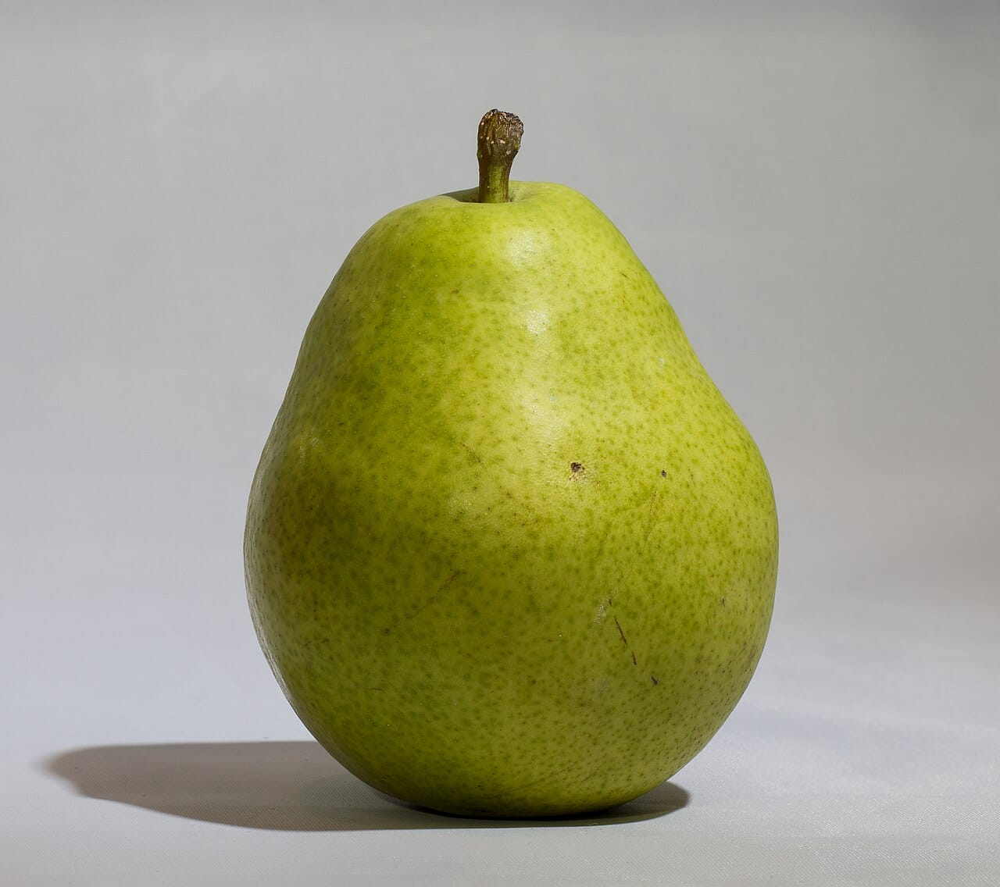

# 水果白兰地/生命之水

水果白兰地（法语 eau-de-vie，字面意思是"生命之水"）是以新鲜果实或果汁发酵后再蒸馏得到的无色透明烈酒；与葡萄原料的[白兰地](ref:brandy)、压榨后果渣原料的果渣酒（marc）不同，它的原料是完整水果或果汁，香气直接来自果实本身。常见品类包括樱桃酒 kirsch、梨酒 Poire Williams、黄香李 mirabelle、覆盆子 framboise、李子 slivovitz 与德语区 Obstler；市售主流产品酒精度多在 40–50%，通常不经橡木桶陈年，卖点是接近鲜果的清香。

图：Fruit Brandy / Eau-de-vie主题示意图。图片：Doubao Seedream 5.0 AI 辅助绘制（项目自有）；不是水果白兰地/生命之水的实拍，仅作主题示意。

## 定义与边界

欧盟《烈酒条例》2019/787 附录 I 第 9 类"水果烈酒"规定，这类酒只能由新鲜多肉果实、浆果或其果汁经酒精发酵与蒸馏制成，带不带果核都可以；每次蒸馏须在低于 86% vol 的酒精度下进行，使馏出物保留原料香气。条例要求挥发性物质不低于每百升纯酒精 200 克，核果类氢氰酸不超过每百升纯酒精 7 克，法定最低酒精度为 37.5% vol。

条例还规定水果烈酒不得调色、加香或额外加酒精；为圆润口感允许少量加糖，以转化糖计每升不超过 18 克。法律名称是"烈酒"加水果名；"Williams"只能用于纯威廉姆斯梨酿成的梨酒，"Obstler"要求醪液中至少 85% 来自苹果、梨或两者混合。

邻近类别需要分清：果渣酒用榨汁后的皮渣；Geist 是把未发酵果实泡在农业来源酒精中再蒸馏；水果利口酒则以烈酒加糖和风味物调配，酒精度更低、甜度明显。[蒸馏](ref:distillation)路径不同，标签类别才不同。

## 历史与命名

"eau-de-vie"在英语国家习惯上指葡萄以外水果酿成的透明蒸馏酒。欧洲大陆的水果蒸馏传统与浆果、核果的丰收剩余直接相关：水果不易保存，发酵再蒸馏是把多余果实的价值浓缩下来的方式；德语区、阿尔卑斯山区与巴尔干都有村镇蒸馏作坊传统。

樱桃酒 kirsch 的公认发源地是德国黑森林，当地长期种植暗色酸樱桃（morello）；法国阿尔萨斯有樱桃酒之路（Route du Pays du Kirsch），瑞士与南蒂罗尔也是高品质产区。受原产地保护的样本包括法国 Kirsch de Fougerolles、瑞士 Zuger Kirsch 与 Rigi Kirsch；瑞士瓦莱州梨蒸馏酒以 AOP 限定只用威廉姆斯梨。

标签上的水果名对应固定原料：樱桃 kirsch、李子 slivovitz、黄香李 mirabelle、覆盆子 framboise、梨 Poire Williams。19 到 20 世纪，分散的家庭蒸馏逐步并入受税收与卫生监管的商业蒸馏厂；延续至今的是"单一鲜果清香型蒸馏酒"这个方向，而不是某一个固定配方。

## 原料与工艺

原料要完全成熟、风味集中。核果类通常带破碎果核发酵，提供淡淡杏仁香；浆果类出汁率低、香气娇气，投料量很高。以樱桃酒为例，一瓶 700–750 毫升的 kirsch 大约需要 10 公斤樱桃。

发酵后转入铜制壶式蒸馏器慢速蒸馏，蒸馏师截取酒头、酒心与酒尾，只留中段酒心；不少传统做法二次蒸馏以收窄风味。蒸馏控制在 86% vol 以下，就是为了让芳香物质留在馏出液里，而不是蒸成近中性酒精。

成品多数在不锈钢罐、玻璃、陶土或白蜡涂层容器中静置，不接触橡木；条例只允许陈年满一年以上的水果烈酒用焦糖调色。发酵停滞、杂菌污染、切割不当或储存失控，都会让好果实变成带溶剂味、煮果味或酸味的缺陷酒。

## 风格与味觉

典型样本无色清亮，干到微甜，香气是新鲜果实、花香与轻微果核杏仁味：樱桃偏酸樱桃与杏仁，梨偏熟梨与花香，覆盆子偏浆果，李子偏核果坚果。市售酒精度常见 40–50%，普遍高于 37.5% 的法定下限；好样本果香先于酒精出来，收口干净不挂甜。

缺陷也容易辨认：冲鼻溶剂味来自没切净的酒头，闷重的煮果味来自发酵或蒸馏过热，稀薄水味通常说明原料等级低。与橡木陈年的葡萄白兰地不同，水果白兰地大多趁年轻饮用，放久了果香会退；只有少数木桶或陶土陈放版本具备缓慢整合的复杂度。

地区风格有细微差别：阿尔萨斯芳香精致，黑森林 kirsch 带果核杏仁骨架，奥地利与南蒂罗尔 Obstler 偏苹果梨清爽，巴尔干 slivovitz 以李子坚果为主，瑞士梨酒更柔顺。比较时先固定水果种类与酒精度，再看产地和生产者。

## 代表产区与品牌

[法国](ref:france)阿尔萨斯是最知名的法语产区，Massenez、Nusbaumer、Willm 等家族蒸馏厂做樱桃、梨、覆盆子与黄香李系列；德国黑森林以 Schladerer 等厂的樱桃酒和苹果梨 Obstler 著称；瑞士瓦莱州、奥地利、南蒂罗尔与巴尔干分别出产受保护梨酒、Obstler 与李子蒸馏酒。

代表产品包括 Poire Williams、Kirsch、Mirabelle、Framboise、Slivovitz 与 Obstler。价格跨度主要由果实投料量、原料等级、产区保护和小批量生产决定：单一水果、高投料量的小瓶样本定价偏高，入门调配款更容易买到；一款高价名酒不能代表整个类别。

## 怎么喝与配餐

水果白兰地通常作为餐后消化酒，单杯约 30–60 毫升。瓦莱州官方建议梨蒸馏酒冷藏在 8–12 °C 饮用；樱桃、浆果类也适合微凉入口，温度太高酒精会盖过果香。杯型用小口郁金香杯或小烈酒杯，纯饮为主，少数轻盈版本可调入鸡尾酒。

配餐上常和甜点收尾搭配：淋在雪芭上，配水果蛋糕、慕斯、巧克力与糖渍果脯；kirsch 也是黑森林蛋糕等甜点提供酒精度深度的传统配料。烹饪中可少量用于收汁或佐水果菜肴，配餐思路是让果香与菜肴甜味呼应，而不是用厚重酱汁压住它。

## 选购、储存与误区

读标签先找水果名称、产地、酒精度与是否含糖：写具体水果名的产品应以该水果为原料，标注 AOP/PGI 产区名的还要符合对应规范。透明无色是这个类别的常态，不等于品质低；年份声明少见，新酒出厂通常即可饮用。"手工""传统"属于营销描述，需结合原料、酒精度和生产者判断。

储存避开光照、高温与震动，直立密封；高酒精度让开瓶后比低度饮料耐放，但果香会随年份散失，建议开瓶后一年内喝完。常见误区是把颜色深浅当陈年程度——多数样本从不接触木桶；把甜度当品质高低，而条例只允许有限调糖，干型才是传统基线。

## 延伸阅读与另见

- 相关条目：[brandy](ref:brandy)、[distillation](ref:distillation)、[cherry](ref:cherry)、[pear](ref:pear)、[france](ref:france)。
- 想建立味觉边界，可以先从一支梨酒和一支樱桃酒入手，对比同温度、同杯型下果香、果核杏仁味与酒精骨架的差别，再尝试浆果或李子版本。

对照阅读：[白兰地](ref:brandy)、[樱桃](ref:cherry)。

## 相关图像

图：Pear：D'anjou pear（Wikimedia Commons）。图片：Rhododendrites，CC BY-SA 4.0，via Wikimedia Commons（[原图页面](https://commons.wikimedia.org/wiki/File:D%27anjou_pear.jpg)）。关联图像：水果白兰地/生命之水。
