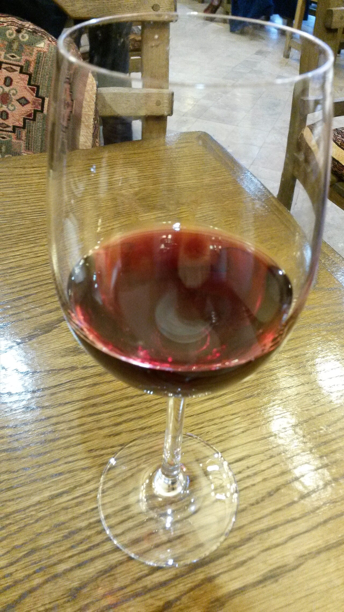

# 果酒

果酒是以水果汁或水果浸提液经酵母发酵得到的酒精饮料。它的酒精度通常低于蒸馏酒，风味取决于水果品种、成熟度、发酵方式和是否保留残糖。苹果酒、梨酒、樱桃酒、蓝莓酒都属于这一大类；中国的果酒行业标准对原料和基本工艺也有相应要求。

图：果酒。图片：Chaojoker，CC BY-SA 3.0，via Wikimedia Commons（[原图页面](https://commons.wikimedia.org/wiki/File:%D5%86%D5%BC%D5%A1%D5%B6_%D5%A3%D5%AB%D5%B6%D5%AB.jpg)）。

## 先划清「果酒」的边界
果酒的核心是“发酵”，不是“浸泡”或“蒸馏”。这一条把果酒与几个相邻类别分开：以烈酒为基、加入果汁并加糖的是水果[利口酒](ref:liqueur)；把水果发酵液再[蒸馏](ref:distillation)得到的是水果白兰地，例如樱桃白兰地或苹果白兰地，属于[白兰地](ref:brandy)大类；只有葡萄汁发酵的才叫[葡萄酒](ref:wine)，其他水果发酵酒通常归入果酒。

在饮料酒分类中，果酒既不是配制酒，也不是蒸馏酒。它可以是完全由果汁发酵的产品，也可以是以果汁为主、加水调整后发酵的产品，具体允许范围由标准与标签决定。判断一瓶酒属于哪一类，看原料表、工艺描述和酒精度，比看包装上的水果图案可靠。

## 原料与发酵

果酒的原料包括水果、水、糖（必要时）、酵母和允许使用的添加剂。苹果、梨、樱桃、蓝莓、草莓、猕猴桃、荔枝、青梅都可用于酿造。水果的酸度、糖度、香气物质和果胶含量决定发酵走向：酸高的水果需要调整发酵条件，糖低的水果可能需要补糖，果胶高的水果则要控制甲醇生成风险。

酵母把糖转化为酒精和二氧化碳。发酵温度低，香气保留更多，过程更慢；温度高，发酵更快，但可能损失细腻香气并产生更多高级醇。是否进行苹果酸-乳酸发酵，会明显改变酸感：苹果酸转为乳酸后，酸度更柔和，奶油感更明显。红果酒是否带皮发酵，还决定颜色与单宁的提取程度。

## 主要类别

- **苹果酒（cider）**：以苹果汁发酵，酒精度多在 4%–8% 之间；英国、法国和西班牙都有成熟传统，风格从干爽到甜润。
- **梨酒（perry）**：以梨汁发酵，与苹果酒工艺相近，但梨的香气更轻，某些梨品种带来明显的花香。
- **浆果酒**：蓝莓、草莓、覆盆子等发酵而成，颜色深，酸度通常较高，常保留一定残糖以平衡酸感。
- **核果酒**：樱桃、李子、杏等发酵而成；樱桃酒可能带有杏仁般的核果气息，来自果核中的微量成分。
- **其他水果酒**：荔枝、青梅、猕猴桃等区域性产品，风味更依赖原料品种与产地。

这些类别的共同点是发酵，不同点在原料化学与工艺选择。把它们统称为“果酒”是分类上的便利，不代表风味可以互相替代。

## 甜度与风格

果酒可以是干型、半干型、半甜型或甜型。甜度来自残糖，也可能来自发酵后添加的糖或浓缩果汁，两者在标签上的表述不同。干型苹果酒强调清爽与酸度，甜型果酒更像轻酒精度饮品，适合单独饮用或加冰。

风格还受气泡影响。静止果酒口感平直，气泡果酒更轻盈，香气被二氧化碳托起。是否经过陈酿、是否使用橡木桶，也会改变质感：桶陈带来香草与烘烤气息，但可能盖住水果本身的细节。选购时先确定自己想要的是“果味清晰”还是“结构复杂”，再决定类型。

## 生产工艺

公开流程包括：选果与清洗、破碎或压榨取汁、调整糖度与酸度、加入酵母发酵、分离酒液、必要时进行苹果酸-乳酸发酵、澄清、稳定处理、过滤、装瓶。若做气泡果酒，还要在密闭容器中保留二氧化碳，或采用二次发酵。

质量控制的关键点有三个：原料卫生，避免霉果带来异味；发酵温度，决定香气保留程度；以及甲醇控制，果胶含量高的原料更需要注意。商业化生产会通过工艺与检测把甲醇控制在法规限值内。家庭自酿缺乏检测条件，风险不应被低估。

## 「果酒」的闻与喝
果酒的香气层次通常分三组：水果本身的香气、发酵产生的香气、以及陈酿或工艺带来的香气。苹果酒常见青苹果、梨、柑橘与花香；浆果酒常见红色浆果、果酱与香料；樱桃酒可能带杏仁与樱桃酒典型的甜香。入口先判断酸度，再看甜度与酒精度是否平衡，最后看收口是否干净。

品鉴时温度很重要。过冷会压住香气，过热会让酒精感突出。可以先在 8–12°C 试饮，再根据风格调整。倒杯后等一两分钟，观察香气是否从“果香为主”转向“发酵香为主”，这能帮助判断酒的复杂度与新鲜度。

## 「果酒」的饮用与搭配
多数果酒适合冷藏后饮用，甜型果酒可以加冰或用于调制 Spritz 类饮品。干型苹果酒适合搭配猪肉、奶酪和油炸食物；浆果酒的酸度能切开油脂，适合沙拉、禽肉与清淡奶酪；甜型果酒更适合甜点或单独饮用。

佐餐时要考虑甜度与酸度的关系：酒比菜更甜，菜会显得寡淡；酒比菜更酸，菜会显得油腻。开瓶后应冷藏并尽快喝完，尤其是低酒精度、低二氧化硫的产品，因为氧化与微生物风险都更高。用酒杯时不必追求专业杯型，能聚拢香气的杯子即可。

## 「果酒」容易被读错的地方
第一，把果酒与水果利口酒混为一谈。前者是发酵酒，后者以烈酒为基并加糖。
第二，认为果酒一定甜。干型苹果酒和干型浆果酒都很常见，甜度是工艺选择，不是类别定义。
第三，认为“水果味越浓越纯”。香气过浓可能来自添加香精，而非原料本身。
第四，忽视甲醇风险。果胶高的水果在发酵中可能产生甲醇，商业产品有检测与控制，自酿则缺乏保障。
第五，把“无添加”当成质量保证。无添加不等于安全，工艺卫生与检测同样重要。

对照阅读：[蒸馏](ref:distillation)、[利口酒](ref:liqueur)。

## 参考资料
- [葡萄酒](ref:wine)：同为发酵酒，但原料限定为葡萄。
- [蒸馏](ref:distillation)：把发酵果酒转化为水果白兰地的关键步骤。
- [利口酒](ref:liqueur)：以烈酒为基、加糖与风味的相邻类别。
- [白兰地](ref:brandy)：水果蒸馏酒的归属大类。
