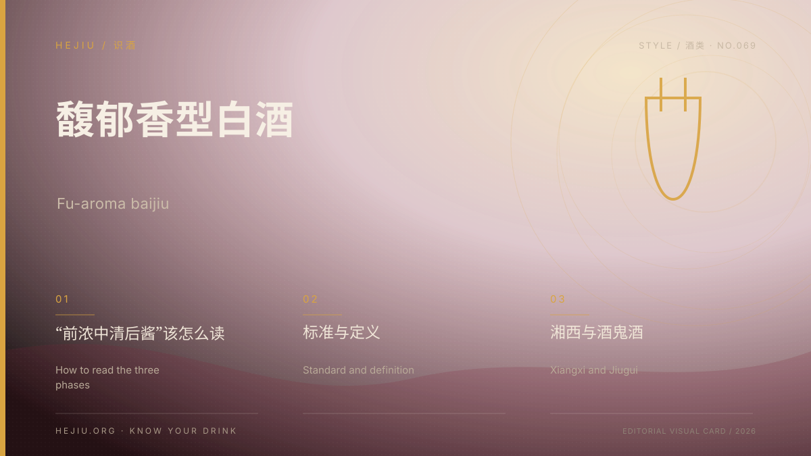

# 馥郁香型白酒

馥郁香型喜欢用一句话介绍自己：“前浓、中清、后酱”。这六个字不是三种香型随意拼贴，而是一条饮用时的时间轴：入口先感到浓香的饱满与窖香，中段转向清香的干净与爽利，收口再出现酱香的焦糊与陈味。要把这条时间轴做出来，靠的是小曲与大曲并用、泥窖发酵与清蒸混入的组合。

图：馥郁香型白酒 双语视觉卡（项目自绘 SVG）。不是实拍。

> **先给结论**
> **一句话：** 这页判断馥郁香型白酒的风味位置，以及怎么选、怎么喝。
>
> - **适合谁：** 正在比较馥郁香型白酒与其他风格、准备购买或点单的人。
> - **不适合谁：** 只想要“哪个最好”的排名、不接受口味差异的人。
> - **先看这两点：**
>   - “前浓”指入口的香气与酒体有浓香型的厚度，窖香、粮香明显；“中清”指酒液在口中展开后，出现清香型的干净、爽冽与轻快。
>   - 馥郁香型通常采用多粮配方，常见的是高粱、大米、糯米、小麦、玉米。

## “前浓中清后酱”该怎么读

“前浓”指入口的香气与酒体有浓香型的厚度，窖香、粮香明显；“中清”指酒液在口中展开后，出现清香型的干净、爽冽与轻快；“后酱”指咽下后的回味带酱香型的焦香、陈香与微微的酱感。三者是先后关系，不是三瓶酒兑在一起。

这种层次感来自发酵与蒸馏的先后安排，而不是添加不同香型的酒。小曲负责糖化与早期发酵，大曲负责后期生香；泥窖提供窖香，清蒸混入保留粮食的干净；不同轮次、不同层次的原酒再经陈酿与勾调，才有口中的转折。把“馥郁”理解成“香气多”，只说对了一半，结构才是关键。

## 标准与定义

现行国家标准是 GB/T 10781.11-2021《白酒质量要求 第11部分：馥郁香型白酒》，2021 年 3 月 9 日发布，2022 年 4 月 1 日实施。标准把馥郁香型白酒定义为：以粮谷为原料，采用小曲和大曲为糖化发酵剂，经泥窖固态发酵、清蒸混入、陈酿、勾调而成，不直接或间接添加食用酒精及非自身发酵产生的呈色呈香呈味物质，具有前浓中清后酱独特风格的白酒。

这里要澄清一个常见误引：GB/T 22736-2008 是《地理标志产品 酒鬼酒》，不是馥郁香型的香型标准。它规定的是酒鬼酒这一地理标志产品的产地、原料与工艺，不能拿来当作整个香型的通用标准。馥郁香型的通用标准是 GB/T 10781.11-2021。

## 湘西与酒鬼酒

馥郁香型的代表产区是湖南湘西，核心企业是吉首的酒鬼酒。酒鬼酒参与并推动了馥郁香型标准的建立，使这一香型从地方工艺上升为国家标准类别。湘西的气候湿润、四季分明，适合小曲与大曲的微生物培养，也为泥窖发酵提供了稳定的环境。

产区与品牌的关系需要分开看。酒鬼酒是地理标志产品，受 GB/T 22736-2008 保护；馥郁香型是一个更宽的香型类别，理论上其他酒厂也可以按 GB/T 10781.11-2021 生产。把“馥郁香型”等同于“酒鬼酒”，会把香型标准与地理标志产品标准混为一谈。

## 多粮配方

馥郁香型通常采用多粮配方，常见的是高粱、大米、糯米、小麦、玉米。高粱提供骨架与单宁，大米带来净爽，糯米增加绵柔，小麦利于生香，玉米带来甜润。多粮不是越多越好，比例决定酒体的厚薄与香气的走向；粮食粉碎度、润粮水温与蒸煮程度，也会影响后续糖化与发酵。

与单粮清香型相比，多粮馥郁香的香气更复合；与浓香型相比，它的粮食香更外放，窖香不追求压过一切。原料的多样性为“前浓中清后酱”提供了物质基础：不同粮食的淀粉结构、蛋白质与脂肪含量不同，发酵产生的酸、酯、醇、醛也不同，最终在口中形成层次。

## 小曲糖化、大曲发酵

馥郁香型的关键工艺是“小曲糖化、大曲发酵”。小曲以根霉、酵母为主，糖化力强，能把粮食淀粉迅速分解为糖；大曲以高温或中高温培养，富集细菌、霉菌与酵母，负责产生酯类、酸类与香味前体。两者先后介入，既保证出酒率，又保证香气复杂度。

这与浓香型主要依靠大曲、清香型主要依靠低温大曲、米香型主要依靠小曲都不同。小曲与大曲并用不是简单混合：小曲先建立糖化与发酵基础，大曲再推动生香，二者的比例、接种顺序与温度控制决定成品风格。比例失衡，可能出现糖化过快、发酵过猛、香气粗糙等问题。

## 泥窖与清蒸混入

发酵容器是泥窖，参见[发酵](ref:fermentation)。泥窖中的窖泥富含己酸菌、丁酸菌等微生物，能产生己酸乙酯等浓香型特征物质，为“前浓”提供基础。窖池的新老、窖泥的养护、入窖水分与温度，都会改变窖香的强弱。新窖窖香薄，老窖窖香厚，但老窖也需要持续养护，否则窖泥退化。

“清蒸混入”是另一条关键。粮食先清蒸，去除杂味、保留粮香；发酵后的酒醅与清蒸后的粮食按比例混合，再入窖或蒸馏。这样既保留了清香型的干净，又让浓香型的窖香有落脚点。与“清蒸清烧”的清香型相比，馥郁香型多了一次混合；与“混蒸混烧”的浓香型相比，它更强调粮食的清洁感。

## 陈酿、勾调与关键参数

新酒经陶坛或不锈钢罐陈酿，让硫化物挥发、酒体柔和、香气融合。勾调时，酒厂会选取不同轮次、不同窖池、不同年份的原酒，按“前浓中清后酱”的目标搭配；有时用少量老酒提陈香，有时用较新的酒保清爽。勾调不是掩盖缺陷，而是把不同原酒的长处组织起来。

关键参数如下：现行标准 GB/T 10781.11-2021；原料为粮谷；糖化发酵剂为小曲与大曲；发酵容器为泥窖；工艺为固态发酵、清蒸混入、陈酿、勾调；酒精度 25.0%–68.0% vol。标准按高度酒与低度酒分列理化指标，具体数值以标准文本为准。

## 与浓香、清香、酱香、兼香的边界

与浓香型的区别，在曲与窖的组合。浓香型以中偏高温大曲与老泥窖为核心，己酸乙酯突出，窖香贯穿始终；馥郁香型用小曲与大曲并用，窖香主要服务“前浓”，中段转向清香，后段转向酱香。与清香型的区别，在曲与容器。清香型用低温大曲、地缸、清蒸清烧，乙酸乙酯为主，干净直接；馥郁香型用泥窖与小曲，香气更复合。

与酱香型的区别，在工艺与轮次。酱香型以高温大曲、石壁泥底窖、多轮次发酵为核心，酱香与焦糊香贯穿；馥郁香型的酱感只在后段出现，主体仍是浓清之间的过渡。与兼香型的区别，在结构。兼香型通常指浓酱兼香，强调浓头酱尾的两段式；馥郁香型是浓、清、酱三段式，且明确要求小曲与大曲并用、泥窖固态发酵、清蒸混入。

## 常见误解

第一，认为馥郁香型是把浓香、清香、酱香三种酒兑在一起。它是同一套工艺在时间轴上的层次，不是勾兑三种香型。第二，把 GB/T 22736-2008 当成馥郁香型标准。它是酒鬼酒的地理标志产品标准。第三，认为多粮一定比单粮好。比例与工艺才是关键。第四，认为小曲只能做米香型。小曲也可以参与馥郁香型的糖化。第五，认为“前浓中清后酱”是营销话术。标准定义明确写了这一风格要求。第六，把酒鬼酒等同于所有馥郁香型。品牌与香型类别不是一回事。

前浓、中清、后酱描述的是入口到余味的变化，不是三种香型简单相加；把它理解成浓香加清香加酱香，会漏掉小曲与大曲并用的工艺基础。

## 延伸阅读

- [白酒](ref:baijiu)：中国白酒的总体分类与工艺框架。
- [高粱](ref:sorghum)与[大米](ref:rice)：多粮配方的主要原料。
- [制曲](ref:qu-making)：小曲与大曲的差别。
- [发酵](ref:fermentation)：泥窖与窖泥微生物的作用。
- [蒸馏](ref:distillation)：固态蒸馏与分段摘酒。

相关条目：[白酒](ref:baijiu)。

**关键事实。**

| 项目 | 内容 |
| --- | --- |
| 一句话定位 | 以粮谷为原料，小曲与大曲并用，经泥窖固态发酵、清蒸混入、陈酿与勾调而成，具有“前浓、中清、后酱”的复合风格；现行标准为 GB/T 10781.11-2021，酒精度 25.0%–68.0% vol |
| 上位风格 | 白酒 |
| 香气家族 | 复合香 |
