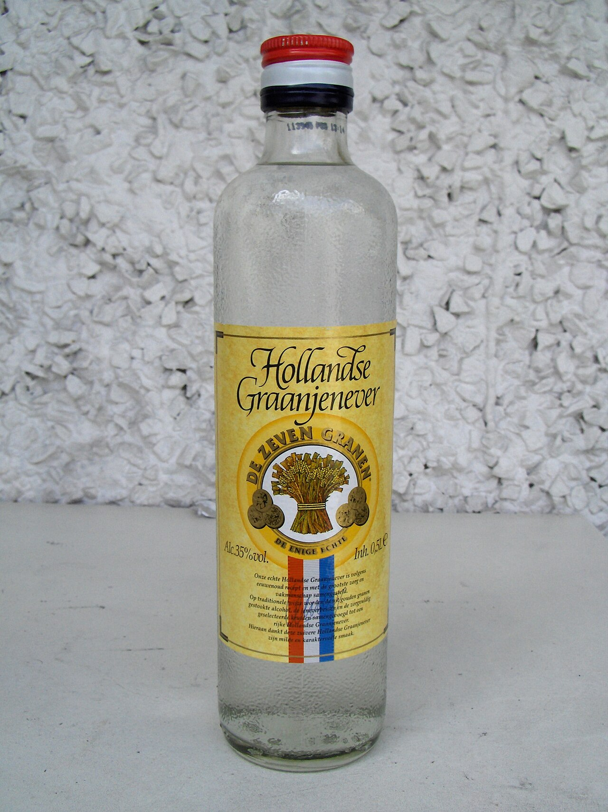

# 荷兰杜松子酒

荷兰杜松子酒（genever，荷兰语 jenever）是以谷物为基底、以杜松子为核心香料的烈酒，主要产于荷兰、比利时以及法国北部的北部省和加来海峡省。它与英式[金酒](ref:gin)共享杜松子，却在原料结构上走出另一条路：传统 genever 使用麦芽酒，也就是把黑麦、玉米、小麦或大麦糖化发酵后蒸馏得到的酒液，再与中性谷物酒精和杜松子等植物调配。这个“麦芽酒底”是理解它的钥匙。

图：荷兰杜松子酒。图片：Wikimedia Commons contributor，CC BY-SA 3.0，via Wikimedia Commons（[原图页面](https://commons.wikimedia.org/wiki/File:Hollandse_Graanjenever_0495.JPG)）。

## 杜松子、麦芽酒与“genever”

“Genever”一词与杜松子（juniper）同源，早期欧洲人把杜松子浸入酒精，用作药酒和消化剂。荷兰语中的 jenever 既指这种烈酒，也指杜松子这种植物。最初的版本并不追求干型，而是带甜、带麦芽香、带草本苦味，更接近“加了杜松子的谷物烈酒”，而不是今天的伦敦干金。

[杜松子](ref:juniper)提供松针、树脂和柑橘般的香气，但 genever 不要求杜松子压倒一切。麦芽酒带来的面包、谷物和坚果感，才是它与英式金酒最明显的分界。也正因为如此，genever 的品鉴语言更接近威士忌或陈年谷物酒，而不是“植物香气是否清晰”的单一标准。

## 从药房到黄金时代

16 世纪，荷兰和佛兰德的药剂师把杜松子浸入酒精，制成用于消化和利尿的药酒。17 世纪，阿姆斯特丹的蒸馏业发展出以麦芽酒为基础的商业版本，genever 随荷兰商船和战争进入英国，成为“Dutch gin”或“Holland gin”的原型。英国士兵在三十年战争期间接触到这种酒，把它带回伦敦，后来演变成更干、更便宜的英式金酒。

18 世纪是 genever 的黄金时代，也是它社会形象分裂的时代。荷兰的城市酒馆里，genever 是日常饮品；在英国，廉价的“金酒热”引发社会恐慌和立法管制，但被管制的对象更多是英式劣质金酒，而不是荷兰 genever。19 世纪以后，连续蒸馏和更稳定的糖化技术让 genever 走向更轻、更干净的现代风格。

## 麦芽酒与中性酒精的配比

传统 genever 的核心是麦芽酒（moutwijn）：谷物糖化、发酵、蒸馏得到风味浓厚的酒液，再与中性谷物酒精、水和植物调配。麦芽酒比例越高，酒体越厚、麦芽和面包感越强；比例越低，风格越轻、越接近伏特加或年轻的英式金酒。korenwijn（谷物酒）是麦芽酒比例最高的一类，法规要求至少 51% 的麦芽酒。

[大麦](ref:barley)和其他谷物提供麦芽糖与蛋白质，发酵和蒸馏决定麦芽酒的厚度。植物可以在蒸馏前浸泡，也可以在蒸馏器中悬挂，让蒸汽穿过；杜松子、芫荽籽、当归、柑橘皮和甘草是常见组合。[蒸馏](ref:distillation)后的调配与加水，决定了最终是“麦芽感突出”还是“植物感突出”。

## oude 与 jonge：不是年份

oude（老式）与 jonge（新式）是配方风格，不是陈年时间。oude 使用更多麦芽酒、更多糖和更深的颜色，风味更麦芽、更甜、更厚；jonge 使用更少的麦芽酒、更少的糖，风格更轻、更干净、更接近现代金酒。两者都可以是透明的，oude 也不一定比 jonge 更老。

这是 genever 最容易被误读的地方。酒标上的“oude”不表示在橡木桶里放了多久，而是表示配方更接近历史上的老式风格；jonge 也不是“新酒”，而是 20 世纪发展出的轻配方。还有“graanjenever”（谷物 genever）和“korenwijn”等子类，分别强调谷物基酒和麦芽酒比例；读标时要看类别词，而不是只看颜色。

## 2008 年的地理标志

Genièvre/Jenever/Genever 在 2008 年获得欧盟地理标志保护，保护范围覆盖荷兰、比利时以及法国北部的北部省和加来海峡省。地理标志约束的是产地和基本原料，不约束每一家酒厂的植物配方；因此，荷兰的 jonge、比利时的 oude 和法国北部的 genièvre 可以共享一个名称，却在风格上差别很大。

地理标志也保护了 jonge 和 oude 这些子名称，防止它们被用作随意的营销词。购买时，产地、类别词和酒精度是三个关键信息；如果只看到“Dutch gin”或“Holland gin”而没有类别说明，就不能假定它是传统麦芽酒风格的 genever。

## 酒杯、kopstootje 与鸡尾酒

荷兰的传统喝法是把 genever 倒满一只小郁金香杯，杯口几乎与酒面齐平，低温、小口喝。阿姆斯特丹的酒吧还流行 kopstootje（“头撞”）：一杯 genever 配一杯啤酒，先喝烈酒再喝啤酒，或用啤酒漱口。这种喝法强调麦芽与谷物的连续感，而不是鸡尾酒的修饰。

在鸡尾酒里，genever 可以替代金酒，但成品会更麦芽、更圆润。它适合做 Martinez 风格的搅拌酒、Collins 风格的长饮，也可以与苦精、柑橘和糖浆搭配。与[老汤姆金酒](ref:old-tom-gin)相比，genever 的甜更来自麦芽酒而不是添加糖；与[伦敦干金](ref:london-dry-gin)相比，它的杜松子更收敛，谷物感更突出。

## 与英式金酒的分岔

英式金酒以中性谷物酒精为基，植物风味来自重新蒸馏或浸泡，目标通常是干型、清晰、杜松子突出；genever 以麦芽酒为重要组成部分，目标是麦芽、谷物和杜松子的平衡。两者共享名称渊源，却在 19 世纪后走向不同的工艺路线。

把 genever 当成“荷兰产的伦敦干金”，会错过它的历史层次。它是金酒的前身之一，也是独立的地理标志类别；它既可以纯饮，也可以调酒，但评价标准应该包括麦芽酒的厚度、甜度和谷物香，而不只是杜松子有多强。

对照阅读：[金酒](ref:gin)、[老汤姆金酒](ref:old-tom-gin)。

**来源与边界。** 本页关于「荷兰杜松子酒」的关键事实，主要由以下来源交叉核对：European Union（Genièvre/Jenever/Genever 地理标志的名称、成员国与 jonge/oude 子名称；烈酒类别、地理标志保护与金酒相关定义）、Oxford University Press（提供关于 genever 历史、麦芽酒与荷比蒸馏传统的条目）、BJCP（补充核对条目背景、术语与制度口径）。价格、批次与状态会变，涉及这些字段时以页面所列来源的最新版本为准。正文为项目自写，来源只作核验，不复制原文。

**并读。** 把「荷兰杜松子酒」与「金酒」、「伦敦干金」、「老汤姆金酒」放在一起读时，先确认它们是同一层级还是上下游关系：先确认定义与工艺，再比较原料、产区与代表品牌。本页负责给出酒类风格的基本坐标，对照条目补上具体案例与差异；读完再回到本页，才能分清哪些差别属于酒类风格本身，哪些只是产地、批次或品牌选择。

**适用边界。** 对「荷兰杜松子酒」而言，法定定义、原料比例与地域风格会随法规和行业分类更新；品牌案例不等于整个风格。

**更新提示。** 「荷兰杜松子酒」最近核对于 2026-11-21；价格、状态与公开信息会变，引用前以本页来源的最新版本为准。
