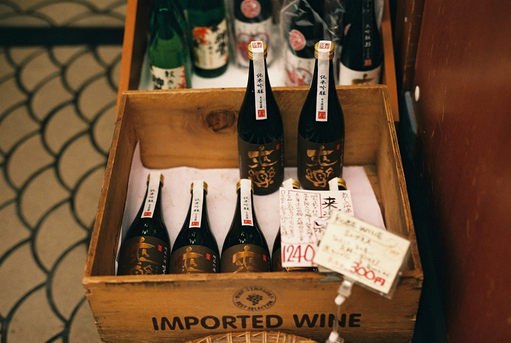
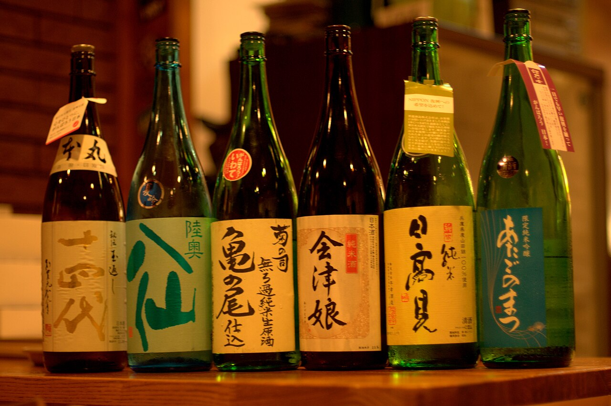

# 吟酿

酒标上出现“吟酿”二字时，多数人先想到香气高、价格贵。但它首先是一个工艺名称：把醪放在比常规更低的温度里养更久，让酵母生成的酯类留在酒液中。精米步合 60% 只是这条路的入场券，真正决定风格的，是温度曲线、酵母与酒母的选择。

图：吟酿相关实景照片。图片：halfrain，CC BY-SA 2.0，via Wikimedia Commons（[原图页面](https://commons.wikimedia.org/wiki/File:%E7%B4%94%E7%B1%B3%E5%90%9F%E9%86%B8_(Junmai_Ginjo)_(15656231855).jpg)）。

## “吟”字的来历

“吟酿”（吟醸）不是古老的传统词，而是近代酿酒技术语。它形容酿酒人在低温下反复观察、慢慢“吟味”醪的变化——发酵慢到需要每天调整，像推敲诗句一样。这个词后来被写进法规，才成为特定名称酒的一类。

因此吟酿不等于“高级清酒”。本酿造、纯米酒也能做得很精细；吟酿只说明它走的是低温长期发酵这条路。

## 法规上的四道门

按日本国税厅的清酒标示基准，标注“吟酿”须同时满足四项：原料为米、米曲与水；精米步合在 60% 以下；采用吟酿造；酿造酒精添加量不超过白米重量的 10%。四项缺一不可，酒标才有资格写这两个字。

完全不添加酿造酒精的版本称“纯米吟酿”。它与吟酿共用精米门槛与工艺要求，差别只在是否添加酒精。把两者当成两个精米等级，是读标时最常见的错误。

## 60% 这条线怎么算

[精米步合](ref:polishing-ratio)是精米后剩余重量占玄米的比例。60% 表示磨掉四成。被磨掉的糠层、蛋白质与脂肪若进入酒液，会带来杂味与沉淀风险；留下的心白富含淀粉，曲菌的酶更容易把它分解成糖。

60% 是上限，不是标准值。市售吟酿多在 50% 到 60% 之间，纯米吟酿有时做到 45%。数值越低，碎米率越高、研磨时间越长、可用米量越少，成本上升很快。把低步合直接当成高品质，会忽略酒米本身是否适合深磨。

## 温度曲线才是核心

吟酿与普通清酒最集中的差别在醪的管理。普通清酒主发酵常在 12 至 15°C，吟酿压到 10°C 以下，大吟酿有时低到 5 至 8°C。温度低，酵母繁殖慢，发酵期从二十天拉长到三十天以上。

低温带来两个结果。第一，酯化生成的香气物质不容易被后续发酵带走；第二，发酵变慢，酒藏必须更频繁地检测日本酒度、酸度与氨基酸度，随时微调。这套操作对温控设备与经验的要求，远高于常温发酵。

## 香气分子：香蕉、苹果与梨

吟酿香的化学基础是酯类。乙酸异戊酯带来香蕉与梨的甜香，己酸乙酯偏向青苹果，辛酸乙酯更接近梨与花香。它们的生成与酵母品种、醪温、氨基酸浓度以及后期过滤方式都有关。

不同协会酵母的产酯能力差别明显。7 号酵母香气端正、适用面广；9 号酵母能给出更华丽的果香；1801 号与各县地方酵母常被用来做差异化。酒藏会把酵母、醪温与酒母路线当作一组参数调整，而不是单独追求“香”。

## 酒母的三条路

酒母是发酵的起点，吟酿常见三条路线。速酿酒母用乳酸调整酸度，周期短、风险低，是多数吟酿的选择。生酛依靠天然乳酸菌慢慢培养，周期长、风味复杂。山废是生酛的改良版，省略部分捣米工序，酸度更柔和。

路线本身不决定酒质。速酿也能做出细腻的吟酿，生酛也可能因管理不当出现杂味。真正影响成品的是酒母酸度、酵母活性，以及接续的三段仕込み是否衔接顺畅。

## 与纯米吟酿的分岔口

添加少量酿造酒精是吟酿工艺的一部分，不是偷工减料。酒精能溶解部分香气物质，让吟酿香更突出，也让酒体更轻、更利落。纯米吟酿不添加酒精，米味与旨味更完整，酒体通常更厚。

两条路线没有高下。喜欢清爽、香气外放的人常选吟酿；喜欢米味与厚度的人常选纯米吟酿。日本酒度与酸度才是判断甜辛与口感的直接指标，名称只说明工艺与原料条件。

## 产区与常见酒款

兵库县滩五乡用硬水与大型设备做酒，酒体厚、结构稳；京都伏见以软水见长，风格柔和；新潟县以低温长期发酵的淡丽辛口闻名；山形、福岛、秋田等东北产区常用果香与酸度建立辨识度。参见[日本](ref:japan)的产区背景。

市售例子包括旭酒造的獭祭、朝日酒造的久保田、八海酿造的八海山与高木酒造的十四代。它们跨越不同价位；具体属于吟酿、纯米吟酿还是大吟酿，要看酒标上的特定名称与精米步合。

## 温度与器皿

吟酿适合 8 至 12°C。温度太低，酯香被锁住；太高，酒精感盖过果香。郁金香形杯或小号葡萄酒杯能聚香，猪口杯更适合日常饮用。先闻静止香，再轻摇，判断果香、米香与曲香的比例。

配餐以清淡为先：白身鱼、贝类、寿司、蒸物、豆腐。重辣、重酸与浓酱会压住香气。开瓶后冷藏，尽量在数周内喝完；生酒与未杀菌产品需要全程冷链。本页关于吟酿的内容涉及酒精饮料；过量饮酒有害健康，未成年人不应饮酒。

## 常见误解

一，吟酿就是纯米吟酿——前者可添加法定上限内的酿造酒精。二，精米步合越低越好——低步合提升香气潜力，也可能削薄米味。三，吟酿香来自香精——它由酵母与低温[发酵](ref:fermentation)生成。四，吟酿一定是辛口——甜辛取决于具体酒款。五，吟酿必须冰到很低——8 至 12°C 更合适。六，大吟酿是吟酿的升级版——两者是并列类别，差别在精米门槛。

对照阅读：[清酒](ref:sake)、[发酵](ref:fermentation)。

## 延伸阅读

- [清酒](ref:sake)：清酒的类别体系与酿造框架。
- [精米步合](ref:polishing-ratio)：吟酿 60% 门槛的含义。
- [发酵](ref:fermentation)：低温长期发酵如何塑造香气。
- [大米](ref:rice)：酒米与食用米的差别。
- [日本](ref:japan)：清酒产区与国家背景。

**关键事实。**

| 项目 | 内容 |
| --- | --- |
| 一句话定位 | 日本清酒的特定名称类别，要求精米步合不超过 60%、采用低温长期发酵的吟酿造，可添加不超过白米重量 10% 的酿造酒精；香气以苹果、香蕉、梨般的酯类为主，与纯米吟酿同属一条工艺路线 |
| 上位风格 | 清酒 |
| 香气家族 | 花果香 |

**来源与边界。** 本页关于「吟酿」的关键事实，主要由以下来源交叉核对：Japan Sake and Shochu Makers Association（吟酿、纯米吟酿与大吟酿的定义、精米步合门槛与吟酿造工艺）、日本国税庁（清酒特定名称酒的标示条件、精米步合与酿造酒精添加上限；日本酒类的法定分类与清酒制造概况）、Oxford University Press（提供关于吟酿造、吟酿香与清酒历史的条目）。价格、批次与状态会变，涉及这些字段时以页面所列来源的最新版本为准。正文为项目自写，来源只作核验，不复制原文。

## 相关图像

图：清酒瓶装，精米步合、酒度与日本酒度常决定选购判断。图片：koutalou，CC BY 2.0，via Wikimedia Commons（[原图页面](https://commons.wikimedia.org/wiki/File:Sake_bottles.jpg)）。关联图像：吟酿。
