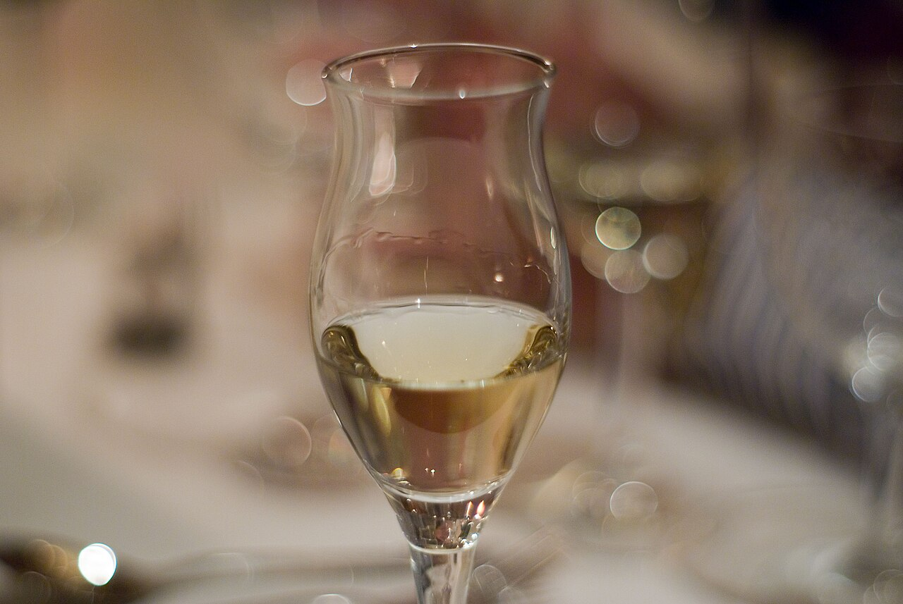

# 格拉帕

格拉帕（grappa）是意大利的果渣白兰地：原料是葡萄压榨后留下的皮、籽和梗，经发酵或半发酵后直接蒸馏，而不是用葡萄酒蒸馏。这一定义看似狭窄，却决定了它的全部性格。格拉帕不是“意大利白兰地”的同义词，也不是把葡萄酒再蒸一遍；它处理的是一种通常会被丢弃的副产品，并把其中的葡萄香气重新提取出来。

图：格拉帕。图片：Carsten Tolkmit from Kiel, Germany，CC BY-SA 2.0，via Wikimedia Commons（[原图页面](https://commons.wikimedia.org/wiki/File:A_glass_of_tasty_grappa.jpg)）。

## 果渣不是废料

酿酒厂压榨葡萄后，果渣里仍残留糖分、果皮香气和少量酒液。过去这些残渣会被送去堆肥或饲料，但意大利北部的农民发现，把湿润的果渣密封发酵后再蒸馏，可以得到一种强烈、带有葡萄皮和青梗气息的烈酒。格拉帕的名字可能来自“graspo”，指葡萄串的梗；词源并不完全确定，但它与果渣的联系十分清楚。

[葡萄](ref:grape)的品种、成熟度和压榨方式会直接进入酒里。白葡萄果渣更轻、更花香，红葡萄果渣颜色更深、单宁和浆果感更强。果渣必须保持新鲜和湿润，不能发霉或过度氧化；从压榨到蒸馏的时间越短，成品的果香越干净。

果渣的含水量和糖分也决定出酒率：太干的果渣蒸馏效率低，太湿的果渣容易滋生杂菌。许多酒厂会在压榨后立即密封，减少氧化，并在数小时内完成蒸馏。这些细节比“陈年多少年”更能解释一瓶格拉帕为什么干净。这也是为什么格拉帕的原料处理比设备更值得关注。

## 从酒渣到酒液

传统做法是把果渣装入蒸馏器，用蒸汽穿过料层，把酒精和香气带出。壶式蒸馏器分批操作，蒸馏师可以逐批调整火力和切割；连续式蒸馏器效率更高，适合大规模生产。无论哪种设备，核心都是避免把果渣烧焦，并保留足够的高沸点香气物质。

[蒸馏](ref:distillation)的切割决定格拉帕的粗细。头段带有溶剂感和刺激，尾段浑浊、苦涩，中间的酒心才是干净的部分。很多生产者会保留少量头尾来增加复杂度，但比例稍高就会让酒体变得粗糙。与用[壶式蒸馏器](ref:pot-still)蒸馏葡萄酒的白兰地相比，格拉帕的原料更松散，蒸汽分布更不均匀，因此更依赖操作经验。

## 意大利的产地拼图

格拉帕的名称在欧盟受地理标志保护，原料必须是意大利种植并酿造的葡萄，蒸馏也必须在意大利境内完成。它不是一个大产区，而是以意大利全国为范围的集体名称；在此之上，又有 Grappa Veneta、Grappa Trentina、Grappa Friulana、Grappa Piemontese、Grappa Lombarda、Grappa Toscana 等地区性标示，以及 Grappa di Barolo、Grappa di Amarone 等与葡萄品种或酒种挂钩的标示。

这些地区名不是质量等级，而是地理与传统线索。威尼托和特伦蒂诺的果渣蒸馏传统深厚，皮埃蒙特常与内比奥罗和巴罗洛联系，托斯卡纳则与桑娇维塞的果渣相关。读标时应区分“产区名”“葡萄品种名”和“陈年标示”，三者说明的是不同维度。

## 年轻与陈年

年轻的格拉帕通常无色透明，香气直接：葡萄皮、青梨、白花、茴香和一丝草本。入口酒体偏轻到中等，酒精感明显，收口干净而带苦。它不适合用大杯慢慢氧化，而适合小杯、低温、快速饮用。

陈年格拉帕在木桶中至少 12 个月，颜色转为金黄，香气出现香草、焦糖、肉桂和干果，酒体变圆。标有 riserva 或 stravecchia 的酒款至少要陈年 18 个月。木桶不是越多越好：过重的烘烤会盖住葡萄皮的气息，过旧的桶则只留下颜色而没有结构。法定最低酒精度为 37.5% vol，但许多酒款装瓶在 40% vol 以上。

在意大利，未陈年的格拉帕常被称为 grappa bianca，强调无色和直接；用芳香型葡萄品种的果渣蒸馏的 grappa aromatica，则更强调花果香。单品种格拉帕要求果渣全部来自标注品种，混酿则不能这样标。这些类别说明，格拉帕并不是“越老越好”，年轻与陈年各有自己的评价标准。

## 咖啡杯旁与鸡尾酒杯里

意大利人喝格拉帕的方式很日常：餐后用小郁金香杯或小玻璃杯，室温或稍微冰镇；在浓缩咖啡里加一点，就是 caffè corretto；作为餐后“压轴”，则叫 ammazzacaffè。它也可以加冰、加柠檬皮，或与汤力水做成高球。

在鸡尾酒里，格拉帕不是最常用的基酒，但它能提供葡萄皮和草本的香气。它与柠檬、蜂蜜、苦精和味美思都能配合，适合替代部分白兰地或[皮斯科](ref:pisco)的位置。使用时要注意它的酒精感和苦尾，过量会压过其他配料。

## 与白兰地、伏特加的分界

[白兰地](ref:brandy)通常以葡萄酒或水果酒为原料，格拉帕以葡萄果渣为原料；这是两者最根本的区别。格拉帕也不等于[伏特加](ref:vodka)：伏特加追求中性，格拉帕追求原料香气的保留。它与意大利的 brandy italiano 同样不同，后者以葡萄酒蒸馏，风格更接近法国白兰地。

格拉帕的价值在于“从残余物里提取香气”。它不需要像葡萄酒那样谈论年份和园地，但同样讲究果渣的新鲜度、蒸馏的切割和是否陈年。把它当成廉价的果渣酒，会错过它在意大利蒸馏传统里的位置。

对照阅读：[白兰地](ref:brandy)、[伏特加](ref:vodka)。

**关键事实。**

| 项目 | 内容 |
| --- | --- |
| 一句话定位 | 意大利以葡萄果渣蒸馏而成的果渣白兰地，名称受欧盟地理标志保护，原料必须来自意大利种植并酿造的葡萄、在意大利蒸馏；最低酒精度 37.5% vol，年轻酒清冽带葡萄皮与花香，木桶陈年 12 个月以上则转向香草与香料 |
| 上位风格 | 白兰地 |
| 香气家族 | 果香/花香/草本 |

**来源与边界。** 本页关于「格拉帕」的关键事实，主要由以下来源交叉核对：Consorzio Nazionale Grappa（格拉帕的法定原料、意大利产地要求与地理标志类型；最低酒精度、陈年标示与产地规则）、European Union（果渣烈酒类别与地理标志烈酒的框架）、Italia — Presidenza del Consiglio dei Ministri（12 个月陈年与 riserva、stravecchia 的 18 个月门槛）。价格、批次与状态会变，涉及这些字段时以页面所列来源的最新版本为准。正文为项目自写，来源只作核验，不复制原文。

**并读。** 把「格拉帕」与「白兰地」、「皮斯科」、「伏特加」放在一起读时，先确认它们是同一层级还是上下游关系：先确认定义与工艺，再比较原料、产区与代表品牌。本页负责给出酒类风格的基本坐标，对照条目补上具体案例与差异；读完再回到本页，才能分清哪些差别属于酒类风格本身，哪些只是产地、批次或品牌选择。
