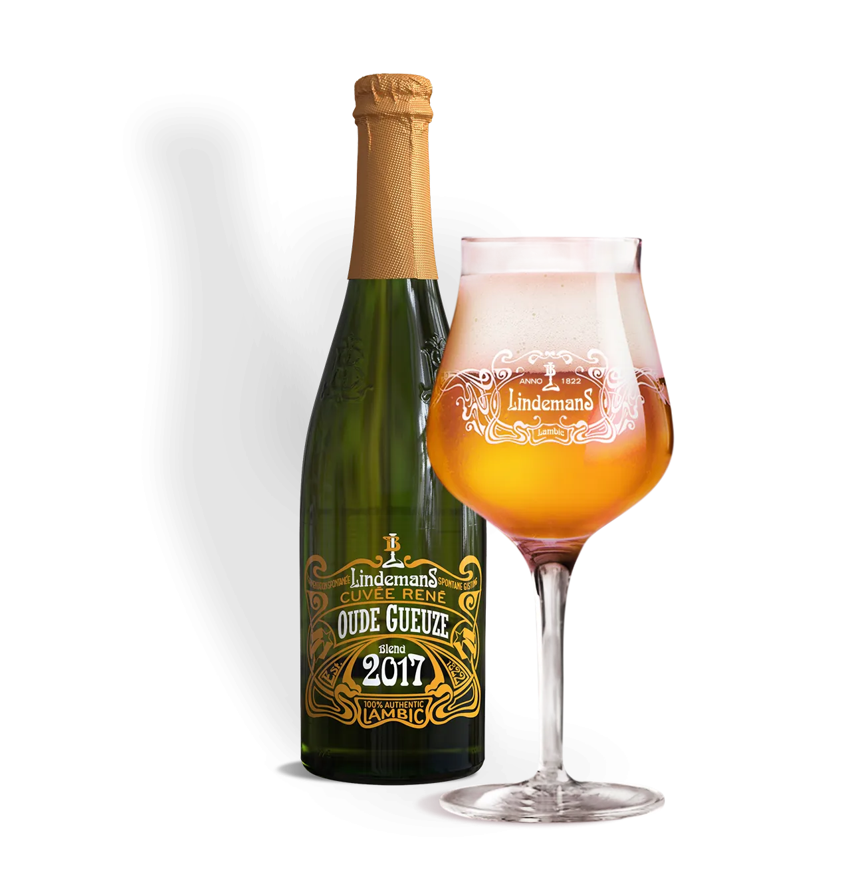

# 贵兹

贵兹（gueuze，也写作 geuze）是[比利时](ref:belgium)[啤酒](ref:beer)中把不同年份的[兰比克](ref:lambic)混合后装瓶、让残余糖在瓶中再次[发酵](ref:fermentation)的一类。它不是一种“加酸”的啤酒，而是把年轻酒与老年酒的结构拼在一起：年轻酒带来可发酵糖与活跃酵母，老年酒带来酸度、谷仓气息与复杂度。成品干爽、气泡细密，酸度明亮但不刺喉。

图：贵兹。图片：Strangerhappenings，CC BY-SA 4.0，via Wikimedia Commons（[原图页面](https://commons.wikimedia.org/wiki/File:Oude_Gueuze_bottle.png)）。

## 布鲁塞尔郊外的混酿

贵兹的历史与布鲁塞尔及周边的帕约滕兰（Pajottenland）紧密相连。19 世纪的布鲁塞尔酒馆与酿酒商把不同桶龄的兰比克调在一起，以稳定质量并让啤酒在运输后仍有气泡。混酿师（blender）因此成为独立角色：他不一定自己酿造兰比克，但必须判断每桶酒的酸度、香气与发酵潜力，再决定比例。

20 世纪，瓶装拉格与甜味饮料挤压了传统酸啤的市场，许多混酿厂关闭。1990 年代以后，小型酒厂与侍酒师重新关注这一传统，贵兹从地方饮品变成精酿世界里的参照物。今天它仍是一个小产量、强地域性的类别，而不是可以随意复制的工业配方。

## 一年、两年与三年的比例

典型做法是把一年左右的年轻兰比克与两到三年的老年兰比克混合。年轻酒的残糖是瓶中二次发酵的动力，老年酒则提供酸度、单宁感与稳定的香气。比例没有固定公式，常见思路是让年轻酒占三成到五成，其余由不同桶龄的老年酒补足；具体数字随酒厂、年份与目标风格而异。

混酿不是“把酸酒兑淡”。如果年轻酒过多，成品会显得甜、气泡粗、复杂度不足；如果老年酒过多，瓶中发酵可能无力，酸度也会变得尖硬。混酿师会在装瓶前反复品尝，判断混合液是否还有足够的糖与活酵母，以及酸度是否在可饮的范围内。

## 自然冷却、橡木桶与瓶中二次发酵

兰比克麦汁在开放式冷却槽中过夜，接触空气里的野生酵母与细菌，随后进入[橡木桶](ref:oak-ageing)长期陈放。桶材、桶龄与酒窖温度都会影响微生物群落，因此同一酒厂不同年份的酒也会有差异。贵兹本身通常不再接触新橡木，它的结构来自混合与瓶内发酵。

装瓶时加入少量年轻兰比克作为“引子”，让残余糖在瓶中产生二氧化碳。瓶内二次发酵通常需要数月，之后酒液逐渐澄清、气泡变得细密。贵兹常见 5%–8% 酒精度，适饮温度约 6–10°C；这些参数随来源与酒厂而异，不是法定标准。

## 酸、谷仓与柑橘的边界

年轻贵兹的香气以柠檬、青苹果、醋栗与湿石为主，老年酒则带来干草、皮革、谷仓与坚果般的陈香。入口酸度明亮，气泡细而有张力，收口干爽，常带一点谷物与木质的回味。酸度应当有层次，而不是单一的醋味；若出现刺鼻的醋酸、指甲油或明显的氧化苦味，通常说明保存或混酿出了问题。

贵兹的酒体轻到中等，酒精感通常不高，但酸度会让它显得非常有存在感。温度过低会压住香气，过高则让醋酸感突出。品尝时可以先用小杯闻香，再小口入口，让酒液在口腔前部停留，感受酸度与气泡的配合。

## 帕约滕兰的酒厂地图

贵兹的核心产区是布鲁塞尔西南的帕约滕兰，包括 Lembeek、Beersel、Halle 等市镇，以及布鲁塞尔市内的少数酒厂。Cantillon 位于布鲁塞尔 Anderlecht，仍使用开放式冷却槽与传统橡木桶；Boon 在 Lembeek，产品线覆盖贵兹与水果兰比克；3 Fonteinen 在 Beersel，以混酿与瓶陈著称。Girardin、De Cam、Tilquin 等名字也常出现在酒单上。

这些酒厂的产量都不大，年份差异明显。购买时可以留意装瓶日期、混酿批次与酒精度，而不是只认品牌。贵兹适合在阴凉避光处存放，瓶内仍可能有缓慢变化，但并非所有版本都适合长期陈放。

## 与兰比克、水果兰比克和酸啤的分界

兰比克是基酒，可以是未混合、未加气的still lambic；贵兹是混合并完成瓶中发酵的版本。水果兰比克在兰比克或贵兹的基础上加入樱桃、覆盆子等水果，风味以果香为主；贵兹则强调酸度、谷物与酵母的整体平衡。与更广泛的[酸啤酒](ref:sour-beer)相比，贵兹的酸来自自发发酵与长期桶陈，而不是后期添加乳酸或醋酸。

理解这组关系，关键是看“发酵来源”和“是否混酿”。把贵兹当成“酸味啤酒”的泛称，会模糊它与柏林酸小麦、壶式酸化酸啤之间的工艺差异。

## 开瓶、温度与餐桌

贵兹开瓶时气泡可能比预期更活跃，建议缓慢开瓶、分两次倒入杯中，避免把沉淀搅起。适饮温度约 6–10°C，杯型以郁金香杯或白葡萄酒杯为宜。年轻的贵兹适合搭配生蚝、山羊奶酪、炸物与带酸度的沙拉；陈年版本更适合搭配熟成奶酪、禽肉与亚洲香料菜肴。

贵兹的酸度会放大食物中的咸味与鲜味，因此不宜与过甜的甜点同饮。若酒液出现明显的醋酸刺鼻或浑浊沉淀，先判断是正常的酵母沉淀还是保存问题；不确定时以酒厂建议为准。

对照阅读：[兰比克](ref:lambic)、[啤酒](ref:beer)。

**关键事实。**

| 项目 | 内容 |
| --- | --- |
| 一句话定位 | 以不同年份的兰比克混酿、在瓶中完成二次发酵的布鲁塞尔传统啤酒；年轻酒提供糖与活力，老年酒提供酸度与复杂度，口感干爽、气泡细密，带有谷仓、柑橘与青苹果气息 |
| 上位风格 | 兰比克 |
| 香气家族 | 酸香与野生酵母 |

**来源与边界。** 本页关于「贵兹」的关键事实，主要由以下来源交叉核对：Brasserie Cantillon（兰比克酿造、橡木桶陈放与贵兹混酿的公开工艺信息）、Beer Judge Certification Program（贵兹的酸度、气泡、酒精度与风味描述框架）、Brewers Association（美国精酿行业对兰比克与贵兹的公开分类表述）等 4 条来源。价格、批次与状态会变，涉及这些字段时以页面所列来源的最新版本为准。正文为项目自写，来源只作核验，不复制原文。

**并读。** 把「贵兹」与「兰比克」、「酸啤酒」、「啤酒」放在一起读时，先确认它们是同一层级还是上下游关系：先确认定义与工艺，再比较原料、产区与代表品牌。本页负责给出酒类风格的基本坐标，对照条目补上具体案例与差异；读完再回到本页，才能分清哪些差别属于酒类风格本身，哪些只是产地、批次或品牌选择。
