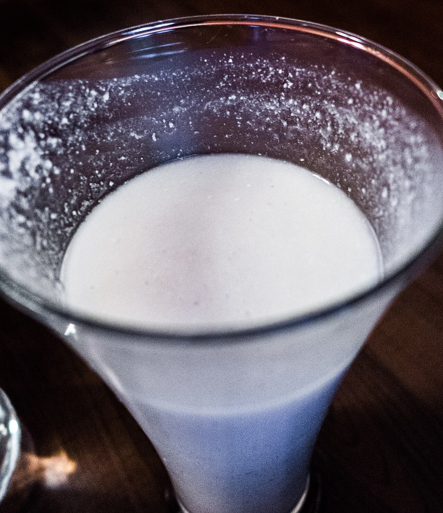

# 青稞酒

青稞酒是青藏高原以青稞为原料的一类酒的总称，既包括藏族家庭日常饮用的低度发酵酒 chang，也包括青海互助等地以蒸馏方式生产的青稞白酒。前者浑浊、微甜、带乳酸感，酒精度通常只有 3% 到 5%；后者清澈、酒精度常在 40% 以上，讲究“清蒸清烧四次清”的工艺。

图：青稞酒。图片：Sharada Prasad CS from Berkeley, India，CC BY 2.0，via Wikimedia Commons（[原图页面](https://commons.wikimedia.org/wiki/File:Chhyang_or_Chhaang_-_Fermented_rice_drink!_(8902831091).jpg)）。

## 青稞、藏区与两种酒

青稞是裸大麦，耐寒、早熟，是青藏高原最重要的粮食作物之一。藏语把发酵青稞酒称为 chang（也写作羌）：青稞煮熟、拌入酒曲、装入陶罐或木桶发酵，几天后即可饮用。

蒸馏青稞酒则把发酵后的酒醅加热，收集酒精蒸汽，得到透明的高度酒。青海互助把这种酒做成产业，形成“互助青稞酒”地理标志产品；西藏、四川阿坝、甘肃甘南与云南迪庆也有各自的传统。

## 它不是白酒的一个香型

中国白酒的香型体系以高粱、小麦、玉米等原料与制曲、发酵、蒸馏工艺为基础，清香、浓香、酱香、米香各有明确的感官描述。青稞酒不在这个香型表里；它以原料命名，发酵型与蒸馏型并存。

青海互助的蒸馏青稞酒有国家标准 GB/T 19331-2007，规定了地理标志产品的范围、原料、工艺与质量要求。当地“清蒸清烧四次清”蒸馏酒传统酿造技艺在 2021 年入选国家级非物质文化遗产名录。

## 从史前农田到互助酒坊

青藏高原的青稞栽培与酿酒史可追溯到数千年前，考古与文献常把互助一带的酿酒传统上溯到 4000 年前。在藏族的口传与宗教仪式里，青稞酒与丰收、敬神、待客相连；寺院、庄园与村落都有各自的酿造方法。

互助威远镇的酒坊传统在明代形成规模，1373 年出现“天佑德酒作坊”的记载。20 世纪以后，互助青稞酒从土法酩馏走向工业化，今天的“天佑德”等品牌让互助成为最集中的产区。

## 蒸、摊、拌曲、发酵

无论发酵型还是蒸馏型，第一步都是把青稞蒸熟：浸泡、蒸煮到开花，摊凉后拌入酒曲。藏族家庭用自制曲饼或曲粉，工业生产者则用更稳定的曲种。拌曲后的青稞装入陶罐、木桶或发酵池，在温和温度下[发酵](ref:fermentation)。

发酵时间从几天到十几天不等，取决于温度、曲种与想要的甜度。发酵完成后，chang 可直接取上层酒液饮用；蒸馏型则把酒醅装入甑锅或[壶式蒸馏器](ref:distillation)，加热收集酒液，再按头、中、尾分段。

## 发酵型与蒸馏型的分岔

Chang 的魅力在于“活”：酒液里有未完全沉降的米粒与酵母，酸甜平衡，气泡细弱，喝起来像带酒精的醪糟。藏族家庭会在陶罐里续添青稞与曲，让发酵持续进行，味道随天数变化。

蒸馏青稞酒则追求稳定与强度。酒液清澈，香气以青稞的谷物甜香为主，入口干净，尾段带一点曲香与辛辣。青海的“酩馏酒”是介于两者之间的传统土法蒸馏酒，酒精度中等，香气更粗粝，常被当作地方风味保存下来。

## 香气：糌粑、酸奶与青草

发酵型青稞酒的香气像糌粑、酸奶与青草：谷物、乳酸、轻微酵母味交织，入口甜中带酸，酒体薄，气泡感让它显得清爽。蒸馏型则更接近谷物烈酒：烤青稞、米香、淡淡曲香与一点泥土气，酒精度高，口感更热。陈放后的版本会多出坚果、蜂蜜与陶坛的矿物感。

与[大麦](ref:barley)威士忌相比，青稞酒的谷物香更偏“熟粮”而不是“麦芽”；与白酒相比，它的香气更朴素，少了窖池与长时间发酵带来的复杂酯类。评价时不必套用威士忌或白酒的术语，重点看谷物香是否干净、酸度是否自然、酒精是否刺鼻。

## 青海、西藏、川西的品牌地图

青海互助是蒸馏青稞酒的核心产区，天佑德、互助等品牌以地理标志与“清蒸清烧四次清”为卖点；西藏拉萨、日喀则一带更常见家庭 chang 与小作坊蒸馏酒，甜度与酸度随家庭配方变化；四川阿坝、甘孜的藏区把青稞酒与酥油茶、糌粑一起摆上桌；甘肃甘南与云南迪庆则有各自的地方版本。

品牌化程度在青海最高，西藏与川西更多是地方性产品。购买时可以看产地、原料与执行标准：标“互助青稞酒”的产品受地理标志保护，标“青稞酒”的产品则可能来自不同产区、使用不同工艺。酒精度从 3% 到 50% 以上都有可能，不能只看名字。

## 节日、敬酒与日常

在藏族的节庆与婚礼上，青稞酒是待客的起点。主人把酒倒进银碗或木碗，客人先用无名指蘸酒向上、向中、向下弹三次，表示敬天、敬地、敬神，然后抿一口；主人再添满，如此三次，最后才一饮而尽。这个仪式比酒本身更重要，它把客人、主人与高原的秩序连在一起。

日常饮用时，chang 常与糌粑一起出现，酸甜的酒液可以解糌粑的干；蒸馏青稞酒则更多出现在宴席、年节与商业场合。它也可以加酥油、糖或热水调成不同喝法，但传统上还是用小杯纯饮，配肉、奶制品与青稞制品。

## 与白酒、黄酒、米酒的区别

青稞酒与白酒的差别在原料与工艺：白酒多以高粱、小麦、玉米为主，强调制曲、窖池与长时间发酵；青稞酒以青稞为核心，发酵型不蒸馏，蒸馏型的工艺也更接近清香路线。它与黄酒的区别在谷物与陈年：黄酒以糯米、粳米为主，麦曲糖化，酒精度中等，颜色琥珀；青稞酒更清澈、更直接。

它也与米酒不同。米酒通常指糯米发酵的甜酒酿，酒精度低、甜度高、保存期短；青稞酒的发酵型 chang 与米酒有相似之处，但原料、曲种与高原环境让它带更明显的乳酸与谷物味。把三者混为一谈，会错过[中国](ref:china)谷物酒的多样性。

## 选购与保存

购买时先分清发酵型与蒸馏型：前者酒精度低、保质期短，需要冷藏并尽快喝完；后者酒精度高、可常温保存。看标签上的原料、产地与执行标准，标“互助青稞酒”的产品有地理标志约束，普通“青稞酒”则要自己判断工艺。蒸馏酒开瓶后避光常温保存即可，长期存放建议用陶瓷或玻璃容器，避免塑料味。

发酵型青稞酒若出现明显酸败、霉味或胀气，说明已经变质，不要饮用。蒸馏型若香气变淡、出现纸板味，通常是氧化或包装密封不良。无论哪种，青稞酒都不适合无限期陈放；它的价值在新鲜、干净与产地风味。

补充阅读：[修道院啤酒](ref:c-extra-1)。

对照阅读：[大麦](ref:barley)、[蒸馏](ref:distillation)。

相关条目：[发酵](ref:fermentation)。
